<p align="center">
  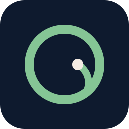
</p>

<h1 align="center">SherlockOS</h1>

<p align="center">
  <strong>Un bureau Linux écrit de zéro en Rust, fini comme un Mac, avec un agent IA qui demande avant d'agir.</strong>
</p>

<p align="center">
  <a href="https://github.com/dodolereporter/sherlockOs/actions/workflows/ci-rust.yml"></a>
  <a href="https://github.com/dodolereporter/sherlockOs/actions/workflows/ci-boot.yml"></a>
  <a href="LICENSE"></a>
</p>

<p align="center">
  <a href="README.md">English version</a> ·
  <a href="ROADMAP.md">Feuille de route</a> ·
  <a href="CONTRIBUTING.md">Contribuer</a> ·
  <a href="CHANGELOG.md">Journal des versions</a>
</p>

---

Le `README.md` en anglais fait foi ; cette page en est la traduction. Les autres documents du
dépôt (feuille de route, contribution, sécurité) sont en anglais.

## Ce que c'est

SherlockOS est un système d'exploitation de bureau pour PC x86-64 (UEFI), bâti sur trois idées :

- **Un bureau à lui, en Rust.** Un compositeur Wayland écrit avec
  [Smithay](https://github.com/Smithay/smithay), et un shell (barre, dock, lanceur,
  notifications, écran de verrouillage) et des applications écrits avec
  [iced](https://github.com/iced-rs/iced). Le niveau visé est celui de macOS : animations à
  ressort à l'entrée *et* à la sortie, états de survol et d'appui, élastique aux limites, « … »
  plutôt qu'un texte coupé, le bon curseur, et une mise en page qui tient du petit portable à la
  4K, à toutes les échelles. L'identité visuelle est propre au projet, ce n'est pas une copie.
- **Sherlock, un agent intégré au système.** Sherlock est à la fois la mascotte animée et un
  agent qui agit sur le système à la demande. Il pilote le vrai
  [Claude Code](https://docs.anthropic.com/en/docs/claude-code) avec l'abonnement de
  l'utilisateur, par des serveurs MCP, un par domaine (fenêtres, fichiers, conteneurs, paquets…).
  Chaque action passe par un **courtier d'accords** dessiné par le compositeur : l'agent ne peut
  pas s'accorder une action lui-même, ni lire ou cliquer la fenêtre des accords. Un modèle local,
  sur le NPU ou la carte graphique, est l'objectif à terme ; le fournisseur de modèle est une
  interface dès le départ.
- **Fait pour développer et pour jouer.** Docker intégré, bacs à sable jetables et outils de
  développement ; Steam et Proton, avec un mode jeu réglé pour NVIDIA.

Chaque fonction du système est exposée par une même API, qui sert à l'interface et à Sherlock :
rien de ce que fait un réglage n'échappe à l'agent, et l'agent ne peut rien faire que l'interface
ne permette pas.

L'interface est en français, au tutoiement ; le développement (code, docs, commits) est en
anglais.

## Captures

Toutes tirées des programmes du dépôt, avec des données inventées.

<table>
  <tr>
    <td width="50%">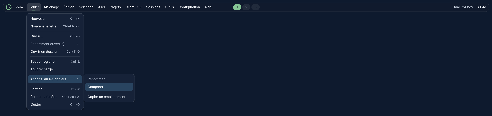<br><sub><b>Barre</b> : menu global de l'application active, bureaux, horloge</sub></td>
    <td width="50%">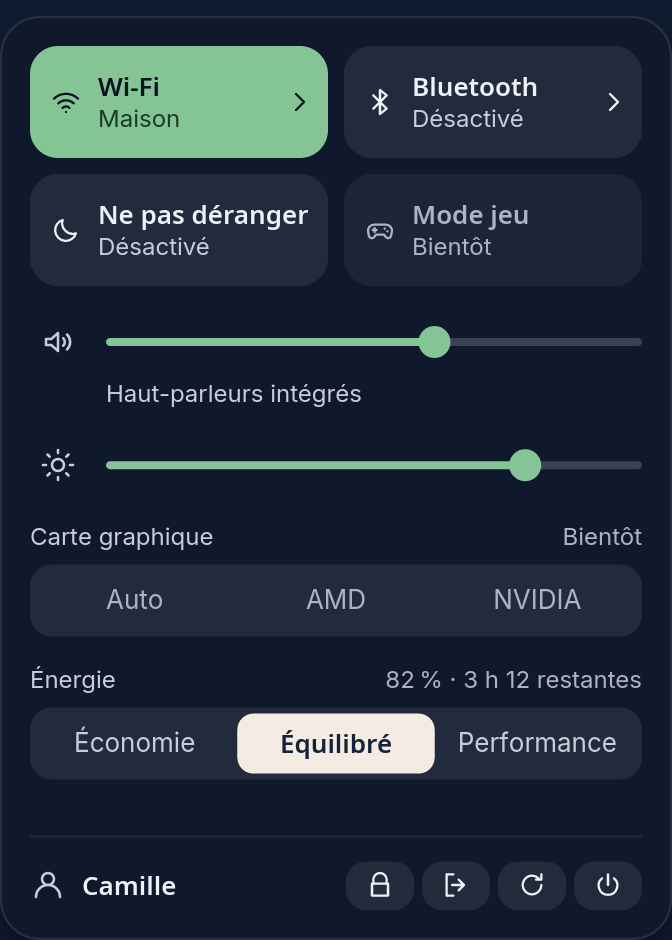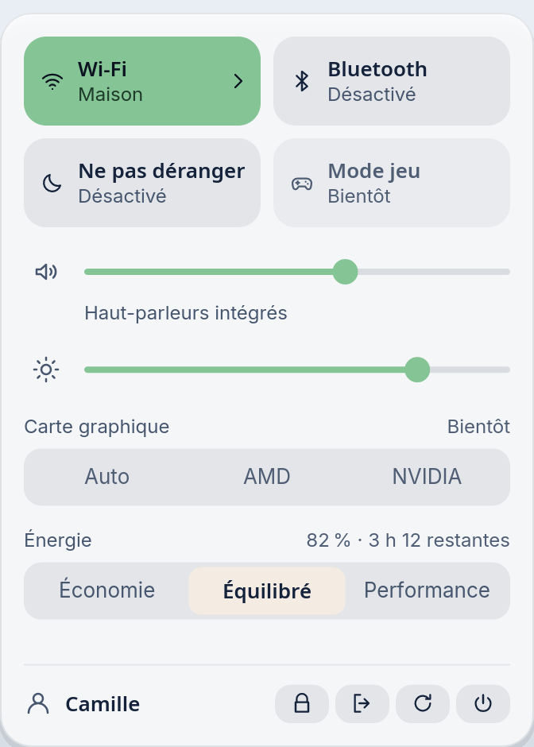<br><sub><b>Centre de contrôle</b> : Wi-Fi, Bluetooth, son, luminosité, énergie, sombre et clair</sub></td>
  </tr>
  <tr>
    <td>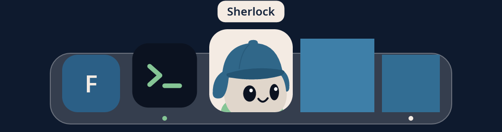<br><sub><b>Dock</b> : grossissement sous le pointeur, Sherlock au centre</sub></td>
    <td>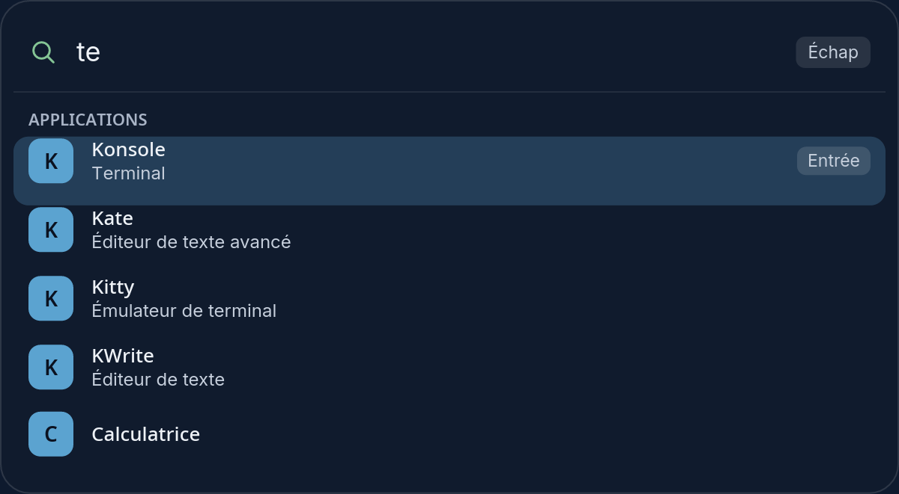<br><sub><b>Lanceur</b> : recherche floue, Super+Espace</sub></td>
  </tr>
  <tr>
    <td>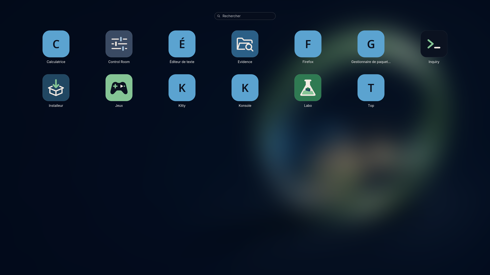<br><sub><b>Applications</b> : toutes les applications installées, en pages, F4</sub></td>
    <td>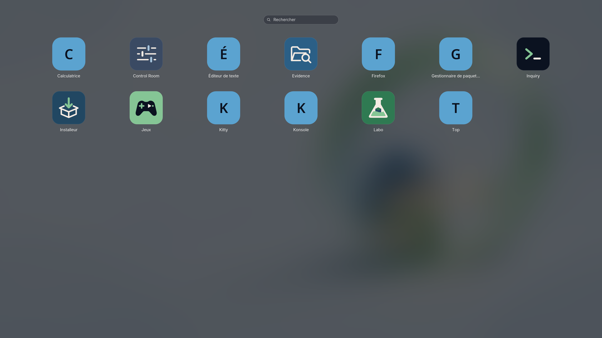<br><sub><b>Applications</b>, thème clair</sub></td>
  </tr>
  <tr>
    <td>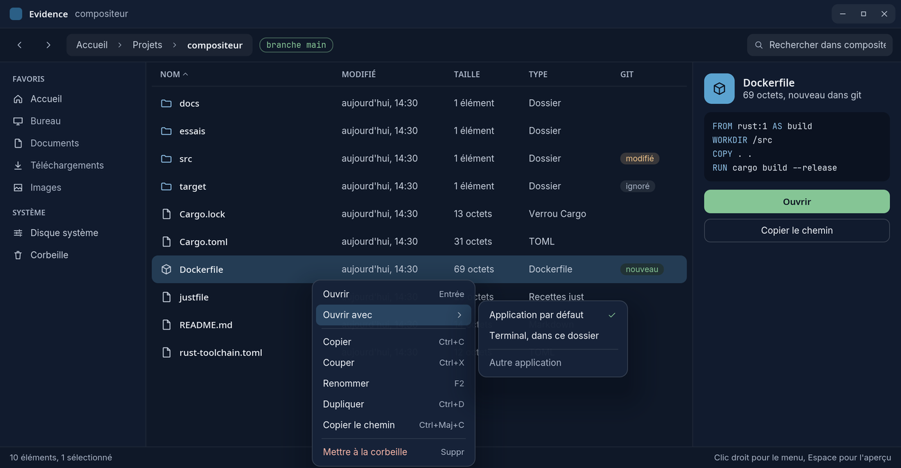<br><sub><b>Evidence</b>, l'explorateur de fichiers : état git par fichier, aperçu, menu contextuel</sub></td>
    <td>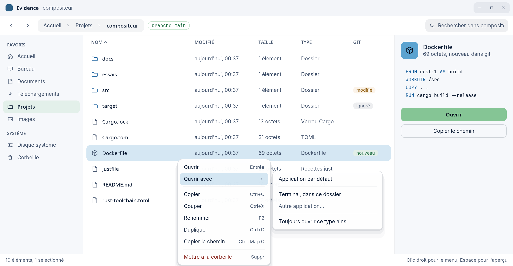<br><sub><b>Evidence</b>, thème clair</sub></td>
  </tr>
  <tr>
    <td>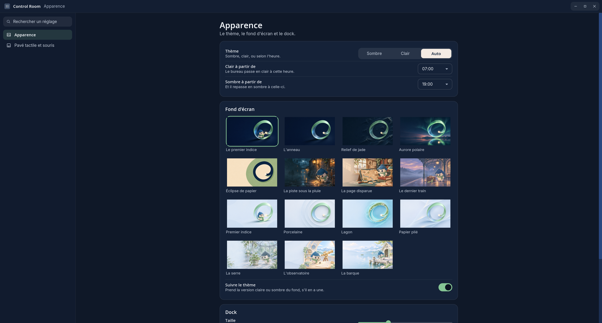<br><sub><b>Control Room</b>, les réglages : thème, fond d'écran, dock</sub></td>
    <td>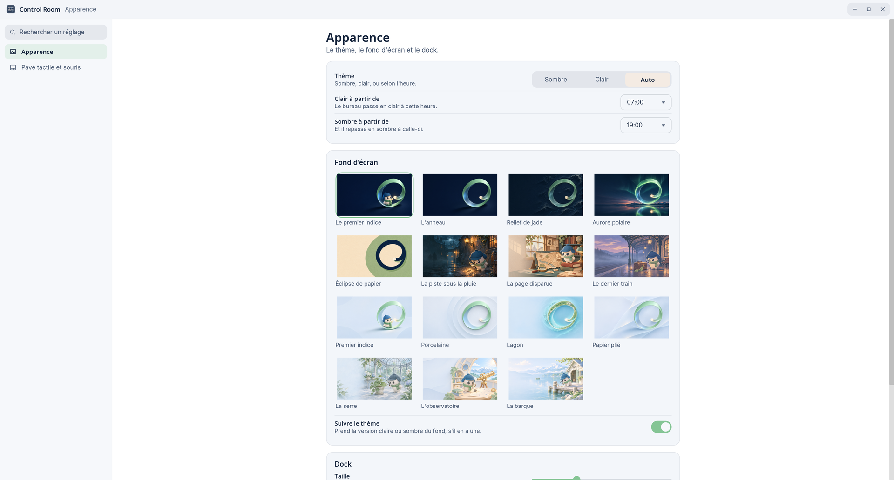<br><sub><b>Control Room</b>, thème clair</sub></td>
  </tr>
  <tr>
    <td>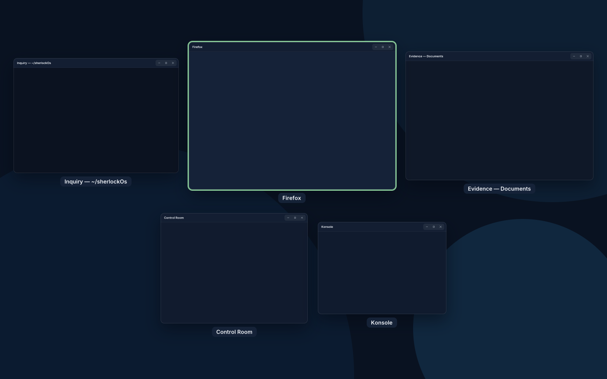<br><sub><b>Mission Control</b> : toutes les fenêtres et tous les bureaux d'un coup d'œil</sub></td>
    <td>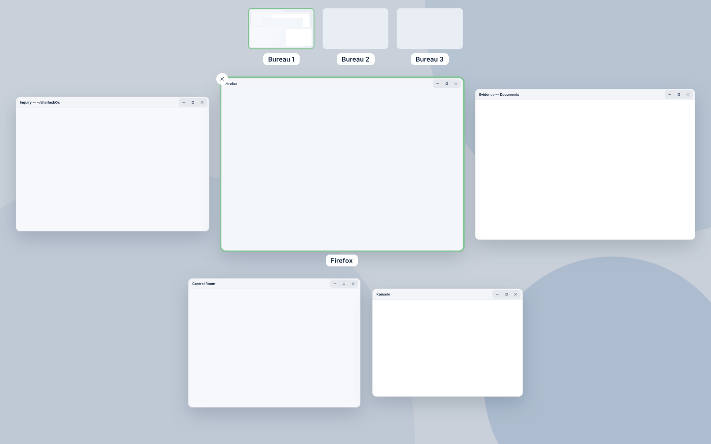<br><sub><b>Mission Control</b>, thème clair</sub></td>
  </tr>
</table>

L'écran de verrouillage, avec Sherlock en 3D, n'a pas encore de capture dans le dépôt.

## Où en est le projet

SherlockOS est jeune et avance vite : il n'est pas encore prêt pour un usage quotidien par
d'autres. La liste complète de ce qui est prévu, avec l'état de chaque point, est dans
[ROADMAP.md](ROADMAP.md).

| Jalon | Critère de sortie | État |
| --- | --- | --- |
| J0 Fondations | CI verte, une image minimale démarre dans QEMU sans intervention | Atteint |
| J1 Compositeur imbriqué | Un navigateur et un terminal tournent dans le compositeur, en fenêtre | Atteint |
| J2 Shell | Le bureau du design est reproduit, dock animé compris | Atteint |
| J3 Session réelle | Une semaine de travail quotidien dessus sans revenir à un autre bureau | En cours |
| J4 Sherlock v1 | Agent, courtier d'accords, journal, cinq serveurs MCP, mascotte animée | Commencé |
| J5 à J11 | Base démarrable, NVIDIA, Steam et mode jeu, Labo, installeur | Prévus |

**Ce qui marche aujourd'hui**, sur une distribution Linux existante :

- Le compositeur, en fenêtre ou en session réelle (DRM, libseat, logind) : fenêtres flottantes
  aux coins arrondis et ombrées, calage, bureaux virtuels, Mission Control, gestes du pavé
  tactile, effet génie, animations d'ouverture et de fermeture, XWayland actif par défaut, mise
  à l'échelle fractionnaire et plusieurs écrans, son propre thème de curseur.
- Le shell : la barre (menu global, bureaux, Wi-Fi, Bluetooth, son, batterie, calendrier,
  centre de contrôle), le dock (grossissement, rebond, épinglage, plusieurs fenêtres par
  application, masquage intelligent), le lanceur, la vue Applications, les notifications, les
  touches multimédia avec un affichage élastique, la capture d'une zone de l'écran.
- Un écran de verrouillage sûr, sur `ext-session-lock-v1` et PAM, avec Sherlock en 3D.
- Evidence (fichiers) et Control Room (apparence, pavé tactile, son, verrouillage, applications
  par défaut).
- Thèmes sombre et clair changés en direct, avec un mode automatique ; les applications GTK et Qt
  suivent.
- Le presse-papiers entre Wayland et X11, l'agent polkit, le trousseau et le portail des fichiers.
- `sherlockd`, le démon de l'agent, qui dialogue avec Claude Code et un serveur MCP de test.

## Architecture

Les programmes sont des processus séparés : si la barre plante, la session continue et elle
redémarre. Le tableau des crates est dans le [README anglais](README.md#architecture).

## Compiler et essayer

Prérequis sur Debian ou Ubuntu :

```sh
sudo apt install gcc libc6-dev python3 \
  libxkbcommon-dev libwayland-dev libudev-dev libinput-dev libseat-dev libgbm-dev libdrm-dev \
  xwayland libegl1 libegl-mesa0 dbus-daemon mesa-vulkan-drivers
```

Puis `rustup` et [`just`](https://github.com/casey/just). La version de Rust est fixée dans
`rust-toolchain.toml` et s'installe seule au premier `cargo`. `just verify` lance tout ce que
vérifie la CI.

Le compositeur tourne en fenêtre dans ta session Wayland ou X11 :

```sh
cargo build --release -p compositor -p bar -p dock -p launcher -p notifications
just wallpapers
SHERLOCKOS_WALLPAPERS=$PWD/target/wallpapers target/release/compositor --nested sh -c 'target/release/bar & target/release/dock & target/release/notifications & wait'
```

En mode imbriqué, Alt remplace Super pour les raccourcis. Voir `docs/compositor.md`.

## Licence et marques

Le code est un logiciel libre sous **licence publique générale GNU, version 3 ou ultérieure** :
voir [LICENSE](LICENSE) et [NOTICE](NOTICE). Les œuvres de tiers gardent leur licence : voir
[THIRD_PARTY.md](THIRD_PARTY.md).

**Le nom SherlockOS, le logo et Sherlock, la mascotte, ne sont pas couverts par la licence du
code : tous droits réservés.** Un fork doit changer de nom et de logo, et retirer la mascotte.
Voir [TRADEMARKS.md](TRADEMARKS.md).

## Contribuer et sécurité

Les contributions sont les bienvenues : lis [CONTRIBUTING.md](CONTRIBUTING.md) et le
[code de conduite](CODE_OF_CONDUCT.md). Pour signaler une faille, n'ouvre pas de ticket : suis
[SECURITY.md](SECURITY.md).
