<p align="center">
  
</p>

<h1 align="center">SherlockOS</h1>

<p align="center">
  <strong>A Linux desktop written from scratch in Rust, polished like a Mac, with an AI agent that asks before it acts.</strong>
</p>

<p align="center">
  <a href="https://github.com/dodolereporter/sherlockOs/actions/workflows/ci-rust.yml"></a>
  <a href="https://github.com/dodolereporter/sherlockOs/actions/workflows/ci-boot.yml"></a>
  <a href="LICENSE"></a>
</p>

<p align="center">
  <a href="README.fr.md">In French</a> ·
  <a href="ROADMAP.md">Roadmap</a> ·
  <a href="CONTRIBUTING.md">Contributing</a> ·
  <a href="CHANGELOG.md">Changelog</a>
</p>

---

## What it is

SherlockOS is a desktop operating system for x86-64 PCs (UEFI), built around three ideas:

- **A desktop of its own, in Rust.** A Wayland compositor written with
  [Smithay](https://github.com/Smithay/smithay), and a shell (bar, dock, launcher, notifications,
  lock screen) and applications written with [iced](https://github.com/iced-rs/iced). The bar
  for quality is macOS: spring animations on the way in *and* out, hover and press states,
  rubber-band at the edges, "…" rather than clipped text, the right cursor, and a layout that
  holds from a small laptop to 4K at any scale. The visual identity is the project's own, not a
  copy.
- **Sherlock, an agent built into the system.** Sherlock is both the animated mascot and an
  agent that acts on the system when asked. It drives the real
  [Claude Code](https://docs.anthropic.com/en/docs/claude-code) with the user's own
  subscription, through MCP servers, one per domain (windows, files, containers, packages…).
  Every action goes through a **consent broker** drawn by the compositor: the agent cannot grant
  itself an action, nor read or click the consent window. Running a local model on the NPU or
  the GPU is the long-term goal; the model provider is an interface from day one.
- **Made to develop and to play.** Docker built in, disposable sandboxes and developer tools;
  Steam and Proton with a game mode tuned for NVIDIA.

Every function of the system is exposed through one API, used both by the interface and by
Sherlock: nothing a setting does is out of the agent's reach, and the agent can do nothing the
interface does not allow.

The interface is in French; development (code, docs, commits) is in English.

## Screenshots

All taken from the programs of this repository, with made-up data.

<table>
  <tr>
    <td width="50%">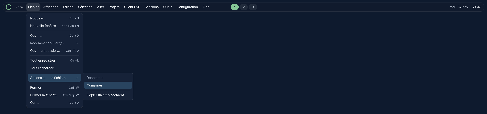<br><sub><b>Bar</b>: global menu of the active application, workspaces, clock</sub></td>
    <td width="50%">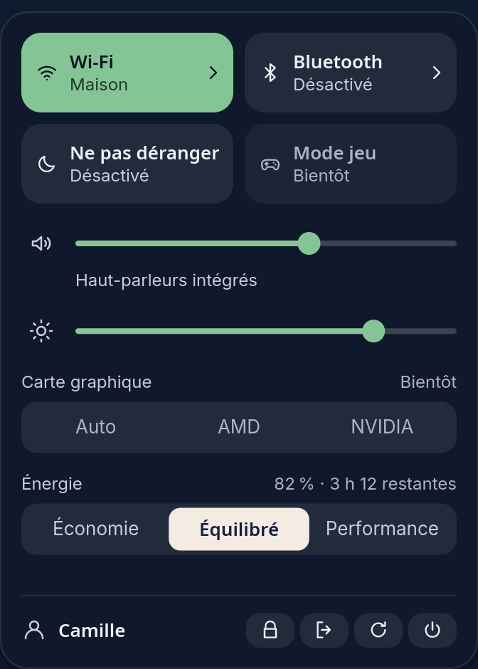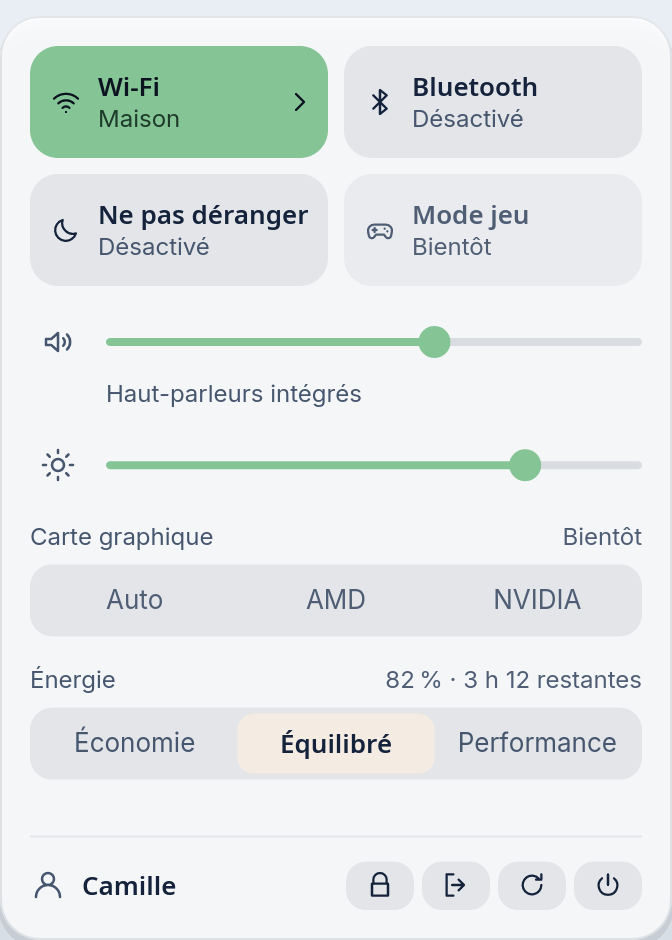<br><sub><b>Control centre</b>: Wi-Fi, Bluetooth, sound, brightness, power, dark and light</sub></td>
  </tr>
  <tr>
    <td>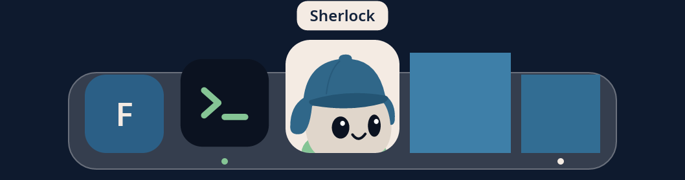<br><sub><b>Dock</b>: magnification under the pointer, Sherlock in the middle</sub></td>
    <td>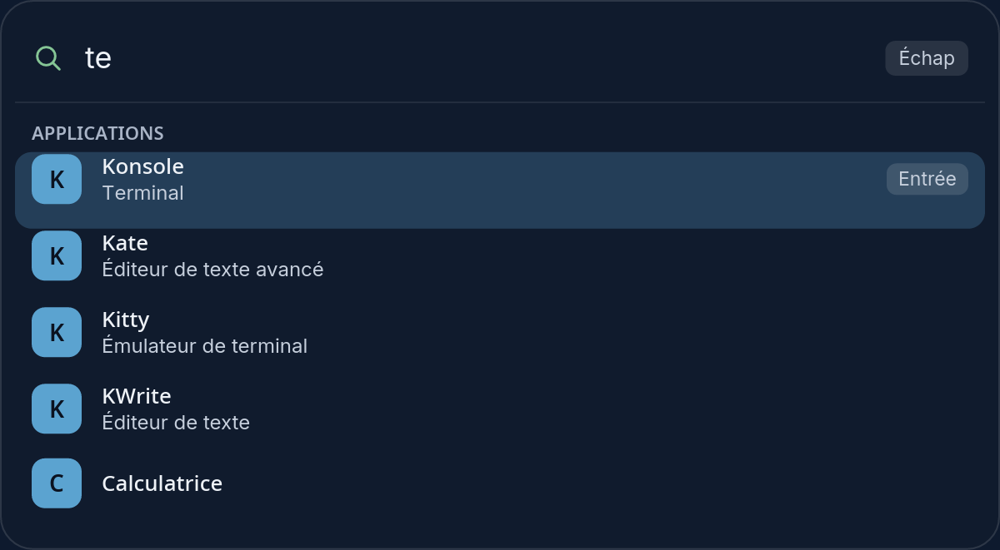<br><sub><b>Launcher</b>: fuzzy search, Super+Space</sub></td>
  </tr>
  <tr>
    <td>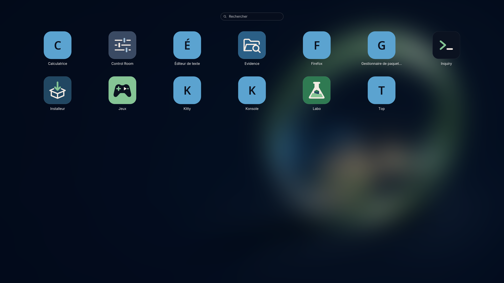<br><sub><b>Applications</b>: every installed application, in pages, F4</sub></td>
    <td>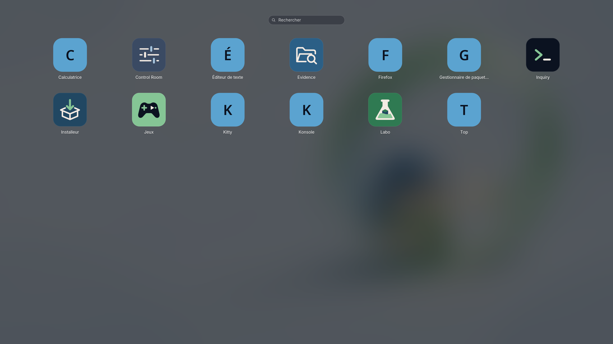<br><sub><b>Applications</b>, light theme</sub></td>
  </tr>
  <tr>
    <td>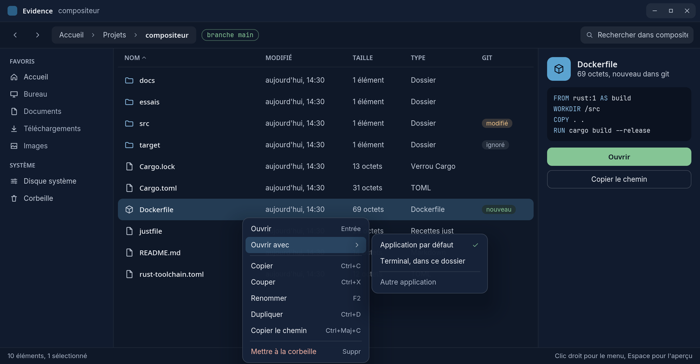<br><sub><b>Evidence</b>, the file manager: git status per file, preview, context menu</sub></td>
    <td>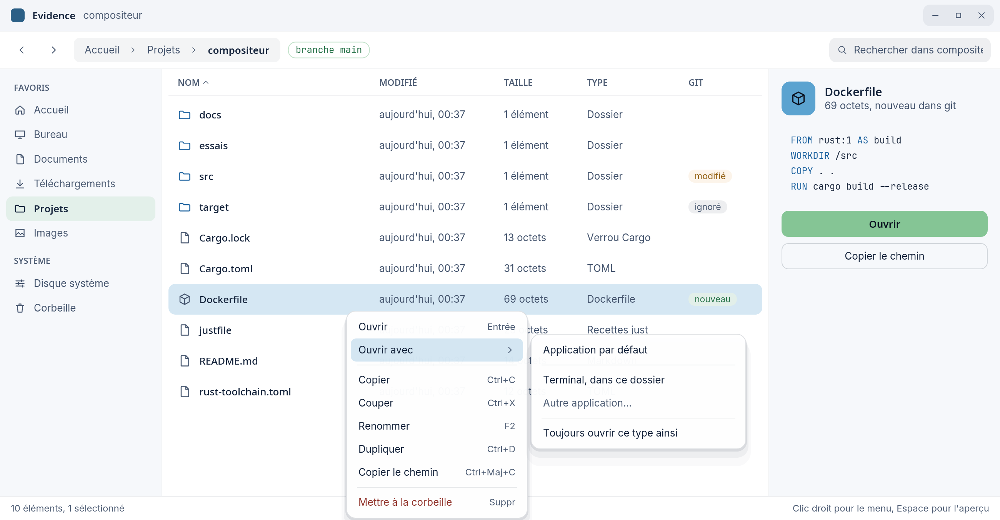<br><sub><b>Evidence</b>, light theme</sub></td>
  </tr>
  <tr>
    <td>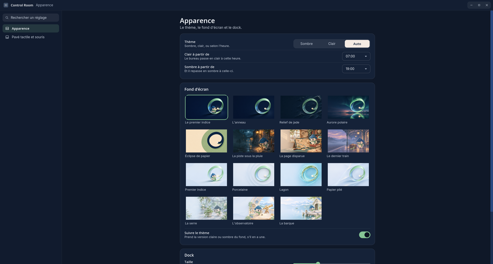<br><sub><b>Control Room</b>, the settings: theme, wallpaper, dock</sub></td>
    <td>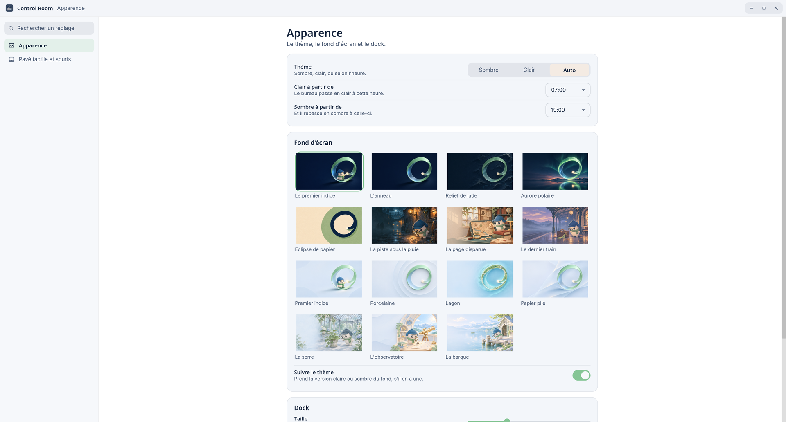<br><sub><b>Control Room</b>, light theme</sub></td>
  </tr>
  <tr>
    <td>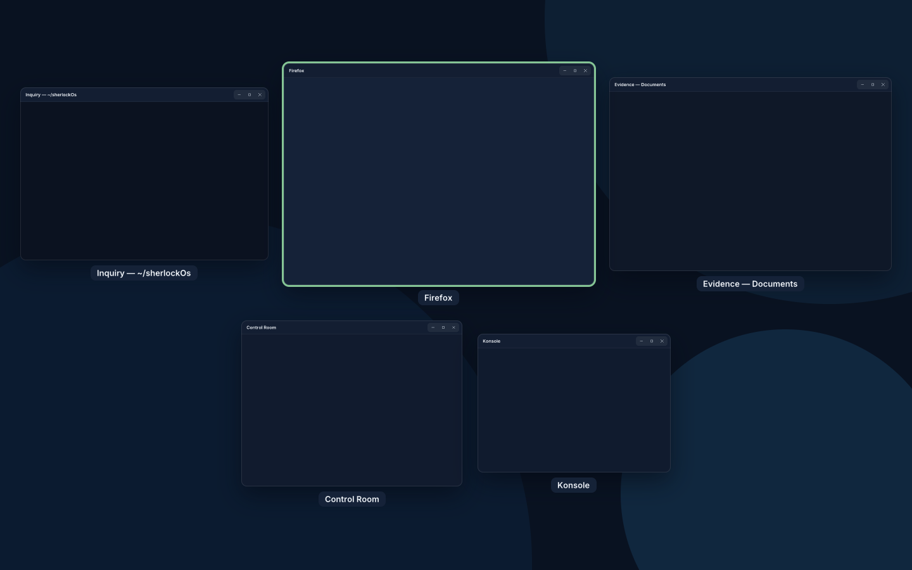<br><sub><b>Mission Control</b>: every window and workspace at a glance</sub></td>
    <td>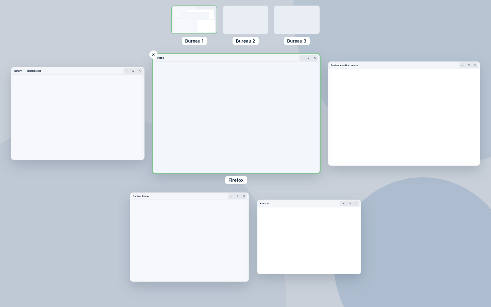<br><sub><b>Mission Control</b>, light theme</sub></td>
  </tr>
</table>

The lock screen, with Sherlock in 3D, has no screenshot in the repository yet.

## Status

SherlockOS is young and moves fast: it is not ready for daily use by others yet. The full list
of what is planned, with the state of each item, is in [ROADMAP.md](ROADMAP.md).

| Milestone | Exit criterion | State |
| --- | --- | --- |
| J0 Foundations | CI green, a minimal image boots in QEMU unattended | Reached |
| J1 Nested compositor | A browser and a terminal run in the compositor, in a window | Reached |
| J2 Shell | The desktop of the design is reproduced, animated dock included | Reached |
| J3 Real session | A week of daily work on it without going back to another desktop | In progress |
| J4 Sherlock v1 | Agent, consent broker, journal, five MCP servers, animated mascot | Started |
| J5 to J11 | Bootable base, NVIDIA, Steam and game mode, Lab, installer | Planned |

**What works today**, on an existing Linux distribution:

- The compositor, nested in a window or as a real session (DRM, libseat, logind): floating
  windows with rounded corners and shadows, snapping, workspaces, Mission Control, touchpad
  gestures, the genie effect, opening and closing animations, XWayland on by default, fractional
  scaling and several screens, its own cursor theme.
- The shell: the bar (global menu, workspaces, Wi-Fi, Bluetooth, sound, battery, calendar,
  control centre), the dock (magnification, bounce, pinning, several windows per application,
  smart hiding), the launcher, the applications view, notifications, the media keys with an
  elastic on-screen display, a screenshot of an area.
- A secure lock screen on `ext-session-lock-v1` and PAM, with Sherlock in 3D.
- Evidence (files) and Control Room (appearance, touchpad, sound, lock, default applications).
- Dark and light themes switched live, with an automatic mode; GTK and Qt applications follow.
- The clipboard between Wayland and X11, the polkit agent, the keyring and the file portal.
- `sherlockd`, the agent's daemon, talking to Claude Code with an MCP test server.

## Architecture

Programs are separate processes: if the bar crashes, the session goes on and it restarts.

| Crate | Kind | Role |
| --- | --- | --- |
| `desktop/compositor` | binary | Wayland compositor on Smithay: windows, rendering, input, XWayland, real session |
| `desktop/shell-protocol` | library | `sherlock-shell-v1`, the private protocol between the compositor and the shell |
| `desktop/bar` | binary | Top bar, its menus and panels |
| `desktop/dock` | binary | Dock |
| `desktop/launcher` | binary | Launcher and search |
| `desktop/apps` | binary | Applications view (`sherlockos-apps`) |
| `desktop/notifications` | binary | Notification daemon and bubbles |
| `desktop/lock` | binary | Lock screen (`sherlockos-lock`) |
| `desktop/evidence` | binary | Evidence, the file manager |
| `desktop/control-room` | binary | Control Room, the settings |
| `desktop/sherlock-ui` | library | Design system: colors, radii, type, motion, components, logo, icons, fonts |
| `desktop/sherlock-3d` | library | Sherlock in 3D (glTF, wgpu), its animations and moods |
| `desktop/system-services` | library | Network, Bluetooth, sound, power, brightness, over D-Bus |
| `desktop/icon-theme` | library | Icon lookup after the XDG Icon Theme specification |
| `desktop/mime-apps` | library | Installed applications, file types, default applications |
| `desktop/cursor-theme` | library and tool | The cursor theme and its Xcursor generator |
| `desktop/toolkit-theme` | library and tool | GTK and Qt themes that follow the desktop |
| `desktop/appearance-config`, `desktop/desktop-config`, `desktop/dock-config`, `desktop/notifications-config` | libraries | Settings files shared by the programs and Control Room, followed live |
| `sherlock/sherlockd` | binary | Daemon of the Sherlock agent: conversation, model provider, MCP client |

Also in the repository: `distro/` (build container, QEMU boot bench, future system image),
`docs/` (one page per component, the plan, the architecture decisions in `docs/adr/`), `assets/`
(wallpapers, lock pictures, cursors) and `prototypes/`.

## Build and try

### Prerequisites

`rustup`, [`just`](https://github.com/casey/just), `python3`, a C compiler as linker, and the
system libraries of the compositor. On Debian or Ubuntu:

```sh
sudo apt install gcc libc6-dev python3 \
  libxkbcommon-dev libwayland-dev libudev-dev libinput-dev libseat-dev libgbm-dev libdrm-dev \
  xwayland libegl1 libegl-mesa0 dbus-daemon mesa-vulkan-drivers
```

The Rust version is pinned in `rust-toolchain.toml` and installs itself on the first `cargo`.

### Main recipes

| Command | What it does |
| --- | --- |
| `just build` | Builds every crate |
| `just verify` | Format, language check, clippy without warnings, tests: what the CI requires |
| `just mascot` | Downloads Sherlock's 3D model at its pinned revision (not stored here) |
| `just wallpapers` | Prepares the wallpapers |
| `just cursors` | Builds the cursor themes |
| `just install-evidence`, `just install-control-room` | Installs an application for your user |
| `just install-session` | Builds the session and prints the commands that install it for a display manager |
| `just test-boot` | Boots the minimal image in QEMU (see `docs/boot-tests.md`) |

### Try it in a window

The compositor runs nested in your current Wayland or X11 session. Everything after `--nested`
is a command started inside it:

```sh
cargo build --release -p compositor -p bar -p dock -p launcher -p notifications
just wallpapers
SHERLOCKOS_WALLPAPERS=$PWD/target/wallpapers target/release/compositor --nested sh -c 'target/release/bar & target/release/dock & target/release/notifications & wait'
```

In nested mode, Alt takes the place of Super for the shortcuts. See `docs/compositor.md` for the
options (`--outputs`, `--scale`, `--workspaces`…) and each component's page in `docs/` for more.

## License and trademarks

The code is free software under the **GNU General Public License, version 3 or later**: see
[LICENSE](LICENSE) and [NOTICE](NOTICE). Third-party works keep their licenses: see
[THIRD_PARTY.md](THIRD_PARTY.md).

**The name SherlockOS, the logo and Sherlock the mascot are not covered by the license of the
code: all rights reserved.** A fork must change the name and the logo, and remove the mascot.
See [TRADEMARKS.md](TRADEMARKS.md).

## Contributing and security

Contributions are welcome: read [CONTRIBUTING.md](CONTRIBUTING.md) and the
[code of conduct](CODE_OF_CONDUCT.md). To report a vulnerability, do not open an issue: follow
[SECURITY.md](SECURITY.md).
