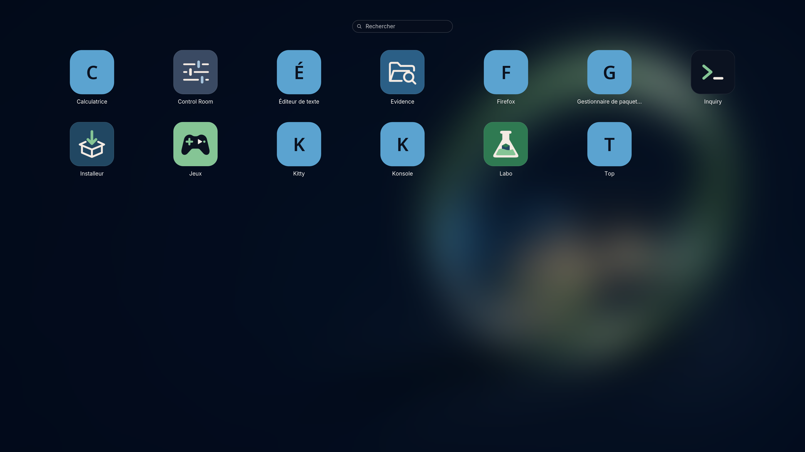
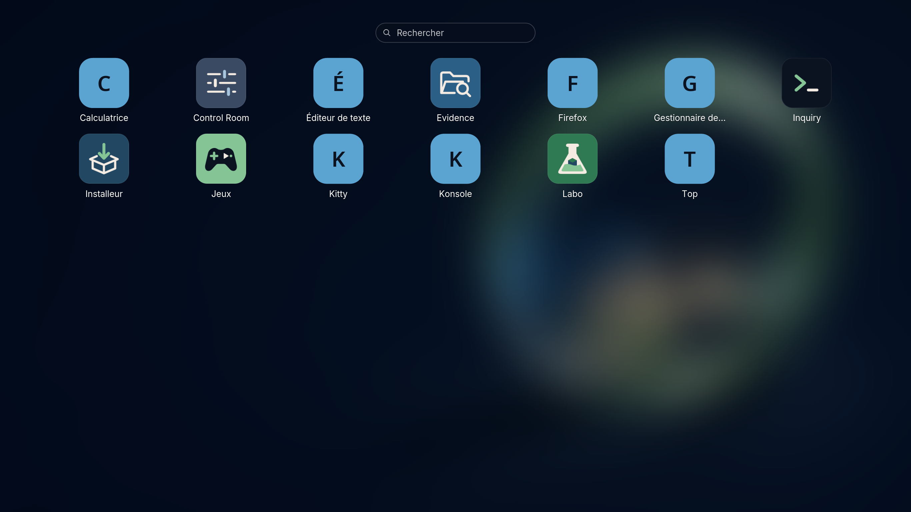
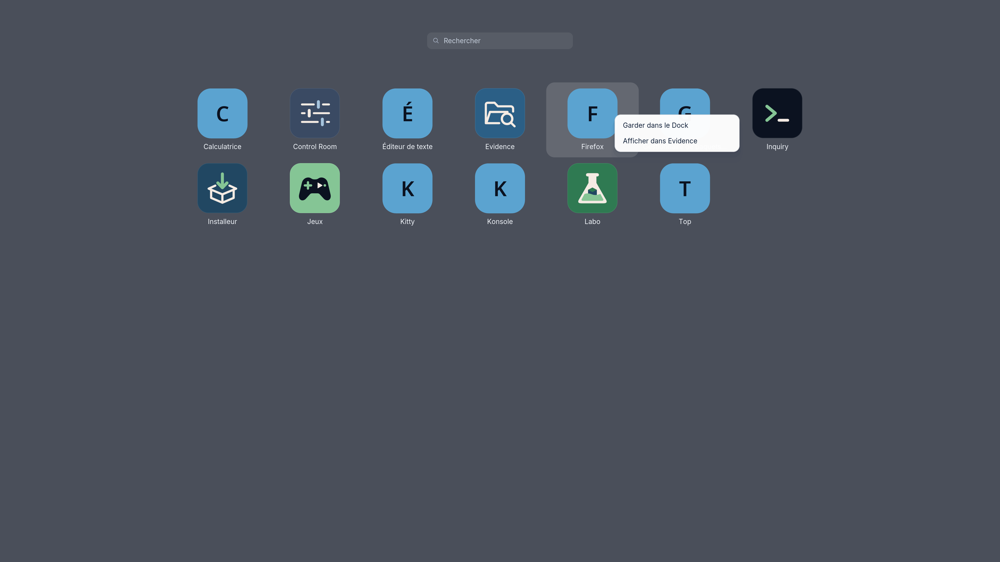

# Applications view

`desktop/apps` is the desktop's applications view, after the Launchpad of macOS: every installed
application in a grid of pages, to start one or to find it again. It is a separate program
started on demand, shown over the whole screen with layer-shell (ADR 0005), written with iced
0.14 and `iced_exwlshell` 0.21.4 like the launcher (`docs/launcher.md`), whose reading of the
applications, search, start and single instance it reuses. The crate is `apps`, the binary and
the layer-shell namespace `sherlockos-apps`. Batch D-41a builds the view, the search and the
start; D-41b adds the right-click menu, pinning to the dock, the dock's button, F4 and the
launcher's « Garder dans le Dock ».
Its texts stay in French, from `sherlock-ui`.




These come from the headless rendering test (`tests/view.rs`), on the fixtures of
`desktop/apps/fixtures` and the desktop's own application icons (`sherlock-ui/icons`). The
simulator draws at scale 2: a capture of 1920 × 1080 logical pixels is the 3840 × 2160 screen at
scale 2, pixel for pixel. It has no wallpaper behind the veil: the desktop's flat color stands in.

| Screen | Capture |
| --- | --- |
| 1366 × 768, scale 1 |  |
| 1920 × 1080, scale 1, and 3840 × 2160, scale 2 |  |
| 2560 × 1600, scale 1.5 (1707 × 1067 logical) |  |
| Two pages, their dots (1366 × 768) |  |
| Light theme |   |

## What it shows

No design board draws this view: it follows the identity rules of `docs/contexte.md`, the
dock's icons and macOS.

| Element | View |
| --- | --- |
| Backdrop | A night blue veil, `rgba(6,12,24,0.70)`, over the whole screen, in both themes as macOS does. The wallpaper blurred under it waits for the blur of D-37; with the software renderer the transparent surface comes out black (see the dock's « Opaque surface ») |
| Search field | Laid out as `component::search_field`, 280 wide, centered, at the top; it has the keyboard from the start. It keeps the dark theme's colors in the light theme too: the backdrop stays dark |
| Grid | Up to 7 columns by 5 rows, as many as the screen holds (see Sizes); icons of 80 on the reference screen, their name under them in the interface font, cut with « … » (`ellipsis`) |
| Application without icon | Its initial on the launcher's blue tile, radius 27 % like the dock |
| Hovered, selected cell | A white veil of 0.08, of 0.14 for the selection, radius 16 |
| Page dots | 8 across, 12 apart, 112 above the screen bottom, clear of the dock; the page shown bright; a click on a dot goes to its page; none for a single page |
| Nothing found | « Aucune application » in secondary text |

The names read at 4.5 to 1 at least on the veil over the default wallpaper and over a white
one, selected or not (`sherlock_ui::apps` tests). Every color, size, duration and text comes
from `sherlock_ui::apps`.

### Sizes

`apps::Layout::fit(width, height)` lays the view out for the screen, in logical pixels, so the
scale only changes the sharpness. The sizes follow the smaller of the two ratios to the
1440 × 900 reference screen, from 0.75 to 1.3 times (`MIN_FACTOR`, `MAX_FACTOR`): icons, cells,
side margins, the place of the field and of the grid. The texts, the field and the dots keep
their size, and so does the room below the grid (140), since the dock keeps its own. Then as
many cells as fit, from 1 to 7 columns and 1 to 5 rows.

| Screen (logical) | Factor | Icon | Grid |
| --- | --- | --- | --- |
| 1366 × 768 | 0.85 | 68 | 7 × 5 |
| 1440 × 900 (reference) | 1 | 80 | 7 × 5 |
| 1707 × 1067 (2560 × 1600 at 1.5) | 1.19 | 95 | 7 × 5 |
| 1920 × 1080 (and 4K at 2) | 1.2 | 96 | 7 × 5 |
| 1280 × 720 (a projector) | 0.8 | 64 | 7 × 4 |
| 800 × 600 | 0.75 | 60 | 6 × 4 |

The icons are looked up for the largest (104, at scale 2). The test checks on these screens and
more that the grid fits between the margins and above the dots, and the dots above the dock.

## Architecture

| Module | Role |
| --- | --- |
| `main.rs` | Renderer choice, logs, single instance, then `run` |
| `lib.rs` | Layer-shell surface, the applications of the session, startup |
| `catalog.rs` | The applications, sorted by name, and the search |
| `pager.rs` | Pages, wheel, swipe, rubber band, all computed from the time |
| `app.rs` | State (`View`), messages, keys, update, view |

**Reused from the launcher.** `launcher::apps::Apps` reads the desktop entries through
`mime-apps` and looks the icons up through `icon-theme`. This batch only opens it up:
`entries`, `start` (the command of an entry) and `icon` are public, and `with_icon_size` looks
the icons up larger than the launcher's 30. The search is `launcher::search::Haystack`, the
start `launcher::launch::spawn`, the single instance `launcher::instance::claim_named` (the
lock file now takes a name).

### Surface

Anchored to the four edges with a size of 0 (`LayerSize::FILL`): the compositor gives it the
whole screen. Layer `Overlay`, above the windows, the bar and the dock, exclusive zone -1. The
keyboard is `Exclusive`; the field takes the focus as the surface maps. The size of the
surface comes with `window::Event::Resized`; until then the reference screen is assumed.

### Applications

The launcher's: every desktop entry of `$XDG_DATA_HOME/applications` then `$XDG_DATA_DIRS`,
subfolders included (`kde/org.kde.konsole.desktop`, id `kde-org.kde.konsole`), the first one of
an id hiding the others, even `Hidden` (how a user removes a system application); `NoDisplay`
entries and those whose `TryExec` is missing are left out, and `Terminal=true` ones without a
terminal. Names in the locale of `LC_ALL`, `LC_MESSAGES` or `LANG`. They are sorted by name,
case and accents ignored, then by desktop id: the order never depends on the files'.

### Search

The field is active from the start: the first letter typed already filters. The launcher's
fuzzy search (`docs/launcher.md`, Search): name, generic name and keywords, accents and case
ignored, best score first, then by name. A search starts again on the first page and selects
its first result.

### Keyboard and pointer

| Input | Effect |
| --- | --- |
| Letters | Typed in the field, the grid filtered |
| Left, Right | Previous, next application; past the page's end, on the next page |
| Up, Down | The cell above, below, on the same page; the first arrow selects the first cell of the page |
| Enter | Starts the selected application, or the first result of a search |
| Escape | Empties the search; then closes |
| Click on an application | Starts it |
| Click beside the applications and the field | Closes, as Launchpad does |
| Wheel | One notch, one page (notches closer than 250 ms turn one page); past the ends, the pages bounce |
| Touchpad, two fingers | The pages follow the fingers, then settle on the nearest page, or the next one past 18 % of the width or faster than 500 px/s |

The keys are read with `event::listen_with`, whatever the field did with them. A held Enter
starts nothing more, and nothing starts twice: once an application started, the view only
fades out.

iced 0.14 reports no end of a touchpad swipe: a swipe is over when no scroll event came for
120 ms. The wheel and the touchpad are told apart by their deltas, lines or pixels; the
dominant axis counts, vertical or horizontal.

### Starting an application

As in the launcher: its `Exec` expanded by `mime-apps`, no shell, the environment without the
renderer choice (ADR 0018), its own process group, no standard streams, its `Path`. Then the
view fades out and the program ends. A failed start leaves the view open and is logged.

### Menu of an application

A right click on an application opens its menu at the pointer, kept 8 away from the screen
edges, in the menu glass of the theme (`component::floating_menu`, 240 wide). The cell stays
lit under it.

| Entry | Effect |
| --- | --- |
| « Garder dans le Dock » | Pins the application at the end of the dock's list; the view stays open |
| « Retirer du Dock » | Instead of the first one when it is pinned |
| « Afficher dans Evidence » | Opens Evidence on the folder of its desktop file, then the view fades out; disabled when Evidence is not installed |

Pinning goes through `dock::pins`: the dock's file (`$XDG_CONFIG_HOME/dock/dock.conf`) gets the
list the dock shows, its defaults included when the file has none, plus or minus the
application; the dock reads it again at once. A click beside the menu, or Escape, closes it and
nothing else.




**Dragging an icon to the dock: not done.** The view and the dock are two surfaces of two
programs, and the view covers the dock (layer `Overlay`). An icon drawn by the view cannot leave
its surface, and handing it to the dock would take a Wayland drag and drop
(`wl_data_device.start_drag`), which neither iced 0.14 nor `iced_exwlshell` 0.21 can start. The
pointer could be followed past the view's edge (the surface keeps it while the button is held),
but the dock is under the view: there is nothing to drop on. « Garder dans le Dock » does it.

### Opening it

| From | How |
| --- | --- |
| The dock | The « Applications » button, first on the left (`docs/dock.md`) |
| The keyboard | F4 alone, caught by the compositor (`docs/compositor.md`) |
| A terminal | `sherlockos-apps` |

The four finger pinch is another batch.

### One view at a time

`$XDG_RUNTIME_DIR/sherlockos-apps.lock`, the launcher's mechanism (`docs/launcher.md`, One
launcher at a time): started again while open, the program closes the open view. The view
started by a key or a button toggles.

## Animations

After macOS. Everything is computed from the time, from the springs of `sherlock_ui::motion`.

| Moment | What moves | Token |
| --- | --- | --- |
| Opening | The grid from a scale of 1.1 to 1, the icons, the veil and the field from transparent | `apps::OPEN_SCALE`, `OPEN_SPRING` (`motion::OPEN_SPRING`) |
| Closing (Escape, a click beside) | The reverse | Same |
| Starting | The application grows to 1.2 while the view fades out | `LAUNCH_SCALE` |
| Page turn | The pages slide | `PAGE_SPRING` (`motion::SNAP_SPRING`) |
| Swipe past the ends | Rubber band, `(1 - 1 / (excess × 0.55 / width + 1)) × width`, as on iOS | `RUBBER` |
| Wheel past the ends | The pages are thrown 2.5 pages a second past the end, the spring brings them back | `BOUNCE_SPEED` |

**Nothing at rest.** Frames are asked for (`window::frames`) only while the view opens or
closes, while the pages move, or during a swipe; typing, an arrow or a resize draw once.
Tested (`nothing_is_drawn_at_rest`).

## Tests

| Test | What it checks |
| --- | --- |
| `every_application_once_by_name_in_its_language` | Hidden, deleted, duplicate and masked entries, subfolders, French and English names, the terminal, the icons, the order |
| `the_search_filters_as_the_launcher_does` | Live filter, accents, generic name, scattered letters, nothing found, Escape |
| `the_pages_hold_seven_by_five` | Pagination, arrows across pages, wheel, dots, resize, a search back on page one |
| `enter_starts_the_first_result_once` | Enter, a second Enter and a click start nothing more |
| `a_click_starts_a_tile_and_a_click_beside_closes` | The pointer on three screens |
| `nothing_is_drawn_at_rest` | No frame at rest, frames while moving, the end after closing |
| `the_view_renders_on_every_screen_in_both_themes` | The captures above |
| `the_menu_pins_to_the_dock_and_shows_in_evidence` | The menu's entries, the file written, Escape, Evidence on the folder |
| `without_evidence_the_menu_cannot_show`, `a_right_click_opens_the_menu` | The disabled entry, the right click |
| `the_menu_renders_in_both_themes` | The menu's captures |
| `dock::pins::tests` | The list written, defaults included, other keys kept |
| `pager::tests` | Page count, notches, bounce, swipe, rubber band |
| `sherlock_ui::apps::tests` | Contrasts, the grid on eight screens |

## Running it

```sh
cargo run -p apps
```

In a Wayland session with layer-shell (our compositor, KWin). Run it again, or press Escape, to
close it.

## What this batch does not do

- The blurred wallpaper: D-37.
- Folders of applications, a later batch.
- The four finger pinch: another batch.
- Dragging an icon to the dock (see Menu of an application).
