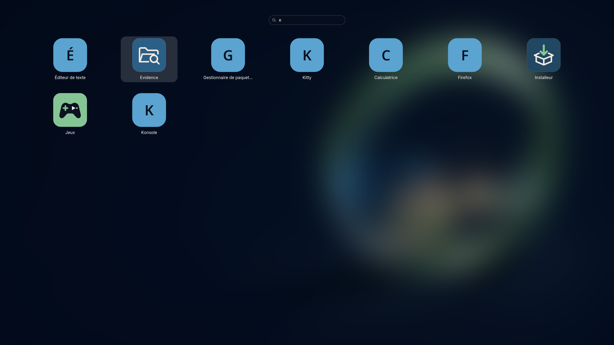
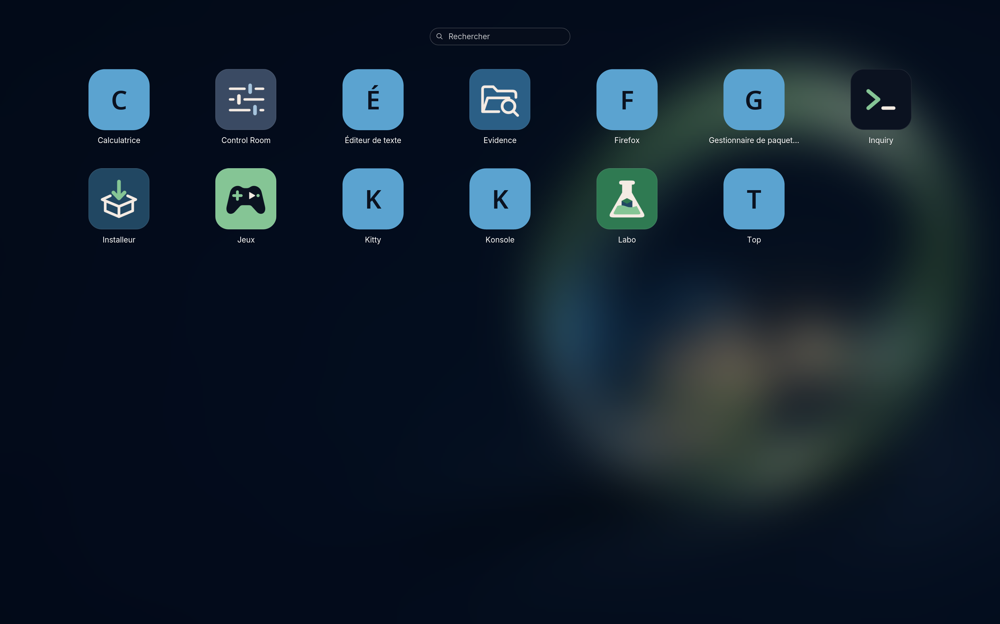
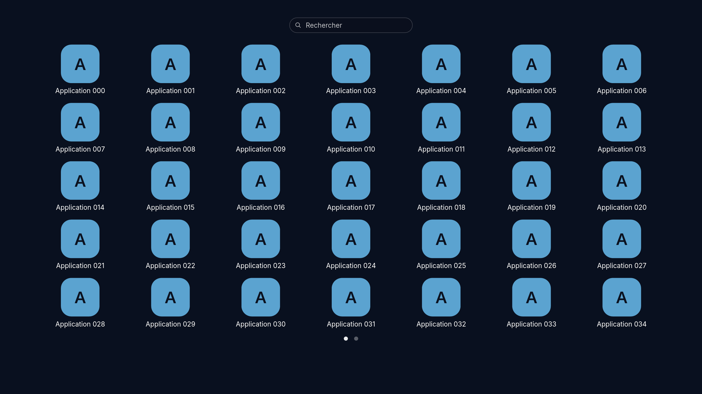
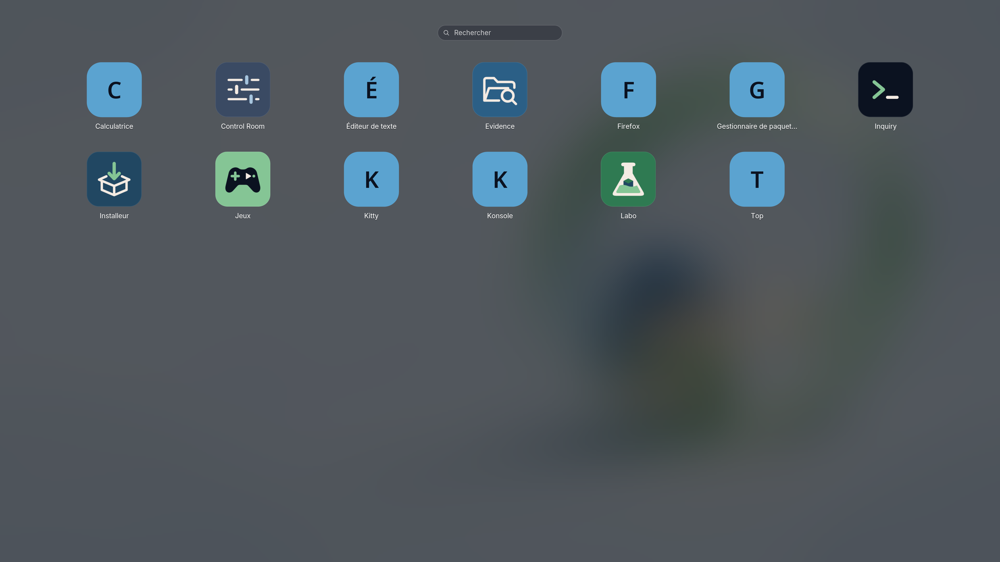
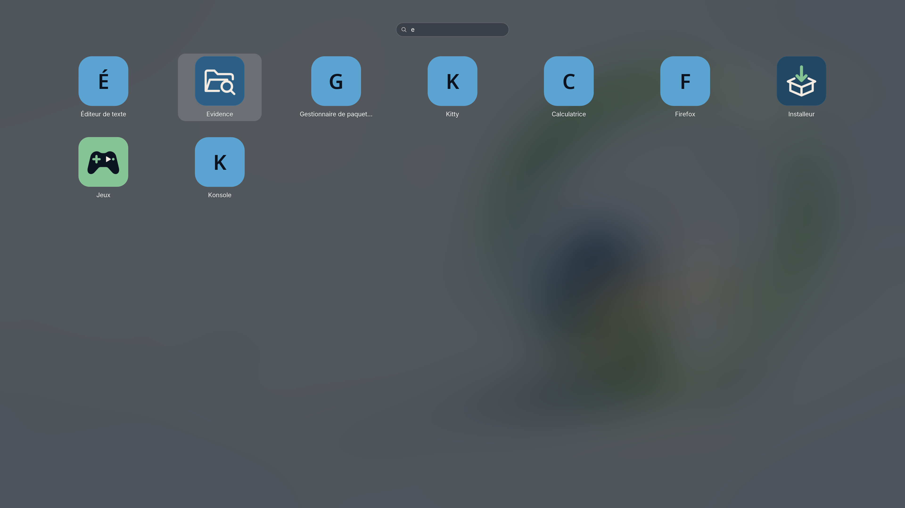

# Applications view

`desktop/apps` is the desktop's applications view, after the Launchpad of macOS: every installed
application in a grid of pages, to start one or to find it again. It is a separate program,
resident: started with the session and kept in memory, its surface shown and hidden at once (lot
P-02, see Resident service), over the whole screen with layer-shell (ADR 0005), written with iced
0.14 and `iced_exwlshell` 0.21.4 like the launcher (`docs/launcher.md`), whose reading of the
applications, search, start and single instance it reuses. The crate is `apps`, the binary and
the layer-shell namespace `sherlockos-apps`. Batch D-41a builds the view, the search and the
start; D-41b adds the right-click menu, pinning to the dock, the dock's button, F4 and the
launcher's « Garder dans le Dock ».
Its texts stay in French, from `sherlock-ui`.




These come from the headless rendering test (`tests/view.rs`), on the fixtures of
`desktop/apps/fixtures` and the desktop's own application icons (`sherlock-ui/icons`). The
simulator draws at scale 2: a capture of 1920 × 1080 logical pixels is the 3840 × 2160 screen at
scale 2, pixel for pixel. Behind the view, the wallpaper of the theme from `assets/wallpapers`,
blurred as in a session.

| Screen | Capture |
| --- | --- |
| 1366 × 768, scale 1 |  |
| 1920 × 1080, scale 1, and 3840 × 2160, scale 2 |  |
| 2560 × 1600, scale 1.5 (1707 × 1067 logical) |  |
| Two pages, their dots (1366 × 768) |  |
| Light theme |   |

## What it shows

No design board draws this view: it follows the identity rules of `docs/contexte.md`, the
dock's icons and macOS.

| Element | View |
| --- | --- |
| Backdrop | The wallpaper of the active theme, blurred and darkened, as Launchpad's (lot P-02c, see Backdrop). Without a wallpaper to read, a night blue veil, `rgba(6,12,24,0.70)`, over the desktop |
| Search field | A pill, 240 by 30, centered at the top: a dark glass `rgba(8,14,26,0.32)` with a white edge of 0.20 (0.34 with the keyboard), a white magnifier and placeholder at 0.75, white text. It has the keyboard from the start: the first letter typed searches. The same in both themes: the backdrop stays dark |
| Grid | Up to 7 columns by 5 rows, spread over the screen between the field and the dots and centered in that room, as Launchpad's (see Sizes); icons of 88 on the reference screen |
| Names | White, under a soft shadow (a copy at `rgba(0,0,0,0.45)`, 1 below), cut with « … » (`ellipsis`) past 1.5 times the icon's width |
| Application without icon | Its initial on the launcher's blue tile, radius 27 % like the dock |
| Hovered, selected cell | A white veil of 0.08, of 0.14 for the selection, radius 16 |
| Page dots | 8 across, 12 apart, 112 above the screen bottom, clear of the dock; the page shown bright; a click on a dot goes to its page; none for a single page |
| Nothing found | « Aucune application » in secondary text |

The names, the field's text and its placeholder read at 4.5 to 1 at least on the brightest
backdrop allowed, and on the veil over the default wallpaper and over a white one, selected or
not (`sherlock_ui::apps` tests). Every color, size, duration and text comes from
`sherlock_ui::apps`.

### Backdrop

`backdrop.rs`. The wallpaper of the active theme, as the compositor picks it (`wallpaper.conf`:
the user's image, or the chosen wallpaper of the collection or its pendant in that theme, its
smallest variant), is cut to cover the screen as the compositor does, reduced to 480 wide
(`BACKDROP_WIDTH`), blurred by a Gaussian of 12 of those pixels (`BACKDROP_BLUR`, about 50 on a
1920 screen) and darkened: by 0.85 at least (`BACKDROP_DIM`), more if needed so that no point is
brighter than a luminance of 0.11 (`BACKDROP_MAX_LUMINANCE`), where the white names still read
at 4.5 to 1 under the selected cell's veil. A dark wallpaper is barely darkened, a white one
much. The GPU stretches it over the screen (`ContentFit::Cover`).

It is computed once per wallpaper and per screen, on the pool, and kept as a PNG in
`$XDG_CACHE_HOME/sherlockos/` (`~/.cache/sherlockos/`), named by a key of the file, its time and
length, the screen in pixels and the processing; the six newest are kept. At each opening, and
when the screen, the scale or the theme changes, the key is computed again (a few `stat`): the
same key costs nothing, a new one is read from the cache, or computed (its time is logged,
`wallpaper blurred`) while the view opens with the picture it had. A wallpaper read
from the user is bounded as on the lock screen (a regular file of 64 MiB at most, 16384 pixels
on a side, 256 MiB to decode); anything unreadable leaves the veil. It does not use the blur of
the compositor (D-37): the view's surface would need it on every frame of its opening, the
picture costs nothing once computed. The `mode` of the setting is not followed: the backdrop
always covers the screen.

### Sizes

`apps::Layout::fit(width, height)` lays the view out for the screen, in logical pixels, so the
scale only changes the sharpness. The sizes follow the smaller of the two ratios to the
1440 × 900 reference screen, from 0.75 to 1.3 times (`MIN_FACTOR`, `MAX_FACTOR`): icons, the
least cell, the side margins, the place of the field. The texts, the field and the dots keep
their size, and so do the dots' place above the bottom (112), since the dock keeps its own.
Then as many least cells (148 wide, the icon, its name and their gaps high) as fit between the
side margins and between the field and the dots, from 1 to 7 columns and 1 to 5 rows. The
cells then spread over that room, up to 1.7 times their width and 1.5 times their height, and
the grid is centered in it, across and down: it fills the screen instead of hanging at its top.
The button of a cell keeps the least size, centered in its cell: a click between two of them is
beside, and closes the view.

| Screen (logical) | Factor | Icon | Grid | Cell |
| --- | --- | --- | --- | --- |
| 1366 × 768 | 0.85 | 75 | 7 × 5 | 176 × 114 |
| 1440 × 900 (reference) | 1 | 88 | 7 × 5 | 183 × 138 |
| 1707 × 1067 (2560 × 1600 at 1.5) | 1.19 | 104 | 7 × 5 | 217 × 170 |
| 2048 × 1280 (2560 × 1600 at 1.25) | 1.3 | 114 | 7 × 5 | 263 × 211 |
| 1920 × 1080 (and 4K at 2) | 1.2 | 106 | 7 × 5 | 247 × 172 |
| 1280 × 720 (a projector) | 0.8 | 70 | 7 × 4 | 165 × 131 |
| 800 × 600 | 0.75 | 66 | 6 × 4 | 113 × 102 |

The icons are looked up for the largest (114, at scale 2). The test checks on these screens and
more that the grid fits between the margins, under the field and above the dots, centered in its
room, and the dots above the dock.

## Architecture

| Module | Role |
| --- | --- |
| `main.rs` | The press handed to the service, renderer choice, logs, single instance, then `run` |
| `lib.rs` | Layer-shell surface, the applications of the session, startup |
| `catalog.rs` | The applications, sorted by name, and the search |
| `pager.rs` | Pages, wheel, swipe, rubber band, all computed from the time |
| `app.rs` | State (`View`), messages, keys, update, view |
| `icons.rs` | The icons drawn once at their size on the screen (lot P-02) |

**Reused from the launcher.** `launcher::apps::Apps` reads the desktop entries through
`mime-apps` and looks the icons up through `icon-theme`. This batch only opens it up:
`entries`, `start` (the command of an entry) and `icon` are public, and `with_icon_size` looks
the icons up larger than the launcher's 30. The search is `launcher::search::Haystack`, the
start `launcher::launch::spawn`, the single instance `launcher::instance::claim_named` (the
lock file now takes a name).

### Surface

Anchored to the four edges with a size of 0 (`LayerSize::FILL`): the compositor gives it the
whole screen. Layer `Overlay`, above the windows, the bar and the dock, exclusive zone -1. The
keyboard is `Exclusive`; the field takes the focus as the surface maps. iced_exwlshell reports
no size for a new surface: the view asks for it (`window::size`) as the surface maps, and
follows `window::Event::Resized` then. A resident view knows the screen before: the logical size
and scale of the screen its surfaces land on (`ExWlSettings::shell_broadcast`); without either,
the reference screen is assumed.

### Applications

The launcher's: every desktop entry of `$XDG_DATA_HOME/applications` then `$XDG_DATA_DIRS`,
subfolders included (`kde/org.kde.konsole.desktop`, id `kde-org.kde.konsole`), the first one of
an id hiding the others, even `Hidden` (how a user removes a system application); `NoDisplay`
entries and those whose `TryExec` is missing are left out, and `Terminal=true` ones without a
terminal. Names in the locale of `LC_ALL`, `LC_MESSAGES` or `LANG`. They are sorted by name,
case and accents ignored, then by desktop id: the order never depends on the files'.

### Search

The field is active from the start: the first letter typed already filters. The launcher's
fuzzy search (`docs/launcher.md`, Search): name, generic name and keywords, accents and case
ignored, best score first, then by name. A search starts again on the first page and selects
its first result.

### Keyboard and pointer

| Input | Effect |
| --- | --- |
| Letters | Typed in the field, the grid filtered |
| Left, Right | Previous, next application; past the page's end, on the next page |
| Up, Down | The cell above, below, on the same page; the first arrow selects the first cell of the page |
| Enter | Starts the selected application, or the first result of a search |
| Escape | Empties the search; then closes |
| Click on an application | Starts it |
| Click beside the applications and the field | Closes, as Launchpad does |
| Wheel | One notch, one page (notches closer than 250 ms turn one page); past the ends, the pages bounce |
| Touchpad, two fingers | The pages follow the fingers, then settle on the nearest page, or the next one past 18 % of the width or faster than 500 px/s |

The keys are read with `event::listen_with`, whatever the field did with them. A held Enter
starts nothing more, and nothing starts twice: once an application started, the view only
fades out.

iced 0.14 reports no end of a touchpad swipe: a swipe is over when no scroll event came for
120 ms. The wheel and the touchpad are told apart by their deltas, lines or pixels; the
dominant axis counts, vertical or horizontal.

### Starting an application

As in the launcher: its `Exec` expanded by `mime-apps`, no shell, the environment without the
renderer choice (ADR 0018), its own process group, no standard streams, its `Path`. Then the
view fades out and the program ends. A failed start leaves the view open and is logged.

### Menu of an application

A right click on an application opens its menu at the pointer, kept 8 away from the screen
edges, in the menu glass of the theme (`component::floating_menu`, 240 wide). The cell stays
lit under it.

| Entry | Effect |
| --- | --- |
| « Garder dans le Dock » | Pins the application at the end of the dock's list; the view stays open |
| « Retirer du Dock » | Instead of the first one when it is pinned |
| « Afficher dans Evidence » | Opens Evidence on the folder of its desktop file, then the view fades out; disabled when Evidence is not installed |

Pinning goes through `dock::pins`: the dock's file (`$XDG_CONFIG_HOME/dock/dock.conf`) gets the
list the dock shows, its defaults included when the file has none, plus or minus the
application; the dock reads it again at once. A click beside the menu, or Escape, closes it and
nothing else.


**Dragging an icon to the dock: not done.** The view and the dock are two surfaces of two
programs, and the view covers the dock (layer `Overlay`). An icon drawn by the view cannot leave
its surface, and handing it to the dock would take a Wayland drag and drop
(`wl_data_device.start_drag`), which neither iced 0.14 nor `iced_exwlshell` 0.21 can start. The
pointer could be followed past the view's edge (the surface keeps it while the button is held),
but the dock is under the view: there is nothing to drop on. « Garder dans le Dock » does it.

### Opening it

| From | How |
| --- | --- |
| The dock | The « Applications » button, first on the left (`docs/dock.md`) |
| The keyboard | F4 alone, caught by the compositor (`docs/compositor.md`) |
| A terminal | `sherlockos-apps` |

The four finger pinch is another batch.

### Resident service

As the launcher (`docs/launcher.md`, Resident service), and for the same reason: the session
starts `sherlockos-apps --resident` and starts it again if it stops. The service listens on
`$XDG_RUNTIME_DIR/sherlockos-apps.sock`, draws its one-pixel surface once to ready the renderer,
and opens its surface at each `toggle`. Once the view faded out, the surface is parked rather
than removed: one transparent pixel in a corner, on the background layer, without the keyboard,
its text field let go (its caret would blink, and draw the surface again). Its renderer keeps
what it drew: the icons uploaded, the glyphs, the shaped names, the layout. Shown again, it is
anchored back to the four edges, on the `Overlay` layer, with the keyboard: its first frame comes
about 10 ms after the press, where a new surface took 75 ms. A surface drawn in software has no
alpha (ADR 0018): there it is removed, not parked, as the pixel would show black. Each opening starts
afresh: the search empty, the first page, nothing selected, no menu; the applications are read
again on a thread of the pool (the first opening uses those read at start). The view hides the
launcher as it opens, and the launcher hides the view. F4, the dock's button and a terminal still
start `sherlockos-apps`, which hands the press to the service and stops.

### Icons

iced's SVG widget rasterizes an icon at the size it is drawn, and forgets what a frame did not
draw. The view's icons were therefore rasterized again at every frame of the opening (their scale
moves from 1.1 to 1), and a whole page of them each time a page came back on screen. Now each icon
is drawn once into pixels (`icons.rs`, with resvg, the renderer iced uses), at the grid's icon size
in the screen's pixels (its logical size times the surface's scale, `window::scale_factor`), on
four threads of the pool, and shown with iced's image widget: the GPU only scales that picture.
They are drawn again only when that size changes (another screen, another scale) or for the
applications installed meanwhile; until an icon is drawn, the SVG widget shows it.

### One view at a time, without the service

`$XDG_RUNTIME_DIR/sherlockos-apps.lock`, the launcher's mechanism (`docs/launcher.md`, One
launcher at a time): started again while open, the program closes the open view. The view
started by a key or a button toggles.

## Animations

After macOS. Everything is computed from the time, from the springs of `sherlock_ui::motion`.

| Moment | What moves | Token |
| --- | --- | --- |
| Opening | The blurred wallpaper fades in over the desktop, the grid comes from a scale of 1.1 to 1, the icons, the field and the dots from transparent | `apps::OPEN_SCALE`, `OPEN_SPRING` (`motion::OPEN_SPRING`) |
| Closing (Escape, a click beside, the dock's button, F4) | The reverse | Same |
| Starting | The application goes to the middle of the dock, shrinking to the dock's icon (52), while the view fades out; the grid stays in place | `LAUNCH_SIDE`, `dock_target` |
| Page turn | The pages slide | `PAGE_SPRING` (`motion::SNAP_SPRING`) |
| Swipe past the ends | Rubber band, `(1 - 1 / (excess × 0.55 / width + 1)) × width`, as on iOS | `RUBBER` |
| Wheel past the ends | The pages are thrown 2.5 pages a second past the end, the spring brings them back | `BOUNCE_SPEED` |

**Nothing at rest.** Frames are asked for (`window::frames`) only while the view opens or
closes, while the pages move, or during a swipe; typing, an arrow or a resize draw once.
Tested (`nothing_is_drawn_at_rest`).

## Performance

Lot P-02, after the author found the view « laggy ». Measured as for the launcher
(`docs/launcher.md`, Performance): reference laptop, RADV on the AMD chip, release builds, a
headless KWin at 1920 × 1080 in `bwrap` with the AMD render node only, the author's 203
applications (189 shown) and his `kora` icon theme, frames read from `WAYLAND_DEBUG`.

| From the press to the first frame | Before: a new program | After: the resident service |
| --- | --- | --- |
| First press | 1,629 ms (the very first run) | 78 to 90 ms (the surface created) |
| Next presses | 222 to 632 ms, median 329 ms (5 runs) | 10 to 27 ms, median 13 ms (7 runs, the surface parked) |

The first frame is drawn transparent, at the start of the opening: the view shows from the next
one, 17 ms later.

The animations, from the `pages` example (`cargo run --release -p apps --example pages`: opens
the view, turns two pages forward and two back, closes it, opens it again, by itself, and counts
the SVG pictures iced rasterizes, from iced_wgpu's own log). « Before » is the same program with
the icons drawn by the SVG widget (`PAGES_SVG=1`), as before this lot.

| Step | SVG rasterized, before → after | CPU time of the process, before → after |
| --- | --- | --- |
| Opening (from the start of the program) | 179 → 10 | 440 → 430 ms |
| First page turn | 65 → 0 | 100 → 70 ms |
| Second page turn | 33 → 0 | 70 → 60 ms |
| Turning back, twice | 0 → 0 | 70 + 50 → 80 + 50 ms |
| Closing | 318 → 12 | 170 → 60 ms |

The few left are the search field's magnifier, an SVG scaled with the view. Every animation kept
60 frames per second in both: 17 to 28 frames each, intervals of 16.4 to 16.8 ms (median), 17.2 to
19.4 ms (95th percentile); the longest, 33.6 ms, was at the opening with the SVG widget. In this
headless compositor the frames held before too: what the author saw comes from what this
measure leaves out, starting a program at each press above all (the first frame 222 to 632 ms
later, 1.6 s the first time) and the rasterizing it repeated at every opening and closing.

Drawing the 189 icons at 96 pixels takes 23 to 42 ms on four threads, once, as the service
starts; looking them up in the icon theme, 31 to 38 ms. The service, hidden: no frame and no CPU
time in 5 s, 90 MiB resident, 67 MiB proportional (the icons drawn: 189 × 96 × 96 × 4 bytes,
7 MiB, 28 MiB on a screen at scale 2).

## Tests

| Test | What it checks |
| --- | --- |
| `every_application_once_by_name_in_its_language` | Hidden, deleted, duplicate and masked entries, subfolders, French and English names, the terminal, the icons, the order |
| `the_search_filters_as_the_launcher_does` | Live filter, accents, generic name, scattered letters, nothing found, Escape |
| `the_pages_hold_seven_by_five` | Pagination, arrows across pages, wheel, dots, resize, a search back on page one |
| `enter_starts_the_first_result_once` | Enter, a second Enter and a click start nothing more |
| `a_click_starts_a_tile_and_a_click_beside_closes` | The pointer on three screens |
| `nothing_is_drawn_at_rest` | No frame at rest, frames while moving, the end after closing |
| `the_view_renders_on_every_screen_in_both_themes` | The captures above |
| `the_menu_pins_to_the_dock_and_shows_in_evidence` | The menu's entries, the file written, Escape, Evidence on the folder |
| `without_evidence_the_menu_cannot_show`, `a_right_click_opens_the_menu` | The disabled entry, the right click |
| `the_menu_renders_in_both_themes` | The menu's captures |
| `dock::pins::tests` | The list written, defaults included, other keys kept |
| `pager::tests` | Page count, notches, bounce, swipe, rubber band |
| `sherlock_ui::apps::tests` | Contrasts on the brightest backdrop, the grid on ten screens, centered, the cell centers and the dock |
| `backdrop::tests` | The wallpaper cut to the screen, blurred, darkened enough, even a white one; computed once per wallpaper and screen, read from the cache, a new key for a new screen or wallpaper, a broken file leaving the veil |
| `the_opening_board` (ignored, slow) | The board of the opening: six frames and the view open, dark and light, 1920 × 1080 and 1366 × 768, in `target/tmp/apps-opening-board.png` |
| `a_resident_view_toggles_and_opens_afresh_on_its_first_page` | Hidden at first, shown and hidden by the service, the search empty and the first page at each opening, nothing drawn while hidden, the launcher's opening hiding it |
| `the_icons_are_drawn_once_at_their_size_on_the_screen` | Every icon drawn at the grid's size in pixels of the screen (scale 1.5), none drawn twice |
| `icons::tests` | An SVG drawn in its proportions, centred, at its side in pixels |

## Running it

```sh
cargo run -p apps
cargo run -p apps -- --resident   # the service, hidden; `sherlockos-apps` then shows or hides it
```

In a Wayland session with layer-shell (our compositor, KWin). Run it again, or press Escape, to
close it.

## What this batch does not do

- Folders of applications, a later batch.
- The four finger pinch: another batch.
- Dragging an icon to the dock (see Menu of an application).
