# Top bar

`desktop/bar` is the desktop's top bar: a separate program, anchored at the top of the screen
with layer-shell (ADR 0005), written with iced 0.14 (ADR 0014), rendered by the GPU of the AMD
chip, or in software without one (ADR 0018). Batch D-20 builds it from the `Main.dc.html` design
board and, for the Sherlock menu, `Menus.dc.html`. The crate, the binary and the layer-shell
namespace are all `bar`. The texts it shows stay in French, from `sherlock-ui`.

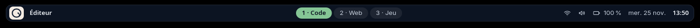

The screenshot comes from a nested KWin running inside a Xephyr display started for the test,
with `USER=Camille` so that no login name of the machine shows (see « Running and checking by
hand »). The Sherlock menu open is shown in « Theme ».

### Logo

The Sherlock button shows the color logo, without its square: green ring `#85C595` and cream
dot `#F4EBE3` (`logo-transparent.svg`), 22 px high, straight on the bar glass. The button has no
fill at rest, the hover and press veils of the other ghost buttons, and while its menu is open
the 0.14 white veil of the open « Fenêtre » button of the Menus board (`TOP_BAR_BUTTON_OPEN`). A
cream pill would hide the cream dot, so the button has none.

The menu avatar is the color logo in its night blue square, 40 px: `Logo::square(40)` picks the
large version. `Logo::square` has optical versions for 32 and 16 px; the bare symbol has none,
since it fills its frame and reads at 16 px (D-01). On the bar, the bare symbol is the more
legible one: the night blue square disappears into the glass and only shrinks the ring.

Contrast of the green ring, a non-text element (3 to 1 required), on the bar glass over the
desktop and its three discs: 7.9 to 8.6 at rest, 6.5 to 7.1 under the hover veil, 5.1 to 5.7
under the open veil. The contrast test of `sherlock-ui` checks it in every state. The cream dot
is at 8.8 or more.

## What it shows

| Place | Content | Source |
| --- | --- | --- |
| Left | Sherlock button, which opens the Sherlock menu as an `xdg_popup` | |
| Left | Title of the active window | `sherlock_shell_v1` (see Workspaces) |
| Center | The workspaces of its screen, the active one in green, the empty ones bare | `ext-workspace-v1`, `sherlock_shell_v1` |
| Right | Network, sound, battery and its percentage | NetworkManager, PulseAudio or PipeWire, UPower |
| Right | Short date and time, in French | Local clock |

An indicator that has not been read yet is not shown. Without a battery, the battery
indicator disappears. A battery discharging below 15 % turns amber.

**Indicators** (UI-01, UI-02). Bluetooth, network, sound and battery make one button, with one
hit area, as in D-20b: they all open the same control centre, and one by one (UI-01) they only
split it (the author's test, UI-02). Their icons are 18 px (`metrics::STATUS_ICON`, the board's
16 was found too small), the button 30 high with 7 on each side (`panels::BAR_BUTTON_HEIGHT`,
`BAR_BUTTON_PADDING`), the icons 14 apart inside it. One pill around the whole group fades in on
hover and deepens on press, and the group shrinks a little while pressed; while the control
centre is open, the group keeps the veil and a short green mark under its middle. A click
anywhere on it, on an icon or between two, opens or closes the control centre. The clock and the
Sherlock button have the same pill, veil and mark. Tab reaches the group once. The application
name ends with « … » where the left half of the bar ends.

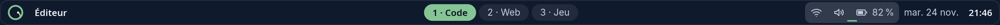
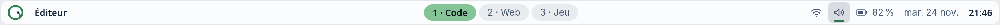
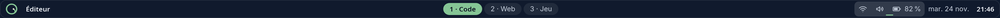

**Live icons** (UI-01). Each icon shows the real state, drawn from its level rather than
chosen among pictures (`sherlock_ui::icon::wifi_svg`, `sound_svg`, `bluetooth_svg`, beside
`battery_svg`), and a change of level or state cross-fades over `motion::GLYPH_FADE`
(`animated::GlyphFade`) instead of jumping:

| Indicator | States |
| --- | --- |
| Wi-Fi | The dot and 0 to 3 arcs lit by the strength of the access point in use (`Strength`, under 25, 50, 75, then 3), the others faded; every arc faded and a slash without a network; an exclamation mark when NetworkManager's `Connectivity` says none, portal or limited; the arcs lit in turn every 400 ms (`motion::PULSE`) while it connects (`State` 40), the next step asked for at its time, no frame in between. A wired network shows every arc |
| Sound | The speaker and 0 to 3 waves by the volume (0, up to 33, up to 66, above), crossed out when muted |
| Bluetooth | The rune faded when off, lit when on, a dot beside it when a device is connected. No indicator without an adapter |
| Battery | As in D-20c, at the new size |

The Wi-Fi and Bluetooth states come from the system bus (`live.rs`): read when the bar starts,
then again on NetworkManager's `PropertiesChanged` (its state, its connectivity, the strength of
an access point) and on BlueZ's `PropertiesChanged`, `InterfacesAdded` and `InterfacesRemoved`,
coalesced like the panels' (`bus::coalesce`), each read sent only when it changed: nothing polls.
Each rule names the objects of its service (`path_namespace` `/org/freedesktop/NetworkManager`
or `/org/bluez`, BlueZ's `ObjectManager` on `/`, Q-43): the system connection is shared and zbus
does not filter a well-known sender name on its side, so without the path an RSSI of BlueZ read
NetworkManager again, and the other way round, panel closed. When the system bus closes (D-Bus
restarted), the icons show unavailable, then follow again on a new connection after 1 s, 2 s, 4 s…
up to 60 s; the cached connections of `system::system` are opened again once closed.
Without NetworkManager on the bus, a Wi-Fi network shows every arc, as before. The microphone has
no indicator in the bar, so its mute is not shown.

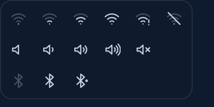
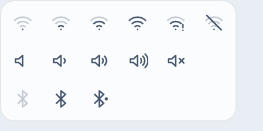

A network name too long for its tile or its line ends with « … » (`sherlock_ui::ellipsis`):


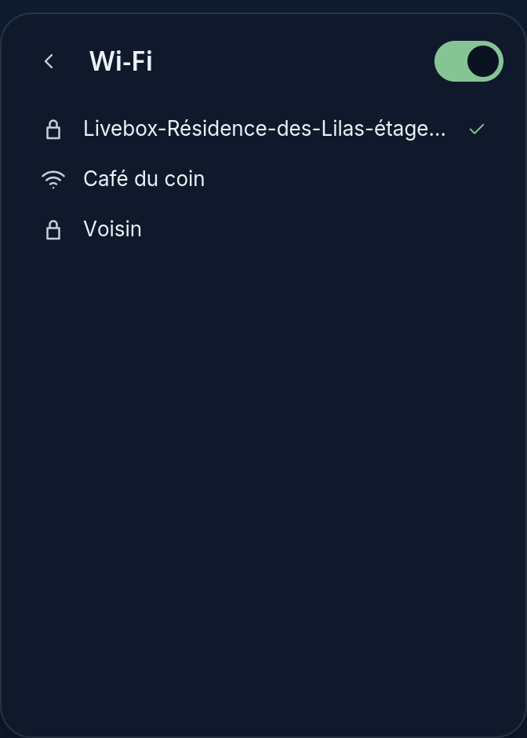

**Battery** (D-20c). The gauge is drawn, not chosen among a few glyphs: the outline of the
`Battery` icon, filled from the left to the real percentage (`icon::battery_svg`, 12 units of
the 24 grid for 100 %). A bolt while it charges, a plug when it is plugged in and full or not
charging; the mark is cut out of the level and filled outside it (even-odd rule), so it shows at
every level in the single color of the icon. Amber only while discharging under 15 %. The
percentage and the time left (« 3 h 12 restantes », « pleine dans 45 min », « branchée »), when
UPower gives it (`time to empty`, `time to full`), are written next to « Énergie » in the control
centre: a tooltip would not fit in the 36 high bar surface. `upower --monitor` prints a line
on each `PropertiesChanged` of a device, and the battery is read again then: no polling.

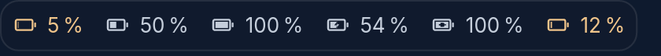
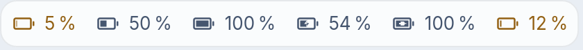

## Architecture

| Module | Role |
| --- | --- |
| `lib.rs` | Layer-shell surface and iced settings, startup (`run`) |
| `app.rs` | State (`Bar`), messages, update, bar view and menu view |
| `menu.rs` | Sherlock menu entries, size of its surface, keyboard keys |
| `shape.rs` | The two forms of the bar, floating and attached, and the spring between them |
| `source/` | One source per piece of system data, behind the `Source` trait |
| `user.rs` | User name, read from the GECOS field of `/etc/passwd` |

Every color, size and text comes from `sherlock-ui`: tokens `TOP_BAR_*`, `CHIP*`,
`SHERLOCK_*`, `STATUS_*`, `MENU_AVATAR`, `MENU_HEADER_PADDING`; components `chip`,
`sherlock_button`, `status`, `battery`, `menu_header`, `logo`, `logo_square`; the `strings` text
module; icons `NetworkOff`, `SoundMuted`, and the battery gauge `icon::battery_svg`. The only threshold written in the
bar is the low battery one (`battery::LOW_PERCENT`), which is behavior.

### Surface

The layer-shell surface is anchored to the top, left and right, on the `Top` layer, 36 high
with margins of 10 at the top and 12 on the sides, which change when it attaches to the top
edge (see « Attached to the top edge »). It declares an exclusive zone of 36. It gets
the keyboard on demand (`OnDemand`): only when clicking into the bar or its menu. Protocol log
taken in the nested KWin (`WAYLAND_DEBUG=client`):

```text
zwlr_layer_surface_v1#29.set_anchor(13)
zwlr_layer_surface_v1#29.set_keyboard_interactivity(2)
zwlr_layer_surface_v1#29.set_size(0, 36)
zwlr_layer_surface_v1#29.set_exclusive_zone(36)
zwlr_layer_surface_v1#29.set_margin(10, 12, 0, 12)
zwlr_layer_surface_v1#29.configure(101, 1416, 36)
```

The Sherlock menu is an `xdg_popup` attached to the bar surface, anchored below the Sherlock
button. Its surface is 256 wide and starts 6 below the bar: the Menus board puts it at
(18, 52), and that is where it shows. The compositor closes it on a click elsewhere.

### Layer-shell crate: `iced_exwlshell` 0.21.4

The brief asked to try `iced_exwlshell` 0.21, never tried by D-00, before falling back to
`iced_layershell` 0.19.1. Version 0.21.4 works at the first try with iced 0.14.0 and tiny-skia;
the bar keeps it, pinned. What we learnt:

- It is declared with `default-features = false, features = ["macros"]`. The default
  `linux-theme-detection` feature pulls `mundy` to read the system theme: useless here, our
  theme comes from `sherlock-ui`.
- It pulls `winit-core` and `winit-common` 0.31.0-beta.4 and builds with them: the
  `iced_exdevtools` 0.19.1 breakage noted by D-00 is gone. It also pulls `iced_devtools` and
  `iced_exdevtools`, even without its `debug` feature.
- It does not pull wgpu: `iced_renderer` comes without default features, so the renderer stays
  the one `sherlock-ui` enables (tiny-skia only). The NVIDIA card is not woken up.
- API changes since 0.19: `ExWlSettings` replaces `Settings` (passed with `.wl_settings(..)`,
  iced's own settings with `.settings(..)`); `LayerSize::fill_width(36)` replaces
  `size: Some((0, 36))`; `Margin { top, right, bottom, left }` replaces the tuple; the macro is
  still `#[to_layer_message(multi)]` for a program with several surfaces.
- `IcedNewPopupSettings::new(parent, size, anchor position, anchor size)` places a popup;
  `.anchor(..)` and `.gravity(..)` tune it.
- `.on_new_shell(..)` reports each created surface with its type: the bar learns its own surface
  id this way, where the D-00 prototype guessed it at the first `view`.
- It can ask the compositor for a blur (`BlurOption`), but only on rectangles: the rounded
  corners of the bar would show a square blur. The bar does not use it.
- It offers `.redraw_scope(..)` to skip redraws on some messages. Not used: the bar already only
  gets a message when a value changes.

## Sources

Each piece of data comes from a source implementing the `source::Source` trait:

```rust
pub trait Source: Send + 'static {
    type State: Clone + PartialEq + Send + Debug + 'static;
    fn read(&mut self) -> Result<Self::State, SourceError>; // reads the current state
    fn wait(&mut self) -> bool; // waits until it may have changed, false if it never will
}
```

`source::watch` runs a source on its own thread and turns it into a stream for an iced
subscription. It only sends a state when it changed: the bar does not redraw for nothing.
`source::Fixed` is the fake implementation used by tests, a state that never changes.

| Source | Read | Watch | Parsing tested on |
| --- | --- | --- | --- |
| `SystemClock` | `localtime_r`, once a minute | The thread looks at the clock every 5 s at most, to catch up after a suspend | Fields of a C `struct tm` |
| `UPower` | `upower -i /org/freedesktop/UPower/devices/DisplayDevice` | `upower --monitor` | `fixtures/upower-*.txt` |
| `NetworkManager` | `nmcli -t -f TYPE,STATE,CONNECTION device` | `nmcli monitor` | `fixtures/nmcli-*.txt` |
| `Pactl` | `pactl get-sink-volume` and `get-sink-mute` on `@DEFAULT_SINK@` | `pactl subscribe`, lines about an output or the server | `fixtures/pactl-*.txt` |
| `shell::Auto` | `ext-workspace-v1` and `sherlock_shell_v1` on the shell socket, or `Placeholder` | The protocol events | Fake compositor (`tests/shell.rs`) |
| `Placeholder` | Variables `BAR_WORKSPACES` and `BAR_APP` | None | Module tests |

Commands run with `LC_ALL=C`, for an output that does not depend on the language. A watch
command that stops is restarted 30 s later. A burst of watch lines (a volume slider being
dragged, a network reconnecting) gives a single refresh: the lines that follow within
`metrics::EVENT_COALESCE_MS` (150 ms) of each other are drained before reading again, for
`metrics::EVENT_COALESCE_MAX_MS` (500 ms) at most, so that a long drag still refreshes. When the
bar stops, the monitors stop quietly and are not restarted. A read
error, such as an `upower` output without a battery section, is logged as a warning once, until
the source reads fine again. The `upower-full.txt`, `nmcli-wifi.txt` and `pactl-55.txt` outputs (the last one in
`desktop/system-services/fixtures`, with the sound shared with the media keys)
were recorded on the reference laptop, with the Wi-Fi name and the Docker bridge ids replaced by
neutral values; the others are rewritten from them by hand (battery at 12 % discharging, sound
muted, Ethernet, network off).

**The commands die with the bar.** Each command is started with `PR_SET_PDEATHSIG` set to
SIGTERM in `pre_exec`: the kernel kills it as soon as the thread that started it ends, and so
whatever way the bar ends (normal exit, `Error during dispatch` when the compositor goes away,
SIGTERM, SIGINT, SIGKILL, panic). The child checks `getppid` right after `prctl`, for the case
where the bar died in between. On top of that, `source::shutdown` stops the monitors still
registered when `run` returns. `tests/children.rs` runs the real sources in a helper process
with fake `upower`, `nmcli` and `pactl` in the `PATH`, kills it with SIGTERM then SIGKILL, and
checks that no fake monitor survives; it fails when `prctl` is removed. This needs `libc`
(`=0.2.191`, already in the lock through iced).

**Why commands and not D-Bus.** The brief allowed `zbus`. The machine's commands are enough,
add no dependency, and can be tested on recorded outputs. Their watch mode reports changes:
nothing polls. Sound is not on D-Bus with PipeWire anyway. If the OS does not ship these
commands, a D-Bus source will implement the same trait.

**The clock reads the C library.** The standard library does not know the time zone, and the
brief does not allow `chrono`. Since D-05b the clock calls `localtime_r` (`libc`, already
pinned), once a minute, instead of starting `date`, through `appearance_config::local`, where
`mktime` first re-reads the time zone. Time zones being offset by whole minutes, the local minute changes at the
same time as the UTC minute, which the thread watches without reading anything.

The OS network service is not chosen yet (batch S-13): `NetworkManager` is the source of the
development machine, another one will replace it if needed.

### Workspaces and active application

Our compositor publishes both on its shell socket, next to the session's Wayland socket
(`wayland-1-shell` for `wayland-1`, ADR 0021). `source::shell` opens a connection of its own
there (`shell_protocol::socket_from_env`), on the source's thread, and binds:

- **`ext-workspace-v1`**: the groups and the screens they hold, each workspace with its `id`,
  `name`, `coordinates` (its order) and `active` state. The bar shows the group holding the
  screen it sits on, the first group while it does not know its screen yet, and none for a
  screen no group holds. Workspaces are shared by every screen for now: a single group.
- **`sherlock_shell_v1`**: the windows, with their workspace and states, and per screen the
  `output` state (a maximized or fullscreen window is on it). A workspace with no window has a
  bare chip, without the veil; minimized windows count. The name on the left is the title of
  the `activated` window, its `app_id` when it has no title, cut where the left half of the
  bar ends. A window keeps its states on a workspace that is not shown: only an active window
  of an active workspace names the application.

**Batches.** Each protocol's events stay pending until the `done` of that protocol's manager,
which settles them; the bar only reads settled batches. A half sent batch of one protocol is
never read because the other one ended a batch.

A click on a workspace (or Enter on its ringed chip) sends `activate` then `commit` on the
watching connection itself (`shell::Switcher`): requests can go from the interface thread
while the source's thread waits for events, and nothing waits for the compositor, so a click
never blocks, even on a compositor that hangs. The bar changes when the compositor says the
workspace changed, not before. The active workspace does nothing. A workspace named after its
number shows the number alone.

The bar's own screen comes from iced_exwlshell (`shell_broadcast`, `WindowOutputChanged`): the
`wl_output` name of its surface, the name both protocols use.

**Elsewhere** (Plasma, another compositor, no shell socket), the bar logs it once at start,
`placeholder workspaces, no active application`, with the reason, and keeps the
`Placeholder` source. When the shell socket is missing or nobody listens on it yet, the
source tries it again every 3 s (`shell::RETRY`), quietly: the unchanged placeholder is not
sent again, so no frame is asked for; once the socket answers, the compositor's workspaces
replace the placeholder. Any other error (the protocols not offered) stops the tries. The
placeholder: three numbered workspaces, the first one active, all veiled, no active
application, the bar always floating. A click is logged. The two variables force the
placeholder even on our compositor, to compare with the design board:

```sh
BAR_WORKSPACES="Code,Web,Jeu" BAR_APP="Éditeur" cargo run -p bar
```

## Global menu (lot D-36)

The menus of the active application go in the bar, after its name, as on a Mac. Qt and KDE
applications export them with `com.canonical.dbusmenu` on the session bus, once a registrar
owns `com.canonical.AppMenu.Registrar` there: they then hide the menu bar of their windows.

### The registrar

`registrar.rs` serves `com.canonical.AppMenu.Registrar` at `/com/canonical/AppMenu/Registrar`
(`RegisterWindow`, `UnregisterWindow`, `GetMenuForWindow`, `GetMenus`, the signals
`WindowRegistered` and `WindowUnregistered`), on the session bus of the bar.

- **It always answers, at once.** A registrar that owns the name without answering made Konsole
  wait 25 seconds for each window (`docs/compositor.md`, "D-Bus session bus"). `RegisterWindow`
  asks the bus daemon for the caller's process (`GetConnectionUnixProcessID`), keeps the
  registration, passes it on to the compositor (`register_app_menu` of `sherlock_shell_v1`,
  written to the shell connection without waiting for anything) and answers. Measured by the
  test on a private bus: under 50 ms, a few milliseconds in practice.
- **Only on our compositor, never in Plasma's place.** `bar::run` starts it once the bar is
  connected to a compositor that offers `sherlock_shell_manager_v1` at version 3; elsewhere
  (a nested KWin) there is none. It asks for the name without queueing and without replacing
  (`DO_NOT_QUEUE`): on a bus where another registrar answers (Plasma's `kded6`), it logs
  `another registrar owns com.canonical.AppMenu.Registrar` and stays out of the way. On its own
  bus (the session's own bus when Plasma runs beside it, or the user's bus when the session is
  alone), it takes the name.
- **Withdrawing.** Qt under Wayland gives every window the id 1. `UnregisterWindow(1)` from a
  connection that registered several menus under that id withdraws only those it no longer
  exports: the registrar answers first, then asks each path for its introspection, which no
  longer names `com.canonical.dbusmenu` once Qt has removed the object. A connection that leaves
  the bus (`NameOwnerChanged`) takes its menus with it. Each withdrawal goes to the compositor
  as `unregister_app_menu` with the bus name and the path.

The compositor gives each registration to its window (`docs/compositor.md`, "Global menu"), and
tells the bar the menu of each window (`app_menu`): `Desktop::menu` is the one of the active
window.

### The menus in the bar (D-36b)


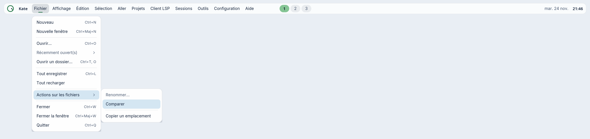
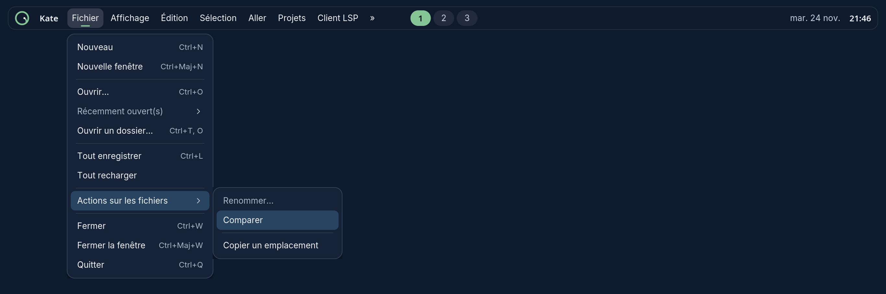
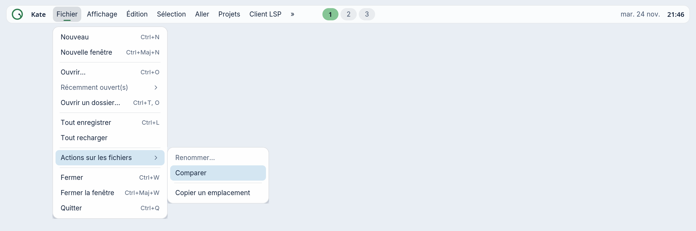
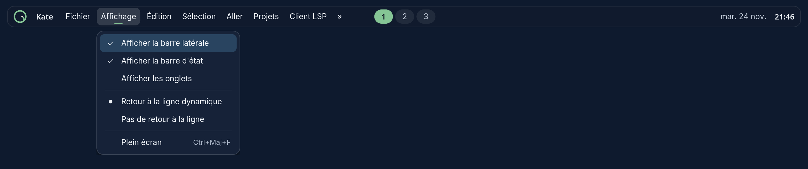
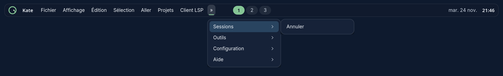

The captures come from `cargo test -p bar --test global_menu`, in software at scale 2: the bar
and each popup rendered apart, laid on the desktop's color where the compositor puts them. The
menus are Kate 25.04's, as it exports them.

- **What shows.** After the Sherlock button, the name of the active application in bold, from
  its desktop entry (`names.rs`: the entry whose id is the window's `app_id`, or whose last part
  or program is it, so `org.kde.kate` and the X11 class `konsole` are found), else the window's
  title; then the application's menus, ghost buttons like the clock's (`panels::bar_button`),
  veiled while open. Without a menu for the active window, the name alone. The name stops at
  `APP_NAME_MAX` (220) with « … » when menus follow it.
- **Room.** The name and the menus keep to the left half of the bar, less the workspaces of the
  middle (`Bar::placement`, from the bar's real width and the widths of the labels as the
  renderer shapes them, `sherlock_ui::ellipsis::width`). The menus that do not fit go into
  « » », the last button, whose entries open them as submenus: on 1366 × 768, Kate keeps
  « Fichier » to « Client LSP » in the bar.
- **Reading.** `dbusmenu.rs` reads the whole tree once the window is active (`GetLayout(0, -1)`),
  and again on each `LayoutUpdated` or `ItemsPropertiesUpdated` of that menu (a match rule on its
  bus name and path, coalesced like the panels' signals). A click on a menu first sends
  `AboutToShow`, reads that menu again, then opens it: an application that fills a menu as it
  opens (Kate's recent files) shows it filled. Each call has a limit of 1.5 s
  (`dbusmenu::TIMEOUT`, on the connection of the menus) and runs in an iced task: an application
  that does not answer leaves the name alone, or the menu as it was read, and the bar goes on.
  A late answer for an application no longer active is dropped.
- **Bounds** (Q-38). Any application on the session bus can send a layout, which the bar lays
  out on its interface thread: one `GetLayout` keeps 200 entries at most (`dbusmenu::MAX_ENTRIES`,
  all levels together), 8 levels of submenus, 256 characters of a label, and 4 key combinations
  of 4 keys of 32 characters in a shortcut; the rest is left out. The notification centre keeps
  of `List` the daemon's own bounds (`history::MAX_ENTRIES`, 100 notifications; the application
  name, title, body and labels cut to the daemon's lengths; 32 actions with keys of 256 bytes),
  since a program that takes the daemon's name after it could send more.
- **A menu.** An `xdg_popup` of the bar under its button, 6 below the bar, like the Sherlock
  menu: the menu glass, entries of 30, separators, the shortcut on the right in tertiary text
  (« Ctrl+Maj+N », the names of a French keyboard, « Ctrl+T, O » for keys pressed in turn), a
  chevron for a submenu, a check mark or a radio dot in a column of its own before the labels
  when the menu has any, disabled entries faded. Labels lose their mnemonic marks (`_` and `&`).
  As wide as its widest entry, from 200 to 380; as tall as its entries, within the screen,
  scrolling beyond.
- **Submenus.** A popup of the menu's popup, at its right, 4 apart, its first entry level with
  the entry that opens it. It opens when the pointer rests on that entry, or on a click, and
  closes when the pointer goes to another entry of its parent.
- **Pointer.** While a menu is open, the pointer on another menu of the bar opens it at once,
  as on a Mac. A second click on the open menu, Escape, or a click outside closes them. A click
  on an entry sends `Event` « clicked » to the application and closes the menus.
- **Keys.** Up and Down walk the entries, past separators and disabled entries, wrapping
  around; Home, End; Right opens the submenu of the highlighted entry, or the next menu of the
  bar; Left closes the submenu, or opens the previous menu; Enter or Space runs the entry;
  Escape closes the submenu, then the menu. Tab reaches the menus of the bar after the Sherlock
  button, and Enter opens one with its first entry highlighted.
- **Motion.** The menu of the bar unfolds from its top left corner and folds back like the
  Sherlock menu, on the GPU; a submenu unfolds the same way. From one menu to the next, the
  menu shown stays until the application has filled the next one (`AboutToShow`, then
  `GetLayout` of that menu), which then replaces it at once at its own size, as on a Mac
  (D-36d: the next menu used to open empty and tiny). Qt answers `GetLayout` of a menu with the
  menu's own properties empty: only its entries are taken, and its button keeps its label.

### Which applications (D-36c)

- **Qt and KDE** (Kate, Konsole, Dolphin): through the registrar with Qt's generic theme or
  qt6ct, through KDE's protocol with KDE's theme. Checked with Kate and Konsole 25.04 against our
  compositor without a screen: the bar reads Kate's 11 menus and Konsole's 7.
- **Evidence**: exports its own menus (`docs/evidence.md`, "Menus in the bar"). Checked the same
  way: the bar reads its 5 menus.
- **GTK** (Firefox, GNOME applications): not yet. GTK 3 exports a menu bar through
  `appmenu-gtk-module`, absent from the reference laptop and from Debian's default install; GTK
  4 and libadwaita applications have no menu bar but a menu of their header bar, described with
  `org.gtk.Menus` and `org.gtk.Actions` (GMenuModel) and announced through `gtk_shell1`, which
  our compositor does not offer. Reading GMenuModel in the bar and offering `gtk_shell1` make a
  lot of their own. Firefox, which draws its own menus, would not use either.
- **X11 applications**: Qt over XWayland calls `RegisterWindow` with its real X11 window id,
  which the compositor matches (tested with a fake registration only: XWayland was not started
  for the check, it wakes the NVIDIA card on the reference laptop).

## Notification area (lot D-45)

The icons applications put in the notification area (Discord, Steam, a VPN, a USB key) wait
behind a chevron, before the indicators, as the hidden icons of Windows do: a click on the
chevron opens a glass popup under it, a grid of those icons. No board draws it: the measures
are in `sherlock_ui::tray`, choices of the lot to review with the design.

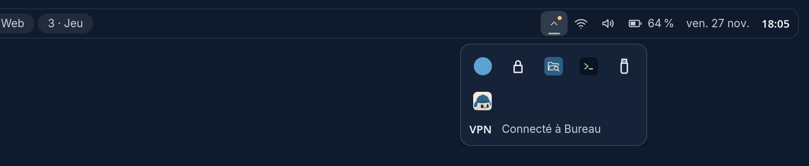
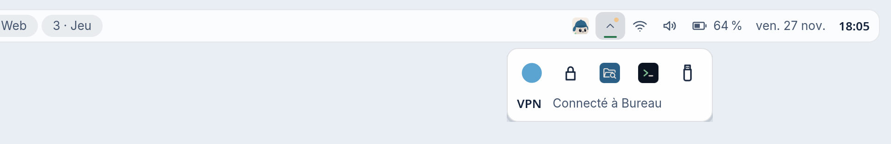
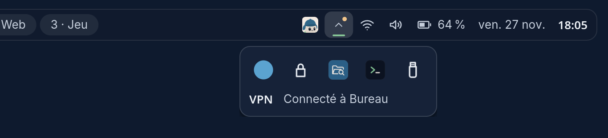
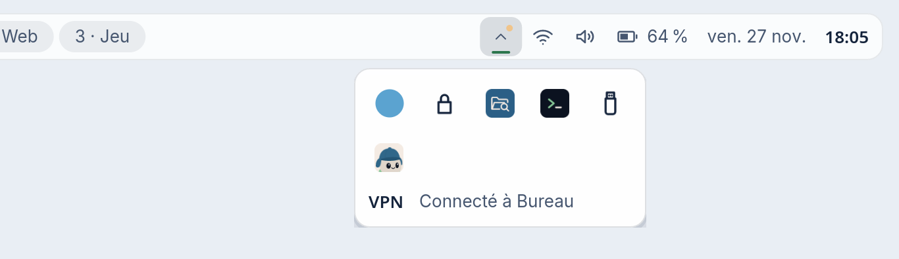

The captures come from `cargo test -p bar --test tray`, in software at scale 2, the bar and the
popup rendered apart and laid where the compositor puts them, as for the global menu. The icons
are ours (application icons, line icons as symbolic ones, a round pixmap): no other brand's.

| Module | Role |
| --- | --- |
| `tray/watcher.rs` | `org.kde.StatusNotifierWatcher`, served by the bar |
| `tray/host.rs` | The host: reads the items and follows them, a stream of `Event` |
| `tray/mod.rs` | An item, its properties, its pixmaps, what a click asks of it (`Request`) |
| `tray/icon.rs` | Where its icon is found |
| `app/tray.rs` | The chevron, the popup, the clicks, the breath, an icon's menu |
| `app/pins.rs` | Icons kept in the bar: the drag, the drop, their view (D-45a) |
| `tray/pins.rs` | Which icons are kept, in the bar's settings file (D-45a) |
| `locate.rs` | Where the chevron is drawn, for the popup to open under it |

- **Protocol.** `StatusNotifierItem`, the protocol KDE wrote, which libappindicator,
  libayatana-appindicator, Electron, Qt and KDE speak. The bar serves
  `org.kde.StatusNotifierWatcher` at `/StatusNotifierWatcher`: `RegisterStatusNotifierItem`,
  `RegisterStatusNotifierHost`, `RegisteredStatusNotifierItems`, `IsStatusNotifierHostRegistered`
  (always true: the bar is a host, so applications that ask do not fall back on the X11 tray),
  `ProtocolVersion`, and the four signals. As the registrar, it answers at once and asks for the
  name without queueing nor replacing (`DO_NOT_QUEUE`): where Plasma's watcher owns it, the bar
  registers there as a host (`org.kde.StatusNotifierHost-<pid>`) and gets the same items. The
  freedesktop name (`org.freedesktop.StatusNotifierWatcher`) is not served: none of these
  libraries looks for it.
- **Items.** An item registers by its bus name (its object is then at `/StatusNotifierItem`), or
  by an object path on its own connection, as libappindicator does. The host reads each with one
  `GetAll` (`Id`, `Title`, `Status`, `IconName`, `IconThemePath`, `IconPixmap`, the attention and
  overlay icons, `ToolTip`, `Menu`, `ItemIsMenu`), and again on each signal of its interface
  (`NewIcon`, `NewAttentionIcon`, `NewOverlayIcon`, `NewTitle`, `NewToolTip`, `NewStatus`), a
  burst coalesced into one read (`bus::coalesce`). `Passive` hides it. It goes when the watcher
  says so, or when its application leaves the bus (`NameOwnerChanged`). An application that
  leaves while its item is read leaves no ghost icon (lot D-45c): each read under way is noted
  (`host::Ledger`), a departure marks the reads of its item (by key, or by the service the key
  names), and a marked read is dropped when it ends.
- **Bounded.** As for the global menu: every call has the 1.5 s limit of the menus' connection
  (`dbusmenu::TIMEOUT`) and runs on the bus's executor or in an iced task, never on the
  interface thread. An application that hangs keeps its item unread, never the bar frozen.
  What an application sends is bounded too (`tray::MAX_*`): 40 items at most (the watcher
  refuses more with `LimitsExceeded`, the host reads no more, and the popup's rows still fit a
  small screen), an item registered only at a valid bus name and object path, 8 pixmaps per icon
  of 512 pixels a side at most, and 256 characters of its id, title and tooltip.
- **Icons.** The name first: in the folder the application gives (`IconThemePath`, where
  Electron and libappindicator write theirs, or a theme in it when it is an `icons` folder), then
  in the user's icon theme, what it inherits, `hicolor` and `pixmaps` (the `icon-theme` crate the
  dock and the launcher share). Else the pixmap: the smallest at least twice the size drawn,
  ARGB32 in network byte order turned into RGBA. A drawing (SVG, or a PNG inside an SVG as in the
  dock) goes through `sherlock_ui::raster`, rasterized at twice its size and drawn with the linear
  sampler: sharp at scales 1 to 2. A symbolic icon (`-symbolic`) takes the color of the text of
  the theme, light or dark (`raster::tinted`). The overlay sits at the bottom right corner, at 55 %
  of the icon. An item without an icon shows its initial.
- **Sizes.** Icons of 22 in cells of 40, 2 apart, 5 columns at most; the line of the tooltip
  under the grid, 26 high. The popup is as wide as its columns, at least 200, on the menus' glass,
  radius 12, with the menus' shadow on the GPU, 6 below the bar. Its middle is under the chevron's,
  and it never goes past where the panels end. Found from the chevron's real place
  (`locate`), whatever the width of the indicators, the screen and its scale. It stops 24 above
  the bottom of the screen, as the global menu does, and its grid scrolls above the tooltip line
  (lot D-45c); never shorter than a row and that line.
- **Chevron.** A ghost button like the indicators', veiled with its green mark while the popup is
  open. It points down, and turns half a turn up on the panels' spring as the popup opens, back as
  it closes (turned inside the SVG, in steps of 10°, as the spinner). Without an icon to show, no
  chevron. Tab reaches it before the indicators; Enter opens the popup.
- **Clicks.** Left: `Activate` at the point under the chevron, and the popup folds back. Middle:
  `SecondaryActivate`. Wheel: `Scroll`, 120 a notch as Qt counts, vertical or horizontal. Right:
  the item's menu (D-45a, below).
- **Tooltip.** The line under the grid gives the hovered icon's tooltip title in bold, then its
  text without markup, ended with « … »; without a tooltip, the item's title. A floating bubble
  would need a popup of its own, and every popup of `iced_exwlshell` takes the grab.
- **Attention.** An item in `NeedsAttention` shows its attention icon when it has one, and
  breathes three times (12 % larger and back, 1.6 s a breath, on a sine, never a blink) when it
  starts to and each time the popup opens; then it rests. The chevron carries an amber dot as long
  as an item needs attention. No endless pulse: at rest, no frame is drawn.
- **Motion.** The popup unfolds from the middle of its top edge and folds back like a panel, on
  the GPU; clicked again while it folds, it unfolds again in the same popup. Escape, a click
  elsewhere or a second click on the chevron close it. One popup holds the grab at a time: a
  panel, the Sherlock menu or an application's menu takes it away at once, and the popup takes
  them away. When the icons shown need another size, it opens again at the new size.

### The menu of an icon, and icons kept in the bar (D-45a)

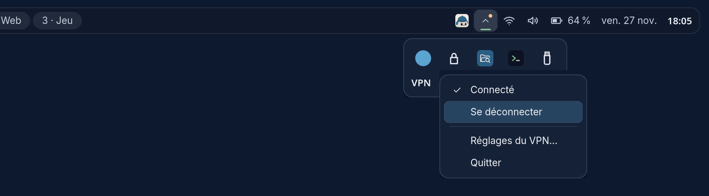
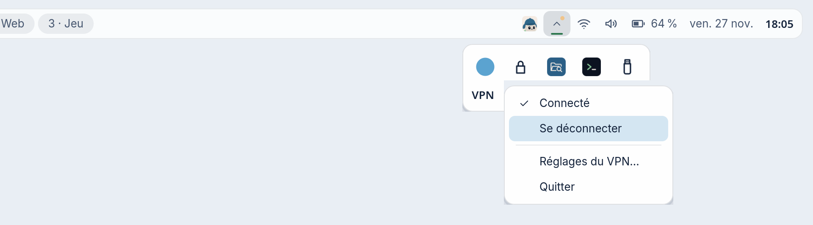
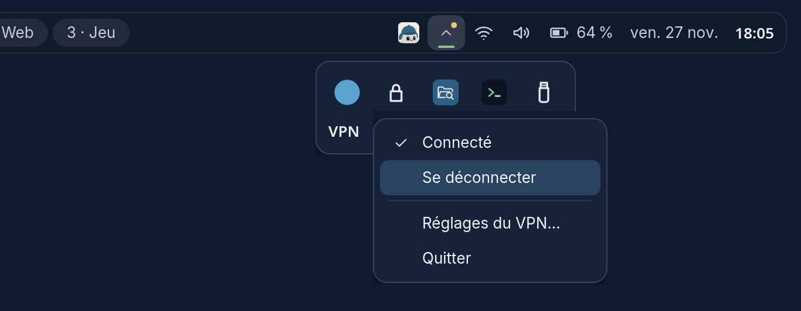
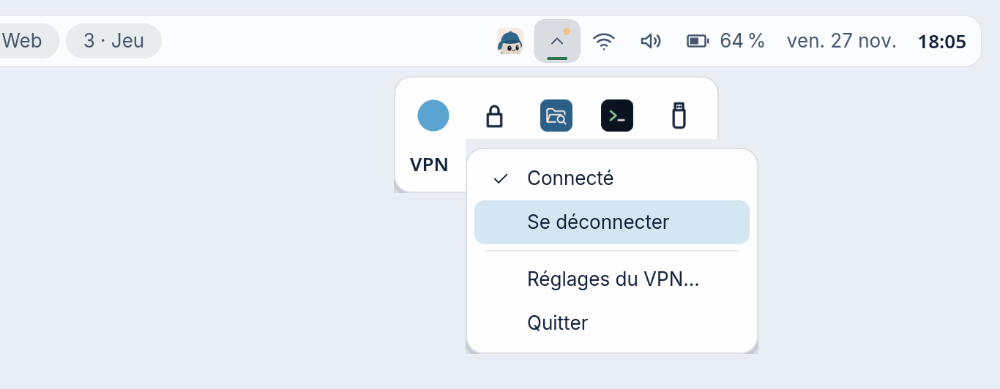

- **Menu.** A right click on an icon opens its menu (`Menu`, `com.canonical.dbusmenu`), read and
  drawn by the global menu's code: the same glass, entries, check marks, submenus, keys, the same
  limits (`AboutToShow`, then `GetLayout`, 1.5 s each). `GlobalMenu::item` holds it while it is
  shown; the bar's menus stay as they are. From the popup it opens under the icon's cell, a popup
  of the popup; from the bar, under the icon, like the bar's menus. An entry that runs sends
  `Event` « clicked » and closes the menu and the popup; Escape closes the menu, then the popup.
  An item that only has a menu (`ItemIsMenu`) opens it on a left click too, and so does an item
  whose `Activate` is refused (`UnknownMethod`), as KDE does. An item without a D-Bus menu gets
  `ContextMenu` and shows its own.
- **Kept in the bar.** An icon dragged from the popup onto the bar stays there, before the
  chevron, in the order it was dropped; the bar shows where it would land, the icon faded in its
  slot, while the pointer is over it, and the icon left in the popup fades meanwhile. Dragged
  along the bar, a kept icon changes place; dragged below the bar, it fades and goes back into
  the popup when let go. A press that does not move 6 pixels is a click. A kept icon answers the
  clicks and the wheel as in the popup, and breathes when it needs attention; the chevron's dot
  only counts the icons of the popup. Without an icon left in the popup, no chevron.
- **Saved.** The icons kept are remembered by their `Id`, the same from one start of the
  application to the next, in `$XDG_CONFIG_HOME/bar/bar.conf`:

  ```text
  [Tray]
  Pinned=sherlock;steam
  ```

  A drop changes the bar at once, then the file is read again just before it is written, the
  change applied to what it holds (another bar, an editor), its other lines kept, written to a
  temporary file renamed over it (`tray/pins.rs`). Read when the bar starts. An `Id` is the
  application's own text: a `;` in it is written `\;`, as in a desktop entry, and read back
  whole (`KeyFile::set_list` and `list`, lot D-45c); a file written before reads the same, and
  the next drop writes it in this form.
- **Moves during a drag.** While a button is held, Wayland gives the pointer's moves to the
  surface it was pressed in, outside it too: the popup gets them over the bar, the bar below
  itself. The bar places them in its own surface from where it put the popup. The moves are only
  asked for while an icon is pressed (`pins::on_pointer`): a pointer crossing the bar sends no
  message. The popup and the menus never leave their surfaces: what is dragged shows in the bar's
  slot, not under the pointer. Once the press became a drag, the surface that keeps the pointer
  shows the closed hand (`grabbing`) wherever it goes, over the bar or not
  (`sherlock_ui::pointer::held`, lot D-45c), and the pointer gets its usual shape back when it
  is let go.

### The X11 tray (XEmbed)

Checked on the reference laptop:

- **AnyDesk 7.1.4** (its Debian package) only knows the X11 tray: `GtkStatusIcon`
  (`gtk_status_icon_*`, `_NET_SYSTEM_TRAY_S%d`, `_XEMBED_INFO` in the binary), no
  libappindicator. Its icon needs XEmbed.
- **Steam** carries its own `libappindicator.so.1`, which looks for
  `org.kde.StatusNotifierWatcher`: `StatusNotifierItem`.
- **Discord** is not installed there. Electron applications speak `StatusNotifierItem`; not
  checked with Discord itself.

So XEmbed is needed, for AnyDesk at least. The old X11 tray icons go through KDE's
`xembedsniproxy`, which the session starts when it is installed (lot D-45b, see "Everyday
services" in `docs/compositor.md`): on Debian 13 it comes with the `plasma-workspace` package (no
package of its own), and it is on the reference laptop (`/usr/bin/xembedsniproxy`). It owns the
X11 tray of XWayland and gives each icon to the bar's watcher as a `StatusNotifierItem`, so they
show in the popup like the others. A proxy of our own, or the same inside the compositor, may
come later if needed.

## Attached to the top edge

While a maximized or fullscreen window is on its screen (the `output` state of
`sherlock_shell_v1`, windows of the active workspace only), the bar leaves its floating pill
for a band along the top edge: margins 0, the whole width, square corners, and the bar's glass
made opaque, its border gone (`theme::top_bar_shaped`). It floats again when no maximized
window is left there. A bar decides from its own screen only: a maximized window on another
screen leaves it floating.


The change follows `motion::TOP_BAR_SPRING`, the spring of a window being maximized
(`shape::Shape`, from 0 floating to 1 attached): margins, radius, opacity and border move
together, frame by frame, and a change of mind halfway turns back from where the bar is. The
overshoot of the spring is clipped, so the bar never leaves the screen nor goes below the pill.

**Exclusive zone.** The compositor keeps clear the exclusive zone plus the top margin: 46
floating, 36 attached. The surface keeps an exclusive zone of 36 and only its margins move,
one commit per whole pixel, at most a dozen in a transition: the room a maximized window gets
follows the bar. Changing the zone too would take a second commit per frame (iced_exwlshell
commits each change on its own), and between the two the compositor would reserve a height
that is neither the old one nor the new one.

## Sherlock menu

It has the entries of the Menus board: a header with the user name and « Session ouverte »,
then « À propos de cet ordinateur », « Réglages », « Mises à jour », « Passer en mode jeu »,
« Verrouiller », « Fermer la session », « Éteindre ». Since D-36d they act:

| Entry | What it does |
| --- | --- |
| « À propos de cet ordinateur », « Réglages » | Starts Control Room (`control-room`), without a shell, with the renderer variables the bar was given (`sherlock_ui::gpu::for_child`), and waits for it on a thread of its own: no zombie. Control Room has no « À propos » page yet, nor a way to be opened on a page: both open its first page |
| « Verrouiller » | The command of the « Verrouiller » button of the control centre (`loginctl lock-session`), at once |
| « Fermer la session », « Éteindre » | A first click arms the entry, which reads « Reclique pour confirmer » under the veil, and the menu stays open; a second click at least 400 ms later (`CONFIRM_DELAY`, a double click only arms) runs the control centre's command. Another entry, Escape or a click elsewhere disarms it. A Mac asks before it logs out or powers off; this asks in the menu itself, where the click was |
| « Mises à jour », « Passer en mode jeu » | Faded, « Bientôt » on the right: nothing behind them yet. The keys and the pointer skip them |

Every other entry closes the menu once it has run.

Keyboard:

| Where | Key | Effect |
| --- | --- | --- |
| Bar | Tab, Shift+Tab | Moves between the buttons (Sherlock, workspaces), light blue ring, wrapping around |
| Bar | Enter, Space | Activates the ringed button: the Sherlock menu, or a workspace (logged) |
| Bar | Escape | Removes the ring |
| Menu | Down, Up, Tab, Shift+Tab | Highlights the next or previous entry, wrapping around |
| Menu | Home, End | First, last entry |
| Menu | Enter, Space | Activates the highlighted entry |
| Menu | Escape | Closes the menu |

Hovering with the pointer highlights an entry too: keyboard and pointer share the same cursor.

The bar keeps its keyboard focus in its own state (`Bar::focused`), like the menu cursor. The
ring is drawn from that value and Enter activates that value, in the same update. iced's focus
operations were tried first: under `iced_exwlshell` they are applied after the redraw, so the
ring stayed one Tab behind the real focus and Enter activated the next button.

The board also shows the shortcuts Super+, Super+G and Super+L in the menu. No compositor binds
them yet, so the menu does not show them.

## Panels (D-20b, D-20c)

As on a Mac, a click on the indicators opens the control centre, the quick settings alone; a
click on the date and time opens the calendar with the notification centre under it. Each is an
`xdg_popup` of the bar surface, with a grab: a click elsewhere closes it, and so does Escape or
a second click on its button. Opening one closes the other and the
Sherlock menu. Both indicators and clock are ghost buttons (`panels::bar_button`), veiled while
their panel is open, and Tab reaches them after the workspaces; their padding is taken back
from the gaps, so the bar looks the same as before.

| Module | Role |
| --- | --- |
| `panel.rs` | Which panel, its size, its place under the bar, its input region; the views of the centre and of the calendar |
| `calendar.rs` | Months, leap years, the weekday of a date, the six weeks of a month from Monday |
| `history.rs` | Client of `org.sherlockos.Notifications.History`: list, group by application, clear, run an action, `Changed` |
| `bus.rs` | The session bus, opened on first use and shared; `coalesce`, which calms the signals |
| `unfold.rs` | The spring and the fade of a panel that unfolds or folds back, and of a page that comes in |

Tokens, styles and French texts are in `sherlock_ui::panels`.

**Place.** The board puts the panels 54 from the top, and their right edge at 1428, where the
bar ends: `panels::BELOW_BAR` (8) under the 46 the bar takes. The popup is placed from the bar
width (each `Resized` of the bar surface) and its side margin, so that it keeps 12 from the
right edge when the bar is attached. On the GPU, the surface holds the panel shadow of the
board (`0 28px 70px`), cut on the right where the screen ends; the input region is the panel
alone. In software it holds the 8 under the bar, like the menu its 6. The anchor rectangle is
the centre of the top edge of the surface, as for the menu (`panel::anchor_rect`).

The width of the bar is kept for every surface iced_exwlshell reports (`Resized`), whether it
comes before or after the bar learns its own surface id, and else taken from the logical width
of its screen (`xdg-output`), less the side margins (UI-02a). Before, a size reported before the
id was lost, and the panels were placed for the 1440 reference screen: on a 1920 screen they
opened near its middle. Only without either does the bar fall back on the reference width, with
a warning. A test places both panels at 1440 and 1920, in software and on the GPU.

### Notification centre

The history of the notification daemon, newest first, a card per application (tile with its
initial, name, time), its three newest notifications in it and « N autres notifications » under
them. A card of one notification looks like the board's; a card of several puts each time on
the right of its title. The time is the hour on the day it came, the short date before. A
notification still open keeps its buttons (three at most, the first one primary, `default`
left out): a click runs the action through the daemon, which sends `ActionInvoked` to the
application and closes it. « Tout effacer » empties the history; open notifications stay on
screen. Without a notification, « Aucune notification »; without the daemon, « Le service des
notifications ne répond pas. » and a warning in the log.

The list is read when the centre opens, and again on each `Changed` of the daemon while it is
open (an iced subscription on the session bus, `history::watch`), from the daemon that owns
the name only: nothing polls, and no other client makes the centre read again. The calls run
in iced tasks, never on the interface thread. The interface is described in
`docs/notifications.md` (History over D-Bus).

The board shows the centre next to the quick settings, both 54 from the top. Since D-20c it is
under the calendar instead, in the panel of the clock, 320 wide like on the board and 280 high
(`panels::CENTER_HEIGHT`): the panel ends at 729 on the 1440 × 900 reference screen, above the
150 kept for the dock. Its list scrolls inside it. The calendar takes the same width, its
grid centred.

### Quick settings

The control centre, after the right column of the Panels board: four tiles (« Wi-Fi », « Bluetooth »,
« Ne pas déranger », « Mode jeu »), the volume and brightness sliders, the keyboard backlight
slider on a machine that has one, the graphics card and energy choices, then the user and the
session buttons (`quick.rs`, services in `system/`; sound, brightnesses and their watchers in the
`system-services` crate, shared with the media keys of the compositor). The panel keeps room for
the keyboard row (`panels::KEYBOARD_ROW`): without one, it is left empty above the user row.

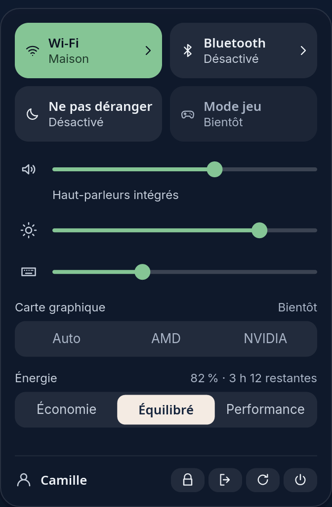

| Control | Service | Read | Written |
| --- | --- | --- | --- |
| Wi-Fi | NetworkManager, system bus | `WirelessEnabled`, `WirelessHardwareEnabled`, the first device of type 2, its `ActiveAccessPoint` and `AccessPoints` | `WirelessEnabled`; `ActivateConnection` of a saved connection, else `AddAndActivateConnection` |
| Bluetooth | BlueZ, system bus | `GetManagedObjects`: the first `Adapter1`, its `Powered`, its `Device1` and their `Battery1` | `Powered`; `Connect`, `Disconnect`, `Pair`, `Trusted`, `RemoveDevice`, `StartDiscovery`, `StopDiscovery` |
| « Ne pas déranger » | `notifications.conf` (`notifications-config`) | `DoNotDisturb` | `NotificationsConfig::save`, atomic, other lines kept |
| Volume | `pactl` (PipeWire's PulseAudio server) | volume, mute, `get-default-sink` and its `Description` in `list sinks` | `set-sink-volume`, `set-sink-mute` on `@DEFAULT_SINK@` |
| Brightness | `/sys/class/backlight`, logind | `brightness` and `max_brightness` of the firmware backlight, else the platform one, else a raw one | `Session.SetBrightness("backlight", name, value)` on `/org/freedesktop/login1/session/auto` |
| Keyboard backlight | UPower, system bus; else `/sys/class/leds` and logind | `GetBrightness`, `GetMaxBrightness` of `org.freedesktop.UPower.KbdBacklight`; else the LED `…::kbd_backlight` | `SetBrightness`; else `Session.SetBrightness("leds", name, value)` |
| « Énergie » | power-profiles-daemon, system bus | `ActiveProfile`, `Profiles`, under `org.freedesktop.UPower.PowerProfiles`, else `net.hadess.PowerProfiles` | `ActiveProfile` |
| « Mode jeu », « Carte graphique » | none yet | | Faded, « Bientôt » |
| Session | the launcher's `Systemd` (`launcher::system`) | | `loginctl lock-session`, `terminate-session`, `systemctl reboot`, `poweroff` |

**Every system write goes through D-Bus** to the service that owns the setting, which asks
polkit when its policy wants it (NetworkManager: `enable-disable-wifi`, `network-control`,
`settings.modify.system`; power-profiles-daemon: `switch-profile`); logind lets the user of the
active session set the brightness. Nothing runs as root, nothing uses `sudo`. Sound is the
exception: PipeWire has no D-Bus interface, and `pactl` talks to the user's own sound server.
The calls run in iced tasks, never on the interface thread; `pactl` and the sysfs reads on a
thread of their own each, never on iced's pool.

**Time limits.** Every D-Bus connection of the bar has a `method_timeout`: 5 s on the session
bus and for the reads on the system bus, 60 s for the actions on the system bus, long enough
for polkit to ask for a password. `pactl` is killed after 3 s (`system::audio::TIMEOUT`). A
service that does not answer in time ends unavailable, never « … » for ever. The sound server
gets one `pactl` at a time: a volume or a mute asked meanwhile waits, the latest of each
replacing the previous one (`SoundQueue`).

**Password.** The Wi-Fi password lives in a `Secret`: its `Debug` shows `***`, it is
overwritten with zeros when dropped, and the panel wipes it whenever it closes (Escape, its
button, a click elsewhere, the compositor) and once it is sent to NetworkManager. The text
field of iced keeps its own copy while the field is on screen. A slider sends one call at a time,
the latest value winning (`Throttle`): a drag does not queue dozens of calls. The brightness
never goes below 1 %.

**States.** A tile shows « … » while it is read. A service that is not there fades its control:
« Indisponible » (no NetworkManager, no Bluetooth adapter), « Aucune carte » without a Wi-Fi
device, « Bloqué » when the radio switch keeps the Wi-Fi off, « Service absent » next to
« Énergie », « Aucune sortie son » under the volume, a faded rail without a backlight. A service
that refuses shows « Refusé » under its tile (« Échec » for another error), the details in the
log; the next read shows the real state again. The D-Bus error name sorts them:
`ServiceUnknown`, `NameHasNoOwner` and an unknown object, interface or method are absent;
`AccessDenied`, `NotAuthorized`, `PermissionDenied`, `InteractiveAuthorizationRequired` are
refused.

**Wi-Fi.** A click on the tile switches the Wi-Fi; its line is the network it is on. The
chevron on its right (« Réseaux Wi-Fi ») opens the list of networks after asking for a scan: one
line per name (the access point in use, else the strongest), twelve at most, read again when
the scan's results come (`PropertiesChanged` of the device's Wi-Fi interface, `AccessPointAdded`,
`AccessPointRemoved`), the arcs of its signal on the left (`icon::wifi_level`), a padlock on a
protected one, a check on the one in use. An open or saved network is joined at once. A new
protected one asks for its password below its line (a hidden field with an eye that shows it,
Enter or « Rejoindre »); NetworkManager keeps the connection, its password readable by root
only. WPA and WPA2 personal (`wpa-psk`) and WPA3 personal (`sae`); WEP and enterprise networks
say « Ce réseau se rejoint depuis les Réglages. ». « Autre réseau… », at the end of the list,
joins a hidden network by its name (32 bytes at most), its protection and its password
(`802-11-wireless.hidden`, any access point).

**Joining, to its end** (D-20e). `AddAndActivateConnection` and `ActivateConnection` answer
before the network is joined: the bar then follows the activation they return (`StateChanged`
of `org.freedesktop.NetworkManager.Connection.Active`, listened to before its `State` is read),
for `network::ACTIVATION_LIMIT` (60 s) at most. The tile and the network's line read
« Connexion… » until it ends, for a saved network too, and a second click waits. Activated, the
network shows checked. Deactivated without secrets or after a failed login (reasons 9 and
10), the password was wrong: the line and the tile say « Mot de passe incorrect », the field
comes back under the line and shakes as on the lock screen (`panels::shake`). Another reason
says « Connexion impossible », the limit « Le réseau ne répond pas ». A connection the bar
created for that join is deleted when it fails: NetworkManager never keeps a wrong password. A
saved network whose password is typed again keeps its connection: the new password replaces
the old one in it (`Update` of its settings), then it is activated. The calls go through the
bus for actions (`ACTION_TIMEOUT`, 60 s): polkit has time to ask for a password.

**Forgetting.** A saved network, and the one in use, have a bin on their right (« Oublier ce
réseau »), which asks for a confirmation under the line, then deletes every saved connection of
that name (`Delete`, polkit `settings.modify.system`).

**Bluetooth** (D-20d). As for the Wi-Fi, a chevron on the tile (« Appareils Bluetooth ») opens
the list of devices (`quick/devices.rs`, services in `system/bluetooth.rs`):

- **« Mes appareils »**: the paired devices, the connected ones first, each with the glyph of
  its kind (headphones, mouse, keyboard, phone, computer, gamepad, else Bluetooth), from
  BlueZ's `Icon`, and on its right « Connecté » and its battery when it gives it
  (`org.bluez.Battery1`). A click connects or disconnects it.
- **« Autres appareils »**: the named devices a scan finds, twelve at most; a device without a
  name would only show its address and is left out. A scan (`StartDiscovery`) runs while the
  list is open, « Recherche… » on the right of the section, and stops (`StopDiscovery`) when
  the list closes, by « Retour » or with the panel. A click pairs the device: `Pair`, then
  `Trusted=true` and `Connect`. One device at a time; its line reads « Connexion… » or
  « Appairage… ».
- **The agent.** For each pairing only, the bar serves `org.bluez.Agent1` at
  `/org/sherlockos/bar/agent` and registers it (`KeyboardDisplay`), and unregisters it at the
  end, whatever the end. It answers BlueZ alone: the unique name that owns `org.bluez`, read
  with `GetNameOwner` when the agent is registered, compared with the sender of every call; and
  about the device being paired alone. Anything else gets `org.bluez.Error.Rejected`. Its
  questions come into the panel, in a card under the list: a code to check on the device
  (`RequestConfirmation`), a code to type on it (`RequestPinCode`, `RequestPasskey`: drawn from
  `/dev/urandom`), or a code it shows (`DisplayPinCode`, `DisplayPasskey`), with « Confirmer »
  and « Annuler ». Nothing is answered by itself: the agent waits for the click.
  `RequestAuthorization` and `AuthorizeService` are refused, always; a « Just Works » pairing
  started by `Pair` does not ask.
- **Closing the panel during a pairing** stops it at once: the iced task of the pairing is
  aborted, its stream dropped, and a guard cancels the pairing (`CancelPairing`, while `Pair`
  has not answered) and unregisters the agent, on the connection's own executor. Only the end
  of the pairing, connection or disconnection under way frees the list for another device.
- **« Oublier »**: the bin button of a paired device asks « Oublier Casque ? Il faudra
  l'appairer de nouveau. » under its line, then `RemoveDevice`.
- **Time limits**: 5 s for the reads and the scan, 60 s for connecting, pairing and forgetting
  (the action connection): a device that does not answer ends in « Échec », never in a wait.
  Without BlueZ, « Indisponible ».
- **Live**: `InterfacesAdded` and `InterfacesRemoved` of BlueZ's object manager, besides its
  `PropertiesChanged`, coalesced like the others: no polling.

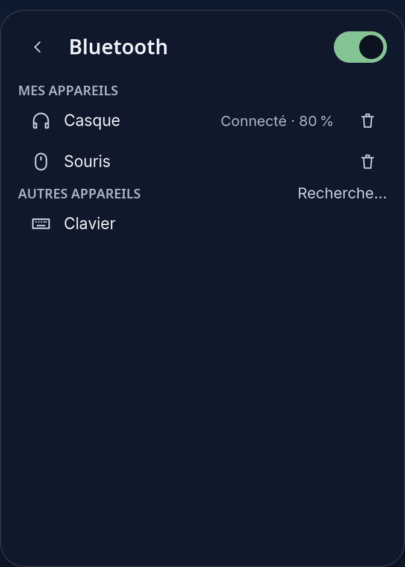
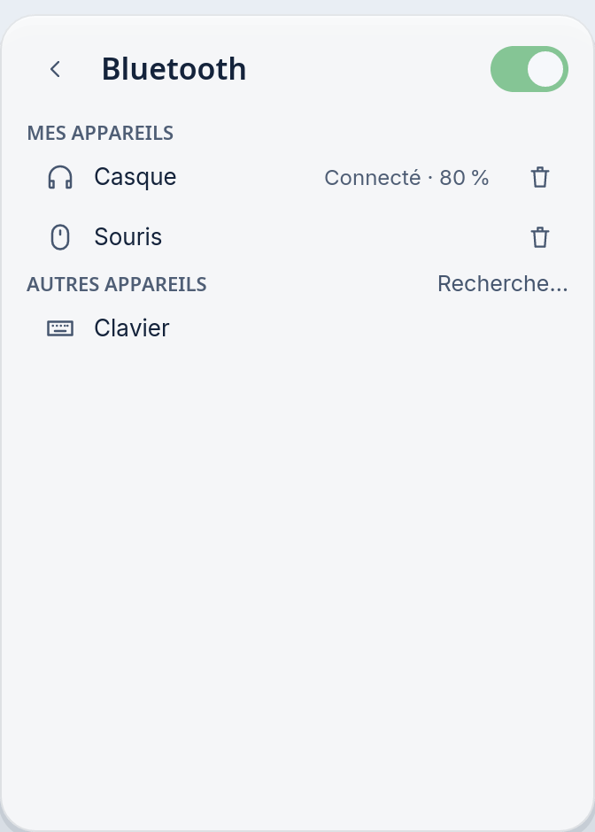
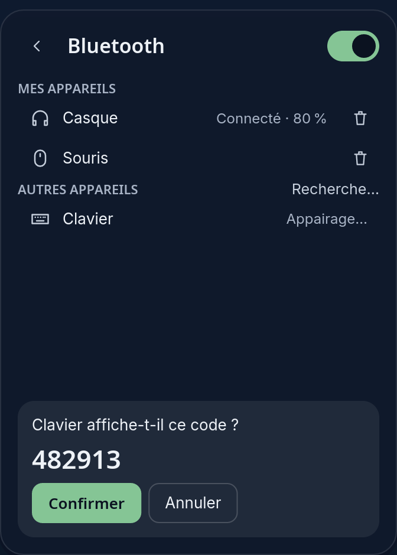
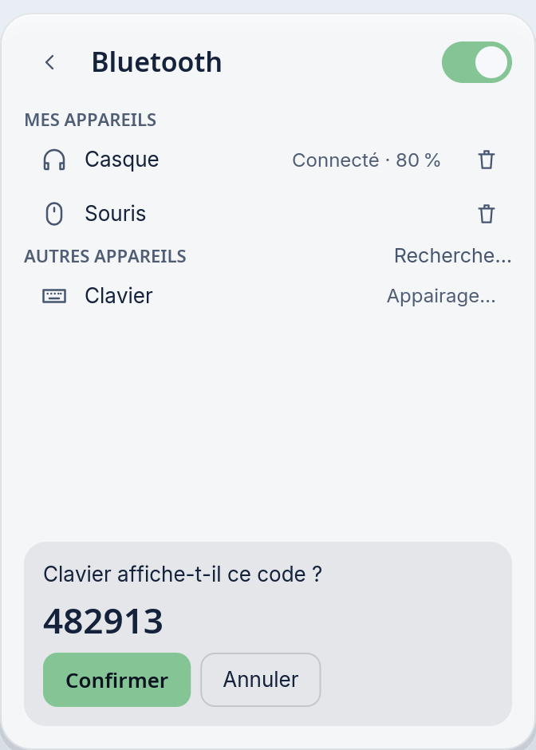

**Live.** While the control centre is open, the bar follows `PropertiesChanged` of
NetworkManager's main object, `StateChanged` of its devices, `PropertiesChanged` of BlueZ and of
power-profiles-daemon, and UPower's `BrightnessChanged` of the keyboard backlight, on the system
bus (`quick::watch`), and reads that service again. Sound and screen brightness follow what
changes elsewhere, a key or another application (lot D-35d, `system_services::watch`, merged in
`quick::watch` by `quick::local`), without polling:

- **Sound**: `pactl subscribe`, on a thread of its own, its lines about an output or the server
  (`watch::sound_changed`, also the filter of the bar's icon). It dies with the bar
  (`PR_SET_PDEATHSIG`); when it dies, it starts again after 0.5 s, then twice as long each time,
  up to 30 s, and the volume is read again. Each read is a `pactl` killed after 3 s. The icon of
  the bar reads through the same timed `pactl`.
- **Screen brightness**: `actual_brightness` of the backlight, with `poll(2)`, which sysfs wakes
  up when the kernel changes it, and inotify for a plain file. Its value read again only then.
- **Held slider**: while a slider is held under the pointer (`Quick::held`, until iced's
  `on_release`), or while a value it sent is on its way, a read leaves it where it is; once let
  go, the service is read again and the change made elsewhere shows.

The watchers ask every second whether the panel is still open (`watch::CHECK`), and stop with
their command once it is closed. The signals come in
bursts (BlueZ sends one for each device seen again during a scan, whoever started it):
`bus::coalesce` lets one batch through every 150 ms at most, each service once in it, and a
service has one read at a time, one more asked meanwhile running after it (`Reads`). The
notification centre follows `Changed` the same way.

**Session.** The user row of the board, with the launcher's commands and rules
(`docs/launcher.md`): « Verrouiller » at once (`loginctl lock-session`: until the lock screen of
D-25 exists, logind has no locker to tell, and the button does nothing visible); « Se déconnecter », « Redémarrer » and
« Éteindre » want a second click at least 400 ms after the first (`launcher::CONFIRM_DELAY`),
so that a double click only arms them. The armed button turns amber and « Reclique pour
confirmer » replaces the user's name; any other click cancels it. The command's exit code is
read for 300 ms (`launcher::system::REFUSAL_WAIT`, Q-43): logind or polkit refusing (another
session open, no right) shows « Refusé » under the buttons, with the reason in the log; a
command still running then (polkit asking for a password) is left to end, reaped by a thread.

**Names from far away (Q-43).** A Bluetooth device's name and a sound output's description (a
Bluetooth headset's is its own name) are cleaned before they are shown
(`system_services::names::shown`): control characters and bidirectional formatting characters
left out, 64 characters at most with « … ». A device named with a right-to-left override or a
line break cannot pass for another one under « Oublier » or « Confirmer ». The SSID of a Wi-Fi
network is not cleaned yet (it waits for D-20e, which changes `network.rs`).

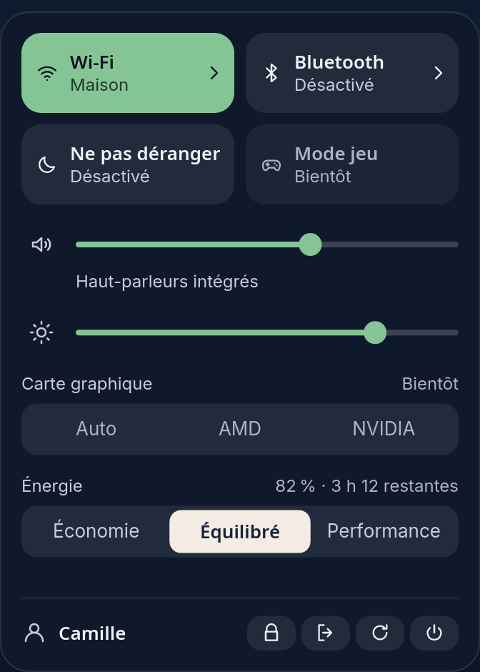

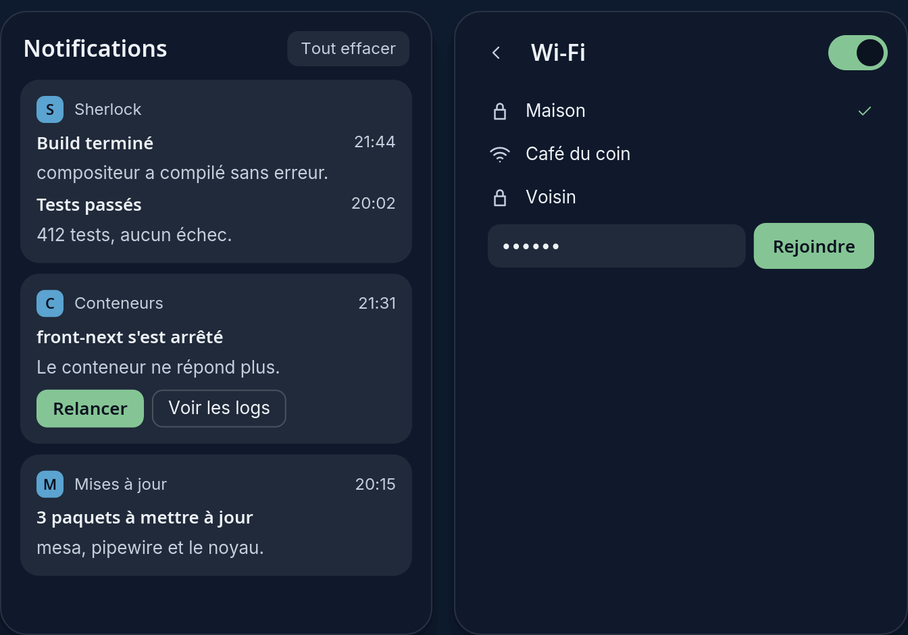

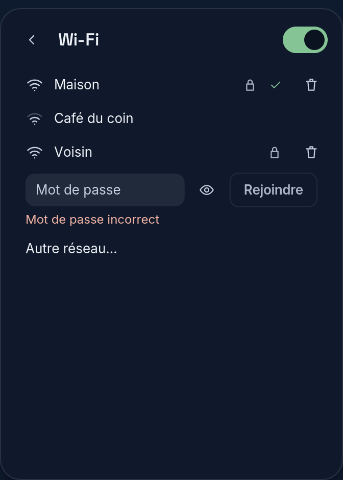

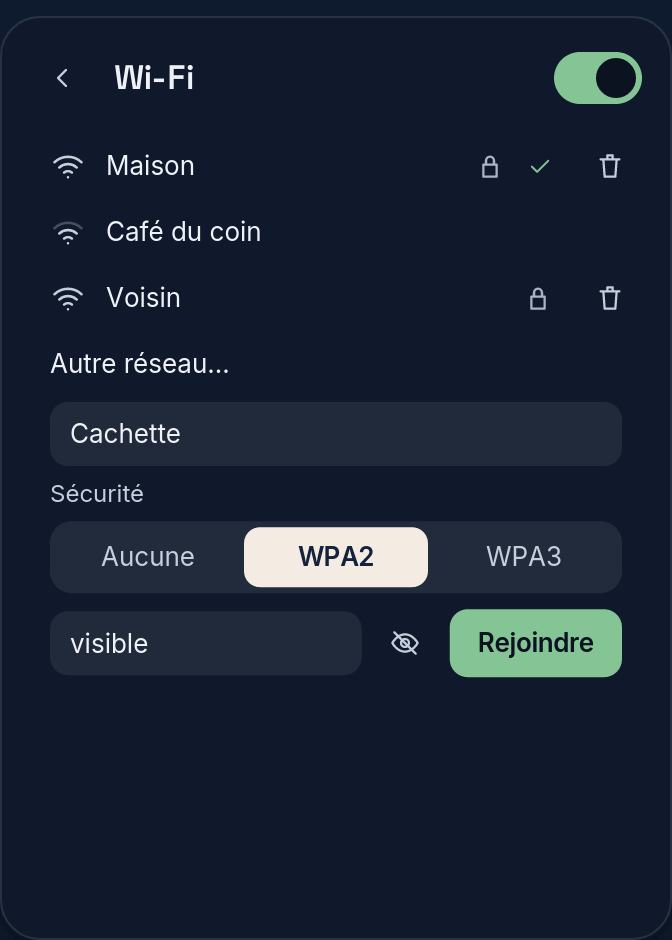
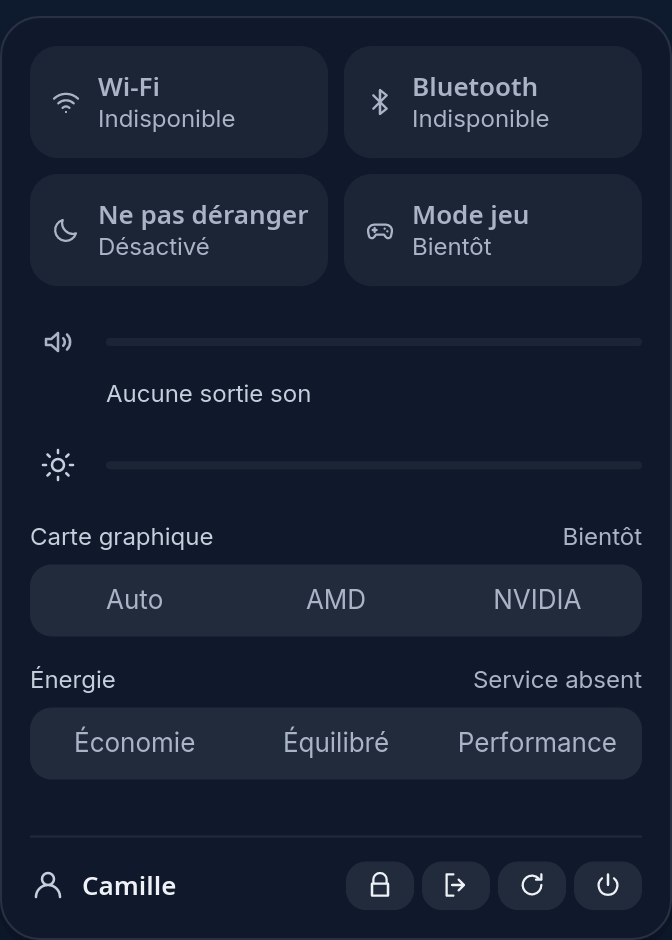
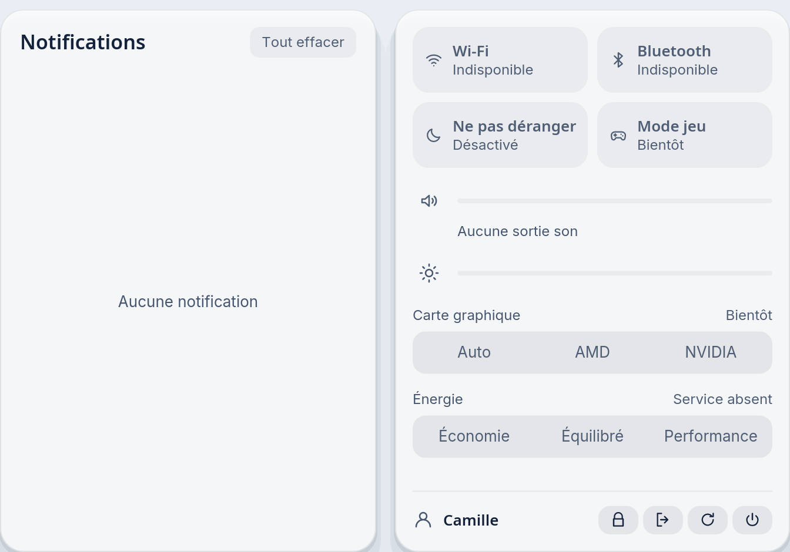

The tiles keep 10 on their sides and 8 between their 16 px glyph and their texts, 2 under the
board each: « Ne pas déranger » fits in the 149 a tile gets, as iced lays out Inter.

### Calendar

No board draws it: the panel glass of the board, seven columns of 36, centred in the 320 of
the notification centre under it. The month and
its year in Space Grotesk 17, the arrows « Mois précédent » and « Mois suivant », the weekday
heads « lu » to « di », Monday first, then always six weeks, so that the panel keeps its height:
the days of the months around are faded (tertiary text), today is a green disc. Under a line,
the slot of the agenda, « Bientôt : tes rendez-vous du jour ici. »: there is no agenda in 0.1.
No week numbers: no board shows them.

It opens on the month of the bar's clock, whose year now comes with the date (`LocalTime::year`).
Page Down and Page Up show the next and previous months, Home comes back to today's.

The dates are computed by `calendar.rs` (Gregorian, Sakamoto's weekday), not by the C library:
only today comes from `localtime_r`.

### Keyboard

| Where | Key | Effect |
| --- | --- | --- |
| Bar | Tab | Also reaches the indicators and the clock; Enter or Space opens their panel |
| Panel | Escape | Closes it |
| Panel | Tab, Shift+Tab | Moves between its controls (iced focus), Enter or Space activates |
| Calendar | Page Down, Page Up, Home | Next month, previous month, today's month |

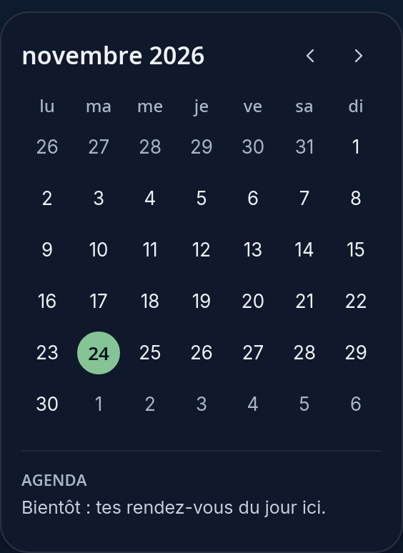
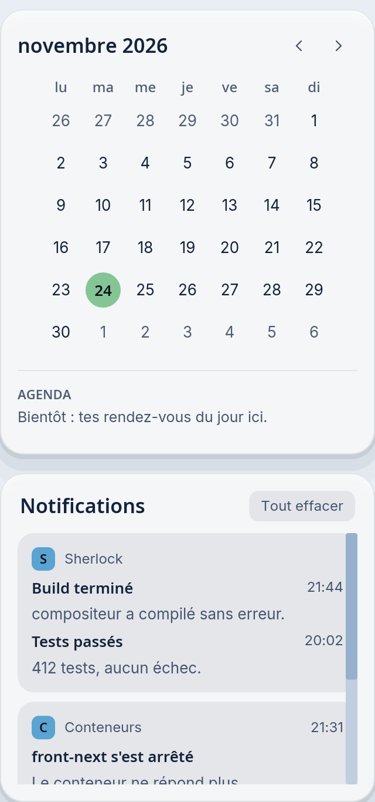

From `cargo test -p bar --test render`, at scale 2, in software: November 2026 on the board's
date over the board's three applications (with a second Sherlock notification), and the board's
quick settings.

### Animations (D-20c)

The motion of the dock and of the attached bar, with the springs of `sherlock_ui::motion`; the
values are in `sherlock_ui::panels`.

- **Opening**: the panel unfolds from the end of the bar, from 96 % of its size around its top
  right corner and 8 higher, on the spring of an opening window (`OPEN_SPRING`), and fades in
  over a hover's 150 ms (`OPEN_FADE`).
- **Closing**: the same backwards, from where it is; the popup closes once it has faded out.
  Clicked again while it folds, the panel unfolds again in the same popup: a double click or a
  quick series of clicks never opens nor closes popups one after the other. Another panel, the
  Sherlock menu, or the compositor (a click on another client) close it at once.
- **A page that comes in**: the Wi-Fi networks slide in from 24 on the right and fade in, the
  main page comes back from the left the same way (`PAGE_SLIDE`).
- **Tiles**: switched on or off, a tile mixes its colors from one state to the other over 150 ms
  (`TILE_FADE`); the first state read shows at once.
- **Sliders**: the volume and the brightness follow the pointer at once, without a spring; the
  value goes to the service one call at a time.
- **Rest**: the bar asks for frames (`window::frames`) only while something moves; at rest it
  draws nothing.

**UI-01.** The author found that the animations « sortent un peu de la fenêtre ». The cause: a
page sliding in was drawn 24 to the side without being cut, over the panel's padding and border
and out of its glass, into the room for the shadow, where the surface's edge cut it short; and
the spring's 2 % overshoot scaled the panel a little past its size. Now:

- **Inside the glass.** A page that slides is cut to the glass of its panel
  (`animated::Reveal::clip_margin`, the panel's padding around it) while it moves; at rest
  nothing is cut, so the software renderer draws no mask. A panel unfolds on the spring's
  progress clamped at 1 (`Unfold::settled`): it never grows past its size.
- **Pages, both ways.** The page shown slides out the other way and fades while the new one
  comes in (`Unfold::leaving_page`), to the Wi-Fi networks or the Bluetooth devices and back. The
  page going out takes no input and no focus (`Reveal::inert`). At rest an empty layer keeps its
  place, so the page shown keeps its scroll and its field.
- **From the control centre to the calendar and back.** On the GPU both panels share one
  popup the size of both (`panel::room`), the panel at its top right, the input region the panel
  shown. Clicking the clock while the control centre is open turns it into the calendar in the
  same popup: the control centre slides out by 12 (`panels::SWITCH_SLIDE`, the room before the
  screen's edge) and fades, the calendar comes in from the other side, from the right going
  towards the clock, from the left going towards the indicators, as they sit in the bar; and a
  mask goes from the height of one to the other's (`Reveal::clip_height`): the height changes on
  the spring. The mask cuts below only, the room for the shadow under it kept: a panel sliding
  sideways keeps its edges, its corners and its shadow. In software each panel keeps a popup of its own size, black around it, and the
  other replaces it at once.
- **The Sherlock menu** unfolds from its top left corner and folds back like the panels, on
  the GPU; a panel opening takes it away at once, so that only one popup holds the grab.

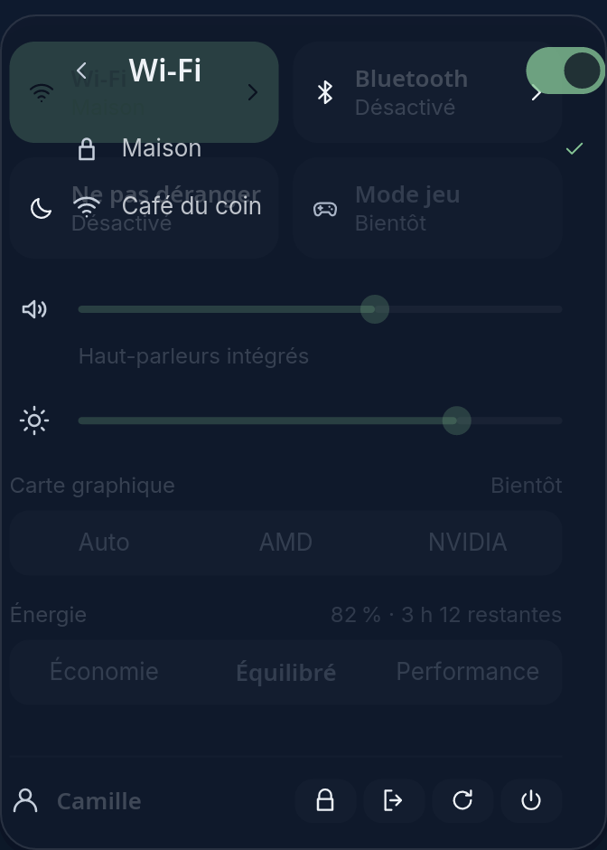
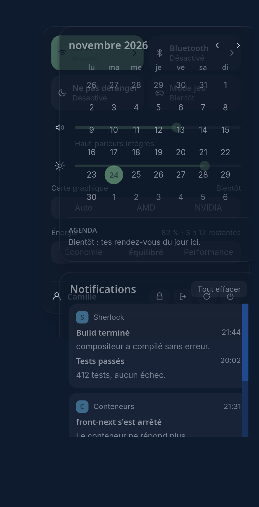

**UI-06.** A click elsewhere closes a panel, the Sherlock menu or an application's menu
through the compositor (`popup_done`), and iced_exwlshell then destroys the popup at once: the
bar cannot fold it back. The compositor keeps its last image and fades it out, slightly
shrunk, over 150 ms (`docs/compositor.md`, "Menus and panels of the shell"); the same when the
bar drops one popup at once to open another (a panel in place of the Sherlock menu). The
steps of that closing, from `the_panels_close_with_their_last_image` (`tests/render.rs`):

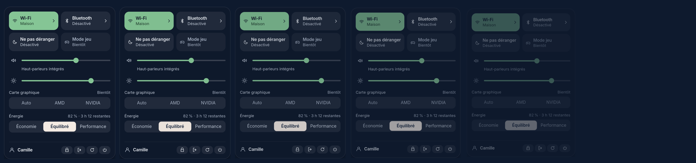
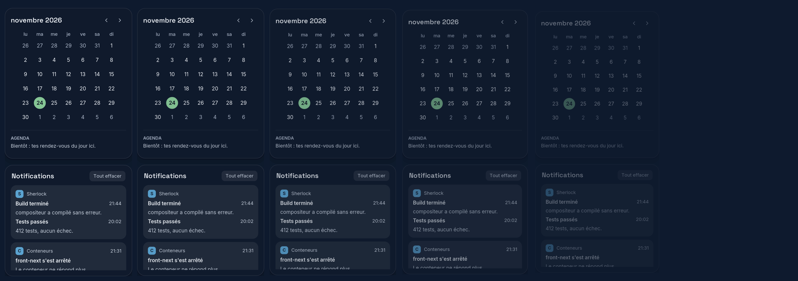

**UI-04.** The icons fade with the panel (see « Icons that fade » in `docs/sherlock-ui.md`), and
the control centre leaves out the row of the keyboard backlight on a machine without one: the
panel opens shorter by that row (`panel::reserve_keyboard`, from the last read of the
backlight), instead of keeping it empty. A backlight found while the panel is open shows the
next time it opens.

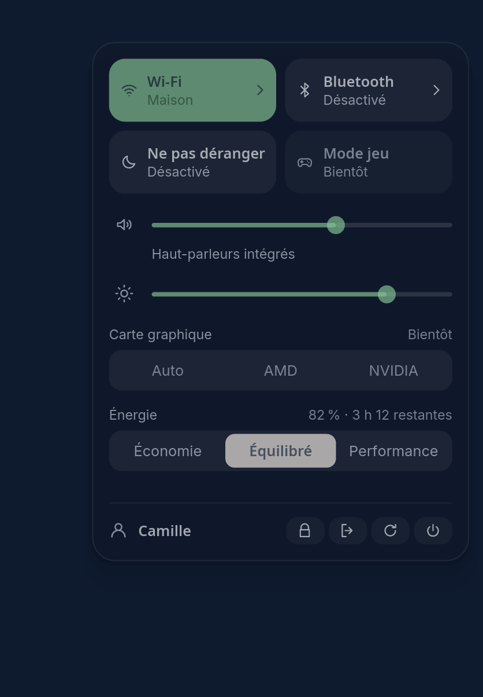

iced 0.14 has no opacity for a group of widgets: `sherlock_ui::color::with_opacity` multiplies
the opacity of every color given to iced on the thread, the panel view is built inside it, and
`animated::Reveal` draws its content inside it, with a transformation for the offset and the
scale. Only on the GPU: in software the surface around the panel is black, and a panel fading in
from black looks worse than one shown at once, so there it opens and closes at once. Pages and
tiles move in both.

## Running and checking by hand

On the author's machine (Plasma X11), in a nested KWin Wayland:

```sh
cargo build -p bar
kwin_wayland --x11-display :0 --width 1440 --height 900 --socket wayland-bar &
WAYLAND_DISPLAY=wayland-bar BAR_WORKSPACES="Code,Web,Jeu" BAR_APP="Éditeur" target/debug/bar
```

The bar chooses its renderer itself (`sherlock_ui::gpu`, see `docs/sherlock-ui.md`) and logs
it at start: `renderer=Vulkan { manifests: [...] }` on the reference laptop. Logs go to standard
error; `RUST_LOG=bar=debug` shows more.

1. **Anchoring**: the bar floats 10 from the top and 12 from the sides, across the whole width.
2. **Exclusive zone**: open a window in the nested KWin and maximize it. It must start below
   the bar without covering it. To open a window there without it being handed to the main
   session over D-Bus:
   `WAYLAND_DISPLAY=wayland-bar QT_QPA_PLATFORM=wayland DBUS_SESSION_BUS_ADDRESS=unix:path=/nonexistent kwrite`.
3. **Real data**: the machine's time and date, the network icon (crossed out when Wi-Fi is
   off), the sound (crossed out when muted), the battery and its percentage. Mute the sound
   (`pactl set-sink-mute @DEFAULT_SINK@ toggle`) or unplug the charger: the bar should follow
   right away.
4. **Menu**: click the Sherlock button. The menu opens below it, the button gets a light
   veil. Down, Up, Enter, Escape. « Réglages » opens Control Room; « Éteindre » asks for a
   second click. A click elsewhere closes the menu.
5. **Keyboard in the bar**: click into the bar (on its background, between the buttons), then
   Tab. The first Tab rings the Sherlock button; each Tab moves the ring to the next workspace,
   then back to Sherlock. Enter activates exactly the ringed button: the menu opens on
   Sherlock, a workspace logs `index=<n>` matching the ringed chip (`index=0` for « 1 · Code »).
   Escape or a mouse click removes the ring.
6. **No orphans**: stop the bar (Ctrl+C, `kill`, or stop the nested KWin), then
   `ps -eo pid,args | grep -E 'upower --monitor|nmcli monitor|pactl subscribe'` lists nothing
   started by the bar.

Comparing with the design boards, by eye or on the screenshots:

- Open `docs/design/planches/Main.dc.html` alongside. Compare: glass `rgba(16,26,44,0.78)`,
  border `rgba(255,255,255,0.09)`, radius 12, inner padding 6 on the left and 10 on the right,
  Sherlock button of 30 by 28 with radius 8 (color logo, see Logo), application name at weight 600, workspace chips 24
  high with radius 12 (active one green, text `#0B1220` at weight 600; the others
  `rgba(255,255,255,0.07)`, text `#C5CEDB`), 4 between them, indicators in `#C5CEDB` 14 apart,
  16 px icons, time in `#EEF2F7` at weight 600.
- Open `Menus.dc.html`: menu 256 wide at (18, 52), padding 6, header with an avatar of 40
  (the logo in its square), separators, chevron on « Éteindre ».
- Pixel measurements: `cargo test -p bar --test render` writes `target/tmp/bar-tiny-skia.png`
  and `target/tmp/sherlock-menu-tiny-skia.png`, then `bar-light-tiny-skia.png` and
  `sherlock-menu-light-tiny-skia.png` in the light theme, at scale 2, from fake sources (the
  date and time of the board). Compare the light ones with `MainClair.dc.html` and
  `MenusClair.dc.html`.

## Theme

The bar reads the theme of the appearance file before its first frame, then follows the file
live (`docs/appearance.md`) and fades from one theme to the other (`color::ThemeFade`, see "Following the theme" in `docs/sherlock-ui.md`). In the light
theme the logo of the Sherlock button takes a dark green ring and a night blue dot, which show
on the light glass.

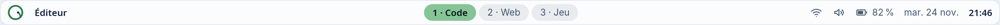
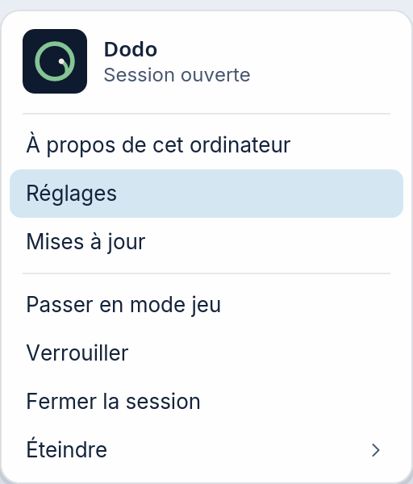

Screenshots and test input never go to the author's session (`:0`). Run the nested KWin
inside a Xephyr display started for the test, and work on that display only:

```sh
Xephyr :5 -screen 1440x900 -br -nolisten tcp &
DISPLAY=:5 kwin_wayland --x11-display :5 --width 1440 --height 900 --socket wayland-bar &
WAYLAND_DISPLAY=wayland-bar USER=Camille BAR_WORKSPACES="Code,Web,Jeu" BAR_APP="Éditeur" target/debug/bar &
DISPLAY=:5 import -window root screenshot.png
```

Clicks and keys for a test (XTest) go to `:5` only, after checking the display name.

## Tests

`just verify` runs everything, without a screen:

- **Clock**: fields of a `struct tm` to the date and time of the board (« mar. 24 nov. »,
  « 21:46 »), Sunday, leading zeros, fields out of range; the local time of a known instant;
  formats of `sherlock_ui::strings`.
- **Theme**: `Theme=light` written in a temporary appearance file reaches the bar, which fades
  to the light palette over the frames, without restarting.
- **Battery, network, sound**: parsing of the recorded and rewritten outputs in `fixtures/`.
- **Sources**: `watch` only sends changes; `Fixed` yields its state once.
- **Placeholder workspaces** and **user name**; the group and the cover of each screen.
- **Shell protocols** (`tests/shell.rs`): a fake compositor with three workspaces, two
  screens, two windows (one active and maximized on `eDP-1`, one on workspace 3), driven by
  commands from the test: the list, names, active and empty workspaces, the active window's
  title; the bar attached on `eDP-1` and floating on `DP-1`; a click names the workspace,
  `activate` then `commit` reach the compositor, the bar sees the switch, floats again and
  loses the title of a window left on another workspace. A half batch of either protocol is
  not read while the other one ends a batch; a window that closes, a workspace removed, a
  compositor that goes. Without the protocols, the placeholder; a shell socket that appears
  after start is picked up. Every wait fails the test after 5 s instead of hanging.
- **Shape** (`shape.rs`): both geometries and their reserved height (46, 36), the clipped
  overshoot, the spring there and back, turned back halfway without a jump.
- **Menu**: keyboard walk, activation, Escape, closing by the compositor, surface size from the
  board.
- **Sherlock menu entries** (D-36d, `app.rs`, programs and session commands recorded, never
  run): « Réglages » and « À propos » start `control-room`; « Verrouiller » runs `Lock` at once;
  « Fermer la session » and « Éteindre » arm on the first click, ignore a double click, run once
  on a later click, and Escape disarms; « Mises à jour » and « Passer en mode jeu » do nothing,
  say « Bientôt » and take no highlight. From « Fichier » to « Édition » under the pointer
  (`tests/global_menu.rs`), « Fichier » stays while « Édition » is read, which then shows at its
  size with its entries, both buttons keeping their labels.
- **Bar focus**: the first Tab already rings Sherlock; the ringed button is the one Enter
  activates, Tab after Tab; Escape clears the ring.
- **Global menu** (`tests/dbusmenu.rs`, `tests/global_menu.rs`, D-36b): a fake application on
  a private bus exports Kate's « Fichier » and « Affichage »: the tree read (labels without
  mnemonics, separators, a disabled submenu, « Ctrl+T, O », a check mark), `AboutToShow` before
  the menu opens, a disabled entry doing nothing, the click on « Nouveau » reaching the
  application as `Event` « clicked »; `LayoutUpdated` heard; an application that never answers
  gives up within the limit and leaves the name alone. The menus follow the active window, a
  late answer of the previous one dropped; the pointer and the keys from menu to menu; the
  captures in both themes at 1920 × 1080 and 1366 × 768, every menu in the bar at 1920 and
  « » » at 1366. In `global_menu.rs`, the placement and « » », the cursor, the width and height
  of a menu; in `names.rs`, the application name from its `app_id`.
- **Notification area** (`tests/tray.rs`, D-45): a fake application on a private bus (its own
  `dbus-daemon`, never the user's bus) registers its item by name: it reaches the bar, with its
  tooltip without markup and its pixels for an icon name found nowhere; the chevron shows, the
  popup opens, a click on its cell gives `TrayClick`, and what it sends reaches the application as
  `Activate`, the wheel as `Scroll -120 vertical`; `NewStatus` to `NeedsAttention` is read again and
  the chevron gets its dot; the application leaving the bus takes its item away, and the chevron
  with it. With another watcher on the bus, the bar registers there as a host and gets the item.
  The captures in both themes at 1920 × 1080 and 1366 × 768, the popup under the chevron. In
  `tray/`: a pixmap from ARGB in network order to RGBA, the pixmap chosen by size, an item by name
  or by path, the properties and the tooltip, the folder of the application before the theme
  before the pixels, a symbolic icon. In `app/tray.rs`: no chevron without an icon to show, Tab
  and Enter, the popup unfolding, folding, Escape, a click elsewhere, a panel taking its place,
  opening again at a new size, and an icon breathing three times then resting. In `sherlock-ui`:
  the size of the popup, the breath, and a symbolic icon tinted with its alpha kept. D-45a, in
  `tests/tray.rs`: a right click opens the item's menu read from the fake application, and a
  click on « Quitter » reaches it as `Event` « clicked »; the captures of the VPN's menu with an
  icon kept in the bar. In `tray/pins.rs`: a drop pinning, moving and unpinning, and the file
  read just before it is written, its other lines kept. In `app/pins.rs`: an icon dragged from
  the popup onto the bar, shown where it lands, kept, and its release not taken for a click; an
  icon of the bar changing place, then going back into the popup; a press without a move left to
  the button; the menu under the second cell, opened once read, Escape closing it then the
  popup, and an item that only has a menu opening it on a left click.
- **Registrar** (`tests/registrar.rs`): on a private bus (its own `dbus-daemon`, never the
  user's bus), `RegisterWindow` answered in under 50 ms (the best of five) and passed on with
  the caller's process and bus name, `GetMenuForWindow`; a second registrar leaves the name to
  the first and passes nothing on; two menus under the id 1, `UnregisterWindow(1)` withdraws
  only the one no longer exported, and the connection leaving the bus withdraws the other.
- **Children** (`tests/children.rs`): no monitoring command survives the bar, after SIGTERM or
  SIGKILL.
- **Bursts**: a burst of monitor lines gives a single refresh.
- **Rendering** (`tests/render.rs`): headless screenshot of the bar and the menu, and of the
  attached bar (`bar-attached`, `bar-attached-light`), expected texts, a click on a workspace
  and on a menu entry yields the right message. The calendar over the notification centre and
  the control centre in both themes, full and empty; the battery at 5, 50 and 100 %, charging,
  plugged in and low; a click on the indicators or the clock, on a month arrow, on an action
  and on « Tout effacer ».
- **Panel motions** (UI-01): in `app.rs`, the control centre turning into the calendar and back
  in the same popup on the GPU, then at rest, and a popup of its own in software; the menu
  folding back before it closes, unfolding again when clicked meanwhile, and gone at once when a
  panel opens. In `unfold.rs`, the panel never past its size. In `sherlock-ui`, a moving page cut
  to its glass and a mask cut to its height. Captures `page-sliding` and `panels-switching`.
- **Clicks and rest** (`app.rs`): twelve quick clicks on the indicators keep one popup, turned
  back and forth, closed once after it has faded out, then no frame; a late close of an old
  popup changes nothing; in software each click opens or closes at once. A notification
  service that is not ours (Plasma's, `UnknownObject`) leaves the centre unavailable without
  reading again. In `unfold.rs`, the progress of a panel unfolding, folding from where it is,
  and resting; in `quick.rs`, a tile's colors mixing then resting, the page sliding in, and a
  burst of fifty changes giving two reads; in `bus.rs`, a burst of signals coalesced.
- **Calendar** (`calendar.rs`): leap years (2000, 1900, 2028), weekdays of known dates, months
  across years, the grid of November and December 2026 and of February 2027 and 2028.
- **Panels** (`panel.rs`): both panels land at 54, their right edge at 1428, with and without
  their shadow, and 12 from the edge under an attached bar; the time of a notification.
- **Quick settings** (`tests/quick.rs`): fake NetworkManager, BlueZ, logind and
  power-profiles-daemon on a private bus started by the test, never the system bus: the Wi-Fi
  read (devices, networks merged by name, security), switched, a saved network joined, a new
  one only with its password; Bluetooth read and switched, an adapter missing; the backlight
  chosen by kind, set through logind, never below 1 %; the profiles under the older name of
  the daemon, without performance; each service refusing (polkit's `AccessDenied`) and absent;
  a `StateChanged` of NetworkManager reaching the bar. A fake `pactl` for the sound. In
  `quick.rs`: a held slider that does not jump under a change made elsewhere, the keyboard row
  only with a keyboard backlight, a fake `pactl subscribe` and a fake sysfs followed
  (`quick::local`), the slider throttle, the session rules (lock at once, a second click too soon,
  cancelled, confirmed), Do not disturb written to a temporary file, a refusal under its tile.
  In `tests/render.rs`: the clicks on the tiles, a profile, and nothing from the game mode or
  the graphics card.
- **Bluetooth** (`tests/bluetooth.rs`): a fake BlueZ on a private bus (its own `dbus-daemon`,
  never the system bus) with fictitious devices: the list, paired first, kinds, battery, an
  unnamed device left out; connecting and disconnecting; a scan started and stopped; a pairing
  confirmed (paired, trusted, connected) and one cancelled, the agent registered for each
  pairing only; another client of the bus calling the agent, BlueZ asking about another device,
  `AuthorizeService` and `RequestAuthorization`, all rejected; the panel closing during a
  pairing, which cancels it and unregisters the agent; a device that never answers `Pair`, failing within the time limit; a device
  forgotten; BlueZ absent. In `quick.rs`, the scan while the list is open and stopped when it
  or the panel closes, one device at a time, the agent's question answered by the click, a
  refusal shown, « Oublier » asking first.
- **Notification centre** (`tests/history.rs`): the real daemon on a private bus: the history
  listed and grouped, `Changed` after each notification, an action run from the centre, « Tout
  effacer », and a bus without the daemon.
- **Contrast** (`sherlock-ui`): bar texts and workspace chips (active, occupied, empty), on
  the bar over the desktop and its three discs, and on the opaque attached bar.

## Differences from the design board

- **Sherlock button**: the board puts the mascot's head on a cream pill, with a green ring
  while the menu is open. The bar shows the color logo without a pill (the cream dot would
  vanish on cream), and a light veil while the menu is open (a green ring would merge with the
  green logo). The menu avatar is the logo in its square instead of the mascot on cream (see
  Logo).
- **Application menus** (« Fichier », « Édition »…): since D-36, those of the active application,
  Qt and KDE ones first (see « Global menu »). The board shows them without « » »: it only
  appears when they do not fit.
- **Containers and sandboxes**: the board shows them on the right. They will come with the L
  batches.
- **Battery**: no board draws it. Line icon like the others, percentage next to it, amber below
  15 % while discharging.
- **User name**: the board shows a sample name. The bar reads the user's GECOS, otherwise the login.
- **Shortcuts**: the board shows Super+, Super+G and Super+L in the menu. Nothing binds them
  yet, so they are not shown.
- **Updates**: the board shows a « 3 » badge. No source gives that number: no badge.
- **« Éteindre »**: the board announces a submenu that it does not draw. The chevron is there; the
  entry is logged like the others.
- **Blur and shadows**: the glass is only a translucent tint; blur is the compositor's job.
  On the GPU, the menu surface is enlarged to hold the board's shadow (`0 22px 54px`), cut on
  the left where the screen ends; a click on the shadow closes the menu. In software the
  surface is opaque and the menu has no shadow.
- **Animations**: the menu opens at once. The hovers and presses of the bar buttons fade
  (UI-01); the panels unfold since D-20c (see Animations).
- **Screen reader labels**: iced 0.14 exposes nothing. The tooltips of `icon_button` do not fit
  in a 36 high surface: the indicators have none.
- **Background**: the nested KWin has no wallpaper; the bar shows over black there.
- **Panels** (D-20b): the notification centre is as high as the quick settings and its list
  scrolls; the board's centre is only as high as its cards. A card per application, not per
  notification. The board's « Réglages » button of the user row is not there (Control Room
  does not exist yet); « Se déconnecter » and « Redémarrer » are added. The Wi-Fi tile has a
  chevron for the network list, which no board draws, nor the calendar. « Carte graphique »
  shows no active choice, since none exists yet.
- **Panels** (D-20c): the notification centre moved from the side of the quick settings to
  under the calendar, as the author asked, as on a Mac.

## GPU rendering (D-02)

On the GPU, the surface has alpha: the bar floats with its rounded corners and its translucent
glass over the desktop. In software (no AMD chip, or a compositor without `linux-dmabuf`, such as
ours for now), it stays opaque with black corners. Since D-02 the menu surface is placed by the
centre of its top edge (anchor and gravity `Bottom`), so that its shadow can start left of and
above the bar surface; the menu itself stays at (18, 52) of the Menus board, which a test checks
with and without the shadow. Its input region is the menu alone: the room for the shadow lies
over the bar, whose buttons stay reachable through it.


The bar above, rendered by RADV in a headless KWin (`kwin_wayland --virtual`, 1440 × 900) over
the `backdrop` example: floating, rounded corners, and the glass lets the disc through. Over the
disc `(22, 49, 79)` the bar reads `(17, 31, 51)`, the board's `rgba(16,26,44,0.78)` laid over it.

The menu with its blurred shadow, in the surface the GPU gets, is rendered by the
`sherlock-menu-shadow` capture of `tests/render.rs` (headless render by wgpu on RADV with
`ICED_TEST_BACKEND=wgpu` and the variables of ADR 0018). No input could be sent to the headless
KWin to open it there.

`cargo run -p bar --example backdrop` lays the Main board's desktop background (colour and three
discs) on the background layer: a nested KWin has no wallpaper, and the translucent glass only
shows against one.

## What this batch does not do

- The application name from its `.desktop` file came with D-36.
- The Sherlock menu's game mode and updates, and a page « À propos » in Control Room.
- The game mode and the choice of the graphics card: their tiles wait for their batches.
- The notification area: the X11 tray waits for D-45b (see « The X11 tray »). A drag shows
  nothing under the pointer between the popup and the bar (no drag icon: `iced_exwlshell` has no
  Wayland drag and drop). When Plasma's watcher, whose
  host the bar is, restarts, the bar does not register again before it restarts too.
- Bluetooth: the first adapter only; no file transfer, no audio profile choice.
- Several outputs: the bar opens on the active output (`StartMode::Active`). Its shape
  already follows that screen alone; a bar on every screen needs the menu to open on the
  surface that was clicked.
- A real session: the bar only ran in a nested KWin. Our compositor supports layer-shell in
  batch D-12.
