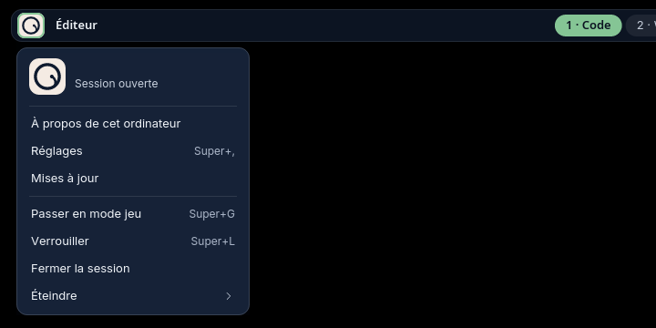
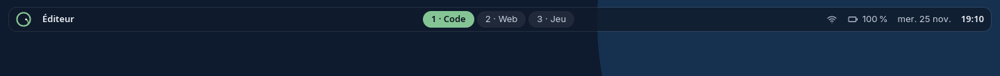
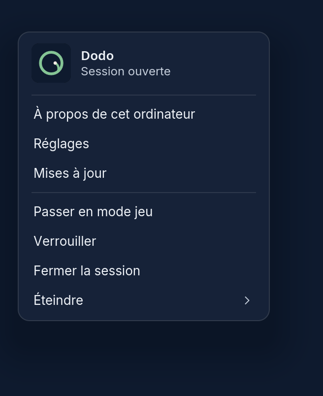

# Top bar

`desktop/bar` is the desktop's top bar: a separate program, anchored at the top of the screen
with layer-shell (ADR 0005), written with iced 0.14 (ADR 0014), rendered by the GPU of the AMD
chip, or in software without one (ADR 0018). Batch D-20 builds it from the `Main.dc.html` design
board and, for the Sherlock menu, `Menus.dc.html`. The crate, the binary and the layer-shell
namespace are all `bar`. The texts it shows stay in French, from `sherlock-ui`.




Both screenshots come from a nested KWin running inside a Xephyr display started for the test,
with `USER=Dodo` so that no login name of the machine shows (see « Running and checking by
hand »).

### Logo

The Sherlock button shows the color logo, without its square: green ring `#85C595` and cream
dot `#F4EBE3` (`logo-transparent.svg`), 22 px high, straight on the bar glass. The button has no
fill at rest, the hover and press veils of the other ghost buttons, and while its menu is open
the 0.14 white veil of the open « Fenêtre » button of the Menus board (`TOP_BAR_BUTTON_OPEN`). A
cream pill would hide the cream dot, so the button has none.

The menu avatar is the color logo in its night blue square, 40 px: `Logo::square(40)` picks the
large version. `Logo::square` has optical versions for 32 and 16 px; the bare symbol has none,
since it fills its frame and reads at 16 px (D-01). On the bar, the bare symbol is the more
legible one: the night blue square disappears into the glass and only shrinks the ring.

Contrast of the green ring, a non-text element (3 to 1 required), on the bar glass over the
desktop and its three discs: 7.9 to 8.6 at rest, 6.5 to 7.1 under the hover veil, 5.1 to 5.7
under the open veil. The contrast test of `sherlock-ui` checks it in every state. The cream dot
is at 8.8 or more.

## What it shows

| Place | Content | Source |
| --- | --- | --- |
| Left | Sherlock button, which opens the Sherlock menu as an `xdg_popup` | |
| Left | Title of the active window | `sherlock_shell_v1` (see Workspaces) |
| Center | The workspaces of its screen, the active one in green, the empty ones bare | `ext-workspace-v1`, `sherlock_shell_v1` |
| Right | Network, sound, battery and its percentage | NetworkManager, PulseAudio or PipeWire, UPower |
| Right | Short date and time, in French | Local clock |

An indicator that has not been read yet is not shown. Without a battery, the battery
indicator disappears. A battery discharging below 15 % turns amber.

## Architecture

| Module | Role |
| --- | --- |
| `lib.rs` | Layer-shell surface and iced settings, startup (`run`) |
| `app.rs` | State (`Bar`), messages, update, bar view and menu view |
| `menu.rs` | Sherlock menu entries, size of its surface, keyboard keys |
| `shape.rs` | The two forms of the bar, floating and attached, and the spring between them |
| `source/` | One source per piece of system data, behind the `Source` trait |
| `user.rs` | User name, read from the GECOS field of `/etc/passwd` |

Every color, size and text comes from `sherlock-ui`: tokens `TOP_BAR_*`, `CHIP*`,
`SHERLOCK_*`, `STATUS_*`, `MENU_AVATAR`, `MENU_HEADER_PADDING`; components `chip`,
`sherlock_button`, `status`, `menu_header`, `logo`, `logo_square`; the `strings` text module; icons
`NetworkOff`, `SoundMuted`, `Battery` and `BatteryCharging`. The only threshold written in the
bar is the low battery one (`battery::LOW_PERCENT`), which is behavior.

### Surface

The layer-shell surface is anchored to the top, left and right, on the `Top` layer, 36 high
with margins of 10 at the top and 12 on the sides, which change when it attaches to the top
edge (see « Attached to the top edge »). It declares an exclusive zone of 36. It gets
the keyboard on demand (`OnDemand`): only when clicking into the bar or its menu. Protocol log
taken in the nested KWin (`WAYLAND_DEBUG=client`):

```text
zwlr_layer_surface_v1#29.set_anchor(13)
zwlr_layer_surface_v1#29.set_keyboard_interactivity(2)
zwlr_layer_surface_v1#29.set_size(0, 36)
zwlr_layer_surface_v1#29.set_exclusive_zone(36)
zwlr_layer_surface_v1#29.set_margin(10, 12, 0, 12)
zwlr_layer_surface_v1#29.configure(101, 1416, 36)
```

The Sherlock menu is an `xdg_popup` attached to the bar surface, anchored below the Sherlock
button. Its surface is 256 wide and starts 6 below the bar: the Menus board puts it at
(18, 52), and that is where it shows. The compositor closes it on a click elsewhere.

### Layer-shell crate: `iced_exwlshell` 0.21.4

The brief asked to try `iced_exwlshell` 0.21, never tried by D-00, before falling back to
`iced_layershell` 0.19.1. Version 0.21.4 works at the first try with iced 0.14.0 and tiny-skia;
the bar keeps it, pinned. What we learnt:

- It is declared with `default-features = false, features = ["macros"]`. The default
  `linux-theme-detection` feature pulls `mundy` to read the system theme: useless here, our
  theme comes from `sherlock-ui`.
- It pulls `winit-core` and `winit-common` 0.31.0-beta.4 and builds with them: the
  `iced_exdevtools` 0.19.1 breakage noted by D-00 is gone. It also pulls `iced_devtools` and
  `iced_exdevtools`, even without its `debug` feature.
- It does not pull wgpu: `iced_renderer` comes without default features, so the renderer stays
  the one `sherlock-ui` enables (tiny-skia only). The NVIDIA card is not woken up.
- API changes since 0.19: `ExWlSettings` replaces `Settings` (passed with `.wl_settings(..)`,
  iced's own settings with `.settings(..)`); `LayerSize::fill_width(36)` replaces
  `size: Some((0, 36))`; `Margin { top, right, bottom, left }` replaces the tuple; the macro is
  still `#[to_layer_message(multi)]` for a program with several surfaces.
- `IcedNewPopupSettings::new(parent, size, anchor position, anchor size)` places a popup;
  `.anchor(..)` and `.gravity(..)` tune it.
- `.on_new_shell(..)` reports each created surface with its type: the bar learns its own surface
  id this way, where the D-00 prototype guessed it at the first `view`.
- It can ask the compositor for a blur (`BlurOption`), but only on rectangles: the rounded
  corners of the bar would show a square blur. The bar does not use it.
- It offers `.redraw_scope(..)` to skip redraws on some messages. Not used: the bar already only
  gets a message when a value changes.

## Sources

Each piece of data comes from a source implementing the `source::Source` trait:

```rust
pub trait Source: Send + 'static {
    type State: Clone + PartialEq + Send + Debug + 'static;
    fn read(&mut self) -> Result<Self::State, SourceError>; // reads the current state
    fn wait(&mut self) -> bool; // waits until it may have changed, false if it never will
}
```

`source::watch` runs a source on its own thread and turns it into a stream for an iced
subscription. It only sends a state when it changed: the bar does not redraw for nothing.
`source::Fixed` is the fake implementation used by tests, a state that never changes.

| Source | Read | Watch | Parsing tested on |
| --- | --- | --- | --- |
| `SystemClock` | `localtime_r`, once a minute | The thread looks at the clock every 5 s at most, to catch up after a suspend | Fields of a C `struct tm` |
| `UPower` | `upower -i /org/freedesktop/UPower/devices/DisplayDevice` | `upower --monitor` | `fixtures/upower-*.txt` |
| `NetworkManager` | `nmcli -t -f TYPE,STATE,CONNECTION device` | `nmcli monitor` | `fixtures/nmcli-*.txt` |
| `Pactl` | `pactl get-sink-volume` and `get-sink-mute` on `@DEFAULT_SINK@` | `pactl subscribe`, lines about an output or the server | `fixtures/pactl-*.txt` |
| `shell::Auto` | `ext-workspace-v1` and `sherlock_shell_v1` on the shell socket, or `Placeholder` | The protocol events | Fake compositor (`tests/shell.rs`) |
| `Placeholder` | Variables `BAR_WORKSPACES` and `BAR_APP` | None | Module tests |

Commands run with `LC_ALL=C`, for an output that does not depend on the language. A watch
command that stops is restarted 30 s later. A burst of watch lines (a volume slider being
dragged, a network reconnecting) gives a single refresh: the lines that follow within
`metrics::EVENT_COALESCE_MS` (150 ms) of each other are drained before reading again, for
`metrics::EVENT_COALESCE_MAX_MS` (500 ms) at most, so that a long drag still refreshes. When the
bar stops, the monitors stop quietly and are not restarted. A read
error, such as an `upower` output without a battery section, is logged as a warning once, until
the source reads fine again. The `upower-full.txt`, `nmcli-wifi.txt` and `pactl-55.txt` outputs
were recorded on the reference laptop, with the Wi-Fi name and the Docker bridge ids replaced by
neutral values; the others are rewritten from them by hand (battery at 12 % discharging, sound
muted, Ethernet, network off).

**The commands die with the bar.** Each command is started with `PR_SET_PDEATHSIG` set to
SIGTERM in `pre_exec`: the kernel kills it as soon as the thread that started it ends, and so
whatever way the bar ends (normal exit, `Error during dispatch` when the compositor goes away,
SIGTERM, SIGINT, SIGKILL, panic). The child checks `getppid` right after `prctl`, for the case
where the bar died in between. On top of that, `source::shutdown` stops the monitors still
registered when `run` returns. `tests/children.rs` runs the real sources in a helper process
with fake `upower`, `nmcli` and `pactl` in the `PATH`, kills it with SIGTERM then SIGKILL, and
checks that no fake monitor survives; it fails when `prctl` is removed. This needs `libc`
(`=0.2.191`, already in the lock through iced).

**Why commands and not D-Bus.** The brief allowed `zbus`. The machine's commands are enough,
add no dependency, and can be tested on recorded outputs. Their watch mode reports changes:
nothing polls. Sound is not on D-Bus with PipeWire anyway. If the OS does not ship these
commands, a D-Bus source will implement the same trait.

**The clock reads the C library.** The standard library does not know the time zone, and the
brief does not allow `chrono`. Since D-05b the clock calls `localtime_r` (`libc`, already
pinned), once a minute, instead of starting `date`, through `appearance_config::local`, where
`mktime` first re-reads the time zone. Time zones being offset by whole minutes, the local minute changes at the
same time as the UTC minute, which the thread watches without reading anything.

The OS network service is not chosen yet (batch S-13): `NetworkManager` is the source of the
development machine, another one will replace it if needed.

### Workspaces and active application

Our compositor publishes both on its shell socket, next to the session's Wayland socket
(`wayland-1-shell` for `wayland-1`, ADR 0021). `source::shell` opens a connection of its own
there (`shell_protocol::socket_from_env`), on the source's thread, and binds:

- **`ext-workspace-v1`**: the groups and the screens they hold, each workspace with its `id`,
  `name`, `coordinates` (its order) and `active` state. The bar shows the group holding the
  screen it sits on, the first group when it does not know its screen yet. Workspaces are
  shared by every screen for now: a single group.
- **`sherlock_shell_v1`**: the windows, with their workspace and states, and per screen the
  `output` state (a maximized or fullscreen window is on it). A workspace with no window has a
  bare chip, without the veil; minimized windows count. The name on the left is the title of
  the `activated` window, its `app_id` when it has no title, cut where the left half of the
  bar ends.

A click on a workspace (or Enter on its ringed chip) sends `activate` then `commit`, on a
second connection of its own, so the watching one stays blocked on its events: the bar
changes when the compositor says the workspace changed, not before. The active workspace
does nothing. A workspace named after its number shows the number alone.

The bar's own screen comes from iced_exwlshell (`shell_broadcast`, `WindowOutputChanged`): the
`wl_output` name of its surface, the name both protocols use.

**Elsewhere** (Plasma, another compositor, no shell socket), the bar logs it once at start,
`placeholder workspaces, no active application`, with the reason, and keeps the
`Placeholder` source: three numbered workspaces, the first one active, all veiled, no active
application, the bar always floating. A click is logged. The two variables force the
placeholder even on our compositor, to compare with the design board:

```sh
BAR_WORKSPACES="Code,Web,Jeu" BAR_APP="Éditeur" cargo run -p bar
```

## Attached to the top edge

While a maximized or fullscreen window is on its screen (the `output` state of
`sherlock_shell_v1`, windows of the active workspace only), the bar leaves its floating pill
for a band along the top edge: margins 0, the whole width, square corners, and the bar's glass
made opaque, its border gone (`theme::top_bar_shaped`). It floats again when no maximized
window is left there. A bar decides from its own screen only: a maximized window on another
screen leaves it floating.


The change follows `motion::TOP_BAR_SPRING`, the spring of a window being maximized
(`shape::Shape`, from 0 floating to 1 attached): margins, radius, opacity and border move
together, frame by frame, and a change of mind halfway turns back from where the bar is. The
overshoot of the spring is clipped, so the bar never leaves the screen nor goes below the pill.

**Exclusive zone.** The compositor keeps clear the exclusive zone plus the top margin: 46
floating, 36 attached. The surface keeps an exclusive zone of 36 and only its margins move,
one commit per whole pixel, at most a dozen in a transition: the room a maximized window gets
follows the bar. Changing the zone too would take a second commit per frame (iced_exwlshell
commits each change on its own), and between the two the compositor would reserve a height
that is neither the old one nor the new one.

## Sherlock menu

It has the entries of the Menus board: a header with the user name and « Session ouverte »,
then « À propos de cet ordinateur », « Réglages », « Mises à jour », « Passer en mode jeu »,
« Verrouiller », « Fermer la session », « Éteindre ». None of these actions exists yet: each
entry stays enabled, so it can be walked through, and activating it logs it and closes the
menu. Nothing is simulated.

Keyboard:

| Where | Key | Effect |
| --- | --- | --- |
| Bar | Tab, Shift+Tab | Moves between the buttons (Sherlock, workspaces), light blue ring, wrapping around |
| Bar | Enter, Space | Activates the ringed button: the Sherlock menu, or a workspace (logged) |
| Bar | Escape | Removes the ring |
| Menu | Down, Up, Tab, Shift+Tab | Highlights the next or previous entry, wrapping around |
| Menu | Home, End | First, last entry |
| Menu | Enter, Space | Activates the highlighted entry |
| Menu | Escape | Closes the menu |

Hovering with the pointer highlights an entry too: keyboard and pointer share the same cursor.

The bar keeps its keyboard focus in its own state (`Bar::focused`), like the menu cursor. The
ring is drawn from that value and Enter activates that value, in the same update. iced's focus
operations were tried first: under `iced_exwlshell` they are applied after the redraw, so the
ring stayed one Tab behind the real focus and Enter activated the next button.

The board also shows the shortcuts Super+, Super+G and Super+L in the menu. No compositor binds
them yet, so the menu does not show them.

## Running and checking by hand

On the author's machine (Plasma X11), in a nested KWin Wayland:

```sh
cargo build -p bar
kwin_wayland --x11-display :0 --width 1440 --height 900 --socket wayland-bar &
WAYLAND_DISPLAY=wayland-bar BAR_WORKSPACES="Code,Web,Jeu" BAR_APP="Éditeur" target/debug/bar
```

The bar chooses its renderer itself (`sherlock_ui::gpu`, see `docs/sherlock-ui.md`) and logs
it at start: `renderer=Vulkan { manifests: [...] }` on the reference laptop. Logs go to standard
error; `RUST_LOG=bar=debug` shows more.

1. **Anchoring**: the bar floats 10 from the top and 12 from the sides, across the whole width.
2. **Exclusive zone**: open a window in the nested KWin and maximize it. It must start below
   the bar without covering it. To open a window there without it being handed to the main
   session over D-Bus:
   `WAYLAND_DISPLAY=wayland-bar QT_QPA_PLATFORM=wayland DBUS_SESSION_BUS_ADDRESS=unix:path=/nonexistent kwrite`.
3. **Real data**: the machine's time and date, the network icon (crossed out when Wi-Fi is
   off), the sound (crossed out when muted), the battery and its percentage. Mute the sound
   (`pactl set-sink-mute @DEFAULT_SINK@ toggle`) or unplug the charger: the bar should follow
   right away.
4. **Menu**: click the Sherlock button. The menu opens below it, the button gets a light
   veil. Down, Up, Enter, Escape. An activated entry is logged:
   `Sherlock menu entry not available yet action=Lock`. A click elsewhere closes the menu.
5. **Keyboard in the bar**: click into the bar (on its background, between the buttons), then
   Tab. The first Tab rings the Sherlock button; each Tab moves the ring to the next workspace,
   then back to Sherlock. Enter activates exactly the ringed button: the menu opens on
   Sherlock, a workspace logs `index=<n>` matching the ringed chip (`index=0` for « 1 · Code »).
   Escape or a mouse click removes the ring.
6. **No orphans**: stop the bar (Ctrl+C, `kill`, or stop the nested KWin), then
   `ps -eo pid,args | grep -E 'upower --monitor|nmcli monitor|pactl subscribe'` lists nothing
   started by the bar.

Comparing with the design boards, by eye or on the screenshots:

- Open `docs/design/planches/Main.dc.html` alongside. Compare: glass `rgba(16,26,44,0.78)`,
  border `rgba(255,255,255,0.09)`, radius 12, inner padding 6 on the left and 10 on the right,
  Sherlock button of 30 by 28 with radius 8 (color logo, see Logo), application name at weight 600, workspace chips 24
  high with radius 12 (active one green, text `#0B1220` at weight 600; the others
  `rgba(255,255,255,0.07)`, text `#C5CEDB`), 4 between them, indicators in `#C5CEDB` 14 apart,
  16 px icons, time in `#EEF2F7` at weight 600.
- Open `Menus.dc.html`: menu 256 wide at (18, 52), padding 6, header with an avatar of 40
  (the logo in its square), separators, chevron on « Éteindre ».
- Pixel measurements: `cargo test -p bar --test render` writes `target/tmp/bar-tiny-skia.png`
  and `target/tmp/sherlock-menu-tiny-skia.png`, then `bar-light-tiny-skia.png` and
  `sherlock-menu-light-tiny-skia.png` in the light theme, at scale 2, from fake sources (the
  date and time of the board). Compare the light ones with `MainClair.dc.html` and
  `MenusClair.dc.html`.

## Theme

The bar reads the theme of the appearance file before its first frame, then follows the file
live (`docs/appearance.md`) and fades from one theme to the other (`color::ThemeFade`, see "Following the theme" in `docs/sherlock-ui.md`). In the light
theme the logo of the Sherlock button takes a dark green ring and a night blue dot, which show
on the light glass.


Screenshots and test input never go to the author's session (`:0`). Run the nested KWin
inside a Xephyr display started for the test, and work on that display only:

```sh
Xephyr :5 -screen 1440x900 -br -nolisten tcp &
DISPLAY=:5 kwin_wayland --x11-display :5 --width 1440 --height 900 --socket wayland-bar &
WAYLAND_DISPLAY=wayland-bar USER=Dodo BAR_WORKSPACES="Code,Web,Jeu" BAR_APP="Éditeur" target/debug/bar &
DISPLAY=:5 import -window root screenshot.png
```

Clicks and keys for a test (XTest) go to `:5` only, after checking the display name.

## Tests

`just verify` runs everything, without a screen:

- **Clock**: fields of a `struct tm` to the date and time of the board (« mar. 24 nov. »,
  « 21:46 »), Sunday, leading zeros, fields out of range; the local time of a known instant;
  formats of `sherlock_ui::strings`.
- **Theme**: `Theme=light` written in a temporary appearance file reaches the bar, which fades
  to the light palette over the frames, without restarting.
- **Battery, network, sound**: parsing of the recorded and rewritten outputs in `fixtures/`.
- **Sources**: `watch` only sends changes; `Fixed` yields its state once.
- **Placeholder workspaces** and **user name**; the group and the cover of each screen.
- **Shell protocols** (`tests/shell.rs`): a fake compositor with three workspaces, two
  screens, two windows (one active and maximized on `eDP-1`, one on workspace 3): the list,
  names, active and empty workspaces, the active window's title; the bar attached on `eDP-1`
  and floating on `DP-1`; a click names the workspace, `activate` then `commit` reach the
  compositor, the bar sees the switch and floats again; without the protocols, the
  placeholder.
- **Shape** (`shape.rs`): both geometries and their reserved height (46, 36), the clipped
  overshoot, the spring there and back, turned back halfway without a jump.
- **Menu**: keyboard walk, activation, Escape, closing by the compositor, surface size from the
  board.
- **Bar focus**: the first Tab already rings Sherlock; the ringed button is the one Enter
  activates, Tab after Tab; Escape clears the ring.
- **Children** (`tests/children.rs`): no monitoring command survives the bar, after SIGTERM or
  SIGKILL.
- **Bursts**: a burst of monitor lines gives a single refresh.
- **Rendering** (`tests/render.rs`): headless screenshot of the bar and the menu, and of the
  attached bar (`bar-attached`, `bar-attached-light`), expected texts, a click on a workspace
  and on a menu entry yields the right message.
- **Contrast** (`sherlock-ui`): bar texts and workspace chips (active, occupied, empty), on
  the bar over the desktop and its three discs, and on the opaque attached bar.

## Differences from the design board

- **Sherlock button**: the board puts the mascot's head on a cream pill, with a green ring
  while the menu is open. The bar shows the color logo without a pill (the cream dot would
  vanish on cream), and a light veil while the menu is open (a green ring would merge with the
  green logo). The menu avatar is the logo in its square instead of the mascot on cream (see
  Logo).
- **Application menus** (« Fichier », « Édition »…): the board shows them after the application name.
  They will come with the global menu of our applications, outside this batch.
- **Containers and sandboxes**: the board shows them on the right. They will come with the L
  batches.
- **Battery**: no board draws it. Line icon like the others, percentage next to it, amber below
  15 % while discharging.
- **User name**: the board says « Dodo ». The bar reads the user's GECOS, otherwise the login.
- **Shortcuts**: the board shows Super+, Super+G and Super+L in the menu. Nothing binds them
  yet, so they are not shown.
- **Updates**: the board shows a « 3 » badge. No source gives that number: no badge.
- **« Éteindre »**: the board announces a submenu that it does not draw. The chevron is there; the
  entry is logged like the others.
- **Blur and shadows**: the glass is only a translucent tint; blur is the compositor's job.
  On the GPU, the menu surface is enlarged to hold the board's shadow (`0 22px 54px`), cut on
  the left where the screen ends; a click on the shadow closes the menu. In software the
  surface is opaque and the menu has no shadow.
- **Animations**: the menu opens at once, hovers change at once (`sherlock-ui` does not wire
  `motion` into its components yet).
- **Screen reader labels**: iced 0.14 exposes nothing. The tooltips of `icon_button` do not fit
  in a 36 high surface: the indicators have none.
- **Background**: the nested KWin has no wallpaper; the bar shows over black there.

## GPU rendering (D-02)

On the GPU, the surface has alpha: the bar floats with its rounded corners and its translucent
glass over the desktop. In software (no AMD chip, or a compositor without `linux-dmabuf`, such as
ours for now), it stays opaque with black corners. Since D-02 the menu surface is placed by the
centre of its top edge (anchor and gravity `Bottom`), so that its shadow can start left of and
above the bar surface; the menu itself stays at (18, 52) of the Menus board, which a test checks
with and without the shadow. Its input region is the menu alone: the room for the shadow lies
over the bar, whose buttons stay reachable through it.



The bar above, rendered by RADV in a headless KWin (`kwin_wayland --virtual`, 1440 × 900) over
the `backdrop` example: floating, rounded corners, and the glass lets the disc through. Over the
disc `(22, 49, 79)` the bar reads `(17, 31, 51)`, the board's `rgba(16,26,44,0.78)` laid over it.



The menu with its blurred shadow, in the surface the GPU gets (headless render by wgpu on RADV,
scale 2, `ICED_TEST_BACKEND=wgpu` with the variables of ADR 0018). No input could be sent to the
headless KWin to open it there.

`cargo run -p bar --example backdrop` lays the Main board's desktop background (colour and three
discs) on the background layer: a nested KWin has no wallpaper, and the translucent glass only
shows against one.

## What this batch does not do

- The application name from its `.desktop` file: the bar shows the window title.
- The Sherlock menu actions: lock (login screen), game mode, settings, updates.
- Quick settings on a click on an indicator (Panels batch), the dock (D-21), the launcher
  (D-22).
- Several outputs: the bar opens on the active output (`StartMode::Active`). Its shape
  already follows that screen alone; a bar on every screen needs the menu to open on the
  surface that was clicked.
- A real session: the bar only ran in a nested KWin. Our compositor supports layer-shell in
  batch D-12.
