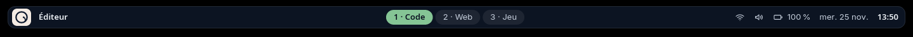
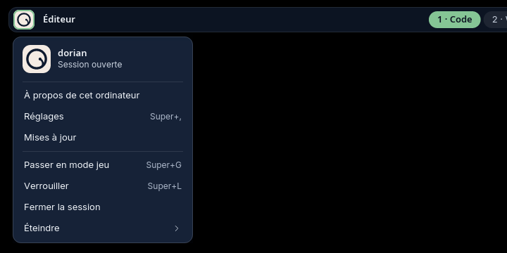

# Barre du haut

`desktop/barre` est la barre du haut du desktop : un programme séparé, ancré en haut de l'écran
par layer-shell (ADR 0005), écrit en iced 0.14 en rendu logiciel tiny-skia (ADR 0014). Le lot
D-20 la livre d'après la planche `Main.dc.html` et, pour le menu Sherlock, `Menus.dc.html`.





## Ce qu'elle montre

| Place | Contenu | Source |
| --- | --- | --- |
| Gauche | Bouton Sherlock, qui ouvre le menu Sherlock en `xdg_popup` | |
| Gauche | Nom de l'application active | Factice (voir Bureaux) |
| Centre | Les bureaux, l'actif en vert | Factice (voir Bureaux) |
| Droite | Réseau, son, batterie et son pourcentage | NetworkManager, PulseAudio ou PipeWire, UPower |
| Droite | Date courte et heure, en français | Horloge locale |

Un indicateur qui n'a pas encore été lu ne s'affiche pas. Sans batterie, l'indicateur de
batterie disparaît. Une batterie qui se vide sous 15 % passe en ambre.

## Architecture

| Module | Rôle |
| --- | --- |
| `lib.rs` | Réglages de la surface layer-shell et d'iced, lancement (`run`) |
| `app.rs` | État (`Bar`), messages, mise à jour, vue de la barre et vue du menu |
| `menu.rs` | Entrées du menu Sherlock, taille de sa surface, touches du clavier |
| `source/` | Une source par donnée du système, derrière le trait `Source` |
| `user.rs` | Nom de l'utilisateur, lu dans le GECOS de `/etc/passwd` |

Toutes les couleurs, tailles et tous les textes viennent de `sherlock-ui` : jetons `TOP_BAR_*`,
`CHIP*`, `SHERLOCK_*`, `STATUS_*`, `MENU_AVATAR*`, `MENU_HEADER_PADDING`, composants `chip`,
`sherlock_button`, `status`, `menu_header`, `logo`, module de textes `strings`, icônes
`NetworkOff`, `SoundMuted`, `Battery` et `BatteryCharging`. Le seul seuil écrit dans la barre
est celui de la batterie faible (`battery::LOW_PERCENT`), qui est un comportement.

### Surface

La surface layer-shell est ancrée en haut, à gauche et à droite, sur la couche `Top`, haute de
36 avec des marges de 10 en haut et 12 sur les côtés. Elle déclare une zone exclusive de 36. Le
clavier lui vient à la demande (`OnDemand`) : seulement quand on clique dans la barre ou son
menu. Journal du protocole relevé dans le KWin imbriqué (`WAYLAND_DEBUG=client`) :

```text
zwlr_layer_surface_v1#29.set_anchor(13)
zwlr_layer_surface_v1#29.set_keyboard_interactivity(2)
zwlr_layer_surface_v1#29.set_size(0, 36)
zwlr_layer_surface_v1#29.set_exclusive_zone(36)
zwlr_layer_surface_v1#29.set_margin(10, 12, 0, 12)
zwlr_layer_surface_v1#29.configure(101, 1416, 36)
```

Le menu Sherlock est un `xdg_popup` rattaché à la surface de la barre, ancré sous le bouton
Sherlock. Sa surface fait 256 de large et commence 6 sous la barre : la planche Menus le pose à
(18, 52), et c'est là qu'il s'affiche. Le compositeur le ferme quand on clique ailleurs.

### Couche layer-shell : `iced_exwlshell` 0.21.4

Le brief demandait d'essayer `iced_exwlshell` 0.21, jamais essayé par D-00, avant de retomber
sur `iced_layershell` 0.19.1. La 0.21.4 marche du premier coup, avec iced 0.14.0 et tiny-skia ;
la barre la garde, épinglée. Ce qu'on en a appris :

- Elle se déclare avec `default-features = false, features = ["macros"]`. La fonction par défaut
  `linux-theme-detection` tire `mundy` pour lire le thème du système : inutile, notre thème vient
  de `sherlock-ui`.
- Elle tire `winit-core` et `winit-common` 0.31.0-beta.4 et compile avec : le blocage de
  `iced_exdevtools` 0.19.1 noté par D-00 a disparu. Elle tire aussi `iced_devtools` et
  `iced_exdevtools`, même sans la fonction `debug`.
- Elle ne tire pas wgpu : `iced_renderer` sans fonction par défaut, le moteur reste celui
  qu'active `sherlock-ui` (tiny-skia seul). La carte NVIDIA n'est pas réveillée.
- Changements d'API depuis 0.19 : `ExWlSettings` remplace `Settings` (passé par
  `.wl_settings(..)`, les réglages d'iced par `.settings(..)`) ; `LayerSize::fill_width(36)`
  remplace `size: Some((0, 36))` ; `Margin { top, right, bottom, left }` remplace le quadruplet ;
  la macro reste `#[to_layer_message(multi)]` pour un programme à plusieurs surfaces.
- `IcedNewPopupSettings::new(parent, taille, position de l'ancre, taille de l'ancre)` place un
  popup ; `.anchor(..)` et `.gravity(..)` le règlent.
- `.on_new_shell(..)` donne l'identifiant de chaque surface créée, avec son type : la barre
  retient ainsi sa surface, là où le prototype de D-00 la devinait au premier `view`.
- Elle sait demander un flou au compositeur (`BlurOption`), mais sur des rectangles : les coins
  arrondis de la barre laisseraient voir un flou carré. La barre ne s'en sert pas.
- Elle propose `.redraw_scope(..)` pour ne pas redessiner sur certains messages. Pas utilisé :
  la barre n'envoie déjà un message que quand une valeur change.

## Sources

Chaque donnée vient d'une source qui implémente le trait `source::Source` :

```rust
pub trait Source: Send + 'static {
    type State: Clone + PartialEq + Send + Debug + 'static;
    fn read(&mut self) -> Result<Self::State, SourceError>; // lit l'état courant
    fn wait(&mut self) -> bool; // attend qu'il ait pu changer, false s'il ne changera plus
}
```

`source::watch` fait tourner une source dans son propre fil et en tire un flux pour un
abonnement iced. Il n'envoie un état que s'il a changé : la barre ne redessine pas pour rien.
`source::Fixed` est la fausse implémentation des tests, un état qui ne change jamais.

| Source | Lecture | Surveillance | Analyse testée sur |
| --- | --- | --- | --- |
| `SystemClock` | `date "+%u %d %m %H %M"`, une fois par minute | Le fil regarde l'horloge toutes les 5 s au plus, pour rattraper une sortie de veille | Sorties écrites à la main |
| `UPower` | `upower -i /org/freedesktop/UPower/devices/DisplayDevice` | `upower --monitor` | `sorties/upower-*.txt` |
| `NetworkManager` | `nmcli -t -f TYPE,STATE,CONNECTION device` | `nmcli monitor` | `sorties/nmcli-*.txt` |
| `Pactl` | `pactl get-sink-volume` et `get-sink-mute` sur `@DEFAULT_SINK@` | `pactl subscribe`, lignes d'une sortie ou du serveur | `sorties/pactl-*.txt` |
| `Placeholder` | Variables `BARRE_BUREAUX` et `BARRE_APPLICATION` | Aucune | Tests du module |

Les commandes tournent avec `LC_ALL=C`, pour une sortie qui ne dépend pas de la langue. Une
commande de surveillance qui s'arrête est relancée 30 s plus tard. Les sorties
`upower-pleine.txt`, `nmcli-wifi.txt` et `pactl-55.txt` sont enregistrées sur le portable de
référence ; les autres en sont réécrites à la main (batterie à 12 % qui se vide, son coupé,
Ethernet, réseau coupé).

**Pourquoi des commandes et pas D-Bus.** Le brief autorisait `zbus`. Les commandes du poste
suffisent, n'ajoutent aucune dépendance, et se testent sur des sorties enregistrées. Elles
préviennent d'un changement par leur mode de surveillance : rien ne tourne en boucle. Le son
n'est de toute façon pas sur D-Bus avec PipeWire. Si l'OS n'embarque pas ces commandes, une
source D-Bus implémentera le même trait.

**Pourquoi `date` pour l'horloge.** La bibliothèque standard ne connaît pas le fuseau horaire,
et le brief n'autorise pas `chrono`. `date` est lancée une fois par minute ; les fuseaux étant
décalés de minutes entières, la minute locale change en même temps que la minute UTC, que le
fil surveille sans rien lancer.

Le service réseau de l'OS n'est pas encore choisi (lot S-13) : `NetworkManager` est la source
du poste de développement, une autre la remplacera si besoin.

### Bureaux et application active

Le compositeur ne publie encore ni ses bureaux ni ses fenêtres. La source `Placeholder` est
factice : trois bureaux numérotés, le premier actif, sans application active. Pour la
comparaison avec la planche :

```sh
BARRE_BUREAUX="Code,Web,Jeu" BARRE_APPLICATION="Éditeur" cargo run -p barre
```

Un clic sur un bureau est écrit au journal ; le bureau actif ne change pas, puisque rien ne
change vraiment de bureau.

**Ce que le compositeur devra fournir**, pour remplacer `Placeholder` par une vraie source :

1. **Bureaux** : le protocole `ext-workspace-v1`. Un groupe de bureaux par écran ; pour chaque
   bureau, son nom (`name`), sa place (`coordinates`, pour le numéro) et son état `active` ; et
   la requête `activate` pour changer de bureau au clic. La barre affiche les bureaux du groupe
   de l'écran où elle est posée.
2. **Application active** : `ext-foreign-toplevel-list-v1` donne la liste des fenêtres avec leur
   `app_id` et leur titre, mais ne dit pas laquelle a le focus. Il faut en plus l'état
   « active » d'une fenêtre : `zwlr_foreign_toplevel_manager_v1` (état `activated`) ou une
   extension de notre compositeur. La barre affiche le nom de l'application, tiré de son
   fichier `.desktop` à partir de l'`app_id`.
3. Des événements à chaque changement, pour que la barre n'ait rien à interroger.

## Menu Sherlock

Il reprend les entrées de la planche Menus : en-tête avec le nom de l'utilisateur et « Session
ouverte », puis « À propos de cet ordinateur », « Réglages », « Mises à jour », « Passer en mode
jeu », « Verrouiller », « Fermer la session », « Éteindre ». Aucune de ces actions n'existe
encore : chaque entrée reste active, pour qu'on puisse la parcourir, et l'activer l'écrit au
journal puis ferme le menu. Rien n'est simulé.

Clavier :

| Où | Touche | Effet |
| --- | --- | --- |
| Barre | Tab, Maj+Tab | Passe d'un bouton à l'autre (Sherlock, bureaux), anneau bleu clair |
| Barre | Entrée, Espace | Active le bouton focalisé : ouvre le menu Sherlock |
| Menu | Bas, Haut, Tab, Maj+Tab | Surligne l'entrée suivante ou précédente, en boucle |
| Menu | Début, Fin | Première, dernière entrée |
| Menu | Entrée, Espace | Active l'entrée surlignée |
| Menu | Échap | Ferme le menu |

Le survol à la souris surligne aussi l'entrée : clavier et souris partagent le même curseur.

## Lancer et vérifier à la main

Sur le poste de l'auteur (Plasma X11), dans un KWin Wayland imbriqué :

```sh
cargo build -p barre
kwin_wayland --x11-display :0 --width 1440 --height 900 --socket wayland-barre &
WAYLAND_DISPLAY=wayland-barre BARRE_BUREAUX="Code,Web,Jeu" BARRE_APPLICATION="Éditeur" \
  target/debug/barre
```

Le rendu est tiny-skia : aucune variable n'est à régler, la NVIDIA dort. Les journaux sortent
sur la sortie d'erreur ; `RUST_LOG=barre=debug` en montre plus.

1. **Ancrage** : la barre flotte à 10 du haut et 12 des côtés, sur toute la largeur.
2. **Zone exclusive** : ouvrir une fenêtre dans le KWin imbriqué et l'agrandir. Elle doit
   commencer sous la barre, sans la recouvrir.
3. **Données réelles** : l'heure et la date du poste, l'icône réseau (barrée si le Wi-Fi est
   coupé), le son (barré en sourdine), la batterie et son pourcentage. Couper le son
   (`pactl set-sink-mute @DEFAULT_SINK@ toggle`) ou débrancher le secteur : la barre doit suivre
   aussitôt.
4. **Menu** : cliquer le bouton Sherlock. Le menu s'ouvre sous lui, le bouton prend son anneau
   vert. Bas, Haut, Entrée, Échap. Une entrée activée s'écrit au journal :
   `entrée du menu Sherlock pas encore disponible action=Lock`. Un clic ailleurs ferme le menu.
5. **Clavier dans la barre** : cliquer dans la barre, puis Tab : l'anneau passe du bouton
   Sherlock aux bureaux.

Comparaison avec les planches, à l'œil ou sur les captures :

- Ouvrir `docs/design/planches/Main.dc.html` à côté. Comparer : verre `rgba(16,26,44,0.78)`,
  bordure `rgba(255,255,255,0.09)`, rayon 12, marges intérieures 6 à gauche et 10 à droite,
  bouton crème de 30 par 28 au rayon 8, nom de l'application en graisse 600, pastilles de
  bureaux de 24 de haut au rayon 12 (active verte, texte `#0B1220` en graisse 600 ; les autres
  `rgba(255,255,255,0.07)`, texte `#C5CEDB`), 4 entre elles, indicateurs en `#C5CEDB` à 14
  d'écart, icônes de 16, heure en `#EEF2F7` graisse 600.
- Ouvrir `Menus.dc.html` : menu de 256 posé en (18, 52), marge 6, en-tête avec avatar crème de
  40 au rayon 11, séparateurs, raccourcis en `#A9B4C6` à 12 px, chevron sur « Éteindre ».
- Mesure au pixel : `cargo test -p barre --test rendu` écrit `target/tmp/barre-tiny-skia.png`
  et `target/tmp/menu-sherlock-tiny-skia.png`, à l'échelle 2, à partir de fausses sources (la
  date et l'heure de la planche).

Pour une capture du KWin imbriqué depuis X11 : `wmctrl -i -R <id>` amène sa fenêtre devant
(`wmctrl -l` donne l'identifiant), puis `import -window <id> capture.png`.

## Tests

`just verifier` lance tout, sans écran :

- **Horloge** : analyse de la sortie de `date`, date et heure de la planche (« mar. 24 nov. »,
  « 21:46 »), zéros devant, sorties refusées ; formats de `sherlock-ui::strings`.
- **Batterie, réseau, son** : analyse des sorties enregistrées et réécrites de `sorties/`.
- **Sources** : `watch` n'envoie que les changements ; `Fixed` rend son état une fois.
- **Bureaux factices** et **nom de l'utilisateur**.
- **Menu** : parcours au clavier, activation, Échap, fermeture par le compositeur, taille de la
  surface d'après la planche.
- **Rendu** (`tests/rendu.rs`) : capture de la barre et du menu sans écran, textes attendus, un
  clic sur un bureau et sur une entrée du menu donne le bon message.
- **Contraste** (`sherlock-ui`) : textes de la barre et pastilles des bureaux, sur la barre
  posée sur le bureau et ses trois disques.

## Écarts avec la planche

- **Bouton Sherlock** : la planche y met la tête de la mascotte. Le brief demande le logo ou une
  icône de `sherlock-ui` : c'est le symbole du logo, bleu nuit sur crème. Même chose pour
  l'avatar du menu.
- **Anneau du menu ouvert** : la planche l'écrit en `box-shadow` de 2 px à l'extérieur du
  bouton ; iced n'a pas d'ombre sans flou, l'anneau vert est une bordure de 2 px à l'intérieur.
- **Menus d'application** (Fichier, Édition…) : la planche les montre après le nom de
  l'application. Ils viendront avec le menu global de nos applications, hors de ce lot.
- **Conteneurs et bacs à sable** : la planche les montre à droite. Ils viendront avec les lots L.
- **Batterie** : aucune planche ne la dessine. Icône au trait comme les autres, pourcentage à
  côté, en ambre sous 15 % quand elle se vide.
- **Nom de l'utilisateur** : la planche écrit « Dodo ». La barre lit le GECOS de l'utilisateur,
  sinon son identifiant.
- **Mises à jour** : la planche montre une pastille « 3 ». Aucune source ne donne ce nombre :
  pas de pastille.
- **Éteindre** : la planche annonce un sous-menu, qu'elle ne dessine pas. Le chevron est là,
  l'entrée s'écrit au journal comme les autres.
- **Flou et ombres** : le verre n'est qu'une teinte translucide ; le flou est le travail du
  compositeur. L'ombre du menu (`0 22px 54px`) déborderait de sa surface : elle n'est pas
  dessinée.
- **Animations** : le menu s'ouvre d'un coup, les survols changent d'un coup (`sherlock-ui` ne
  branche pas encore `motion` sur ses composants).
- **Libellés pour les lecteurs d'écran** : iced 0.14 n'expose rien. Les bulles de
  `icon_button` ne tiennent pas dans une surface de 36 de haut : les indicateurs n'en ont pas.
- **Fond** : le KWin imbriqué n'a pas de fond d'écran ; la barre y paraît sur du noir.

## Ce que le lot ne fait pas

- Les vrais bureaux et l'application active : ils attendent les protocoles du compositeur.
- Les actions du menu Sherlock : verrouiller (connexion), mode jeu, réglages, mises à jour.
- Les réglages rapides au clic sur un indicateur (lot Panneaux), le dock (D-21), le lanceur
  (D-22).
- Plusieurs écrans : la barre s'ouvre sur l'écran actif (`StartMode::Active`).
- La session réelle : la barre n'a tourné que dans un KWin imbriqué. Notre compositeur gère
  layer-shell au lot D-12.
