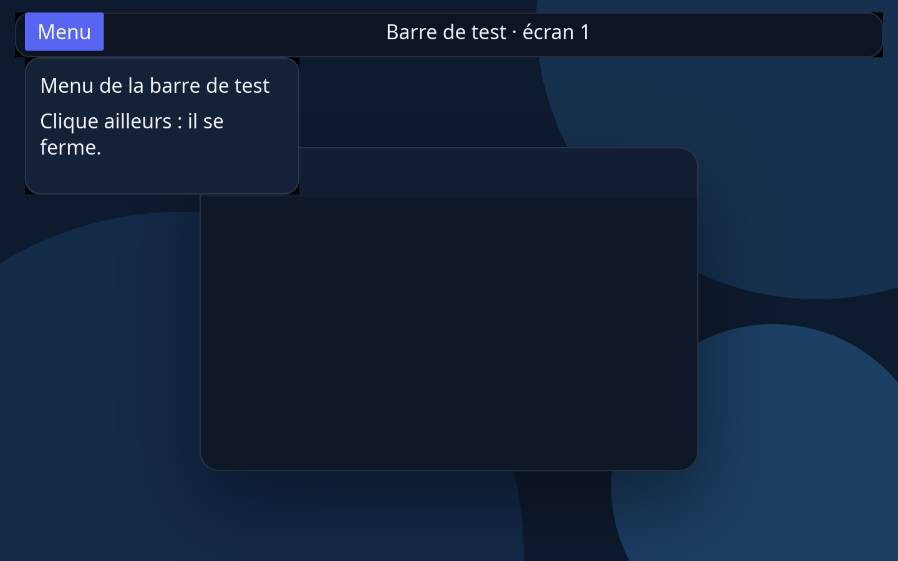
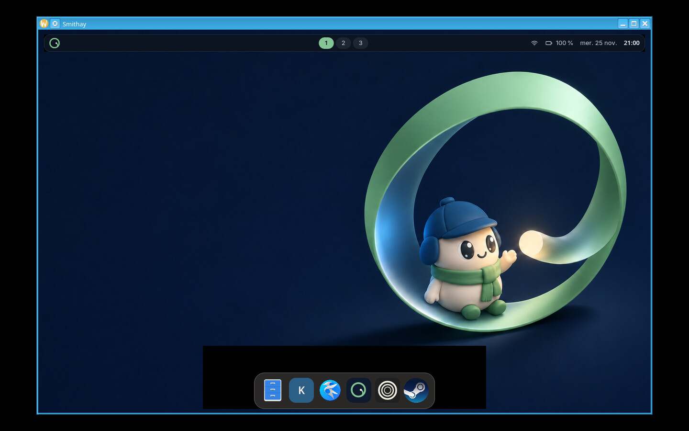
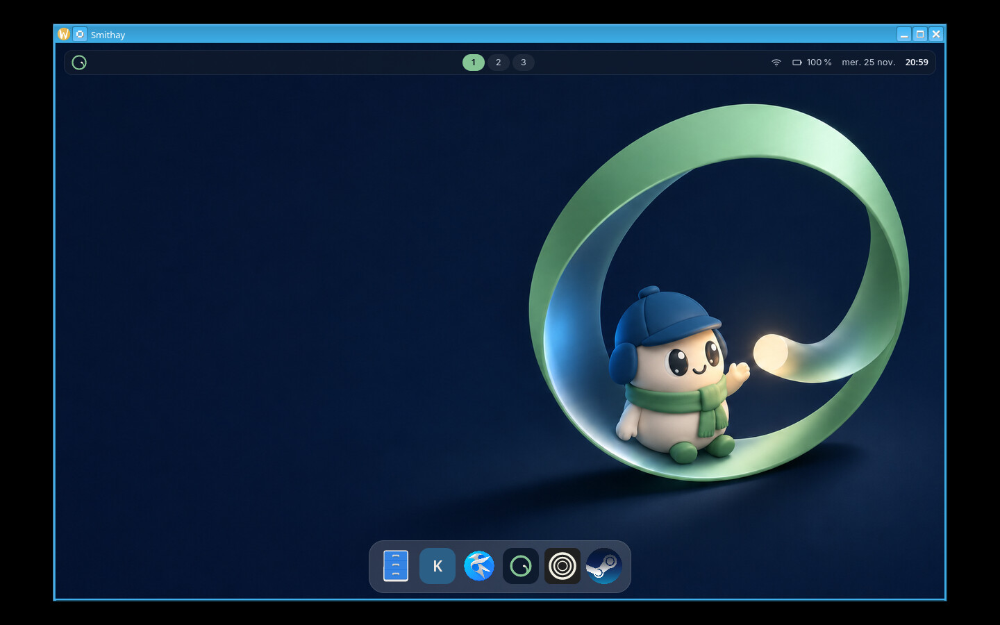

# Compositor

The compositor shows the windows of Wayland applications and receives the keyboard and the mouse.
It is written in Rust with Smithay 0.7, in `desktop/compositor`. Lot D-10 lays its base: it runs
in a window inside an existing session, without visual effects. Lot D-17 makes windows easy to
handle: grab band, cursors, snapping against the screen edges. Lot D-11 gives it the look of the
boards: desktop background, rounded corners, border, shadow, and spring animations. Lot D-13
runs X11 applications in it, through XWayland, with the clipboard both ways. Lot D-12 adds
anchored surfaces (layer-shell) for the bar, the dock and the panels, several screens, and
fractional scaling. Lot D-04 draws the wallpaper. Lot D-06 accepts the buffers of clients that
draw on the GPU (linux-dmabuf). Lot D-14 runs it as a real session, on the screens of the
machine, from a text console or the login screen (see "Real session").

Machine prerequisites, on top of those in `CLAUDE.md`: the `Xwayland` server (`xwayland` package
on Debian). Tried with version 24.1.6 from Debian 13; the CI installs the one from Ubuntu 24.04.
Without it, the compositor still starts, and only Wayland applications show up.

## Architecture

| File | Role |
| --- | --- |
| `src/main.rs` | Picks the backend, creates the event loop, starts XWayland, launches the given command |
| `src/options.rs` | Command line: `--nested`, `--measure`, `--outputs`, `--scale`, `--workspaces`, the command |
| `src/udev.rs` | Real session: libseat session, the card, one `DrmCompositor` per screen, libinput, console switches |
| `src/card.rs` | Choice of the card the real session drives, from `/sys` |
| `src/mesa.rs` | What keeps the NVIDIA card asleep: EGL restricted to Mesa, Xwayland's environment (GBM backends without NVIDIA's) |
| `src/cursor.rs` | Cursor images of the real session, from the cursor theme |
| `src/keyboard.rs` | Keyboard layout: `XKB_DEFAULT_*`, the system setting, or French AZERTY |
| `session/` | Session entry of the login screen (`sherlockos.desktop`), start script, `install.sh` |
| `src/lib.rs` | `State`: Wayland display, protocols, seat, `Space` of the windows. Socket, screen, focus |
| `src/handlers.rs` | Protocol handlers: `wl_compositor`, `wl_shm`, `wl_seat`, `wl_output`, xdg-shell, cursor shapes, clipboard and primary selection. Placing a window according to its state (`rearrange`), Wayland or X11 |
| `src/layer.rs` | Anchored surfaces (`zwlr_layer_shell_v1`): placement by each screen's layer map, exclusive zone and work area, keyboard, menus, hit testing |
| `src/output.rs` | Screens: place in the space and in the host frame, scale, `wp_fractional_scale_v1`, `wp_viewporter`. `View` turns space coordinates into frame pixels |
| `src/xwayland.rs` | XWayland: startup and shutdown, X11 window manager (`X11Wm`), surface association, clipboard as seen from X11 |
| `src/dmabuf.rs` | GPU buffers (`zwp_linux_dmabuf_v1`): global with its default feedback, import through the renderer, refusal of a buffer it cannot draw, size check before smithay's (lot D-06) |
| `src/focus.rs` | Keyboard target: Wayland surface or X11 window |
| `src/input.rs` | Keyboard and mouse: click to focus, gestures, snapping, shortcuts, cursor shape |
| `src/layout.rs` | Layout: place, move, resize, grab band, snap zones, return to the previous size. Pure computation, without Wayland or rendering |
| `src/winit.rs` | Windowed backend: the host window, its virtual screens side by side, its cursor. Starts the rendering of each frame and its measurement. Offers linux-dmabuf for the chip it renders on |
| `src/render.rs` | Rendering: wallpaper or background and discs, shadows, content clipped to a rounded rectangle, borders, snap preview |
| `src/wallpaper.rs` | Wallpaper: setting read again when it changes, images decoded on a thread, one texture per variant in use, placement on each screen |
| `../desktop-config` | Settings shared with Control Room: `wallpaper.conf`, choice of the variant, cover / contain / center geometry; the variant generator `wallpaper-variants` |
| `src/shaders/` | The three GLSL programs of the renderer: `shape.frag`, `shadow.frag`, `clip.frag` |
| `src/anim.rs` | Motion of windows, of the preview and of the workspaces: springs applied to rectangles and to the row of workspaces. Pure computation |
| `src/stats.rs` | Frame statistics for `--measure` |
| `src/shell/` | Data and control for the shell programs, on the shell socket only (lot D-18a, ADR 0021): `sherlock_shell_v1` (`toplevels.rs`), workspaces through `ext-workspace-v1` (`workspaces.rs`); the workspaces themselves and minimizing (lot D-18w) |
| `../shell-protocol` | The XML of `sherlock_shell_v1` and its bindings, client and server, generated by `wayland-scanner` |
| `examples/scene.rs` | Test client: the measurement scene, and one window to compare with the board (`board`), maximized from the start (`maximized`) or small enough for scale 2 (`small`) |
| `../../prototypes/bar-test` | Test bar of lot D-12, out of the workspace: 36 px, anchored at the top of every screen, with a menu |

Colors, sizes, durations and springs come from `sherlock-ui` (modules `color`, `metrics`,
`motion` and `window`), without its `iced` feature.

Everything runs in a single thread, on a `calloop` loop. The loop sources are the Wayland
display (client requests), the listening socket and, in nested mode, the winit window (input
and redraw requests). After each iteration, `State::refresh` cleans up dead windows and sends
the replies to the clients.

The layout logic lives in `layout.rs` and only knows rectangles: rendering (`winit.rs`) and input
(`input.rs`) call it. The real session (`udev.rs`, lot D-14) reuses `State`, the scene and the
input handling as they are, in place of `winit.rs`.

Behavior:

- A new window is centered at its first content and gets the keyboard. With several screens, it
  is centered in the work area of the screen under the pointer.
- A click on a window gives it the keyboard and raises it.
- The gesture key is Super in a real session (lot D-14), and Alt in nested mode (`--nested`): the
  host session keeps Super for itself (under Plasma, the KWin window actions and the launcher).
  That is niri's convention. The rule lives in `gesture_modifier_held` (`src/input.rs`).
- Windows draw their title bar themselves: xdg-decoration is out of the lot.
- The keyboard is French AZERTY, unless `XKB_DEFAULT_LAYOUT` is set (xkbcommon then reads the
  `XKB_DEFAULT_*` variables), or the system sets a layout: `XKBLAYOUT`, `XKBVARIANT`,
  `XKBOPTIONS` and `XKBMODEL` in `/etc/vconsole.conf` (written by `localectl`) or else in
  `/etc/default/keyboard` (Debian).

Moving and resizing:

- An 8 pixel band surrounds each window, outside its geometry. It widens to 20 pixels at the
  corners, diagonally as well as along the sides. A left button press in the band pulls that
  edge or corner. The client does not see the press. The band of a window comes before the
  windows it covers, not before those above it. A window without content has no band.
- Dragging the title bar or an edge that a client draws itself moves or resizes its window
  (`xdg_toplevel.move` and `.resize`). As xdg-shell requires, the request is only granted on the
  compositor's seat, while a button is pressed on a surface of this client, with the serial of
  that press.
- Gesture key + drag with the left button moves the window under the pointer. With the right
  button, it is resized by the corner nearest to the pointer.
- During a resize, the opposite corner stays in place, and the client's minimum and maximum
  sizes are respected.
- A move only shifts the window once the pointer has travelled 4 pixels: a mere click does not
  shift it nor pull it out of its zone.
- Only the release of the button that started the gesture ends it. Other buttons go to the
  seat, with no client to receive them.
- A fullscreen window is neither moved nor resized by a gesture, and has no band.

Snapping:

- A moved window, dropped with the pointer within 8 pixels of the top edge of the screen, is
  maximized. Against the left or right edge, it takes that half of the screen. In a corner,
  within 64 pixels of the corner along an edge, it takes that quarter. The bottom edge alone
  snaps nothing. During the drag, a translucent green rectangle shows the targeted zone.
- This holds for moves with the gesture key as well as for those requested by the client.
- Moving a snapped or maximized window gives it back its previous size, under the pointer,
  grabbed at the same proportion of its width. If it had none, because it was maximized before
  its first content, the client chooses its size. Resizing it removes the maximized or snapped
  state, and it starts from its current size.
- A window snapped by a drop returns, when leaving its zone, to its place from before the drag.
- Gesture key + Up arrow maximizes the window that has the keyboard, or gives it back its
  previous size if it already is. Left or Right arrow: half of the screen. Down arrow: previous
  size. Only the gesture key may be held: with Shift as well, the arrow goes to the client;
  with Ctrl, Left and Right change workspace (see "Workspaces"). These keys, press and release alike, do not go to the client. They have no effect in
  fullscreen. If the host window loses the keyboard between the press and the release, the
  compositor forgets the interception.
- Maximized is the xdg-shell `maximized` state, which the client knows about. A half or a
  quarter is only an imposed size: the `tiled` states are not sent.
- Zones are taken from the work area of a screen: what the exclusive zones of anchored surfaces
  leave (see below). A maximized or snapped window never covers the bar or the dock; a
  fullscreen one covers the whole screen. Dropped by a drag, a window snaps on the screen under
  the pointer, against that screen's edges. A shortcut or a client request acts on the window's
  screen, the one under its center. Along the edge that two screens share, both edges snap:
  dragging a window from one screen to the other shows the preview of each side in turn.

Cursors:

- Over the band, the cursor takes the shape of the edge or corner. During a move, it takes the
  "move" shape, and during a resize that of the pulled edge.
- Over a client, the cursor is the one it names through the cursor shape protocol
  (`wp_cursor_shape_v1`, which Qt 6 uses). A client that draws its cursor image itself
  (`wl_pointer.set_cursor` with a surface) gets the arrow: the image is not shown. Elsewhere,
  it is the arrow.
- In nested mode, the cursor of the host window changes shape, with the host session's theme.
  The real session draws the cursor itself, from the cursor theme (see "Real session").

## Anchored surfaces (layer-shell)

The bar, the dock, the launcher and the notifications are separate programs (ADR 0005). They
anchor themselves to a screen edge with `zwlr_layer_shell_v1` (version 4 in smithay 0.7). Each
screen has a layer map (smithay's `LayerMap`) that places its surfaces from their anchors,
size and margins, and computes the work area.

- **Screen.** A surface goes to the screen it names, or else to the screen under the pointer.
  It is placed and receives its first configure at its first commit, and again on every
  commit, which is when its anchors, size, margins or exclusive zone may change.
- **Layers.** Background and bottom surfaces are drawn under the windows, top and overlay ones
  above them, the snap preview between the top surfaces and the windows. The pointer follows
  the same order. Anchored surfaces are drawn as they are: no rounded corners, border or
  shadow, which are the client's business (the bar draws its own glass).
- **Exclusive zone.** What a surface reserves along its edge, plus its margin on that edge, is
  taken from the work area. Windows are centered, maximized and snapped inside it. When it
  changes (the bar starts, stops or resizes), maximized, fullscreen and snapped windows of that
  screen take the new work area, Wayland or X11, including those that do not have their first
  content yet (a window maximized at startup, before the bar arrives). A bar of 36 with a top
  margin of 10 leaves the area from y = 46. The work area always stays inside the screen and is
  never smaller than `window::MIN_WORK_AREA` of sherlock-ui (320 × 240, or the screen if
  smaller): zones that cover the whole screen leave that minimum at their edge, never a
  negative or empty area.
- **Checks.** Client values are checked before smithay places anything, so that no geometry
  can overflow. A size beyond 2^31 (`set_size`) is a protocol error (`invalid_size`), sent
  before smithay reads it, which would otherwise assert against a negative size. At each
  commit, the surfaces of the screen are refused (`closed` and a warning in the log, the
  surface leaves the layer map before it is placed) when a margin is larger than the screen, or
  when the exclusive zones with their margins, summed along each axis, are larger than the
  screen: a zone of 100 000, or `i32::MAX` with a margin, is refused, and the third panel that
  no longer fits too.
- **Null buffer.** A surface that commits a null buffer is unmapped: its exclusive zone and the
  keyboard come back, as when it is closed. Its next commit maps it again on the same screen,
  with a new configure.
- **Keyboard.** `none`: never. `on_demand`: a click on the surface gives it the keyboard, a
  click on a window takes it back. `exclusive`, on the top or overlay layer: the surface takes
  the keyboard as soon as it shows something, and keeps it while it is there; clicks on
  windows still raise them, without the keyboard. When it leaves or gives up the keyboard, the
  window that had it gets it back.
- **Menus.** An `xdg_popup` attached to an anchored surface (`zwlr_layer_surface_v1.get_popup`,
  the menus of the bar) is drawn and hit in front of it, nested popups included. It is kept
  inside its screen (flip, slide, resize of `xdg_positioner`). A menu that asks for a grab
  (`xdg_popup.grab`) is closed (`popup_done`, the whole chain) by a press on a surface of
  another client, or on the desktop; the press still goes through. Presses on the client's own
  surfaces go to it, which closes its menu itself. The serial of the grab is not checked:
  iced opens its menus on release, with the serial of the press. The menu does not take the
  keyboard: Escape and arrow keys go to the surface that has it.
- **Blur.** `Scene::push_backdrop` is the place where the blur behind glass surfaces comes, with
  lot D-11b: it is called for each anchored surface, behind it, with its rectangle in the
  frame. It draws nothing yet: a translucent surface shows a sharp desktop behind it.

### Security notes

Not settled by lot D-12, which runs nested only. What its review established, to carry into
the briefs of D-14, D-25 and the lot of the consent window (ADR 0011):

- **The `zwlr_layer_shell_v1` global is open to every Wayland client**, Flatpak ones included:
  nothing filters it.
- **Keyboard theft.** An overlay surface with an `exclusive` keyboard keeps it as long as it
  exists, even a 1 × 1 surface, and even after a click on a window (the test
  `a_surface_with_an_exclusive_keyboard_keeps_it` checks the protocol's behavior). Any client
  can thus capture all typing with an almost invisible surface. The compositor's shortcuts are
  still intercepted before the client, but they act on `focused_window()`, which is `None`
  while an anchored surface has the keyboard: the gesture key + arrows then do nothing.
- **Clicks.** An overlay surface anchored to the four edges is in front of everything, drawn
  and hit first: it receives every click.
- **To reserve to the compositor:**
  - a layer above the overlay one, for the consent window (ADR 0011) and the lock screen,
    drawn by the compositor itself and hit before `layer_hit`;
  - a forced keyboard focus that comes before `exclusive_layer()`;
  - a filter on the layer-shell global, kept for the shell programs that the session starts;
  - `ext-session-lock` for D-25, rather than an overlay surface.

### Layer-shell toolkit of the shell (answer to ADR 0014)

ADR 0014 asked which iced layer-shell crate the shell keeps. Answer: **`iced_exwlshell` 0.21.4**
(waycrate, MIT), the crate formerly published as `iced_layershell` (0.19.1, used by the D-00
prototype). The bar of lot D-20 pins it (`=0.21.4`), with iced `=0.14.0` and tiny-skia, and so
does the test bar `prototypes/bar-test`, used to try this lot.

What was checked in our compositor with the test bar: a bar on every screen
(`StartMode::AllScreens`, with `daemon`), anchors, margins and exclusive zone, the keyboard on
demand, a menu in an `xdg_popup` attached to the bar and closed by a click elsewhere, and the
fractional scale (the bar draws at 1.25, 1.5 and 2 through `wp_fractional_scale_v1` and
`wp_viewporter`).

Limits to keep in mind:

- Small project, which renamed itself and broke its API between 0.19 and 0.21 (October 2026).
  The version is pinned; a new version is a lot of its own.
- `application` refuses `StartMode::AllScreens`: a program with one surface per screen must use
  `daemon`, and its message type `#[to_layer_message(multi)]`.
- No accessibility (iced 0.14 has none), as ADR 0014 says.
- iced redraws on every message: one frame per message, even when nothing changes.
- The menus are views written by hand; the crate only creates and places the popup.
- **In software rendering (tiny-skia), surfaces are opaque.** iced presents through softbuffer
  0.4.8, whose Wayland backend only creates `XRGB8888` buffers: the transparent pixels of the
  bar (outside its rounded corners, behind the translucent glass) come out black, in any
  compositor. The floating bar of the board, with its 10 px gap and its glass, needs either
  a buffer with alpha (a softbuffer that offers `ARGB8888`, or iced's wgpu renderer on the AMD
  chip) or a square bar. To decide with lot D-20; not checked further here. Since lot D-02
  (ADR 0018) the shell draws with wgpu on the AMD chip, and since lot D-06 our compositor
  accepts its buffers (see "GPU buffers"): the corners and the glass are transparent.

## Shell protocol (lot D-18a)

The bar and the dock learn the windows, the screens and the workspaces from the compositor, and
act on the windows, through two protocols that only the shell programs reach (ADR 0021):

- `sherlock_shell_v1`, private, described in
  `desktop/shell-protocol/protocol/sherlock-shell-v1.xml`;
- `ext-workspace-v1`, the standard protocol of workspaces (wayland-protocols 0.32, staging).

### Shell socket

Next to its Wayland socket, the compositor opens a second one, the same name followed by
`-shell` (`$XDG_RUNTIME_DIR/wayland-1-shell` for `wayland-1`; next to the given path with
`listen_at`, the suffix before an extension: `wayland-shell.sock` for `wayland.sock`, so that
the two locks, named by replacing the extension, never collide). Clients accepted there are marked as shell clients (`ClientState::shell`). Both
sockets offer every global; the globals of `sherlock_shell_v1` and `ext-workspace-v1` are only
visible to shell clients (`GlobalDispatch::can_view`), and a client of the ordinary socket that
binds them by name gets `wl_display.error` `invalid_object` from wayland-server, which
libwayland-client reports as `EINVAL`. XWayland, whose connection smithay creates, is never a
shell client. `State::shutdown` removes the shell socket and its lock with the other one. If
the shell socket cannot be opened, the log says so and the session goes on without it.

A shell program finds the socket with `shell_protocol::socket_from_env()`, from
`WAYLAND_DISPLAY` and `XDG_RUNTIME_DIR`, and talks to these protocols on that second
connection; its surfaces stay on the ordinary socket, and so do the applications it launches.

Checked on the reference laptop with Flatpak 1.16.6: Zen's sandbox, which has `filesystems=host`,
sees `wayland-2` and not `wayland-2-shell` (see ADR 0021).

### `sherlock_shell_v1`

| Object | Requests | Events |
| --- | --- | --- |
| `sherlock_shell_manager_v1` | `destroy` | `toplevel` (a new window), `output` (name, state of a screen), `output_removed`, `done` |
| `sherlock_shell_toplevel_v1` | `activate`, `minimize`, `close`, `move_to_workspace` (workspace id), `set_rectangle` (screen name, x, y, width, height), `destroy` | `id`, `title`, `app_id`, `state`, `output`, `workspace` (id), `geometry`, `closed` |

- **Bind.** The whole state is sent right away, in the bind: every window that shows content,
  then every screen, then `done`, sent even without window nor screen. A roundtrip after the
  bind brings it.
- **Windows.** Wayland and X11 windows that show content, X11 menus aside, and the minimized
  ones. `id` is stable for the window's life, the same for every client, never given again
  while the compositor runs. `app_id` is the xdg-shell one, or the X11 class. `geometry` is
  the place and size without the shadow, relative to the screen of `output` (the one under the
  window's center), the target of an animation rather than its steps. A minimized window
  keeps the screen and the geometry it had. Without any screen, a window stays listed with an
  empty screen name and its place in the space.
- **States.** `maximized`, `fullscreen`, `snapped` (half or quarter), `minimized`, `activated`.
  The active window is the last one given the keyboard: it stays active while the bar or the
  dock has the keyboard after a click on them, which is what the dock needs to choose between
  bringing an application forward and minimizing it (`docs/dock.md`, Launching).
- **Screens.** `output` gives, for each screen by its `wl_output` name, `maximized` and
  `fullscreen` when such a window, not minimized and on the active workspace, is on it: what
  the bar of lot D-18b reacts to.
- **Workspace of a window.** `workspace` gives the id of its workspace, the one
  `ext_workspace_handle_v1.id` gives; `move_to_workspace` moves it (see "Workspaces"), an
  unknown id is ignored.
- **Changes.** After each loop iteration, `State::refresh_shell` reads the windows and the
  screens, compares them with what each bound manager was told, and sends the differences
  (only the properties that changed, `closed` for a window gone), then `done`. Nothing else in
  the compositor calls it; with no shell client bound, it reads nothing.
- **Requests.** `activate` brings a minimized window back, goes to its workspace, raises it and
  gives it the keyboard (an anchored surface with an exclusive keyboard keeps it). `minimize`
  hides the window at its place in the space: it is no longer drawn nor hit, and if it was
  active, the window on top becomes active; nothing happens during a gesture. An X11 window gets
  `_NET_WM_STATE_HIDDEN` while minimized, and loses it when it comes back, or when its
  application withdraws it meanwhile (smithay keeps the state for the life of the surface: the
  window mapped again would believe it is still minimized). `close` sends `xdg_toplevel.close`, or
  `WM_DELETE_WINDOW`. `set_rectangle` keeps the rectangle of the dock icon of a window,
  replaced by the next one and removed with a width or height of 0, for the minimize
  animation of lot D-19 (`State::icon_rectangle`), and forgotten with its window; a negative
  size, or `x + width` or `y + height` past the 32-bit range, is the protocol error
  `invalid_rectangle`. Requests on a window that is gone do nothing.
- **Minimize requested by the application.** Not honored yet (`xdg_toplevel.set_minimized`,
  `_NET_WM_STATE_HIDDEN`): until the dock can bring a window back (lot D-18c), a minimize
  button would lose the window.
- **`WM_STATE` of a minimized X11 window.** It stays `NormalState`, where the ICCCM expects
  `IconicState`. smithay 0.7 only sets `IconicState` through `X11Surface::set_mapped(false)`,
  which also unmaps the frame: XWayland then drops the window's surface, which the compositor
  reads as the application withdrawing it. To take up with D-18c, if X11 applications go on
  drawing while minimized.

### Workspaces

Workspaces are shared by every screen (ADR 0021): one active workspace for all of them. Lot
D-18w gives them their behavior.

- **Number.** 3 by default, from 1 to 9 with `--workspaces N` (at most as many as there are
  shortcuts to reach them), numbered from 1: the number is both the id and the name.
  `State::set_workspace_count` changes it while the session runs: the windows of a removed
  workspace go to the active one; if the active one goes, the first one becomes active, without
  sliding, and its window on top takes the keyboard.
- **A window belongs to one workspace,** the active one when it shows up (first content, or
  association of its surface for an X11 window): the workspace where the user is.
- **Hidden windows stay in the space.** The windows of the other workspaces and the minimized
  ones keep their place, their screen, their commits and their arrangement: a change of the work
  area or a screen unplugged rearranges them like the others. Rendering, hit testing and the
  choice of the window that takes the keyboard back skip them (`State::is_visible`). They keep
  receiving frame callbacks.
- **Switching** (`State::activate_workspace`): the windows of the arriving workspace show up,
  the others hide, open menus close, the keyboard goes to the window on top of the arriving
  workspace (to none if it is empty), and the pointer to what is under it now. A window being
  dragged comes along. `activate` on a window of another workspace goes there.
- **Sliding.** The workspaces stand in a row, side by side; each screen shows its part of it.
  The view moves along the row on `SNAP_SPRING` (`anim::WorkspaceSlide`): the leaving workspace
  goes out on one side while the arriving one comes in from the other, by the width of each
  window's screen. A switch during a slide turns around from where the view is; a jump over
  several workspaces passes through those between them. While sliding, a window is drawn on its
  own screen only, so as not to slide onto the next one; input already goes to the arriving
  workspace.
- **Moving a window** (`State::move_to_workspace`): out of the active workspace, it hides
  without being followed, and if it was the active window, the window on top takes the
  keyboard.
- **Anchored surfaces** (bar, dock) are not windows: they stay on every workspace.

| Keys (Alt in place of Super with `--nested`) | Effect |
| --- | --- |
| Super + 1 to 9 | Goes to that workspace |
| Super + Shift + 1 to 9 | Sends the window that has the keyboard to that workspace |
| Super + Ctrl + Left or Right | Goes to the workspace on that side, without wrapping around |

The digits are the keys of the top row, whatever the layout: on AZERTY, Super + `&` goes to
workspace 1. These keys, press and release, do not go to the client. Only the modifiers of the
table may be held; with others, the key goes to the client.

Through `ext-workspace-v1`: one group, with `output_enter` for each of the client's
`wl_output` objects of every screen (including those bound later, and `output_leave` when a
screen goes); in it each workspace with its `id`, `name`, `coordinates` (its index), `state`
(`active`) and the `activate` capability. `activate` waits for the `commit` of the manager
that announced that workspace, the last one winning: a client's commit never applies another
client's requests. After a change of the model, the compositor sends the workspaces added,
removed or changed, then `done`.

### Follow-ups for D-18c and later

From the review of D-18a. Lot D-18w settled the workspace of a new window, set when it shows up,
and the minimized windows out of reach of `rearrange` and of their commits: they now stay in
the space.

- **Frame callbacks of hidden windows.** They keep coming, at the pace of the screen. Throttling
  them, or sending the xdg-shell `suspended` state, would save the battery; to check against
  clients that wait for their callback before drawing again (Mesa's EGL with a swap interval).
- **Cost of `snapshot`.** Without a shell client, nothing is read. With one, each loop
  iteration (so at the pace of the pointer) allocates the title, `app_id`, screen and
  workspace of every window and locks two mutexes per window: about O(windows × managers +
  windows²). A dirty flag, or a comparison without allocation, can come later.
- **Signals.** After a panic or a SIGTERM, neither socket nor its lock is removed (the `flock`
  falls with the process, and the next start takes the place back). Stopping the loop on
  SIGTERM and SIGINT through calloop's signals would clean them.

### Plugging in the shell

- **Bar (D-18b).** Its workspaces source binds `ext_workspace_manager_v1` on the shell socket
  and shows the group of its screen (today the only one), a click sends `activate` and
  `commit`; its active application is the window with `activated`;
  its shape follows the `output` state of its screen.
- **Dock (D-18c).** `windows::Source` and `windows::Control` get an implementation over
  `sherlock_shell_v1`, next to `Wlr`: `Windows` from the toplevels (`app_id`, `activated`),
  and `Request::Activate`, `Minimize`, `Close` as the requests of the same names, without a
  seat. The rectangle of each icon goes with `set_rectangle`.

### Tests

`tests/shell.rs` runs like `tests/headless.rs`, with two clients: an application on the
ordinary socket, and a shell program.

- **Filter.** The application sees neither global; binding the manager by the shell's global
  name ends its connection with `EINVAL`, and the shell client goes on. With `listen_at`, the
  socket next to the given path is the shell one: a client of each socket sees what it should,
  and `shutdown` removes both.
- **Windows.** A new window arrives with its id, title, `app_id`, `activated`, screen and
  geometry (350, 260, 100, 80); a second manager gets the same id. Renamed and maximized: the
  title, the `maximized` state and the screen's state follow. Minimized by the shell: out of
  the space, not active, the screen uncovered; activated: back at its place with the keyboard.
  The icon rectangle is kept, then removed. `close` reaches the application, and the shell
  sees the window go.
- **Active window and dock.** Two windows; the shell client's own anchored surface (a dock
  with the keyboard on demand) is clicked: the window in front stays active. Minimized, the
  window behind becomes active.
- **Errors.** A negative rectangle, and one whose `x + width` or `y + height` overflows, is
  `invalid_rectangle`, nothing is kept, and the compositor goes on.
- **Without screen.** The first `done` comes even with no window and no screen.
- **Screens.** A window moved to a second screen is on `virtual-2`, its geometry relative to
  it.
- **Workspaces.** One group, which enters the client's `wl_output`, holding three workspaces,
  `1` at `[0]` active; a new screen joins the same group once its `wl_output` is bound;
  `activate` and `commit` on the active workspace change nothing. A window is on workspace
  `1`; moving it to an unknown workspace changes nothing. With two workspaces and two shell
  clients, the first one's `activate` waits for its own `commit`: the second one's commit
  leaves workspace 1 active, then the first one's makes workspace 2 active for both.

- **Switching by the keys** (lot D-18w). Super + 2: the window of workspace 1 hides, neither the
  keyboard nor the pointer reach it, the slide leaves from it; a window opened there belongs to
  workspace 2. Super + Ctrl + Left: back on workspace 1, its window has the keyboard and the
  pointer; nothing on its left; Super + Ctrl + Right goes on. Super + Shift + 3 sends the active
  window to workspace 3 without following it; Super + 3 finds it with the keyboard.
- **Switching by the shell.** `move_to_workspace` hides the active window and the keyboard goes
  to the window behind; `activate` and `commit` of `ext-workspace-v1` switch, windows and
  keyboard follow; `activate` on a window of another workspace goes there. From 3 workspaces
  to 2 while on the third: its window and the active state go to the first; then to 5.
- **Minimized and the work area.** A maximized window, minimized, gets the new work area when
  a dock with an exclusive zone appears.

The unit tests check the keys of the top row with AZERTY symbols and in nested mode
(`src/input.rs`), the slide side by side, its turn around and its stop (`src/anim.rs`), and the
model from 1 to 9 workspaces (`src/shell/workspaces.rs`).

`tests/xwayland.rs` also checks that the real XWayland is not a shell client, that the shell
socket goes away with the compositor, and that an X11 window minimized by the shell, then
withdrawn by its application and mapped again, is no longer hidden (`_NET_WM_STATE_HIDDEN`).

## Screens and scale

In nested mode, `--outputs N` (1 to 4) splits the host window into N screens side by side, each
with its own `wl_output`, its own work area and its own layer map. `--scale S` sets the scale
of the screens (`1`, `1.25`, `1.5`, `2`; a decimal comma works too); given several times, the
first applies to the first screen, the second to the second, and missing ones repeat the last.
Each screen gets an equal slice of the window, in pixels; its size in the space is that slice
divided by its scale. In the space, screens sit side by side from (0, 0), in order.

- **Windows.** A new window, Wayland or X11, is centered on the screen under the pointer. Snap
  zones are those of the screen under the pointer (see "Snapping"). A window across two screens
  is drawn on both, at each screen's scale. Its shadow is drawn on its own screen only (the
  one under its center): a maximized window casts none on the next screen.
- **Scale announced to clients.** `wl_output` gives the scale rounded up (2 for 1.25 or 1.5).
  `wp_fractional_scale_v1` gives the exact scale, in 120ths, for each surface, from the screen
  under its center: clients that know it (Qt 6, GTK 4, iced through `iced_exwlshell`) draw at
  that scale and give the size in points with `wp_viewporter`. `wl_surface.preferred_buffer_scale`
  (version 6) gives the rounded scale. Every surface is told again when it changes screen.
- **xdg-output.** `zxdg_output_manager_v1` gives each screen's place and size in points: XWayland
  and toolkits read them. X11 applications are not scaled by XWayland: they draw at scale 1 and
  are enlarged, so they are blurry at 1.5 or 2.
- **Rendering.** Each screen draws into its slice of the frame, at its scale (see "Rendering").
- **Pointer.** The host window gives a point of the whole frame; the screen whose slice holds it
  turns it into a point of the space.

Screenshots, taken in nested mode on the reference laptop with the test bar (its menu opened by
`BAR_TEST_MENU=1`) and `scene small`, in a host window of 1440 × 900:

| Scale | Screenshot |
| --- | --- |
| 1 |  |
| 1.5 |  |
| 2 |  |
| Two screens, 1 and 2, `scene maximized` maximized on the second (in Xephyr, 1280 × 800): no shadow on the first |  |

The black corners around the bar and its menu are the test bar's own: iced draws with
tiny-skia through softbuffer 0.4.8, whose Wayland backend only uses `XRGB8888` buffers, so the
surface is opaque and its transparent pixels come out black (see the layer-shell toolkit
limits above).

The real session (lot D-14) has one output per connector with a screen, side by side in the
order they are found, each with a frame of its own (see "Real session").

## XWayland

XWayland is an X11 server that is also a Wayland client of the compositor. Each X11 window has
a Wayland surface there, which the xwayland-shell protocol associates with the window. Smithay
provides the launch (`XWayland`) and the X11 window manager (`X11Wm`), which talks to the X
server on behalf of the compositor. X11 windows enter the same `Space` as Wayland windows, as
`Window`s: layout, gestures, rendering and animations make no difference, except in the few
places where a state is read or sent.

**Started at launch.** XWayland starts with the compositor, not at the first connection of an
X11 client. Reasons:

- The command launched by `--nested` must know `DISPLAY`, and may itself be an X11
  application: it starts once XWayland is ready, with `DISPLAY=:N` and `WAYLAND_DISPLAY`.
- Smithay 0.7 can only launch XWayland right away. Starting on demand would require listening
  on the X11 sockets ourselves and handing the first connection to the server: more code, for
  little gain.
- The cost is modest: on the reference laptop, XWayland is ready in 0.2 s and takes about 85 MB
  of resident memory (shared libraries included), without an X11 client.

The display number is the first free one (`:1` under an X11 session that holds `:0`). It is in
the log: `XWayland ready display=1`. Xwayland's messages go to the compositor's standard error,
mixed with its logs. At startup, warnings from xkbcomp are expected. With linux-dmabuf (lot
D-06, see "GPU buffers"), Xwayland's glamor finds the render node in the default feedback and
draws on the GPU: `(II) GLX: Initialized glamor GL provider`. Without it (software rendering,
or before D-06), glamor gives up (`GBM Wayland interfaces not available`, and `nv_gbm` errors
on a machine with the NVIDIA driver) and Xwayland draws in software (`DRISWRAST`). At shutdown,
`(EE) failed to read Wayland events` too: the compositor closes its connection. Without `Xwayland` on the machine, the log says so
(`no X11 applications`), and the command starts without `DISPLAY`: it does not inherit the host
session's, where its X11 windows would open outside the compositor.

**Shutdown.** When quitting, the compositor removes XWayland and its Wayland socket from the
loop (`State::shutdown`): the X server stops, its lock (`/tmp/.X<N>-lock`) and its socket
(`/tmp/.X11-unix/X<N>`) go away, and so do the Wayland socket (`$XDG_RUNTIME_DIR/wayland-N`) and
its lock. It has to be done by hand: the `X11Wm` source keeps a handle to the loop, which is
therefore never freed, nor anything in it. If `X11Wm` does not start, the compositor cuts
XWayland's connection right away and stops it: X11 applications do not show up, but the
session goes on. Killed by a signal (Ctrl + C in the terminal), the compositor leaves the lock
behind; Smithay takes it over at the next launch, since its process no longer exists. The
compositor creates `/tmp/.X11-unix` if it is missing, with the permissions systemd gives it
(1777).

**Managed windows.**

- A window that asks to be mapped is centered on the screen, at the size it asks for. It shows
  up (with the opening animation) and gets the keyboard when XWayland associates its surface
  with it: before that, it would not have received the keyboard input.
- The keyboard goes through the Wayland surface and through the X11 focus (`SetInputFocus` or
  `WM_TAKE_FOCUS`, depending on what the window accepts). A window that is raised is raised for
  the X server too.
- The compositor places the window: it sends the X server its place and size on every move,
  snap or resize. A floating window gets the size it asks for, never the place. Maximized,
  snapped or fullscreen, it keeps the one it was given.
- The maximized and fullscreen states are those of `_NET_WM_STATE`, which the window knows
  about, like those of xdg-shell for a Wayland window. Its requests (`_NET_WM_STATE` and
  `_NET_WM_MOVERESIZE`, for example from a browser's title bar) go through the same paths as
  those of a Wayland window. Since the X server gives no serial, a requested gesture is only
  granted while a button is pressed on the surface of that very window. A surface of XWayland is
  not enough: all X11 clients are a single Wayland client, and another X11 program could
  otherwise move its window during a click in xterm.
- An X11 window takes its new size as soon as it is sent. During a resize, its place is
  therefore realigned right away, without waiting for its content.
- The title is `_NET_WM_NAME` or `WM_NAME`.

**Menus and tooltips.** Override-redirect windows place themselves, above the others. They are
drawn as they are, like Wayland menus: no corners, border, shadow, animation or grab band. A
click inside them does not move the keyboard.

**Clipboard.** The compositor advertises `wl_data_device_manager` (CLIPBOARD) and the primary
selection (`zwp_primary_selection_device_manager_v1`, PRIMARY). The client that has the keyboard
reads and sets both. Exchanges with X11 go through `X11Wm`:

- A Wayland client sets a selection: the window manager takes it on the X side. An X11 client
  that reads it receives the Wayland client's data.
- An X11 client sets a selection: the compositor sets it on the Wayland side on its behalf. A
  Wayland client that reads it receives the X11 client's data.
- Like a Wayland client, an X11 client only reads a selection coming from Wayland, and only sets
  its own on the Wayland side, if an X11 window has the keyboard. A background X11 program
  therefore cannot change what the user pastes into a Wayland application. The rule is strict,
  with no exception for command line tools: `xclip -i` launched from a Konsole (Wayland) sets
  nothing on the Wayland side. The log says so at the `debug` level: `X11 selection refused`.

## GPU buffers (linux-dmabuf)

A client that draws on the GPU hands over its image as a dmabuf: GPU memory shared by file
descriptor, without a copy. Mesa's Vulkan driver presents on Wayland only this way, and Mesa's
EGL wants the default feedback (version 4 or later) to know which chip to allocate on. Before lot
D-06, the compositor only offered `wl_shm`: the shell, drawn with wgpu on Vulkan (ADR 0018),
found no way to present and fell back to software rendering, whose buffers have no alpha, so
the author saw black around the dock and the rounded corners. Games, browsers and XWayland's
glamor need it as well.

- **Global.** `zwp_linux_dmabuf_v1` in version 5, the one smithay 0.7 gives with a default
  feedback (version 4 plus the check that every plane has the same modifier). Clients that bind
  version 3 receive the same formats as `modifier` events.
- **Default feedback.** One tranche. The main device and the tranche's target device are the
  node of the chip the compositor renders on, read from its EGL display
  (`EGL_EXT_device_drm_render_node`, or the primary node if EGL does not name the render node).
  The formats are those its GLES renderer can import (`ImportDma::dmabuf_formats`), modifiers
  included. The log names the node and its kernel driver (read from sysfs), the number of pairs
  and the formats: `linux-dmabuf offered node=/dev/dri/renderD128 driver="amdgpu" formats=358`;
  each pair is logged at the `debug` level (`RUST_LOG=info,compositor::winit=debug`).
- **Import.** Each buffer a client creates goes through the renderer first (`import_dmabuf`,
  which makes an EGL image of it). Imported, it is drawn like any other surface: clipped to the
  rounded rectangle by `clip.frag`, external textures (YUV formats) included. Refused, the
  client receives `failed` (for `create`) and may fall back to `wl_shm`; for `create_immed`, the
  protocol leaves no other answer than the `invalid_wl_buffer` error. The compositor never stops
  for a buffer: the refusal is logged at the `debug` level (`compositor::dmabuf`).
- **Checks before smithay.** Smithay 0.7 checks the format (announced or `invalid_format`), the
  planes against the size of their file (`out_of_bounds`) and the size, with two holes that
  `src/dmabuf.rs` closes before handing the request to smithay:
  - after a width or a height below 1, smithay only sends `invalid_dimensions` and goes on: with
    a height of 0, an offset plus a stride overflows, which is a panic in a debug build (seen in
    `tests/dmabuf.rs`, at `smithay-0.7.0/src/wayland/dmabuf/mod.rs:1177`), and the buffer still
    reaches the importer;
  - it checks the full height only for the plane the client numbers 0, then numbers the planes
    again in the order they came: a single plane sent with index 1, over a file of one row,
    reached the importer as a full buffer.

  The compositor keeps the planes each `zwp_linux_buffer_params_v1` receives (index, offset,
  stride, size of the file by `lseek`), and at `create` or `create_immed` checks them as wlroots
  and weston do: indices from 0 to n - 1 and at least the colour planes of the format
  (`incomplete` otherwise), then each colour plane inside its file, `offset + stride × rows`
  with the rows of its subsampling (`out_of_bounds`). A metadata plane that a modifier adds
  (AMD's DCC) is checked for its first row only, as smithay does. The same check runs again on
  the buffer smithay built, just before the import: a buffer that gets past the first check, or
  whose file cannot be seeked, gets `failed` and never reaches the renderer. The rest of smithay
  0.7.0's `delegate_dmabuf!` is written out next to it, to review at each smithay update.
- **Without a GPU.** If the renderer is software (llvmpipe: Xephyr, the CI) or EGL does not name
  its device, the protocol is not offered and the log says why: clients keep `wl_shm`, as
  before.

In nested mode, the compositor renders on the chip of its host window, the one the host session
gives EGL. Under KWin (Wayland), that is KWin's main device; under X11, the chip that drives the
screen. With `__EGL_VENDOR_LIBRARY_FILENAMES` set to Mesa's file (see "Measuring"), NVIDIA's EGL
is never loaded by the compositor. The renderer is shared between the winit backend and the
importer (`Rc<RefCell<…>>`): the importer runs while the clients are read, never during a frame.

**XWayland.** XWayland is a client like the others: it gets the default feedback, and glamor
opens the render node it names (`(II) GLX: Initialized glamor GL provider`) instead of falling
back to software. Before D-06, on the reference laptop, glamor gave up with `GBM Wayland
interfaces not available` and two `nv_gbm` errors, then `DRISWRAST`. Smithay clears XWayland's
environment (only `PATH` and `XDG_RUNTIME_DIR` remain), so `__EGL_VENDOR_LIBRARY_FILENAMES` does
not reach it: XWayland loads NVIDIA's EGL libraries (`libEGL_nvidia`, `libnvidia-egl-gbm`), as it
did before, but opens no NVIDIA device file and uses the AMD render node only (see below).

**Security.** The global is open to every client, like `wl_shm`. Each imported buffer holds an
EGL image of the renderer as long as the client keeps its `wl_buffer`: a client can use GPU
memory as it can use shared memory. Not limited in this lot.

**Follow-ups.**

- **`DmabufBlocker`.** A surface commit does not wait for the client's GPU work
  (`Dmabuf::generate_blocker` and `add_blocker` are not called): with implicit synchronization,
  a client can make a compositor frame wait on its own GPU load, up to the kernel timeout (about
  10 s on amdgpu, then a GPU reset). In nested mode, on a GPU shared with the host, the gain is
  small; the DRM backend needs it. Not done by lot D-14, which offers linux-dmabuf in the real
  session too: the next lot on the real session.
- **File descriptors.** Each unused `zwp_linux_buffer_params_v1` holds up to 4 descriptors until
  the client destroys it or leaves. A client can pile them up to the compositor's
  `RLIMIT_NOFILE` (often 1024), after which no client can connect. Not specific to dmabuf (any
  fd passing allows it). Leads: raise the soft limit at startup, or cap the `params` per client.

**Checked on the reference laptop**, in a headless KWin 6.3 (`kwin_wayland --virtual`,
1440 × 900) in `bwrap` with a `/dev/dri` that only holds the AMD render node, its own D-Bus and
XDG folders, nothing shown on the screen. The compositor itself ran outside `bwrap`, seeing
every DRM node, with Mesa's EGL only, and the wallpaper `first-clue`:

- the renderer is `AMD Radeon Graphics (radeonsi, renoir)`, and the offer is on
  `/dev/dri/renderD128`, driver `amdgpu`: 358 format and modifier pairs over 47 formats
  (`AR24`, `XR24`, `AB24`, `XB24`, `AR30`, `XR30`, `AB30`, `XB30`, 16-bit and half-float
  formats, `NV12`, `P010`, `YUYV` and the other YUV formats), each with `Linear`, the implicit
  modifier and AMD's tiled modifiers (9 pairs for `AR24`);
- `vkcube --wsi wayland` (RADV, `VK_DRIVER_FILES` restricted to `radeon_icd.json`) shows up;
- the bar and the dock of lot D-02 (branch commit `22efe3c`, then main once D-02 was merged,
  `a5947ef`) choose Vulkan on RADV, read the default feedback, create `AR24` buffers with
  `create_immed`, and are drawn with their transparency: rounded corners and glass over the
  wallpaper;
- the compositor, XWayland, the bar and the dock hold `/dev/dri/renderD128` only, no
  `/dev/nvidia*`, and only XWayland maps NVIDIA libraries (see above);
- `/sys/bus/pci/devices/0000:01:00.0/power/runtime_status`, read every 100 ms from before the
  KWin start to after the last stop: `suspended` throughout. The last trial (main's bar and dock,
  30 seconds under `timeout`, clients stopped before the compositor) read it with the CPU and
  AMD temperatures and `gpu_busy_percent` (12 % at most): `suspended` before, during and after.

| What | Screenshot |
| --- | --- |
| Bar and dock of D-02, before this lot (compositor of main): software rendering, black around the dock and the corners of the bar |  |
| Bar and dock of main, with linux-dmabuf: Vulkan on the AMD chip, transparent |  |
| Corner of the dock, enlarged 8 times: rounded and smoothed over the wallpaper, glass tinted by what is behind |  |
| `vkcube --wsi wayland` |  |

The KWin window decoration around the frame is KWin's: our compositor is one of its windows.

## Rendering

Each frame is redrawn in full with Smithay's GLES renderer (`GlesRenderer`), in the compositor's
single thread. `render::Scene` compiles three programs at startup and lays out the elements from
front to back, as Smithay expects them:

1. anchored surfaces of the overlay and top layers, each with its menus in front;
2. the snap preview: translucent green rounded rectangle, 2 px green border;
3. for each window, from the topmost to the lowest: its menus (`xdg_popup`, neither clipped nor
   scaled), its border, its clipped content, its shadow;
4. anchored surfaces of the bottom and background layers;
5. the wallpaper, or without one the three background discs (see "Wallpapers");
6. the desktop color, which fills the rest.

**Screens and scale (lot D-12).** Each screen has its own list of elements, built in pixels of
the frame by its `View`: its area of the space, its slice of the frame, its scale. Rectangles are
converted corner by corner, so that touching rectangles still touch. Radii, border widths,
shadow offset and blur, and the snap preview border are multiplied by the scale: at 1.5, a
window has a radius of 24 pixels, a border of 1.5 and a shadow offset by 42 and blurred over 105,
exactly the 1.5× of the board. Client surfaces are built at scale 1 from their origin, then
scaled around it (`RescaleRenderElement`), with the animation's stretch when there is one: a
client that draws at the screen's scale is drawn pixel for pixel. The compositor draws the
frame itself rather than through smithay's `OutputDamageTracker`: it clears the frame, then
draws each screen's elements from back to front, each one limited to its screen's slice (the
damage given to `draw`). The frame is drawn at scale 1: the elements' "logical" coordinates
are frame pixels.

| Program | Kind | What it draws |
| --- | --- | --- |
| `shape.frag` | Pixels | Rounded rectangle, filled and bordered, smoothed over one pixel: window borders (without fill), background discs (radius of half the side), snap preview |
| `shadow.frag` | Pixels | Drop shadow of a rounded rectangle blurred by a Gaussian, cleared under the window |
| `clip.frag` | Texture | Client content multiplied by the coverage of its window's rounded rectangle |

The values, all taken from `sherlock-ui`:

| Element | Value | Token |
| --- | --- | --- |
| Background | `#0E1A2E` | `color::DESKTOP` |
| Discs | `#132A49`, `#16314F`, `#1B3F63`, places and diameters from the Main board | `color::DESKTOP_DISCS`, `metrics::DESKTOP_DISC_GEOMETRY` |
| Corners | Radius 16, reduced for a window smaller than two corners | `metrics::WINDOW_RADIUS` |
| Border | 1 px `rgba(255,255,255,0.10)`, inside the window as in CSS | `metrics::BORDER_WIDTH`, `color::BORDER` |
| Shadow | `0 28px 70px rgba(3,8,18,0.55)` | `metrics::SHADOW_OFFSET`, `metrics::SHADOW_BLUR`, `color::SHADOW` |

**Background.** On a 1440 by 900 screen, the discs are exactly at their place on the board:
(-260, 340) diameter 1100, (860, -420) diameter 900, (980, 520) diameter 520, the last one in
front. On another screen, their centers follow the screen on each axis and their diameter
follows the larger of the two ratios, so that they stay round.

**Corners.** The client content is really clipped: `RoundedSurface` wraps each surface of the
window and, while drawing it, replaces Smithay's texture program with `clip.frag`. The clip is
computed from `gl_FragCoord`, in frame pixels: it holds for subsurfaces as for the main surface,
at any scale. The windowed backend flips the frame (`Flipped180`); `clip_in_frame` applies the
same transform to the clip rectangle. What the client draws outside its geometry (GTK
client-side shadows) is cut: the compositor draws the shadow. A fullscreen window has no
corners, border or shadow: it keeps them while it slides towards the whole screen and loses them
on arrival, when it already covers the screen. A maximized or snapped window keeps them.

**Shadow.** Like `box-shadow`: the window rectangle, shifted 28 down, blurred by a Gaussian with
a standard deviation of 35 (half the blur, as browsers do). The element extends 70 around that
rectangle. The computation follows Evan Wallace ("Fast Rounded Rectangle Shadows"): exact
integral in x, four samples in y. The shadow is not drawn under the window, which matters for a
translucent client and during fades.

**Cost.** Clipped surfaces have no opaque region: the windows below are always drawn. The frame
is redrawn in full every time (age 0), as before this lot. The DRM backend (D-14) will be able to
give surfaces back their opaque part, outside the corners.

### Animations

The `sherlock_ui::motion` module holds the physics, as pure computation and without iced, so
that the compositor and the shell share the same springs:

- `Spring`: damped spring of mass 1, defined by its stiffness and its damping. `solve` gives the
  offset and the velocity at any time through the exact solution of the equation (underdamped,
  critically damped or overdamped), without a time step: a late frame does not change the
  trajectory.
- `Animation`: a value driven by a spring. `retarget` changes target while keeping value and
  velocity: nothing jumps when the target moves along the way.
- `Fade`: a fade over a fixed duration, quick start and soft landing (cubic). When interrupted,
  it starts again from its current value.

| Token | Value | Damping ratio | Use |
| --- | --- | --- | --- |
| `SNAP_SPRING` | stiffness 500, damping 33.5 | 0.75, 3 % overshoot | Snap, maximize, restore |
| `OPEN_SPRING` | stiffness 450, damping 34 | 0.80, 2 % overshoot | Scale at opening, from `OPEN_SCALE` (0.92) to 1 |
| `PREVIEW_SPRING` | stiffness 700, damping 42 | 0.79 | Snap preview |
| `FADE` | 150 ms | | Opacity at opening, preview appearing and fading out |

`docs/contexte.md` only gives « ressorts » (springs), « léger dépassement » (slight overshoot)
and hovers of 110 to 150 ms: these values are choices of the lot. Each spring covers 90 % of the
way in less than 150 ms and settles within 1 % in less than 300 ms (tests of `motion`). The fade
lasts one hover.

`anim.rs` applies them to windows:

- **Opening.** At its first frame, the window grows from 0.92 to 1 around its center and goes
  from transparent to opaque. Its shadow and its border follow.
- **Snap and restore.** `rearrange` (snap, maximize, fullscreen, restore) calls
  `animate_next_change`. The flag only holds for the next frame, where it is consumed in every
  case: if the geometry has changed there, it starts from the last drawn geometry on four
  springs, position and size; otherwise nothing is animated. An animation already running
  simply changes target. The target then follows the real geometry: the position changes right
  away, the size when the client answers, and the spring carries on without a jolt. During the
  animation, the client buffer is stretched into the animated rectangle
  (`RescaleRenderElement`). Once settled, it is drawn at scale 1. Limit: a snap that only
  changes the size, the position staying the same, is not animated.
- **Drag and resize.** They are never animated: the start of a gesture stops any geometry
  animation (`WindowMotion::follow`), and the window follows the pointer without delay. A
  snapped or maximized window pulled out by dragging it gets its previous size back at once,
  under the pointer, as before this lot.
- **Snap preview.** It appears by growing from 0.92 to 1 and fading in, slides from one zone to
  another, and fades out at its last place.
- **Workspaces.** The row of workspaces slides on `SNAP_SPRING` (see "Workspaces" under "Shell
  protocol").

Nothing flickers: a window appears from zero opacity, and each animation starts from what was
drawn in the previous frame.

### What rendering does not do yet

- **Blur** behind glass surfaces (dual Kawase, radii of 24, 28 and 30 px): postponed, the lot
  was already over its size. Its place for anchored surfaces is ready (`Scene::push_backdrop`,
  lot D-12). It needs an offscreen render of what is behind the surface, at reduced
  resolution, then blur passes; the snap preview would be its first client.
- **Animated closing.** When the client destroys its window, its buffer goes away with it.
  Animating it requires keeping a copy of its last frame (texture) at the time of destruction.
- **Hovers**: the compositor has nothing to hover yet. The `motion::FADE` token is already at
  the duration of a hover.

## Wallpapers

The wallpapers are in `assets/wallpapers/`, one original per wallpaper, named by its id. Their
names as the interface shows them, their category, the theme they are made for and their
pendant in the other theme are in `sherlock_ui::wallpapers`, the index that Control Room's
picker (lot D-26) will read.

| Id | Name | Category | Theme | Pendant |
| --- | --- | --- | --- | --- |
| `first-clue` | « Le premier indice » | « Par défaut » | Dark | `first-clue-light` |
| `ring` | « L'anneau » | « Emblèmes » | Dark | |
| `jade-relief` | « Relief de jade » | « Emblèmes » | Dark | |
| `aurora` | « Aurore polaire » | « Emblèmes » | Dark | |
| `paper-eclipse` | « Éclipse de papier » | « Emblèmes » | Light | |
| `rain-trail` | « La piste sous la pluie » | « Enquêtes » | Dark | |
| `missing-page` | « La page disparue » | « Enquêtes » | Dark | |
| `last-train` | « Le dernier train » | « Enquêtes » | Dark | |
| `first-clue-light` | « Premier indice » | « Par défaut » | Light | `first-clue` |
| `porcelain` | « Porcelaine » | « Emblèmes » | Light | |
| `lagoon` | « Lagon » | « Emblèmes » | Light | |
| `folded-paper` | « Papier plié » | « Emblèmes » | Light | |
| `greenhouse` | « La serre » | « Enquêtes » | Light | |
| `observatory` | « L'observatoire » | « Enquêtes » | Light | |
| `rowboat` | « La barque » | « Enquêtes » | Light | |

All originals are 3840 × 2160. The default wallpaper is the pair `first-clue` (dark) and
`first-clue-light` (light); the other pairs will come from the author. `for_theme(id, variant)`
gives the id to show in a theme: the pendant when the wallpaper has one and was made for the
other theme, the wallpaper itself otherwise.

**Why `assets/` at the root.** The originals are data, not code: no crate compiles them in
(`include_bytes!` would put 25 MB in every binary that reads the index). The image factory
(distro) and the variant generator read them from there, and `sherlock-ui` stays a library of
code.

**Storage of the originals.** One original per wallpaper, never the variants. The author's
images are PNG; they are stored as JPEG quality 95 without chroma subsampling (4:4:4), which is
2.3 to 2.9 times lighter than lossless WebP for the same look. Measured with ImageMagick
7.1.1 (libjpeg-turbo 2.1.5, libwebp 1.5.0), in bytes:

| Id | PNG of the author | Lossless WebP | JPEG 95, 4:4:4 | PSNR of the JPEG |
| --- | ---: | ---: | ---: | ---: |
| `first-clue` | 3 493 222 | 2 517 310 | 1 027 575 | 50.3 dB |
| `jade-relief` | 6 877 563 | 4 933 206 | 1 681 408 | 49.5 dB |
| `aurora` | 4 449 886 | 3 181 034 | 1 303 022 | 50.0 dB |
| `paper-eclipse` | 8 255 911 | 6 000 624 | 2 077 363 | 48.7 dB |
| `rain-trail` | 8 244 986 | 5 996 404 | 2 426 269 | 47.9 dB |
| `missing-page` | 8 985 211 | 6 594 314 | 2 424 029 | 48.2 dB |
| `last-train` | 9 455 659 | 7 014 710 | 2 730 627 | 47.5 dB |
| `first-clue-light` | 3 884 393 | 2 449 674 | 998 931 | 50.4 dB |
| `porcelain` | 5 202 221 | 3 437 448 | 1 177 150 | 50.2 dB |
| `lagoon` | 5 440 581 | 3 442 574 | 1 355 700 | 49.9 dB |
| `folded-paper` | 4 663 243 | 3 104 744 | 1 123 654 | 50.1 dB |
| `greenhouse` | 8 761 192 | 5 868 046 | 2 148 273 | 48.7 dB |
| `observatory` | 6 851 029 | 4 484 750 | 1 688 785 | 49.3 dB |
| `rowboat` | 6 243 708 | 3 862 736 | 1 699 568 | 49.4 dB |
| `ring` (JPEG source) | | 2 768 312 | 1 261 945 (copied as is) | |
| Total | 90 808 805 | 65 655 886 | 25 124 299 | |

Above 40 dB the difference does not show: on the earlier 1672 × 941 originals, a crop of the
dark gradient under the ring of `first-clue`, contrast stretched 3.3 times, showed the same
grain in the PNG and in the JPEG. A JPEG source (the ring) is copied without being encoded
again, which would only lose quality. Keeping JPEG also lets the compositor and the generator
decode the originals with the PNG and JPEG codecs only. `assets/wallpapers/import.sh
<collection> [ring]` imports one of the author's collections (dark or light) again, with the
names of `assets/wallpapers/sources.json` (the author's file names, kept as data); the same
source gives the same bytes.

**Variants.** `just wallpapers [folder]` (default `target/wallpapers`) runs
`wallpaper-variants` (crate `desktop-config`, feature `variants`), which writes for each
original `<folder>/<id>/1920x1080.png`, `2560x1440.png` and `3840x2160.png`:

- the middle of the original cut to 16:9, as `cover` shows it;
- for 1920 and 2560: reduced with Lanczos 3, in floating point, then brought back to 8 bits
  with a triangular dither of one step (seeded noise): the rounding error becomes a fine grain
  instead of steps in the dark gradients, and the result is the same byte for byte from one
  run to the next;
- for 3840: the 4K original itself, decoded and written as PNG, without resampling or dither.
  An original smaller than a definition (an image of the user's) would be enlarged the same
  way as the others are reduced.

The variants are not versioned: the image factory will generate them and install them in
`/usr/share/nom-os/wallpapers/` (lot of the session on our base). On the reference laptop, the
fifteen wallpapers take 174 seconds (8 to 13 per wallpaper, on one core) and 202 MB: 38 MB at
1920, 64 MB at 2560, 99 MB at 3840. The dithered grain keeps PNG from compressing the reduced
variants much, which is also why they are generated and not stored. Generating
them at the first launch would cost that time at the start of the session; at build time, it
costs nothing in the session.

### Setting

`$XDG_CONFIG_HOME/nom-os/wallpaper.conf` (`~/.config/nom-os/…` by default). `nom-os` stands for
the name of the OS, not chosen yet: it is written once, in `desktop_config::DIR`.

```text
# A wallpaper of the collection, by id: first-clue by default.
wallpaper = ring
# true (default): in the other theme, its pendant if it has one.
follow-theme = true
# Or an image of your own (PNG or JPEG), or a folder of variants named
# <width>x<height>.png: it comes before `wallpaper`.
path = /home/me/Images/wall.png
# cover (default), contain or center.
mode = cover
```

- Without a file, or without `path` and `wallpaper`: the default pair, which follows the theme.
- A wallpaper of the collection is looked for in `$XDG_DATA_HOME/nom-os/wallpapers/<id>`, then
  in each `$XDG_DATA_DIRS`.
- `Config::choice(variant)` (crate `desktop-config`) gives what to show in a theme: the user's
  path, or the installed wallpaper to look for. The compositor keeps the theme in
  `Wallpaper::set_theme`; it stays dark for now. Lot D-05 brings the theme setting
  (`appearance-config`) and lot D-05c will call `set_theme` when it changes.
- `cover` fills the screen, centered, and cuts what overflows. `contain` shows the whole image,
  centered, with the desktop color in the bands. `center` puts one image pixel on one screen
  pixel, centered.
- The file is checked every 2 seconds (one `stat`, modification time and length): when it
  changes, it is read again and the wallpaper changes, without restarting.
- A wrong line (unknown key, mode or `follow-theme` value) is logged with its number, and the
  default setting applies. A missing image, a wallpaper that is not installed, a folder without
  variants or an image that does not decode is logged, and the background of the board shows:
  color and discs. Never a crash.

### Rendering

- **Variant.** Each screen takes the variant made for its size in pixels, that is its size
  in points times its scale: the smallest one that `cover` (or `contain`) does not enlarge,
  or else the largest. 1440 × 900 at scale 1 takes 1920 × 1080; the same screen at scale 2
  (2880 × 1800) takes 3840 × 2160.
- **Placement.** Computed in the pixels of the screen's slice of the frame, so the scale is
  already in it: a screen at 1 and a screen at 2 of the same size in pixels show exactly the
  same part of the image.
- **Loading.** The image is decoded on a thread of its own (a 4K PNG takes a while): the
  frames go on, with the board's background until it is ready. The decoder refuses an image
  larger than 8192 pixels on a side or needing more than 256 MiB (a PNG "decompression bomb"),
  and a thread that the system refuses is logged: both give the board's background. It is then uploaded once as a
  texture, shared by the screens that use the same variant, and drawn every frame as one
  textured rectangle. A texture that no screen uses any more is freed; a new setting drops
  them all.
- **Cost at rest.** One textured rectangle per screen in place of the three discs, and one
  `stat` every 2 seconds.
- **Blur (lot D-11b).** The wallpaper is an element of the same list as the rest of the scene,
  drawn first into the same frame: whatever the blur reads behind a glass surface
  (`Scene::push_backdrop`) contains it, as it contains the windows.

Screenshots, in Xephyr (software rendering), with `scene small` and the variants of
`just wallpapers`, default setting unless said otherwise:

| Screen | Screenshot |
| --- | --- |
| 16:9, 1920 × 1080, scale 1 |  |
| 16:10, 1440 × 900, scale 1 |  |
| 16:10, 2880 × 1800, scale 2 (variant 3840 × 2160) |  |
| Two screens of 1440 × 900, scales 1 and 2: the same framing on both |  |
| `wallpaper = first-clue-light`, `follow-theme = false` |  |

**Measurement.** `--measure` with the ten windows of the measurement scene, in Xephyr at
1440 × 900 (llvmpipe, the only renderer there), average render time of all frames, per run
main before this lot 15.10, 12.76 ms; this lot with the default wallpaper 14.15, 15.08,
14.09 ms; this lot with the board's background 16.14, 14.47 ms. The spread between runs is
larger than the difference: no regression seen. Software rendering does not hold 60 frames per
second in any of the three, so the late frame criterion has to be checked on the AMD chip of
the reference laptop (see "Measuring").

Notes:

- In `center` mode, a wallpaper of the collection always loads its largest variant (the factor
  is 1 for all of them) and shows its middle, one image pixel per screen pixel.
- The settings file is read as it is found: a program that writes it (Control Room) must write
  a temporary file and `rename` it, or a half-written file may be refused for 2 seconds.
- Variants installed after the start are seen at the next change of the settings file.
- Both backends redraw continuously (the real session at the pace of each screen). When they
  draw on damage, a new setting (`reload`) and a decoded image (`receive`) will have to request
  a frame.

Left for lot D-04b, from the review of D-04:

1. **No flash when the source changes.** Every reload (file rewritten identically, `mode`
   alone changed, `set_theme` on a wallpaper without a pendant) and every scale change of a
   screen drop the textures: the board's background shows while decoding. Change the
   generation only when the source changes, and keep the last ready texture until the new one
   is uploaded. To do before or with D-05c.
2. **Development fallback on the original.** In a debug build, when the wallpaper is not
   installed, show `assets/wallpapers/<id>.jpg`; and reduce on the decoding thread an image
   more than twice the screen (`thumbnail`), against the aliasing of the GPU's bilinear
   reduction without mipmaps (also for a large `path =` image).
3. **The 3840 variant as JPEG.** It is the original decoded and written as PNG: 99 MB in the
   system image instead of 25 MB of JPEG, and slower to decode. Copy the original as
   `3840x2160.jpg` and let `variants()` accept `.jpg`; to see with the image factory.
4. **Alpha.** The texture is imported as `Xbgr8888`: a transparent PNG of the user's shows the
   color stored under its transparent pixels. Compose it over `color::DESKTOP` when decoding,
   or import as premultiplied `Abgr8888`.

To try it, with the variants in a test folder:

```sh
just wallpapers
mkdir -p /tmp/wallpaper-test/share/nom-os
ln -s "$PWD/target/wallpapers" /tmp/wallpaper-test/share/nom-os/wallpapers
XDG_DATA_HOME=/tmp/wallpaper-test/share cargo run -p compositor -- --nested
```

Then write `wallpaper = ring` and `mode = contain` in `~/.config/nom-os/wallpaper.conf`: the
wallpaper changes within 2 seconds.

## Running

```sh
cargo run -p compositor -- --nested
```

A window opens in the current session, Wayland or X11. Everything after `--nested` is a
command, launched once XWayland is ready, with the compositor's socket in `WAYLAND_DISPLAY` and
its X11 display in `DISPLAY`. What this command launches in turn inherits both. For a terminal:

```sh
cargo run -p compositor -- --nested env QT_QPA_PLATFORM=wayland konsole --separate
```

Logs go to standard error, at the `info` level by default. `RUST_LOG` sets it, for example
`RUST_LOG=compositor=debug,smithay=warn`. The socket name shows up at startup. At the `debug`
level, each gesture logs its start and its end, with its type (pulled edges, or none for a
move) and its source (gesture key or client request). A refused client request is logged too.

`--workspaces N` sets the number of workspaces (1 to 9, 3 by default).

Two screens, the second one at scale 2, with the test bar on both (built beforehand, see
`prototypes/bar-test`):

```sh
(cd prototypes/bar-test && cargo build --release)
cargo run -p compositor -- --nested --outputs 2 --scale 1 --scale 2 \
  prototypes/bar-test/target/release/bar-test
```

`QT_QPA_PLATFORM=wayland` forces Konsole to speak Wayland: in an X11 session, Qt would choose
X11, and Konsole would go through XWayland. `--separate` keeps the command from joining a Konsole
that is already open.

### An X11 application

```sh
cargo run -p compositor -- --nested xterm
```

Or, from the compositor's Konsole, which already has the right `DISPLAY`: `xterm &`,
`xeyes &`. From another terminal, the display from the log must be given: `DISPLAY=:1 xterm`.

### Zen

Zen is installed as a Flatpak (`app.zen_browser.zen`). Its permissions already include the
`wayland` and `fallback-x11` sockets, and the home folder. Flatpak passes it the compositor's
socket, read from `WAYLAND_DISPLAY`. Two precautions:

- `--new-instance`: otherwise, if Zen is already running in the host session, the command hands
  it the page, and the window opens in the host session, outside the compositor.
- `--profile`: a separate profile, because the everyday one is locked by the Zen of the host
  session. The test folder below is in Zen's data, which the sandbox sees.

In native Wayland, which Zen picks on its own when `WAYLAND_DISPLAY` is set:

```sh
mkdir -p ~/.var/app/app.zen_browser.zen/compositor-test
cargo run -p compositor -- --nested flatpak run app.zen_browser.zen \
  --new-instance --profile "$HOME/.var/app/app.zen_browser.zen/compositor-test"
```

In X11, through XWayland: the Wayland socket is taken away from the sandbox and the X11 one is
given to it.

```sh
cargo run -p compositor -- --nested flatpak run --nosocket=wayland --socket=x11 \
  --env=MOZ_ENABLE_WAYLAND=0 app.zen_browser.zen \
  --new-instance --profile "$HOME/.var/app/app.zen_browser.zen/compositor-test"
```

The log says which of the two is running: `X11 window title="Zen Browser"` in X11, nothing like
it in Wayland. Close Zen before the compositor: closed first, the compositor may leave Zen
processes behind (`ps -eo pid,args | grep compositor-test` shows them).

### Clipboard from the command line

`wl-copy` and `wl-paste` (`wl-clipboard` package) are Wayland clients, `xclip` an X11 client.
An X11 window must have the keyboard, in both directions: launch the compositor with `xterm`,
and do not click elsewhere. With the numbers from the log:

```sh
WAYLAND_DISPLAY=wayland-1 wl-copy "from Wayland"; DISPLAY=:1 xclip -o -selection clipboard
echo -n "from X11" | DISPLAY=:1 xclip -i -selection clipboard; WAYLAND_DISPLAY=wayland-1 wl-paste
```

With `--primary` for `wl-copy` and `wl-paste`, and `-selection primary` for `xclip`, it is the
primary selection.

## Real session

Without `--nested`, the compositor takes the screens, the keyboard, the mouse and the touchpad of
the machine (lot D-14). It is started from a text console (TTY) or by the login screen (SDDM on
the author's Debian), never from inside another graphical session: when `DISPLAY` or
`WAYLAND_DISPLAY` is set, it refuses to start and suggests `--nested`. Inside Plasma it would
take the seat's screens and input devices from it.

How it works (`src/udev.rs`):

- **Session.** Smithay's `LibSeatSession` (libseat, with logind or seatd behind it) opens the
  devices without root and says when the console is left or entered again.
- **Card.** `card::choose` reads `/sys/class/drm` like `sherlock_ui::gpu` (vendor, driver,
  `boot_vga`, connector `status`), which never wakes a card. It takes the `boot_vga` card with a
  screen plugged in, or else the `boot_vga` card, or else any card with a screen. **An NVIDIA
  card is never chosen nor opened**: on the reference laptop, the AMD chip drives the internal
  screen and the RTX stays asleep. Only the chosen card is opened: screens wired to another card
  (some laptops wire their HDMI port to the NVIDIA card) stay dark.
- **EGL.** Before anything else, the compositor sets `__EGL_VENDOR_LIBRARY_FILENAMES` to Mesa's
  vendor file (`50_mesa.json`, looked for in `/etc/glvnd/egl_vendor.d` and
  `/usr/share/glvnd/egl_vendor.d`), unless the user set it: libglvnd never loads NVIDIA's EGL
  library, which comes first on Debian. The programs it launches keep it (Konsole, Firefox and
  every EGL client would otherwise load NVIDIA's first); a user who set the variable keeps
  their own value. A game meant for the NVIDIA card has to be launched with the variable unset,
  for now by hand.
- **XWayland: off unless asked for (`--xwayland`).** Smithay starts Xwayland with an empty
  environment; `src/mesa.rs` gives it the EGL restriction and `GBM_BACKENDS_PATH` pointing to
  `$XDG_RUNTIME_DIR/nom-os/gbm-backends`, a folder of links to the system's GBM backends without
  NVIDIA's (`nvidia-drm_gbm.so`), so that libgbm falls back to Mesa's. Measured with
  `tests/xwayland.rs` on the reference laptop (Xwayland 24.1.6), sampling the descriptors of
  Xwayland every 10 ms:

  | Xwayland's environment | `nv_gbm` errors | NVIDIA nodes seen open |
  | --- | --- | --- |
  | Empty (before, measured by the review of the lot) | 2 | not measured |
  | EGL restricted to Mesa | 1 | `card1` |
  | GBM backends without NVIDIA's | 0 | `card1`, `renderD129` |
  | Both | 0 | `card1` |
  | Both, and glamor off (`XWAYLAND_NO_GLAMOR=1`) | 0 | `card1` |

  The test has no renderer, hence no linux-dmabuf. Without the default feedback of lot D-06,
  Xwayland still opens the NVIDIA card's node at startup, whatever it is given, and opening it
  may wake the card. The feedback, which the real session now offers, names the AMD node; lot
  D-06 saw XWayland open no NVIDIA device with it in nested mode, but that is not measured in
  the real session yet. So the real session starts XWayland only with `--xwayland`
  (`NOM_OS_XWAYLAND=1` for the start script): without it, X11 applications do not show up, and
  the launched command gets no `DISPLAY`. Nested mode starts it as before, with the same
  environment.
- **Screens.** Every connector with a screen gets a CRTC, its preferred mode and a
  `DrmCompositor` (GBM buffers, `XRGB8888`). They sit side by side in the space, in the order
  the card lists them; `--scale S` sets their scale, one per screen in order, the last one
  repeated (1 by default). udev reports screens plugged in or out; the connectors are read again
  then. A screen unplugged takes its anchored surfaces with it (their program gets `closed`),
  the screens on its right close ranks, the pointer comes back on a screen, and the windows no
  screen shows any more come to the screen under the pointer: snapped and maximized ones take
  its work area, the others are centered in it. Its `wl_output` global is hidden at once and
  destroyed five seconds later, so that a client binding it right then gets no error. If no
  screen can be driven at startup, the compositor leaves with `no screen driven` rather than
  stay dark (opening the card switched its screens off).
- **Rendering.** The same scene as the windowed backend (`Scene::screens`), built for each
  screen in its own frame, at scale 1 in the `DrmCompositor` (the scene already applies the
  screen's scale). Everything is composited: no plane is given to a client buffer, since the
  rounded clip would be lost. A screen draws its next frame after the vertical blank of the
  previous one; a frame that changes nothing is tried again 16 ms later. The cursor is drawn in
  front of the scene, from the cursor theme (`XCURSOR_THEME`, or the system's `default`;
  `XCURSOR_SIZE`, 24 by default, times the screen's scale), in the shape `cursor_icon` asks for;
  a client that draws its own cursor image gets the arrow, as in nested mode. linux-dmabuf
  (lot D-06) is offered on the render node of the driven card, with its renderer's formats, as
  in nested mode; the `DmabufBlocker` it lacks is still to come (see "GPU buffers"). A frame that
  fails is logged at its 1st, 2nd, 4th, 8th… failure in a row, not on every frame.
- **Input.** libinput, on the session's seat: keyboard (see "Behavior" for the layout; a layout
  xkb refuses falls back to AZERTY with a warning), mouse,
  touchpad with tap to click. The pointer moves by steps and stays on the screens. The gesture
  key is Super.
- **Console switch.** Ctrl + Alt + F1 to F12 switch console. When the session is left, input
  and drawing stop, and the keys still held are released for the clients; when it comes back,
  the screens are reset, read again (a screen may have been plugged in meanwhile) and redrawn.
- **Way out.** **Ctrl + Alt + Backspace stops the compositor**, whatever has the keyboard: the
  emergency exit when nothing answers any more. These keys never reach a client. In nested mode
  they do nothing (the host session keeps its consoles, and closing the window stops it).
- **Leaving.** The screens and the card are released first, which gives the console back its
  display state, then the seat (`RealSession::close`).

The compositor links to libseat, libinput, udev and GBM: on Debian, `libseat-dev`,
`libinput-dev`, `libudev-dev`, `libgbm-dev` and `libdrm-dev` to build it, and `libseat1` to run
it.

### From a text console

1. Build: `cargo build --release -p compositor -p bar -p dock`.
2. Switch to a free console: Ctrl + Alt + F3, and log in.
3. Launch, with the log in a file:

   ```sh
   cd ~/IdeaProjects/sherlockOs
   RUST_LOG=info,compositor=debug target/release/compositor \
     sh -c 'target/release/bar & target/release/dock & exec konsole' 2> /tmp/compositor.log
   ```

   Or the whole session, as the login screen starts it:
   `NOM_OS_BIN=$PWD/target/release desktop/compositor/session/sherlockos-session`.
   With `--xwayland` after `compositor` (`NOM_OS_XWAYLAND=1` for the script), X11 applications
   too, at the risk of waking the NVIDIA card (see above).

4. To come back: Ctrl + Alt + Backspace stops the compositor and gives the console back.
   Ctrl + Alt + F1 or F2 goes back to the login screen or to Plasma, which keeps running; the
   compositor waits on its console, Ctrl + Alt + F3 comes back to it.

### From the login screen (SDDM)

`just install-session` builds the compositor, the bar and the dock in release, then **prints**
the commands that install the session, without running them:

- the three programs and the start script `sherlockos-session` go to `/usr/local/libexec/nom-os/`;
- the entry `sherlockos.desktop` (`Name=NOM_OS`) goes to `/usr/share/wayland-sessions/`, where
  SDDM lists the Wayland sessions;
- `sudo apt install libseat1` is added when libseat is missing.

At the next login, SDDM offers « NOM_OS » next to Plasma in its session menu. The start script
sets `XDG_CURRENT_DESKTOP`, `XDG_SESSION_DESKTOP` (both `NOM_OS`) and `XDG_SESSION_TYPE=wayland`,
then launches the compositor, which launches the bar and the dock once it is ready. The bar and
the dock start again when they stop (ADR 0005), as long as the compositor is there, after 1, 2,
4, 8 then 16 seconds; one that stopped 5 times within 60 seconds is given up, with a line in the
log (`session: … given up`).
To remove the session: `sudo rm -r /usr/local/libexec/nom-os /usr/share/wayland-sessions/sherlockos.desktop`.

Why `desktop/compositor/session/` and not `distro/`: these files start the compositor and the
shell built from this workspace, and are tried on the author's Debian before the base exists.
The package recipes of `distro/` will install them from here.

### When something goes wrong

- **Nothing answers.** Ctrl + Alt + Backspace stops the compositor, and the session with it: SDDM
  comes back, or the console.
- **The keyboard does not answer either.** In a graphical session the kernel leaves the
  console keys to the compositor: if it no longer reads the keyboard, Ctrl + Alt + Fn does
  nothing either. Then, in order:
  1. from another machine, `ssh` and `pkill compositor`;
  2. the kernel's SysRq keys, which Debian allows (`kernel.sysrq = 438`): Alt + SysRq (Print
     Screen) + R gives the keyboard back to the kernel; then Ctrl + Alt + F2 switches console
     (logind releases the console without waiting for the compositor); log in there and
     `pkill compositor`. Do not use Alt + SysRq + K under SDDM: it kills the programs that
     hold the console, which is then logind, not the compositor (from a console where you
     launched the compositor yourself, K does stop it);
  3. last resort, a long press on the power button.
- **The session does not start.** SDDM comes back at once: the reason is at the end of the log.
- **Back to Plasma.** Pick Plasma in SDDM's session menu: it stays the default as long as it was
  the last one used. To remove our entry from the menu, the `sudo rm` above.

### Logs

| Started from | Log |
| --- | --- |
| A console, `compositor` | Its standard error: `2> /tmp/compositor.log` as above |
| `sherlockos-session` (SDDM or a console) | `~/.local/state/nom-os/session.log`; the previous session, or the first 5 MiB of a long one, in `session.log.old` |
| SDDM, before the script runs | `~/.local/share/sddm/wayland-session.log`, and `journalctl -b -u sddm` |

The level follows `RUST_LOG`; the start-up lines name the card (`real session card=/dev/dri/…`),
each screen with its mode and scale (`screen plugged in`), the input devices and the cursor
theme. Each console switch logs `session paused` and `session active again`.

### Left for later

- Screens plugged in again after the last one was unplugged: windows keep their place, and
  those outside the new screens are not brought back (no crash: the pointer and the layout
  handle having no screen).
- XWayland in the real session by default, once the author's test with `--xwayland` shows
  Xwayland keeping off the NVIDIA card with the dmabuf feedback.
- `DmabufBlocker` in the real session (see "GPU buffers").
- Drawing on damage only, for the battery.

## Measuring

`--measure`, right after `--nested`, writes to the log every second the number of frames, the
frame rate, the average and maximum render time, the longest interval between two frames and
the number of late frames, that is frames that came more than 16.67 ms after the previous one
(frame rate of 60 frames per second, `motion::FRAME_RATE`). The render time goes from building
the elements to the end of the GPU's work: when measuring, the compositor waits for the end of
the render before presenting the frame. When the launched command ends, the session stops and
writes two summaries: all frames, and those drawn during an animation.

The measurement scene, `examples/scene.rs`, opens ten windows centered on each other, then
maximizes the topmost one and gives it back its size every 700 ms, twelve times: each change is
an animated snap, with its ten shadows and its ten clips. It lasts about ten seconds.

```sh
cargo build --release -p compositor --bin compositor --example scene
__EGL_VENDOR_LIBRARY_FILENAMES=/usr/share/glvnd/egl_vendor.d/50_mesa.json \
  target/release/compositor --nested --measure target/release/examples/scene
```

On the reference laptop, the compositor must run on the AMD chip:

- Smithay's log names the renderer at startup, `GL Renderer: "AMD Radeon Graphics
  (radeonsi, …)"`;
- `__EGL_VENDOR_LIBRARY_FILENAMES` only lets libglvnd load Mesa's EGL: NVIDIA's, which takes
  priority on Debian (`10_nvidia.json`), is not even opened;
- `cat /sys/bus/pci/devices/0000:01:00.0/power/runtime_status` must stay `suspended` before,
  during and after. The address of the NVIDIA card is the device whose `vendor` is `0x10de`
  and whose `class` starts with `0x03` (display):
  `grep -l 0x10de /sys/bus/pci/devices/*/vendor | xargs -n1 dirname | while read d; do grep -q '^0x03' $d/class && echo ${d##*/}; done`.
  Do not use `lspci`: it reads the PCI configuration space of every device, which wakes a
  sleeping NVIDIA card (seen in lot D-02).

Without `DRI_PRIME`, Mesa renders on the default chip, the one driving the screen: the AMD.
`DRI_PRIME=0` is refused by Mesa (`Invalid value (0) for DRI_PRIME`): do not set it. The
renderer log is authoritative.

Under Plasma X11, Mesa syncs the host window's presentation to the laptop screen: the frame rate
caps at its refresh rate, and the render time also counts the wait for the previous frame, so
that it gets close to the interval between two frames. To see the real cost of rendering,
`vblank_mode=0` (a Mesa variable) lifts this wait. At the `debug` level
(`RUST_LOG=info,compositor=debug`), each late frame is logged with its time, its interval and its
render time: a delay with a short render comes from somewhere other than rendering.

The criterion is "60 frames per second held": no late frame in the summary of animated frames.
The frame rate itself follows the host screen: the winit window is presented at the pace of the
laptop screen. The measured figures are in the merge request of lot D-11.

## Comparing with the Main board

1. Open `docs/design/planches/Main.dc.html` in Chromium, with a 1440 by 900 window, or take a
   screenshot of it:
   `chromium --headless --disable-gpu --hide-scrollbars --window-size=1440,900 --screenshot=board.png docs/design/planches/Main.dc.html`.
2. Launch the compositor without a command, set its host window to 1440 by 900, and only then
   open the window the size of the board's editor (836 × 652). The compositor centers a window
   at its first content, on the screen it has at that moment: the order matters. The socket
   name is in the log (`compositor ready socket="wayland-1"`).

   ```sh
   cargo build -p compositor --bin compositor --example scene
   target/debug/compositor --nested &
   wmctrl -r Smithay -e 0,-1,-1,1440,900
   WAYLAND_DISPLAY=wayland-1 target/debug/examples/scene board &
   import -window "$(xwininfo -name Smithay | awk '/Window id/ {print $4}')" compositor.png
   ```

   Check that the screenshot is 1440 by 900. For a host of W by H, the window is at
   ((W - 836) / 2, (H - 652) / 2): its bottom left corner is at ((W - 836) / 2, (H + 652) / 2).

3. Compare:
   - the background and the discs, to the pixel: same places, same colors;
   - the bottom left corner of the window: (36, 716) on the board, (302, 776) in the compositor
     at 1440 by 900. Both corners are on the `#132A49` disc. Crop around each one and put the
     two side by side: radius, 1 px light border (`(39, 47, 61)` on the window body in both),
     shadow shifted down that fades out over 70 px.

## Testing

```sh
just verify
```

| Test | What it checks |
| --- | --- |
| `src/layout.rs` | Centering, moving, resizing by each edge, opposite corner fixed during the whole gesture, client minimum and maximum sizes. Grab band: each side, each corner, wider at the corners, nothing inside, narrow window. Snapping: top, left and right edges, four corners, geometry of each zone, return to the previous size under the pointer |
| `sherlock-ui/src/color.rs` | Colors premultiplied by their opacity |
| `sherlock-ui/src/motion.rs` | Springs: convergence to the target, slight and bounded overshoot (between 0.5 and 4 %), response time (90 % in less than 150 ms, settled in less than 300 ms), target change without a jump in value or velocity, no overshoot for a critically damped or overdamped spring. Fade: duration of a hover, resumes without a jump |
| `src/anim.rs` | Centered opening starting from zero opacity. Animated snap of the position then of the size, drag followed without delay before and after. Flag consumed even without a change or during an animation, stopped by a gesture. Preview that appears, slides and fades out |
| `src/render.rs` | Discs at their place on the board at 1440 by 900, round on another screen. Shadow dimensions of the board's window, at scale 1 and 1.5. Corner radius, reduced for a small window. Clip flipped with the frame. Space to frame conversion of a screen at scale 2 and 1.25, without gaps |
| `src/stats.rs` | Frame rate, late frames, summary of animated frames |
| `src/wallpaper.rs` | Placement at each screen's scale, variant per screen size in pixels, default wallpaper from the data folders and its pendant after `set_theme`, board's background for a missing or undecodable image, setting read again when it changes, image of an older setting dropped |
| `desktop-config` | Settings read and written back, wrong lines refused with their number, missing file, XDG folders, choice per theme (default pair, fixed wallpaper, wallpaper without a pendant, user's path), variant choice (16:9, 16:10, scales 1 and 2, contain), cover / contain / center geometry, dither of a dark gradient (mean kept, reproducible), 4K variant identical to its original |
| `sherlock-ui/src/wallpapers.rs` | Every wallpaper of the index has its original, unique ids, pairs that point back to each other across themes, `for_theme` |
| `src/card.rs` | Card choice on a fake `/sys/class/drm`: AMD alone, AMD and NVIDIA (the NVIDIA card never chosen, even alone or `boot_vga`), Intel and a dedicated AMD card, no screen plugged in, no `boot_vga` |
| `src/keyboard.rs` | AZERTY without a setting, Debian's `/etc/default/keyboard` and `vconsole.conf` read, `XKB_DEFAULT_LAYOUT` left to xkbcommon, an unknown layout refused by xkb where AZERTY is accepted (the fallback) |
| `src/options.rs` | Real session without `--nested`, scales repeated, the command and its own options, wrong options refused; the real session refused under `DISPLAY` or `WAYLAND_DISPLAY` with a message naming `--nested`; XWayland only with `--xwayland` in the real session |
| `src/input.rs` | Ctrl + Alt + Fn and Ctrl + Alt + Backspace in a real session, nothing in nested mode |
| `src/mesa.rs` | Mesa's EGL vendor file found and NVIDIA's left out; Xwayland's environment: the EGL restriction and a GBM folder without NVIDIA's backend (an older link to it removed), nothing more without a runtime folder |
| `src/udev.rs` | The pointer kept on screens of different heights |
| `src/dmabuf.rs` | Device numbers split as glibc does, for the driver in the log |
| `tests/headless.rs` | Without a screen or backend, see below |
| `tests/dmabuf.rs` | linux-dmabuf without a GPU, see below |
| `tests/xwayland.rs` | XWayland and an X11 client, without a screen or backend, see below |

The tests in `tests/headless.rs`:

- **Configure.** A client creates a titled window and receives its configure. It is maximized,
  goes fullscreen, comes back, then closes.
- **Move by the title bar.** A client shows content: its window is centered. It requests a move
  with a wrong serial, which is refused. With the serial of its press, the window follows the
  pointer until the release.
- **Snap at the top.** Dropped against the top edge, the window is maximized: the preview covers
  the screen and the client receives 800 × 600 with `maximized`. Moved again, it gets its
  previous size back.
- **Snap in a corner, then on a side.** The window dropped in the bottom right corner takes that
  quarter. Dropped then against the left edge, it takes the left half. Super + Down gives it
  back its place from before the drag.
- **Maximized before its content.** When moved, it receives 0 × 0 without `maximized`: the
  client chooses. Snapped then restored, it receives 0 × 0 again, not the screen size.
- **Grab band.** The cursor changes over the band. A press in the bottom right corner resizes
  the window. A right click during the gesture does not end it.
- **Resize requested by the client.** An `xdg_toplevel.resize` by the bottom right corner makes
  the size follow.
- **Fullscreen.** Neither move nor resize, and no band.
- **Shortcuts.** Super + arrows snaps left, maximizes, gives back the previous size. The client,
  which has a keyboard, receives Super but never the press nor the release of the intercepted
  arrows. Super + Shift + Left reaches it and snaps nothing.
- **Bar anchored at the top.** A maximized window; a client creates a layer-shell surface
  anchored at the top and both sides, 36 high, margins of 10 and 12, exclusive zone of 36. It
  receives a configure of 776 × 36, draws, and the work area becomes (0, 46, 800, 554): the
  maximized window is configured at 800 × 554 in (0, 46). Snapped left, it takes 400 × 554 in
  (0, 46). A click on the bar gives it the keyboard (on demand).
- **Exclusive zones stacked.** Two bars at the top and a dock of 76 at the bottom: work area
  (0, 92, 800, 432), and the maximized window follows. A surface with a zone of -1 changes
  nothing. Closing the second bar gives (0, 46, 800, 478), closing them all the whole screen.
- **Zones too large.** A zone of 100 000, `i32::MAX` with a margin of 10, a margin of
  `i32::MAX`: each surface is closed, the work area stays whole, the maximized window does not
  move and snapping still works. A size beyond 2^31 ends the client with `invalid_size`, and
  the compositor goes on.
- **Zones that cover the screen.** 300 at the top and 300 at the bottom on 600: the work area
  is the minimum of sherlock-ui, (0, 300, 800, 240), where maximizing and snapping happen. One
  more pixel of zone is refused.
- **Null buffer.** The bar, with the keyboard, commits a null buffer: the maximized window
  takes 800 × 600 again and the keyboard goes back to it. Committed again, the bar gets a new
  configure, draws, and the window goes back under it.
- **Maximized before the bar.** A window maximized before its first content receives
  800 × 600; the bar arrives; the window, still without content, receives 800 × 554, and its
  first content lands in (0, 46). The same on the second of two screens, in (800, 46), the
  first screen keeping its whole work area.
- **Exclusive keyboard.** An overlay surface of 1 × 1 with an exclusive keyboard takes it at
  its first content and keeps it after a click on the window, until it is destroyed.
- **The bar's client goes away.** A second client shows a bar, then disconnects: its zone comes
  back to the maximized window.
- **Two screens.** A second screen of 800 × 600 to the right. With the pointer on it, its work
  area is the one for new windows. The window, dragged with the gesture key to the right edge
  of the second screen, is shown the right half of that screen in the preview and takes it
  (400 × 600 in (1200, 0)); maximized by the shortcut, it fills the second screen.
- **A screen unplugged.** A window dragged onto a second screen comes back centered on the
  first when the second is removed, with the pointer. Plugged in again, the second screen is
  back on the right; the window, maximized on it, is maximized on the first when it goes away
  again.
- **Fractional scale.** A screen of 800 × 600 pixels at 1.5 is 533 × 400 in the space.
  `wp_fractional_scale_manager_v1`, `wp_viewporter` and `zxdg_output_manager_v1` are announced,
  and a new window's surface receives a preferred scale of 180 (1.5 in 120ths). With a screen
  at 1 and one at 2 sharing a frame of 1440 pixels, the pixel (720, 10) is the point
  (720, 5) of the space and (1439, 899) the point (1079.5, 449.5).
- **What is drawn follows the gestures.** `State::window_visual` gives the drawn geometry at a
  chosen time, without rendering. Maximized then restored during the animation, the window
  dragged afterwards is drawn under the pointer on every frame. Snapped left twice in a row,
  then resized by its band, it is drawn at its new size. Snapped then pulled out by dragging it
  fast, it stays under the pointer.

The integration test runs the compositor and the client in the same thread, over a pair of Unix
sockets: it depends neither on a screen nor on `XDG_RUNTIME_DIR`. It loads `libwayland-client`
at runtime, like the winit backend.

The test in `tests/xwayland.rs` launches a real XWayland (`Xwayland` is needed on the machine,
and the CI installs the `xwayland` package). The compositor loop runs in the test thread, an
X11 client written with x11rb in another one. The client opens a titled 200 × 100 window and an
override-redirect menu at (50, 60). The test checks, looking both at the compositor's space and
at what the X server knows about the window:

- the title, and the window centered, at the same place for the compositor and for the X
  server;
- the keyboard given to the window as soon as it has its surface;
- the menu at the place it chose, drawn as is, without taking the keyboard;
- Super + drag up to the top edge: window maximized, `_NET_WM_STATE` included, over the whole
  screen; Super + Down: back to its previous place;
- the grab band: the bottom right corner pulled, the top left corner in place;
- a move requested by the window (`_NET_WM_MOVERESIZE`): refused during a press on the menu,
  which belongs to the same Wayland client; granted during a press on the window;
- the clipboard: the window without the keyboard sets neither CLIPBOARD nor PRIMARY on the
  Wayland side; with the keyboard, it sets both;
- closing: the client leaves, its windows go away, nobody has the keyboard;
- clean shutdown: XWayland removes its socket, and the compositor's Wayland socket (opened in
  the temporary directory, since the CI has no `XDG_RUNTIME_DIR`) and its lock go away.

The tests in `tests/dmabuf.rs` run like those of `tests/headless.rs`, with a fake renderer that
accepts or refuses each import and records it (the CI has no GPU):

- **Not offered without a renderer.** `wl_shm` is there, `zwp_linux_dmabuf_v1` is not.
- **Global and default feedback.** Version 5. The main device and the single tranche's target
  are the given device; the tranche's indices, read in the format table, give back exactly the
  announced pairs (linear and tiled). A client of version 3 receives them as `modifier` events.
- **Refused buffer.** A one-plane `AR24` buffer of 64 × 48 (backed by a plain file) refused by
  the renderer: the client receives `failed`, keeps its connection, and the renderer saw that
  size and format. Accepted, the same request gives a `wl_buffer`, which a surface attaches and
  commits.
- **Invalid parameters.** An `NV12` buffer that was not announced (`invalid_format`), a height of
  0 with a stride of 2^32 - 1 at offset 4 (`invalid_dimensions`, the case that panics inside
  smithay without our check), a plane larger than its file (`out_of_bounds`): each ends the
  client with that error, never reaches the renderer, and a new client still finds the global.

What the tests do not see: the real session on the hardware (libseat, DRM, libinput, console
switches, screens plugged in for real), tried by hand on the reference laptop (see "Real
session"); the GLSL programs and the image they produce (the CI has no GPU), the real import of
a dmabuf by the GLES renderer (checked by hand, see "GPU buffers"),
the real shape of the host window's cursor, and the transfer of clipboard data between Wayland
and X11, checked by hand and from the command line (see "Running"). For those, the manual
procedure below, the measurement and the comparison with the board are needed.

## Manual test

In nested mode, under Plasma X11, the gesture key is Alt:

```sh
RUST_LOG=compositor=debug cargo run -p compositor -- --nested env QT_QPA_PLATFORM=wayland konsole --separate
```

1. **Typing and focus.** Type in Konsole. Open a second Konsole (Ctrl + Shift + N), then click
   from one window to the other.
2. **Band cursor.** Slowly bring the pointer towards the right edge of Konsole, from the
   outside. A few pixels from the edge, the cursor becomes a horizontal double arrow. Go around:
   vertical double arrow at the top and bottom, diagonal arrows near the corners, even a little
   diagonally outside the window.
3. **Resize by the band.** For each of the four sides and the four corners, press just outside
   the window and drag. The edge or corner follows the pointer, and the opposite corner does not
   move. The log shows `gesture start` with `source=Border`.
4. **Qt edges.** Resizing by the 3 inner pixels that Qt draws still works (`source=Client`).
5. **Konsole cursor.** Over the text, the cursor is the one Konsole asks for, normally a text
   bar. Over the title bar, an arrow.
6. **Move.** Drag the title bar: the cursor takes the "move" shape during the gesture. Do the
   same with Alt + drag.
7. **Snap at the top.** Drag the title bar up to the top edge of the compositor window. Going
   past that edge counts too: under X11, the host window follows the pointer as long as the
   button is pressed. A translucent green rectangle covers the whole area. Release: Konsole is
   maximized.
8. **Restore.** Grab the title bar of a maximized Konsole, on the right side, and drag down. It
   gets its previous size back, and the pointer stays on its title bar, on the right side.
9. **Halves.** Drag up to the left edge, then up to the right edge. The preview covers the
   targeted half, and the window takes it on release.
10. **Quarters.** Drag into each of the four corners. The preview covers that quarter, and the
    window takes it on release. Near a corner, along the edge, it still counts as the corner.
11. **Alt + drag.** Redo step 7 with Alt + drag in the middle of the window.
12. **Overlapping windows.** Put a Konsole partly above the other one. Press just outside the
    edge of the lower one, at a spot covered by the upper one. The upper window gets the click,
    the cursor stays Konsole's, and nothing is resized.
13. **Resize a snapped window.** Snap a window to the left, then pull its band to the right. It
    is no longer snapped: moving it no longer changes its size.
14. **Shortcuts.** In Konsole, type `echo one two three` without pressing Enter, and put the
    shell cursor on `two` with the arrows. Then:
    - Alt + Left, then Alt + Right: left half, then right half;
    - Alt + Up maximizes, a second time gives back the previous size;
    - Alt + Down gives back the previous size.

    Throughout, the shell cursor does not move, no `;3D` or `;3C` shows up, and nothing repeats
    after the release. Alt + Shift + Left, on the other hand, snaps nothing: the key goes to
    Konsole.
15. **Mere click.** On a maximized Konsole, an Alt + click without moving changes nothing.
16. **Fullscreen.** Put Konsole in fullscreen (Ctrl + Shift + F11). Neither Alt + drag, nor
    Alt + right click, nor the band move or resize it. Alt + arrows do nothing either. Leave
    fullscreen.

Alt + arrows conflicts with applications that use them, in nested mode only: these keys no
longer reach the application. For example, in a browser, Alt + Left goes back to the previous
page, and JetBrains IDEs switch tabs with Alt + Left or Right. In a real session, it will be
Super + arrows.

### X11 applications

From the compositor's Konsole (command above), which already has the right `DISPLAY`:

```sh
xterm -xrm 'XTerm*selectToClipboard: true' &
xeyes &
```

`selectToClipboard` makes xterm copy the mouse selection into CLIPBOARD, and paste CLIPBOARD with
Shift + Insert and the middle click: without it, xterm only knows PRIMARY.

1. **Mapping.** xterm and xeyes appear in the center, with the opening animation, the rounded
   corners, the border and the shadow. The eyes follow the pointer.
2. **Click to focus.** Click from one window to the other and type: the text goes to the
   clicked one. The xterm cursor is a solid block when it has the keyboard, hollow otherwise.
3. **Gestures.** Redo with xterm steps 3, 6, 7, 9, 10, 11, 13 and 14 of the list above: grab
   band, Alt + drag, snap at the top, halves, quarters, resizing a snapped window, Alt + arrows.
   The xterm content follows the window size.
4. **Menus.** Ctrl + left click in xterm: its menu opens under the pointer, without shadow or
   corners. Pick an entry: it applies, and the keyboard stays with xterm.
5. **Clipboard, Wayland to X11.** In Konsole, select a word and Ctrl + Shift + C. Click in xterm
   and Shift + Insert: the word shows up.
6. **Clipboard, X11 to Wayland.** In xterm, select a word with the mouse. Click in Konsole and
   Ctrl + Shift + V: the word shows up.
7. **Primary selection.** Launch an xterm without `-xrm`. Select a word in Konsole, then middle
   click in that xterm: the word shows up. And the other way round. Finally, in Konsole, type
   `echo -n intruder | xclip -i -selection clipboard`, then Ctrl + Shift + V: the old content
   is pasted, not `intruder`, because no X11 window has the keyboard.
8. **Closing.** `exit` in xterm: the window goes away, and the keyboard goes back to the window
   on top.
9. **Zen.** Close the compositor and launch it again with one of the two Zen commands (see
   "Running"). Zen opens in the center. Browse, open a menu (right click in the page, main
   menu), go fullscreen (F11) and back, maximize the window with Alt + Up. From another
   terminal, `DISPLAY=:1 xterm -xrm 'XTerm*selectToClipboard: true'` (number from the log) opens
   an xterm next to it: copy the page address in Zen and paste it into xterm.
10. **Shutdown.** Close the compositor window. `ls /tmp/.X11-unix/` no longer shows the `X<N>`
    socket from the log, `ls $XDG_RUNTIME_DIR` no longer shows `wayland-N` nor
    `wayland-N.lock`, and `pgrep Xwayland` finds nothing.

### Anchored surfaces, screens and scale (lot D-12)

Build the test bar once (`(cd prototypes/bar-test && cargo build --release)`), then:

```sh
cargo run -p compositor -- --nested --outputs 2 --scale 1 --scale 2 \
  sh -c 'prototypes/bar-test/target/release/bar-test & exec env QT_QPA_PLATFORM=wayland konsole --separate'
```

1. **Bar on both screens.** The window is split in two screens. Each one has the test bar at
   the top, 10 from the top and 12 from the sides, opaque with black corners (iced in software
   rendering, see the layer-shell toolkit limits), « écran 1 » on the left, « écran 2 » on the
   right. The one on the right is twice as big and as sharp.
2. **Maximize under the bar.** Alt + Up on Konsole: it fills its screen below the bar, without
   covering it. Alt + Left: the left half, below the bar too. Drag it to the top edge of the
   other screen: maximized on that screen, below its bar.
3. **Menu of the bar.** Click « Menu » on a bar: a menu opens below the button, above Konsole.
   Click on Konsole: the menu closes, and Konsole gets the click. Open it again and click on
   the desktop: it closes.
4. **Keyboard.** Click on the bar, then type: nothing reaches Konsole. Click on Konsole: typing
   goes to it again.
5. **Scale.** Relaunch with `--scale 1.25`, then `--scale 1.5`, with a single screen: the bar,
   Konsole's corners, border and shadow keep their proportions and stay sharp.
6. **X11.** From Konsole, `xterm &`: it opens centered on the screen under the pointer; Alt + Up
   maximizes it below the bar of that screen.

### GPU clients (lot D-06)

On the reference laptop, with the bar and the dock built from lot D-02 (ADR 0018) or later, and
`vkcube` (`vulkan-tools` package):

```sh
cargo build -p compositor -p bar -p dock
__EGL_VENDOR_LIBRARY_FILENAMES=/usr/share/glvnd/egl_vendor.d/50_mesa.json \
  target/debug/compositor --nested sh -c 'target/debug/bar & target/debug/dock & \
  exec env VK_DRIVER_FILES=/usr/share/vulkan/icd.d/radeon_icd.json vkcube --wsi wayland'
```

1. **Offer.** The log says `linux-dmabuf offered node=/dev/dri/renderD128 driver="amdgpu"`, after
   `GL Renderer: "AMD Radeon Graphics …"`.
2. **Transparency.** The bar floats 10 pixels from the top with rounded corners, the dock shows
   its corners and its glass over the wallpaper: no black rectangle around them.
3. **Vulkan.** The vkcube window turns, with the compositor's rounded corners and shadow.
4. **XWayland.** The log has `(II) GLX: Initialized glamor GL provider`, and no `nv_gbm` error.
5. **NVIDIA.** `cat /sys/bus/pci/devices/0000:01:00.0/power/runtime_status` gives `suspended`
   before, during and after.
