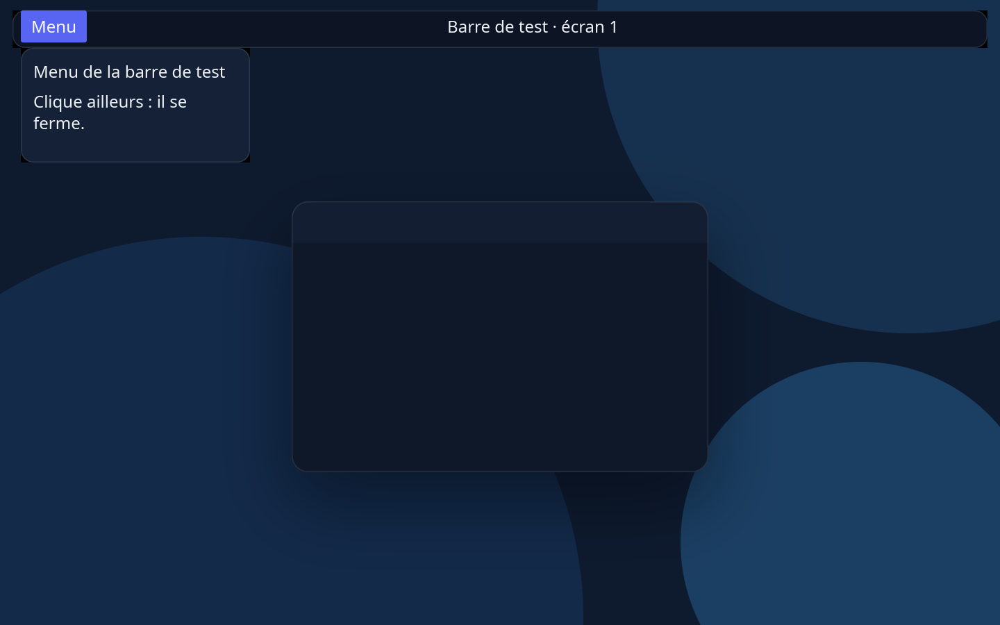
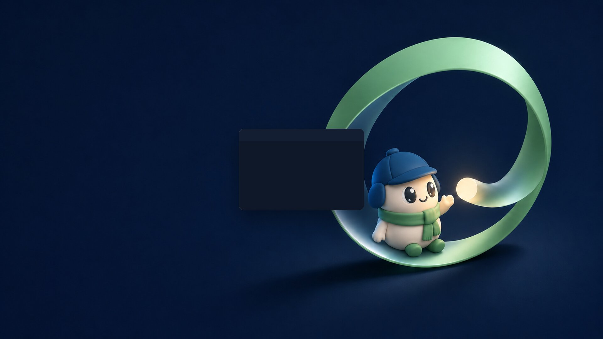
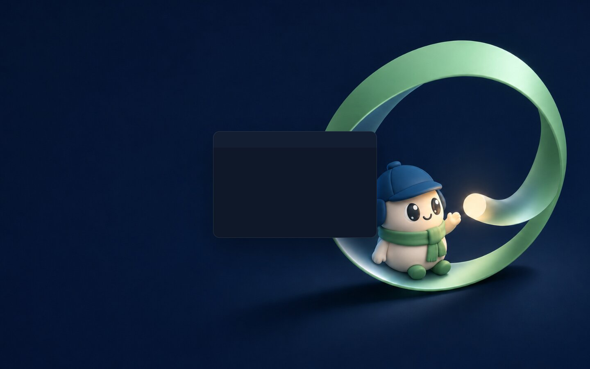

# Compositor

The compositor shows the windows of Wayland applications and receives the keyboard and the mouse.
It is written in Rust with Smithay 0.7, in `desktop/compositor`. Lot D-10 lays its base: it runs
in a window inside an existing session, without visual effects. Lot D-17 makes windows easy to
handle: grab band, cursors, snapping against the screen edges. Lot D-11 gives it the look of the
boards: desktop background, rounded corners, border, shadow, and spring animations. Lot D-13
runs X11 applications in it, through XWayland, with the clipboard both ways. Lot D-12 adds
anchored surfaces (layer-shell) for the bar, the dock and the panels, several screens, and
fractional scaling. Lot D-04 draws the wallpaper.

Machine prerequisites, on top of those in `CLAUDE.md`: the `Xwayland` server (`xwayland` package
on Debian). Tried with version 24.1.6 from Debian 13; the CI installs the one from Ubuntu 24.04.
Without it, the compositor still starts, and only Wayland applications show up.

## Architecture

| File | Role |
| --- | --- |
| `src/main.rs` | Reads the options (`--nested`, `--measure`, `--outputs`, `--scale`), creates the event loop, starts XWayland, launches the given command |
| `src/lib.rs` | `State`: Wayland display, protocols, seat, `Space` of the windows. Socket, screen, focus |
| `src/handlers.rs` | Protocol handlers: `wl_compositor`, `wl_shm`, `wl_seat`, `wl_output`, xdg-shell, cursor shapes, clipboard and primary selection. Placing a window according to its state (`rearrange`), Wayland or X11 |
| `src/layer.rs` | Anchored surfaces (`zwlr_layer_shell_v1`): placement by each screen's layer map, exclusive zone and work area, keyboard, menus, hit testing |
| `src/output.rs` | Screens: place in the space and in the host frame, scale, `wp_fractional_scale_v1`, `wp_viewporter`. `View` turns space coordinates into frame pixels |
| `src/xwayland.rs` | XWayland: startup and shutdown, X11 window manager (`X11Wm`), surface association, clipboard as seen from X11 |
| `src/focus.rs` | Keyboard target: Wayland surface or X11 window |
| `src/input.rs` | Keyboard and mouse: click to focus, gestures, snapping, shortcuts, cursor shape |
| `src/layout.rs` | Layout: place, move, resize, grab band, snap zones, return to the previous size. Pure computation, without Wayland or rendering |
| `src/winit.rs` | Windowed backend: the host window, its virtual screens side by side, its cursor. Starts the rendering of each frame and its measurement |
| `src/render.rs` | Rendering: wallpaper or background and discs, shadows, content clipped to a rounded rectangle, borders, snap preview |
| `src/wallpaper.rs` | Wallpaper: setting read again when it changes, images decoded on a thread, one texture per variant in use, placement on each screen |
| `../desktop-config` | Settings shared with Control Room: `wallpaper.conf`, choice of the variant, cover / contain / center geometry; the variant generator `wallpaper-variants` |
| `src/shaders/` | The three GLSL programs of the renderer: `shape.frag`, `shadow.frag`, `clip.frag` |
| `src/anim.rs` | Motion of windows and of the preview: springs applied to rectangles. Pure computation |
| `src/stats.rs` | Frame statistics for `--measure` |
| `examples/scene.rs` | Test client: the measurement scene, and one window to compare with the board (`board`), maximized from the start (`maximized`) or small enough for scale 2 (`small`) |
| `../../prototypes/bar-test` | Test bar of lot D-12, out of the workspace: 36 px, anchored at the top of every screen, with a menu |

Colors, sizes, durations and springs come from `sherlock-ui` (modules `color`, `metrics`,
`motion` and `window`), without its `iced` feature.

Everything runs in a single thread, on a `calloop` loop. The loop sources are the Wayland
display (client requests), the listening socket and, in nested mode, the winit window (input
and redraw requests). After each iteration, `State::refresh` cleans up dead windows and sends
the replies to the clients.

The layout logic lives in `layout.rs` and only knows rectangles: rendering (`winit.rs`) and input
(`input.rs`) call it. The future DRM backend (lot D-14) will reuse `State` as is and only replace
`winit.rs`.

Behavior:

- A new window is centered at its first content and gets the keyboard. With several screens, it
  is centered in the work area of the screen under the pointer.
- A click on a window gives it the keyboard and raises it.
- The gesture key is Super in a real session (lot D-14), and Alt in nested mode (`--nested`): the
  host session keeps Super for itself (under Plasma, the KWin window actions and the launcher).
  That is niri's convention. The rule lives in `gesture_modifier_held` (`src/input.rs`).
- Windows draw their title bar themselves: xdg-decoration is out of the lot.
- The keyboard is French AZERTY, unless `XKB_DEFAULT_LAYOUT` is set.

Moving and resizing:

- An 8 pixel band surrounds each window, outside its geometry. It widens to 20 pixels at the
  corners, diagonally as well as along the sides. A left button press in the band pulls that
  edge or corner. The client does not see the press. The band of a window comes before the
  windows it covers, not before those above it. A window without content has no band.
- Dragging the title bar or an edge that a client draws itself moves or resizes its window
  (`xdg_toplevel.move` and `.resize`). As xdg-shell requires, the request is only granted on the
  compositor's seat, while a button is pressed on a surface of this client, with the serial of
  that press.
- Gesture key + drag with the left button moves the window under the pointer. With the right
  button, it is resized by the corner nearest to the pointer.
- During a resize, the opposite corner stays in place, and the client's minimum and maximum
  sizes are respected.
- A move only shifts the window once the pointer has travelled 4 pixels: a mere click does not
  shift it nor pull it out of its zone.
- Only the release of the button that started the gesture ends it. Other buttons go to the
  seat, with no client to receive them.
- A fullscreen window is neither moved nor resized by a gesture, and has no band.

Snapping:

- A moved window, dropped with the pointer within 8 pixels of the top edge of the screen, is
  maximized. Against the left or right edge, it takes that half of the screen. In a corner,
  within 64 pixels of the corner along an edge, it takes that quarter. The bottom edge alone
  snaps nothing. During the drag, a translucent green rectangle shows the targeted zone.
- This holds for moves with the gesture key as well as for those requested by the client.
- Moving a snapped or maximized window gives it back its previous size, under the pointer,
  grabbed at the same proportion of its width. If it had none, because it was maximized before
  its first content, the client chooses its size. Resizing it removes the maximized or snapped
  state, and it starts from its current size.
- A window snapped by a drop returns, when leaving its zone, to its place from before the drag.
- Gesture key + Up arrow maximizes the window that has the keyboard, or gives it back its
  previous size if it already is. Left or Right arrow: half of the screen. Down arrow: previous
  size. Only the gesture key may be held: with Shift or Ctrl as well, the arrow goes to the
  client. These keys, press and release alike, do not go to the client. They have no effect in
  fullscreen. If the host window loses the keyboard between the press and the release, the
  compositor forgets the interception.
- Maximized is the xdg-shell `maximized` state, which the client knows about. A half or a
  quarter is only an imposed size: the `tiled` states are not sent.
- Zones are taken from the work area of a screen: what the exclusive zones of anchored surfaces
  leave (see below). A maximized or snapped window never covers the bar or the dock; a
  fullscreen one covers the whole screen. Dropped by a drag, a window snaps on the screen under
  the pointer, against that screen's edges. A shortcut or a client request acts on the window's
  screen, the one under its center. Along the edge that two screens share, both edges snap:
  dragging a window from one screen to the other shows the preview of each side in turn.

Cursors:

- Over the band, the cursor takes the shape of the edge or corner. During a move, it takes the
  "move" shape, and during a resize that of the pulled edge.
- Over a client, the cursor is the one it names through the cursor shape protocol
  (`wp_cursor_shape_v1`, which Qt 6 uses). A client that draws its cursor image itself
  (`wl_pointer.set_cursor` with a surface) gets the arrow: the image is not shown. Elsewhere,
  it is the arrow.
- In nested mode, the cursor of the host window changes shape, with the host session's theme.
  The real session (lot D-14) will have to draw the cursor itself.

## Anchored surfaces (layer-shell)

The bar, the dock, the launcher and the notifications are separate programs (ADR 0005). They
anchor themselves to a screen edge with `zwlr_layer_shell_v1` (version 4 in smithay 0.7). Each
screen has a layer map (smithay's `LayerMap`) that places its surfaces from their anchors,
size and margins, and computes the work area.

- **Screen.** A surface goes to the screen it names, or else to the screen under the pointer.
  It is placed and receives its first configure at its first commit, and again on every
  commit, which is when its anchors, size, margins or exclusive zone may change.
- **Layers.** Background and bottom surfaces are drawn under the windows, top and overlay ones
  above them, the snap preview between the top surfaces and the windows. The pointer follows
  the same order. Anchored surfaces are drawn as they are: no rounded corners, border or
  shadow, which are the client's business (the bar draws its own glass).
- **Exclusive zone.** What a surface reserves along its edge, plus its margin on that edge, is
  taken from the work area. Windows are centered, maximized and snapped inside it. When it
  changes (the bar starts, stops or resizes), maximized, fullscreen and snapped windows of that
  screen take the new work area, Wayland or X11, including those that do not have their first
  content yet (a window maximized at startup, before the bar arrives). A bar of 36 with a top
  margin of 10 leaves the area from y = 46. The work area always stays inside the screen and is
  never smaller than `window::MIN_WORK_AREA` of sherlock-ui (320 × 240, or the screen if
  smaller): zones that cover the whole screen leave that minimum at their edge, never a
  negative or empty area.
- **Checks.** Client values are checked before smithay places anything, so that no geometry
  can overflow. A size beyond 2^31 (`set_size`) is a protocol error (`invalid_size`), sent
  before smithay reads it, which would otherwise assert against a negative size. At each
  commit, the surfaces of the screen are refused (`closed` and a warning in the log, the
  surface leaves the layer map before it is placed) when a margin is larger than the screen, or
  when the exclusive zones with their margins, summed along each axis, are larger than the
  screen: a zone of 100 000, or `i32::MAX` with a margin, is refused, and the third panel that
  no longer fits too.
- **Null buffer.** A surface that commits a null buffer is unmapped: its exclusive zone and the
  keyboard come back, as when it is closed. Its next commit maps it again on the same screen,
  with a new configure.
- **Keyboard.** `none`: never. `on_demand`: a click on the surface gives it the keyboard, a
  click on a window takes it back. `exclusive`, on the top or overlay layer: the surface takes
  the keyboard as soon as it shows something, and keeps it while it is there; clicks on
  windows still raise them, without the keyboard. When it leaves or gives up the keyboard, the
  window that had it gets it back.
- **Menus.** An `xdg_popup` attached to an anchored surface (`zwlr_layer_surface_v1.get_popup`,
  the menus of the bar) is drawn and hit in front of it, nested popups included. It is kept
  inside its screen (flip, slide, resize of `xdg_positioner`). A menu that asks for a grab
  (`xdg_popup.grab`) is closed (`popup_done`, the whole chain) by a press on a surface of
  another client, or on the desktop; the press still goes through. Presses on the client's own
  surfaces go to it, which closes its menu itself. The serial of the grab is not checked:
  iced opens its menus on release, with the serial of the press. The menu does not take the
  keyboard: Escape and arrow keys go to the surface that has it.
- **Blur.** `Scene::push_backdrop` is the place where the blur behind glass surfaces comes, with
  lot D-11b: it is called for each anchored surface, behind it, with its rectangle in the
  frame. It draws nothing yet: a translucent surface shows a sharp desktop behind it.

### Security notes

Not settled by lot D-12, which runs nested only. What its review established, to carry into
the briefs of D-14, D-25 and the lot of the consent window (ADR 0011):

- **The `zwlr_layer_shell_v1` global is open to every Wayland client**, Flatpak ones included:
  nothing filters it.
- **Keyboard theft.** An overlay surface with an `exclusive` keyboard keeps it as long as it
  exists, even a 1 × 1 surface, and even after a click on a window (the test
  `a_surface_with_an_exclusive_keyboard_keeps_it` checks the protocol's behavior). Any client
  can thus capture all typing with an almost invisible surface. The compositor's shortcuts are
  still intercepted before the client, but they act on `focused_window()`, which is `None`
  while an anchored surface has the keyboard: the gesture key + arrows then do nothing.
- **Clicks.** An overlay surface anchored to the four edges is in front of everything, drawn
  and hit first: it receives every click.
- **To reserve to the compositor:**
  - a layer above the overlay one, for the consent window (ADR 0011) and the lock screen,
    drawn by the compositor itself and hit before `layer_hit`;
  - a forced keyboard focus that comes before `exclusive_layer()`;
  - a filter on the layer-shell global, kept for the shell programs that the session starts;
  - `ext-session-lock` for D-25, rather than an overlay surface.

### Layer-shell toolkit of the shell (answer to ADR 0014)

ADR 0014 asked which iced layer-shell crate the shell keeps. Answer: **`iced_exwlshell` 0.21.4**
(waycrate, MIT), the crate formerly published as `iced_layershell` (0.19.1, used by the D-00
prototype). The bar of lot D-20 pins it (`=0.21.4`), with iced `=0.14.0` and tiny-skia, and so
does the test bar `prototypes/bar-test`, used to try this lot.

What was checked in our compositor with the test bar: a bar on every screen
(`StartMode::AllScreens`, with `daemon`), anchors, margins and exclusive zone, the keyboard on
demand, a menu in an `xdg_popup` attached to the bar and closed by a click elsewhere, and the
fractional scale (the bar draws at 1.25, 1.5 and 2 through `wp_fractional_scale_v1` and
`wp_viewporter`).

Limits to keep in mind:

- Small project, which renamed itself and broke its API between 0.19 and 0.21 (October 2026).
  The version is pinned; a new version is a lot of its own.
- `application` refuses `StartMode::AllScreens`: a program with one surface per screen must use
  `daemon`, and its message type `#[to_layer_message(multi)]`.
- No accessibility (iced 0.14 has none), as ADR 0014 says.
- iced redraws on every message: one frame per message, even when nothing changes.
- The menus are views written by hand; the crate only creates and places the popup.
- **In software rendering (tiny-skia), surfaces are opaque.** iced presents through softbuffer
  0.4.8, whose Wayland backend only creates `XRGB8888` buffers: the transparent pixels of the
  bar (outside its rounded corners, behind the translucent glass) come out black, in any
  compositor. The floating bar of the board, with its 10 px gap and its glass, needs either
  a buffer with alpha (a softbuffer that offers `ARGB8888`, or iced's wgpu renderer on the AMD
  chip) or a square bar. To decide with lot D-20; not checked further here.

## Screens and scale

In nested mode, `--outputs N` (1 to 4) splits the host window into N screens side by side, each
with its own `wl_output`, its own work area and its own layer map. `--scale S` sets the scale
of the screens (`1`, `1.25`, `1.5`, `2`; a decimal comma works too); given several times, the
first applies to the first screen, the second to the second, and missing ones repeat the last.
Each screen gets an equal slice of the window, in pixels; its size in the space is that slice
divided by its scale. In the space, screens sit side by side from (0, 0), in order.

- **Windows.** A new window, Wayland or X11, is centered on the screen under the pointer. Snap
  zones are those of the screen under the pointer (see "Snapping"). A window across two screens
  is drawn on both, at each screen's scale. Its shadow is drawn on its own screen only (the
  one under its center): a maximized window casts none on the next screen.
- **Scale announced to clients.** `wl_output` gives the scale rounded up (2 for 1.25 or 1.5).
  `wp_fractional_scale_v1` gives the exact scale, in 120ths, for each surface, from the screen
  under its center: clients that know it (Qt 6, GTK 4, iced through `iced_exwlshell`) draw at
  that scale and give the size in points with `wp_viewporter`. `wl_surface.preferred_buffer_scale`
  (version 6) gives the rounded scale. Every surface is told again when it changes screen.
- **xdg-output.** `zxdg_output_manager_v1` gives each screen's place and size in points: XWayland
  and toolkits read them. X11 applications are not scaled by XWayland: they draw at scale 1 and
  are enlarged, so they are blurry at 1.5 or 2.
- **Rendering.** Each screen draws into its slice of the frame, at its scale (see "Rendering").
- **Pointer.** The host window gives a point of the whole frame; the screen whose slice holds it
  turns it into a point of the space.

Screenshots, taken in nested mode on the reference laptop with the test bar (its menu opened by
`BAR_TEST_MENU=1`) and `scene small`, in a host window of 1440 × 900:

| Scale | Screenshot |
| --- | --- |
| 1 |  |
| 1.5 |  |
| 2 |  |
| Two screens, 1 and 2, `scene maximized` maximized on the second (in Xephyr, 1280 × 800): no shadow on the first |  |

The black corners around the bar and its menu are the test bar's own: iced draws with
tiny-skia through softbuffer 0.4.8, whose Wayland backend only uses `XRGB8888` buffers, so the
surface is opaque and its transparent pixels come out black (see the layer-shell toolkit
limits above).

The session on the real machine (lot D-14) will have one output per connector: `State` already
knows several screens, only `winit.rs` lays them out in one window.

## XWayland

XWayland is an X11 server that is also a Wayland client of the compositor. Each X11 window has
a Wayland surface there, which the xwayland-shell protocol associates with the window. Smithay
provides the launch (`XWayland`) and the X11 window manager (`X11Wm`), which talks to the X
server on behalf of the compositor. X11 windows enter the same `Space` as Wayland windows, as
`Window`s: layout, gestures, rendering and animations make no difference, except in the few
places where a state is read or sent.

**Started at launch.** XWayland starts with the compositor, not at the first connection of an
X11 client. Reasons:

- The command launched by `--nested` must know `DISPLAY`, and may itself be an X11
  application: it starts once XWayland is ready, with `DISPLAY=:N` and `WAYLAND_DISPLAY`.
- Smithay 0.7 can only launch XWayland right away. Starting on demand would require listening
  on the X11 sockets ourselves and handing the first connection to the server: more code, for
  little gain.
- The cost is modest: on the reference laptop, XWayland is ready in 0.2 s and takes about 85 MB
  of resident memory (shared libraries included), without an X11 client.

The display number is the first free one (`:1` under an X11 session that holds `:0`). It is in
the log: `XWayland ready display=1`. Xwayland's messages go to the compositor's standard error,
mixed with its logs. At startup, warnings from glamor, GBM and xkbcomp are expected: without
access to the GPU, Xwayland draws in software. At shutdown, `(EE) failed to read Wayland events`
too: the compositor closes its connection. Without `Xwayland` on the machine, the log says so
(`no X11 applications`), and the command starts without `DISPLAY`: it does not inherit the host
session's, where its X11 windows would open outside the compositor.

**Shutdown.** When quitting, the compositor removes XWayland and its Wayland socket from the
loop (`State::shutdown`): the X server stops, its lock (`/tmp/.X<N>-lock`) and its socket
(`/tmp/.X11-unix/X<N>`) go away, and so do the Wayland socket (`$XDG_RUNTIME_DIR/wayland-N`) and
its lock. It has to be done by hand: the `X11Wm` source keeps a handle to the loop, which is
therefore never freed, nor anything in it. If `X11Wm` does not start, the compositor cuts
XWayland's connection right away and stops it: X11 applications do not show up, but the
session goes on. Killed by a signal (Ctrl + C in the terminal), the compositor leaves the lock
behind; Smithay takes it over at the next launch, since its process no longer exists. The
compositor creates `/tmp/.X11-unix` if it is missing, with the permissions systemd gives it
(1777).

**Managed windows.**

- A window that asks to be mapped is centered on the screen, at the size it asks for. It shows
  up (with the opening animation) and gets the keyboard when XWayland associates its surface
  with it: before that, it would not have received the keyboard input.
- The keyboard goes through the Wayland surface and through the X11 focus (`SetInputFocus` or
  `WM_TAKE_FOCUS`, depending on what the window accepts). A window that is raised is raised for
  the X server too.
- The compositor places the window: it sends the X server its place and size on every move,
  snap or resize. A floating window gets the size it asks for, never the place. Maximized,
  snapped or fullscreen, it keeps the one it was given.
- The maximized and fullscreen states are those of `_NET_WM_STATE`, which the window knows
  about, like those of xdg-shell for a Wayland window. Its requests (`_NET_WM_STATE` and
  `_NET_WM_MOVERESIZE`, for example from a browser's title bar) go through the same paths as
  those of a Wayland window. Since the X server gives no serial, a requested gesture is only
  granted while a button is pressed on the surface of that very window. A surface of XWayland is
  not enough: all X11 clients are a single Wayland client, and another X11 program could
  otherwise move its window during a click in xterm.
- An X11 window takes its new size as soon as it is sent. During a resize, its place is
  therefore realigned right away, without waiting for its content.
- The title is `_NET_WM_NAME` or `WM_NAME`.

**Menus and tooltips.** Override-redirect windows place themselves, above the others. They are
drawn as they are, like Wayland menus: no corners, border, shadow, animation or grab band. A
click inside them does not move the keyboard.

**Clipboard.** The compositor advertises `wl_data_device_manager` (CLIPBOARD) and the primary
selection (`zwp_primary_selection_device_manager_v1`, PRIMARY). The client that has the keyboard
reads and sets both. Exchanges with X11 go through `X11Wm`:

- A Wayland client sets a selection: the window manager takes it on the X side. An X11 client
  that reads it receives the Wayland client's data.
- An X11 client sets a selection: the compositor sets it on the Wayland side on its behalf. A
  Wayland client that reads it receives the X11 client's data.
- Like a Wayland client, an X11 client only reads a selection coming from Wayland, and only sets
  its own on the Wayland side, if an X11 window has the keyboard. A background X11 program
  therefore cannot change what the user pastes into a Wayland application. The rule is strict,
  with no exception for command line tools: `xclip -i` launched from a Konsole (Wayland) sets
  nothing on the Wayland side. The log says so at the `debug` level: `X11 selection refused`.

## Rendering

Each frame is redrawn in full with Smithay's GLES renderer (`GlesRenderer`), in the compositor's
single thread. `render::Scene` compiles three programs at startup and lays out the elements from
front to back, as Smithay expects them:

1. anchored surfaces of the overlay and top layers, each with its menus in front;
2. the snap preview: translucent green rounded rectangle, 2 px green border;
3. for each window, from the topmost to the lowest: its menus (`xdg_popup`, neither clipped nor
   scaled), its border, its clipped content, its shadow;
4. anchored surfaces of the bottom and background layers;
5. the wallpaper, or without one the three background discs (see "Wallpapers");
6. the desktop color, which fills the rest.

**Screens and scale (lot D-12).** Each screen has its own list of elements, built in pixels of
the frame by its `View`: its area of the space, its slice of the frame, its scale. Rectangles are
converted corner by corner, so that touching rectangles still touch. Radii, border widths,
shadow offset and blur, and the snap preview border are multiplied by the scale: at 1.5, a
window has a radius of 24 pixels, a border of 1.5 and a shadow offset by 42 and blurred over 105,
exactly the 1.5× of the board. Client surfaces are built at scale 1 from their origin, then
scaled around it (`RescaleRenderElement`), with the animation's stretch when there is one: a
client that draws at the screen's scale is drawn pixel for pixel. The compositor draws the
frame itself rather than through smithay's `OutputDamageTracker`: it clears the frame, then
draws each screen's elements from back to front, each one limited to its screen's slice (the
damage given to `draw`). The frame is drawn at scale 1: the elements' "logical" coordinates
are frame pixels.

| Program | Kind | What it draws |
| --- | --- | --- |
| `shape.frag` | Pixels | Rounded rectangle, filled and bordered, smoothed over one pixel: window borders (without fill), background discs (radius of half the side), snap preview |
| `shadow.frag` | Pixels | Drop shadow of a rounded rectangle blurred by a Gaussian, cleared under the window |
| `clip.frag` | Texture | Client content multiplied by the coverage of its window's rounded rectangle |

The values, all taken from `sherlock-ui`:

| Element | Value | Token |
| --- | --- | --- |
| Background | `#0E1A2E` | `color::DESKTOP` |
| Discs | `#132A49`, `#16314F`, `#1B3F63`, places and diameters from the Main board | `color::DESKTOP_DISCS`, `metrics::DESKTOP_DISC_GEOMETRY` |
| Corners | Radius 16, reduced for a window smaller than two corners | `metrics::WINDOW_RADIUS` |
| Border | 1 px `rgba(255,255,255,0.10)`, inside the window as in CSS | `metrics::BORDER_WIDTH`, `color::BORDER` |
| Shadow | `0 28px 70px rgba(3,8,18,0.55)` | `metrics::SHADOW_OFFSET`, `metrics::SHADOW_BLUR`, `color::SHADOW` |

**Background.** On a 1440 by 900 screen, the discs are exactly at their place on the board:
(-260, 340) diameter 1100, (860, -420) diameter 900, (980, 520) diameter 520, the last one in
front. On another screen, their centers follow the screen on each axis and their diameter
follows the larger of the two ratios, so that they stay round.

**Corners.** The client content is really clipped: `RoundedSurface` wraps each surface of the
window and, while drawing it, replaces Smithay's texture program with `clip.frag`. The clip is
computed from `gl_FragCoord`, in frame pixels: it holds for subsurfaces as for the main surface,
at any scale. The windowed backend flips the frame (`Flipped180`); `clip_in_frame` applies the
same transform to the clip rectangle. What the client draws outside its geometry (GTK
client-side shadows) is cut: the compositor draws the shadow. A fullscreen window has no
corners, border or shadow: it keeps them while it slides towards the whole screen and loses them
on arrival, when it already covers the screen. A maximized or snapped window keeps them.

**Shadow.** Like `box-shadow`: the window rectangle, shifted 28 down, blurred by a Gaussian with
a standard deviation of 35 (half the blur, as browsers do). The element extends 70 around that
rectangle. The computation follows Evan Wallace ("Fast Rounded Rectangle Shadows"): exact
integral in x, four samples in y. The shadow is not drawn under the window, which matters for a
translucent client and during fades.

**Cost.** Clipped surfaces have no opaque region: the windows below are always drawn. The frame
is redrawn in full every time (age 0), as before this lot. The DRM backend (D-14) will be able to
give surfaces back their opaque part, outside the corners.

### Animations

The `sherlock_ui::motion` module holds the physics, as pure computation and without iced, so
that the compositor and the shell share the same springs:

- `Spring`: damped spring of mass 1, defined by its stiffness and its damping. `solve` gives the
  offset and the velocity at any time through the exact solution of the equation (underdamped,
  critically damped or overdamped), without a time step: a late frame does not change the
  trajectory.
- `Animation`: a value driven by a spring. `retarget` changes target while keeping value and
  velocity: nothing jumps when the target moves along the way.
- `Fade`: a fade over a fixed duration, quick start and soft landing (cubic). When interrupted,
  it starts again from its current value.

| Token | Value | Damping ratio | Use |
| --- | --- | --- | --- |
| `SNAP_SPRING` | stiffness 500, damping 33.5 | 0.75, 3 % overshoot | Snap, maximize, restore |
| `OPEN_SPRING` | stiffness 450, damping 34 | 0.80, 2 % overshoot | Scale at opening, from `OPEN_SCALE` (0.92) to 1 |
| `PREVIEW_SPRING` | stiffness 700, damping 42 | 0.79 | Snap preview |
| `FADE` | 150 ms | | Opacity at opening, preview appearing and fading out |

`docs/contexte.md` only gives « ressorts » (springs), « léger dépassement » (slight overshoot)
and hovers of 110 to 150 ms: these values are choices of the lot. Each spring covers 90 % of the
way in less than 150 ms and settles within 1 % in less than 300 ms (tests of `motion`). The fade
lasts one hover.

`anim.rs` applies them to windows:

- **Opening.** At its first frame, the window grows from 0.92 to 1 around its center and goes
  from transparent to opaque. Its shadow and its border follow.
- **Snap and restore.** `rearrange` (snap, maximize, fullscreen, restore) calls
  `animate_next_change`. The flag only holds for the next frame, where it is consumed in every
  case: if the geometry has changed there, it starts from the last drawn geometry on four
  springs, position and size; otherwise nothing is animated. An animation already running
  simply changes target. The target then follows the real geometry: the position changes right
  away, the size when the client answers, and the spring carries on without a jolt. During the
  animation, the client buffer is stretched into the animated rectangle
  (`RescaleRenderElement`). Once settled, it is drawn at scale 1. Limit: a snap that only
  changes the size, the position staying the same, is not animated.
- **Drag and resize.** They are never animated: the start of a gesture stops any geometry
  animation (`WindowMotion::follow`), and the window follows the pointer without delay. A
  snapped or maximized window pulled out by dragging it gets its previous size back at once,
  under the pointer, as before this lot.
- **Snap preview.** It appears by growing from 0.92 to 1 and fading in, slides from one zone to
  another, and fades out at its last place.

Nothing flickers: a window appears from zero opacity, and each animation starts from what was
drawn in the previous frame.

### What rendering does not do yet

- **Blur** behind glass surfaces (dual Kawase, radii of 24, 28 and 30 px): postponed, the lot
  was already over its size. Its place for anchored surfaces is ready (`Scene::push_backdrop`,
  lot D-12). It needs an offscreen render of what is behind the surface, at reduced
  resolution, then blur passes; the snap preview would be its first client.
- **Animated closing.** When the client destroys its window, its buffer goes away with it.
  Animating it requires keeping a copy of its last frame (texture) at the time of destruction.
- **Hovers**: the compositor has nothing to hover yet. The `motion::FADE` token is already at
  the duration of a hover.

## Wallpapers

The wallpapers of the collection are in `assets/wallpapers/`, one original per wallpaper, named
by its id. Their names as the interface shows them, their category and their tone (light or
dark) are in `sherlock_ui::wallpapers`, the index that Control Room's picker (lot D-26) will
read. The default one is `first-clue`, « Le premier indice ».

| Id | Name | Category | Tone | Original |
| --- | --- | --- | --- | --- |
| `first-clue` | Le premier indice | Par défaut | Dark | 1672 × 941 |
| `ring` | L'anneau | Emblème | Dark | 3840 × 2160 |
| `jade-relief` | Relief de jade | Emblème | Dark | 1672 × 941 |
| `aurora` | Aurore polaire | Emblème | Dark | 1672 × 941 |
| `paper-eclipse` | Éclipse de papier | Emblème | Light | 1672 × 941 |
| `rain-trail` | La piste sous la pluie | Les enquêtes de Sherlock | Dark | 1672 × 941 |
| `missing-page` | La page disparue | Les enquêtes de Sherlock | Dark | 1672 × 941 |
| `last-train` | Le dernier train | Les enquêtes de Sherlock | Dark | 1672 × 941 |

**Why `assets/` at the root.** The originals are data, not code: no crate compiles them in
(`include_bytes!` would put 5 MB in every binary that reads the index). The image factory
(distro) and the variant generator read them from there, and `sherlock-ui` stays a library of
code.

**Storage of the originals.** One original per wallpaper, never the variants. The author's
images are PNG; they are stored as JPEG quality 95 without chroma subsampling (4:4:4), which is
three to five times lighter than lossless WebP for the same look. Measured with ImageMagick
7.1.1 (libjpeg-turbo 2.1.5, libwebp 1.5.0), in bytes:

| Id | PNG of the author | Lossless WebP | JPEG 95, 4:4:4 | PSNR of the JPEG |
| --- | ---: | ---: | ---: | ---: |
| `first-clue` | 1 557 618 | 973 164 | 206 577 | 48.5 dB |
| `jade-relief` | 2 125 863 | 1 404 736 | 415 234 | 45.3 dB |
| `aurora` | 1 666 937 | 1 153 590 | 306 778 | 47.6 dB |
| `paper-eclipse` | 2 510 471 | 1 643 796 | 530 777 | 43.5 dB |
| `rain-trail` | 2 432 252 | 1 810 506 | 733 322 | 42.3 dB |
| `missing-page` | 2 702 563 | 1 827 410 | 700 332 | 42.7 dB |
| `last-train` | 2 806 238 | 2 007 668 | 809 464 | 41.2 dB |
| `ring` (JPEG source) | | 2 768 312 | 1 261 945 (copied as is) | |
| Total | 15 801 942 | 13 589 178 | 4 964 429 | |

Above 40 dB, the difference does not show; a crop of the dark gradient under the ring of
`first-clue`, contrast stretched 3.3 times, shows the same grain in the PNG and in the JPEG.
A JPEG source (the ring) is copied without being encoded again, which would only lose
quality. Keeping JPEG also lets the compositor and the generator decode the originals with
the PNG and JPEG codecs only. `assets/wallpapers/import.sh <collection> [ring]` imports the
author's collection again, for instance when the 4K versions come.

**Variants.** `just wallpapers [folder]` (default `target/wallpapers`) runs
`wallpaper-variants` (crate `desktop-config`, feature `variants`), which writes for each
original `<folder>/<id>/1920x1080.png`, `2560x1440.png` and `3840x2160.png`:

- the middle of the original cut to 16:9, as `cover` shows it;
- resized with Lanczos 3, in floating point;
- brought back to 8 bits with a triangular dither of one step (seeded noise): the rounding
  error becomes a fine grain instead of steps in the dark gradients, and the result is the
  same byte for byte from one run to the next.

The variants are not versioned: the image factory will generate them and install them in
`/usr/share/nom-os/wallpapers/` (lot of the session on our base). On the reference laptop,
the eight wallpapers take 2 minutes and 120 MB (1.9, 3.1 and 6.6 MB for `first-clue`); the
dithered grain keeps PNG from compressing them much, which is also why they are generated and
not stored. Generating them at the first launch would cost the same 9 to 20 seconds per wallpaper
at the start of the session; at build time, it costs nothing in the session.

With 1672 × 941 originals, the 2560 and 3840 variants are enlargements: sharp in the sense of
"not enlarged again by the GPU", but no more detailed than the original. The 4K originals the
author will provide fix that; the ring is already 4K.

### Setting

`$XDG_CONFIG_HOME/nom-os/wallpaper.conf` (`~/.config/nom-os/…` by default). `nom-os` stands for
the name of the OS, not chosen yet: it is written once, in `desktop_config::DIR`.

```text
# An image (PNG or JPEG), or a folder of variants named <width>x<height>.png.
path = /usr/share/nom-os/wallpapers/ring
# cover (default), contain or center.
mode = cover
```

- Without `path`, or without the file: the default wallpaper, looked for in
  `$XDG_DATA_HOME/nom-os/wallpapers/first-clue` then in each `$XDG_DATA_DIRS`.
- `cover` fills the screen, centered, and cuts what overflows. `contain` shows the whole image,
  centered, with the desktop color in the bands. `center` puts one image pixel on one screen
  pixel, centered.
- The file is checked every 2 seconds (one `stat`, modification time and length): when it
  changes, it is read again and the wallpaper changes, without restarting.
- A wrong line (unknown key or mode) is logged with its number, and the default setting
  applies. A missing image, a folder without variants or an image that does not decode is
  logged, and the background of the board shows: color and discs. Never a crash.

### Rendering

- **Variant.** Each screen takes the variant made for its size in pixels, that is its size
  in points times its scale: the smallest one that `cover` (or `contain`) does not enlarge,
  or else the largest. 1440 × 900 at scale 1 takes 1920 × 1080; the same screen at scale 2
  (2880 × 1800) takes 3840 × 2160.
- **Placement.** Computed in the pixels of the screen's slice of the frame, so the scale is
  already in it: a screen at 1 and a screen at 2 of the same size in pixels show exactly the
  same part of the image.
- **Loading.** The image is decoded on a thread of its own (a 4K PNG takes a while): the
  frames go on, with the board's background until it is ready. It is then uploaded once as a
  texture, shared by the screens that use the same variant, and drawn every frame as one
  textured rectangle. A texture that no screen uses any more is freed; a new setting drops
  them all.
- **Cost at rest.** Nothing more than one textured rectangle per screen in place of the three
  discs, and one `stat` every 2 seconds.
- **Blur (lot D-11b).** The wallpaper is an element of the same list as the rest of the scene,
  drawn first into the same frame: whatever the blur reads behind a glass surface
  (`Scene::push_backdrop`) contains it, as it contains the windows.

Screenshots, in Xephyr, with `scene small`, from the variants of `just wallpapers`:

| Screen | Screenshot |
| --- | --- |
| 16:9, 1920 × 1080, scale 1 |  |
| 16:10, 1440 × 900, scale 1 |  |
| 16:10, 2880 × 1800, scale 2 |  |
| Two screens of 1440 × 900, scales 1 and 2 |  |

To try it, with the variants in a test folder:

```sh
just wallpapers
mkdir -p /tmp/wallpaper-test/share/nom-os
ln -s "$PWD/target/wallpapers" /tmp/wallpaper-test/share/nom-os/wallpapers
XDG_DATA_HOME=/tmp/wallpaper-test/share cargo run -p compositor -- --nested
```

Then write `path = …/target/wallpapers/ring` and `mode = contain` in
`~/.config/nom-os/wallpaper.conf`: the wallpaper changes within 2 seconds.

## Running

```sh
cargo run -p compositor -- --nested
```

A window opens in the current session, Wayland or X11. Everything after `--nested` is a
command, launched once XWayland is ready, with the compositor's socket in `WAYLAND_DISPLAY` and
its X11 display in `DISPLAY`. What this command launches in turn inherits both. For a terminal:

```sh
cargo run -p compositor -- --nested env QT_QPA_PLATFORM=wayland konsole --separate
```

Logs go to standard error, at the `info` level by default. `RUST_LOG` sets it, for example
`RUST_LOG=compositor=debug,smithay=warn`. The socket name shows up at startup. At the `debug`
level, each gesture logs its start and its end, with its type (pulled edges, or none for a
move) and its source (gesture key or client request). A refused client request is logged too.

Two screens, the second one at scale 2, with the test bar on both (built beforehand, see
`prototypes/bar-test`):

```sh
(cd prototypes/bar-test && cargo build --release)
cargo run -p compositor -- --nested --outputs 2 --scale 1 --scale 2 \
  prototypes/bar-test/target/release/bar-test
```

`QT_QPA_PLATFORM=wayland` forces Konsole to speak Wayland: in an X11 session, Qt would choose
X11, and Konsole would go through XWayland. `--separate` keeps the command from joining a Konsole
that is already open.

### An X11 application

```sh
cargo run -p compositor -- --nested xterm
```

Or, from the compositor's Konsole, which already has the right `DISPLAY`: `xterm &`,
`xeyes &`. From another terminal, the display from the log must be given: `DISPLAY=:1 xterm`.

### Zen

Zen is installed as a Flatpak (`app.zen_browser.zen`). Its permissions already include the
`wayland` and `fallback-x11` sockets, and the home folder. Flatpak passes it the compositor's
socket, read from `WAYLAND_DISPLAY`. Two precautions:

- `--new-instance`: otherwise, if Zen is already running in the host session, the command hands
  it the page, and the window opens in the host session, outside the compositor.
- `--profile`: a separate profile, because the everyday one is locked by the Zen of the host
  session. The test folder below is in Zen's data, which the sandbox sees.

In native Wayland, which Zen picks on its own when `WAYLAND_DISPLAY` is set:

```sh
mkdir -p ~/.var/app/app.zen_browser.zen/compositor-test
cargo run -p compositor -- --nested flatpak run app.zen_browser.zen \
  --new-instance --profile "$HOME/.var/app/app.zen_browser.zen/compositor-test"
```

In X11, through XWayland: the Wayland socket is taken away from the sandbox and the X11 one is
given to it.

```sh
cargo run -p compositor -- --nested flatpak run --nosocket=wayland --socket=x11 \
  --env=MOZ_ENABLE_WAYLAND=0 app.zen_browser.zen \
  --new-instance --profile "$HOME/.var/app/app.zen_browser.zen/compositor-test"
```

The log says which of the two is running: `X11 window title="Zen Browser"` in X11, nothing like
it in Wayland. Close Zen before the compositor: closed first, the compositor may leave Zen
processes behind (`ps -eo pid,args | grep compositor-test` shows them).

### Clipboard from the command line

`wl-copy` and `wl-paste` (`wl-clipboard` package) are Wayland clients, `xclip` an X11 client.
An X11 window must have the keyboard, in both directions: launch the compositor with `xterm`,
and do not click elsewhere. With the numbers from the log:

```sh
WAYLAND_DISPLAY=wayland-1 wl-copy "from Wayland"; DISPLAY=:1 xclip -o -selection clipboard
echo -n "from X11" | DISPLAY=:1 xclip -i -selection clipboard; WAYLAND_DISPLAY=wayland-1 wl-paste
```

With `--primary` for `wl-copy` and `wl-paste`, and `-selection primary` for `xclip`, it is the
primary selection.

## Measuring

`--measure`, right after `--nested`, writes to the log every second the number of frames, the
frame rate, the average and maximum render time, the longest interval between two frames and
the number of late frames, that is frames that came more than 16.67 ms after the previous one
(frame rate of 60 frames per second, `motion::FRAME_RATE`). The render time goes from building
the elements to the end of the GPU's work: when measuring, the compositor waits for the end of
the render before presenting the frame. When the launched command ends, the session stops and
writes two summaries: all frames, and those drawn during an animation.

The measurement scene, `examples/scene.rs`, opens ten windows centered on each other, then
maximizes the topmost one and gives it back its size every 700 ms, twelve times: each change is
an animated snap, with its ten shadows and its ten clips. It lasts about ten seconds.

```sh
cargo build --release -p compositor --bin compositor --example scene
__EGL_VENDOR_LIBRARY_FILENAMES=/usr/share/glvnd/egl_vendor.d/50_mesa.json \
  target/release/compositor --nested --measure target/release/examples/scene
```

On the reference laptop, the compositor must run on the AMD chip:

- Smithay's log names the renderer at startup, `GL Renderer: "AMD Radeon Graphics
  (radeonsi, …)"`;
- `__EGL_VENDOR_LIBRARY_FILENAMES` only lets libglvnd load Mesa's EGL: NVIDIA's, which takes
  priority on Debian (`10_nvidia.json`), is not even opened;
- `cat /sys/bus/pci/devices/0000:01:00.0/power/runtime_status` must stay `suspended` before,
  during and after (address of the NVIDIA card given by `lspci -D | grep -i nvidia`).

Without `DRI_PRIME`, Mesa renders on the default chip, the one driving the screen: the AMD.
`DRI_PRIME=0` is refused by Mesa (`Invalid value (0) for DRI_PRIME`): do not set it. The
renderer log is authoritative.

Under Plasma X11, Mesa syncs the host window's presentation to the laptop screen: the frame rate
caps at its refresh rate, and the render time also counts the wait for the previous frame, so
that it gets close to the interval between two frames. To see the real cost of rendering,
`vblank_mode=0` (a Mesa variable) lifts this wait. At the `debug` level
(`RUST_LOG=info,compositor=debug`), each late frame is logged with its time, its interval and its
render time: a delay with a short render comes from somewhere other than rendering.

The criterion is "60 frames per second held": no late frame in the summary of animated frames.
The frame rate itself follows the host screen: the winit window is presented at the pace of the
laptop screen. The measured figures are in the merge request of lot D-11.

## Comparing with the Main board

1. Open `docs/design/planches/Main.dc.html` in Chromium, with a 1440 by 900 window, or take a
   screenshot of it:
   `chromium --headless --disable-gpu --hide-scrollbars --window-size=1440,900 --screenshot=board.png docs/design/planches/Main.dc.html`.
2. Launch the compositor without a command, set its host window to 1440 by 900, and only then
   open the window the size of the board's editor (836 × 652). The compositor centers a window
   at its first content, on the screen it has at that moment: the order matters. The socket
   name is in the log (`compositor ready socket="wayland-1"`).

   ```sh
   cargo build -p compositor --bin compositor --example scene
   target/debug/compositor --nested &
   wmctrl -r Smithay -e 0,-1,-1,1440,900
   WAYLAND_DISPLAY=wayland-1 target/debug/examples/scene board &
   import -window "$(xwininfo -name Smithay | awk '/Window id/ {print $4}')" compositor.png
   ```

   Check that the screenshot is 1440 by 900. For a host of W by H, the window is at
   ((W - 836) / 2, (H - 652) / 2): its bottom left corner is at ((W - 836) / 2, (H + 652) / 2).

3. Compare:
   - the background and the discs, to the pixel: same places, same colors;
   - the bottom left corner of the window: (36, 716) on the board, (302, 776) in the compositor
     at 1440 by 900. Both corners are on the `#132A49` disc. Crop around each one and put the
     two side by side: radius, 1 px light border (`(39, 47, 61)` on the window body in both),
     shadow shifted down that fades out over 70 px.

## Testing

```sh
just verify
```

| Test | What it checks |
| --- | --- |
| `src/layout.rs` | Centering, moving, resizing by each edge, opposite corner fixed during the whole gesture, client minimum and maximum sizes. Grab band: each side, each corner, wider at the corners, nothing inside, narrow window. Snapping: top, left and right edges, four corners, geometry of each zone, return to the previous size under the pointer |
| `sherlock-ui/src/color.rs` | Colors premultiplied by their opacity |
| `sherlock-ui/src/motion.rs` | Springs: convergence to the target, slight and bounded overshoot (between 0.5 and 4 %), response time (90 % in less than 150 ms, settled in less than 300 ms), target change without a jump in value or velocity, no overshoot for a critically damped or overdamped spring. Fade: duration of a hover, resumes without a jump |
| `src/anim.rs` | Centered opening starting from zero opacity. Animated snap of the position then of the size, drag followed without delay before and after. Flag consumed even without a change or during an animation, stopped by a gesture. Preview that appears, slides and fades out |
| `src/render.rs` | Discs at their place on the board at 1440 by 900, round on another screen. Shadow dimensions of the board's window, at scale 1 and 1.5. Corner radius, reduced for a small window. Clip flipped with the frame. Space to frame conversion of a screen at scale 2 and 1.25, without gaps |
| `src/stats.rs` | Frame rate, late frames, summary of animated frames |
| `src/wallpaper.rs` | Placement at each screen's scale, variant per screen size in pixels, default wallpaper from the data folders, board's background for a missing or undecodable image, setting read again when it changes, image of an older setting dropped |
| `desktop-config` | Settings read and written back, wrong lines refused with their number, missing file, XDG folders, variant choice (16:9, 16:10, scales 1 and 2, contain), cover / contain / center geometry, dither of a dark gradient (mean kept, reproducible) |
| `sherlock-ui/src/wallpapers.rs` | Every wallpaper of the index has its original, unique ids, a single light one |
| `tests/headless.rs` | Without a screen or backend, see below |
| `tests/xwayland.rs` | XWayland and an X11 client, without a screen or backend, see below |

The tests in `tests/headless.rs`:

- **Configure.** A client creates a titled window and receives its configure. It is maximized,
  goes fullscreen, comes back, then closes.
- **Move by the title bar.** A client shows content: its window is centered. It requests a move
  with a wrong serial, which is refused. With the serial of its press, the window follows the
  pointer until the release.
- **Snap at the top.** Dropped against the top edge, the window is maximized: the preview covers
  the screen and the client receives 800 × 600 with `maximized`. Moved again, it gets its
  previous size back.
- **Snap in a corner, then on a side.** The window dropped in the bottom right corner takes that
  quarter. Dropped then against the left edge, it takes the left half. Super + Down gives it
  back its place from before the drag.
- **Maximized before its content.** When moved, it receives 0 × 0 without `maximized`: the
  client chooses. Snapped then restored, it receives 0 × 0 again, not the screen size.
- **Grab band.** The cursor changes over the band. A press in the bottom right corner resizes
  the window. A right click during the gesture does not end it.
- **Resize requested by the client.** An `xdg_toplevel.resize` by the bottom right corner makes
  the size follow.
- **Fullscreen.** Neither move nor resize, and no band.
- **Shortcuts.** Super + arrows snaps left, maximizes, gives back the previous size. The client,
  which has a keyboard, receives Super but never the press nor the release of the intercepted
  arrows. Super + Shift + Left reaches it and snaps nothing.
- **Bar anchored at the top.** A maximized window; a client creates a layer-shell surface
  anchored at the top and both sides, 36 high, margins of 10 and 12, exclusive zone of 36. It
  receives a configure of 776 × 36, draws, and the work area becomes (0, 46, 800, 554): the
  maximized window is configured at 800 × 554 in (0, 46). Snapped left, it takes 400 × 554 in
  (0, 46). A click on the bar gives it the keyboard (on demand).
- **Exclusive zones stacked.** Two bars at the top and a dock of 76 at the bottom: work area
  (0, 92, 800, 432), and the maximized window follows. A surface with a zone of -1 changes
  nothing. Closing the second bar gives (0, 46, 800, 478), closing them all the whole screen.
- **Zones too large.** A zone of 100 000, `i32::MAX` with a margin of 10, a margin of
  `i32::MAX`: each surface is closed, the work area stays whole, the maximized window does not
  move and snapping still works. A size beyond 2^31 ends the client with `invalid_size`, and
  the compositor goes on.
- **Zones that cover the screen.** 300 at the top and 300 at the bottom on 600: the work area
  is the minimum of sherlock-ui, (0, 300, 800, 240), where maximizing and snapping happen. One
  more pixel of zone is refused.
- **Null buffer.** The bar, with the keyboard, commits a null buffer: the maximized window
  takes 800 × 600 again and the keyboard goes back to it. Committed again, the bar gets a new
  configure, draws, and the window goes back under it.
- **Maximized before the bar.** A window maximized before its first content receives
  800 × 600; the bar arrives; the window, still without content, receives 800 × 554, and its
  first content lands in (0, 46). The same on the second of two screens, in (800, 46), the
  first screen keeping its whole work area.
- **Exclusive keyboard.** An overlay surface of 1 × 1 with an exclusive keyboard takes it at
  its first content and keeps it after a click on the window, until it is destroyed.
- **The bar's client goes away.** A second client shows a bar, then disconnects: its zone comes
  back to the maximized window.
- **Two screens.** A second screen of 800 × 600 to the right. With the pointer on it, its work
  area is the one for new windows. The window, dragged with the gesture key to the right edge
  of the second screen, is shown the right half of that screen in the preview and takes it
  (400 × 600 in (1200, 0)); maximized by the shortcut, it fills the second screen.
- **Fractional scale.** A screen of 800 × 600 pixels at 1.5 is 533 × 400 in the space.
  `wp_fractional_scale_manager_v1`, `wp_viewporter` and `zxdg_output_manager_v1` are announced,
  and a new window's surface receives a preferred scale of 180 (1.5 in 120ths). With a screen
  at 1 and one at 2 sharing a frame of 1440 pixels, the pixel (720, 10) is the point
  (720, 5) of the space and (1439, 899) the point (1079.5, 449.5).
- **What is drawn follows the gestures.** `State::window_visual` gives the drawn geometry at a
  chosen time, without rendering. Maximized then restored during the animation, the window
  dragged afterwards is drawn under the pointer on every frame. Snapped left twice in a row,
  then resized by its band, it is drawn at its new size. Snapped then pulled out by dragging it
  fast, it stays under the pointer.

The integration test runs the compositor and the client in the same thread, over a pair of Unix
sockets: it depends neither on a screen nor on `XDG_RUNTIME_DIR`. It loads `libwayland-client`
at runtime, like the winit backend.

The test in `tests/xwayland.rs` launches a real XWayland (`Xwayland` is needed on the machine,
and the CI installs the `xwayland` package). The compositor loop runs in the test thread, an
X11 client written with x11rb in another one. The client opens a titled 200 × 100 window and an
override-redirect menu at (50, 60). The test checks, looking both at the compositor's space and
at what the X server knows about the window:

- the title, and the window centered, at the same place for the compositor and for the X
  server;
- the keyboard given to the window as soon as it has its surface;
- the menu at the place it chose, drawn as is, without taking the keyboard;
- Super + drag up to the top edge: window maximized, `_NET_WM_STATE` included, over the whole
  screen; Super + Down: back to its previous place;
- the grab band: the bottom right corner pulled, the top left corner in place;
- a move requested by the window (`_NET_WM_MOVERESIZE`): refused during a press on the menu,
  which belongs to the same Wayland client; granted during a press on the window;
- the clipboard: the window without the keyboard sets neither CLIPBOARD nor PRIMARY on the
  Wayland side; with the keyboard, it sets both;
- closing: the client leaves, its windows go away, nobody has the keyboard;
- clean shutdown: XWayland removes its socket, and the compositor's Wayland socket (opened in
  the temporary directory, since the CI has no `XDG_RUNTIME_DIR`) and its lock go away.

What the tests do not see: the GLSL programs and the image they produce (the CI has no GPU),
the real shape of the host window's cursor, and the transfer of clipboard data between Wayland
and X11, checked by hand and from the command line (see "Running"). For those, the manual
procedure below, the measurement and the comparison with the board are needed.

## Manual test

In nested mode, under Plasma X11, the gesture key is Alt:

```sh
RUST_LOG=compositor=debug cargo run -p compositor -- --nested env QT_QPA_PLATFORM=wayland konsole --separate
```

1. **Typing and focus.** Type in Konsole. Open a second Konsole (Ctrl + Shift + N), then click
   from one window to the other.
2. **Band cursor.** Slowly bring the pointer towards the right edge of Konsole, from the
   outside. A few pixels from the edge, the cursor becomes a horizontal double arrow. Go around:
   vertical double arrow at the top and bottom, diagonal arrows near the corners, even a little
   diagonally outside the window.
3. **Resize by the band.** For each of the four sides and the four corners, press just outside
   the window and drag. The edge or corner follows the pointer, and the opposite corner does not
   move. The log shows `gesture start` with `source=Border`.
4. **Qt edges.** Resizing by the 3 inner pixels that Qt draws still works (`source=Client`).
5. **Konsole cursor.** Over the text, the cursor is the one Konsole asks for, normally a text
   bar. Over the title bar, an arrow.
6. **Move.** Drag the title bar: the cursor takes the "move" shape during the gesture. Do the
   same with Alt + drag.
7. **Snap at the top.** Drag the title bar up to the top edge of the compositor window. Going
   past that edge counts too: under X11, the host window follows the pointer as long as the
   button is pressed. A translucent green rectangle covers the whole area. Release: Konsole is
   maximized.
8. **Restore.** Grab the title bar of a maximized Konsole, on the right side, and drag down. It
   gets its previous size back, and the pointer stays on its title bar, on the right side.
9. **Halves.** Drag up to the left edge, then up to the right edge. The preview covers the
   targeted half, and the window takes it on release.
10. **Quarters.** Drag into each of the four corners. The preview covers that quarter, and the
    window takes it on release. Near a corner, along the edge, it still counts as the corner.
11. **Alt + drag.** Redo step 7 with Alt + drag in the middle of the window.
12. **Overlapping windows.** Put a Konsole partly above the other one. Press just outside the
    edge of the lower one, at a spot covered by the upper one. The upper window gets the click,
    the cursor stays Konsole's, and nothing is resized.
13. **Resize a snapped window.** Snap a window to the left, then pull its band to the right. It
    is no longer snapped: moving it no longer changes its size.
14. **Shortcuts.** In Konsole, type `echo one two three` without pressing Enter, and put the
    shell cursor on `two` with the arrows. Then:
    - Alt + Left, then Alt + Right: left half, then right half;
    - Alt + Up maximizes, a second time gives back the previous size;
    - Alt + Down gives back the previous size.

    Throughout, the shell cursor does not move, no `;3D` or `;3C` shows up, and nothing repeats
    after the release. Alt + Shift + Left, on the other hand, snaps nothing: the key goes to
    Konsole.
15. **Mere click.** On a maximized Konsole, an Alt + click without moving changes nothing.
16. **Fullscreen.** Put Konsole in fullscreen (Ctrl + Shift + F11). Neither Alt + drag, nor
    Alt + right click, nor the band move or resize it. Alt + arrows do nothing either. Leave
    fullscreen.

Alt + arrows conflicts with applications that use them, in nested mode only: these keys no
longer reach the application. For example, in a browser, Alt + Left goes back to the previous
page, and JetBrains IDEs switch tabs with Alt + Left or Right. In a real session, it will be
Super + arrows.

### X11 applications

From the compositor's Konsole (command above), which already has the right `DISPLAY`:

```sh
xterm -xrm 'XTerm*selectToClipboard: true' &
xeyes &
```

`selectToClipboard` makes xterm copy the mouse selection into CLIPBOARD, and paste CLIPBOARD with
Shift + Insert and the middle click: without it, xterm only knows PRIMARY.

1. **Mapping.** xterm and xeyes appear in the center, with the opening animation, the rounded
   corners, the border and the shadow. The eyes follow the pointer.
2. **Click to focus.** Click from one window to the other and type: the text goes to the
   clicked one. The xterm cursor is a solid block when it has the keyboard, hollow otherwise.
3. **Gestures.** Redo with xterm steps 3, 6, 7, 9, 10, 11, 13 and 14 of the list above: grab
   band, Alt + drag, snap at the top, halves, quarters, resizing a snapped window, Alt + arrows.
   The xterm content follows the window size.
4. **Menus.** Ctrl + left click in xterm: its menu opens under the pointer, without shadow or
   corners. Pick an entry: it applies, and the keyboard stays with xterm.
5. **Clipboard, Wayland to X11.** In Konsole, select a word and Ctrl + Shift + C. Click in xterm
   and Shift + Insert: the word shows up.
6. **Clipboard, X11 to Wayland.** In xterm, select a word with the mouse. Click in Konsole and
   Ctrl + Shift + V: the word shows up.
7. **Primary selection.** Launch an xterm without `-xrm`. Select a word in Konsole, then middle
   click in that xterm: the word shows up. And the other way round. Finally, in Konsole, type
   `echo -n intruder | xclip -i -selection clipboard`, then Ctrl + Shift + V: the old content
   is pasted, not `intruder`, because no X11 window has the keyboard.
8. **Closing.** `exit` in xterm: the window goes away, and the keyboard goes back to the window
   on top.
9. **Zen.** Close the compositor and launch it again with one of the two Zen commands (see
   "Running"). Zen opens in the center. Browse, open a menu (right click in the page, main
   menu), go fullscreen (F11) and back, maximize the window with Alt + Up. From another
   terminal, `DISPLAY=:1 xterm -xrm 'XTerm*selectToClipboard: true'` (number from the log) opens
   an xterm next to it: copy the page address in Zen and paste it into xterm.
10. **Shutdown.** Close the compositor window. `ls /tmp/.X11-unix/` no longer shows the `X<N>`
    socket from the log, `ls $XDG_RUNTIME_DIR` no longer shows `wayland-N` nor
    `wayland-N.lock`, and `pgrep Xwayland` finds nothing.

### Anchored surfaces, screens and scale (lot D-12)

Build the test bar once (`(cd prototypes/bar-test && cargo build --release)`), then:

```sh
cargo run -p compositor -- --nested --outputs 2 --scale 1 --scale 2 \
  sh -c 'prototypes/bar-test/target/release/bar-test & exec env QT_QPA_PLATFORM=wayland konsole --separate'
```

1. **Bar on both screens.** The window is split in two screens. Each one has the test bar at
   the top, 10 from the top and 12 from the sides, opaque with black corners (iced in software
   rendering, see the layer-shell toolkit limits), « écran 1 » on the left, « écran 2 » on the
   right. The one on the right is twice as big and as sharp.
2. **Maximize under the bar.** Alt + Up on Konsole: it fills its screen below the bar, without
   covering it. Alt + Left: the left half, below the bar too. Drag it to the top edge of the
   other screen: maximized on that screen, below its bar.
3. **Menu of the bar.** Click « Menu » on a bar: a menu opens below the button, above Konsole.
   Click on Konsole: the menu closes, and Konsole gets the click. Open it again and click on
   the desktop: it closes.
4. **Keyboard.** Click on the bar, then type: nothing reaches Konsole. Click on Konsole: typing
   goes to it again.
5. **Scale.** Relaunch with `--scale 1.25`, then `--scale 1.5`, with a single screen: the bar,
   Konsole's corners, border and shadow keep their proportions and stay sharp.
6. **X11.** From Konsole, `xterm &`: it opens centered on the screen under the pointer; Alt + Up
   maximizes it below the bar of that screen.
