# Compositor

The compositor shows the windows of Wayland applications and receives the keyboard and the mouse.
It is written in Rust with Smithay 0.7, in `desktop/compositor`. Lot D-10 lays its base: it runs
in a window inside an existing session, without visual effects. Lot D-17 makes windows easy to
handle: grab band, cursors, snapping against the screen edges. Lot D-11 gives it the look of the
boards: desktop background, rounded corners, border, shadow, and spring animations. Lot D-13
runs X11 applications in it, through XWayland, with the clipboard both ways. Lot D-12 adds
anchored surfaces (layer-shell) for the bar, the dock and the panels, several screens, and
fractional scaling. Lot D-04 draws the wallpaper. Lot D-06 accepts the buffers of clients that
draw on the GPU (linux-dmabuf). Lot D-14 runs it as a real session, on the screens of the
machine, from a text console or the login screen (see "Real session"). Lot D-31 gives the
touchpad its setting and its gestures (see "Touchpad"). Lot D-33 adds Mission Control (see
"Mission Control"). Lot D-35 takes the media keys and shows their on-screen display
(`docs/media-keys.md`), and takes screenshots (`docs/screenshots.md`). Lot D-25a locks the
session (see "Session lock").

Machine prerequisites, on top of those in `CLAUDE.md`: the `Xwayland` server (`xwayland` package
on Debian). Tried with version 24.1.6 from Debian 13; the CI installs the one from Ubuntu 24.04.
Without it, the compositor still starts, and only Wayland applications show up.

## Architecture

| File | Role |
| --- | --- |
| `src/main.rs` | Picks the backend, creates the event loop, starts XWayland, launches the given command |
| `src/options.rs` | Command line: `--nested`, `--measure`, `--outputs`, `--scale`, `--workspaces`, `--snap-gap`, `--minimize-effect`, `--window-animations`, the command |
| `src/udev.rs` | Real session: libseat session, the card, one `DrmCompositor` per screen, libinput, console switches, the frame cycle of each screen |
| `src/pacing.rs` | When a screen of the real session draws: only after a change or during an animation, at the pace of its vertical blank (lot P-01) |
| `src/damage.rs` | Stable identity of the elements the compositor draws itself, so that only what changed is redrawn (lot P-01) |
| `src/perf.rs` | Where the time of the event loop goes: totals every 5 s, stalls at once (lot P-01) |
| `src/card.rs` | Choice of the card the real session drives, from `/sys` |
| `src/mesa.rs` | What keeps the NVIDIA card asleep: EGL restricted to Mesa, Xwayland's environment (GBM backends without NVIDIA's) |
| `src/cursor.rs` | Cursor of the real session: the house theme or the user's, size and scale, the turn of the waiting cursors, the fade of a new shape, shake to find (lot D-07, see `docs/cursor.md`) |
| `src/keyboard.rs` | Keyboard layout: `XKB_DEFAULT_*`, the system setting, or French AZERTY |
| `session/` | Session entry of the login screen (`sherlockos.desktop`), start script, `install.sh` |
| `src/lib.rs` | `State`: Wayland display, protocols, seat, `Space` of the windows. Socket, screen, focus |
| `src/handlers.rs` | Protocol handlers: `wl_compositor`, `wl_shm`, `wl_seat`, `wl_output`, xdg-shell, cursor shapes, clipboard and primary selection. Placing a window according to its state (`rearrange`), Wayland or X11 |
| `src/layer.rs` | Anchored surfaces (`zwlr_layer_shell_v1`): placement by each screen's layer map, exclusive zone and work area, keyboard, menus, hit testing |
| `src/output.rs` | Screens: place in the space and in the host frame, scale, `wp_fractional_scale_v1`, `wp_viewporter`. `View` turns space coordinates into frame pixels |
| `src/displays.rs`, `src/output_management.rs`, `src/edid.rs` | Changing the screens (ADR 0025): checked then applied configurations, `wlr-output-management`, the EDID names, `displays.conf` |
| `src/xwayland.rs` | XWayland: startup and shutdown, X11 window manager (`X11Wm`), surface association, clipboard as seen from X11 |
| `src/clipboard_history/` | Clipboard history of Super + V: what is read of each copy, off the loop, and the history (lot D-42) |
| `src/x11_paste.rs` | Non-text X11 selections pasted in Wayland, read by the compositor as an X11 client (lot D-29) |
| `src/dmabuf.rs` | GPU buffers (`zwp_linux_dmabuf_v1`): global with its default feedback, import through the renderer, refusal of a buffer it cannot draw, size check before smithay's (lot D-06) |
| `src/focus.rs` | Keyboard target: Wayland surface or X11 window |
| `src/input.rs` | Keyboard and mouse: click to focus, gestures, snapping, shortcuts, cursor shape |
| `src/gestures.rs` | Touchpad gestures (lot D-31): three finger swipes for the compositor, the others to the clients (`zwp_pointer_gestures_v1`) |
| `src/touchpad.rs` | Touchpad setting applied to libinput, read again when it changes (lot D-31) |
| `src/media_keys.rs` | Media keys of the real session (lot D-35): sound, brightness, players, on a worker thread (see `docs/media-keys.md`) |
| `src/capture.rs` | Screenshots (lot D-35c): Print Screen, the area, the drawing offscreen, the PNG, the clipboard (see `docs/screenshots.md`) |
| `src/osd.rs` | On-screen display of the media keys: the pill, its springs, its texture (lot D-35) |
| `src/mission_control/` | Mission Control (lot D-33): its state, keys, pointer and gesture (`mod.rs`), the grid (`layout.rs`, pure computation), the titles drawn into textures (`label.rs`) |
| `src/lock.rs` | Session lock (lot D-25a, ADR 0023): `ext-session-lock-v1` with its checks, what a locked screen shows, the lock program started again |
| `src/layout.rs` | Layout: place, move, resize, grab band, snap zones, return to the previous size. Pure computation, without Wayland or rendering |
| `src/winit.rs` | Windowed backend: the host window, its virtual screens side by side, its cursor. Starts the rendering of each frame and its measurement. Offers linux-dmabuf for the chip it renders on |
| `src/render.rs` | Rendering: what each screen shows (`items`, plain data), then its elements: wallpaper or background and discs, shadows, content clipped to a rounded rectangle, borders, snap preview |
| `src/decorations/` | Server-side decorations (lot D-08): who gets one (`protocol.rs`), the frame and its bar, the pointer on the bar and its buttons, the bar drawn into a texture (`raster.rs`) |
| `src/wallpaper.rs` | Wallpaper: setting read again when it changes, images decoded on a thread, one texture per variant in use, placement on each screen |
| `../desktop-config` | Settings shared with Control Room: `wallpaper.conf`, choice of the variant, cover / contain / center geometry; the variant generator `wallpaper-variants`; `touchpad.conf` (lot D-31) |
| `src/shaders/` | The four GLSL programs of the renderer: `shape.frag`, `shadow.frag`, `clip.frag`, `genie.frag` |
| `src/genie.rs` | Minimize effect (lot D-19): the genie into the dock icon, the scale effect without one, the setting |
| `src/window_anim.rs` | Opening and closing of the windows (lot D-34): the last image of a closed window, its closing, the setting |
| `src/anim.rs` | Motion of windows, of the preview and of the workspaces: springs applied to rectangles and to the row of workspaces. Pure computation |
| `src/stats.rs` | Frame statistics for `--measure` |
| `src/shell/` | Data and control for the shell programs, on the shell socket only (lot D-18a, ADR 0021): `sherlock_shell_v1` (`toplevels.rs`), workspaces through `ext-workspace-v1` (`workspaces.rs`); the workspaces themselves and minimizing (lot D-18w) |
| `../shell-protocol` | The XML of `sherlock_shell_v1` and its bindings, client and server, generated by `wayland-scanner` |
| `examples/scene.rs` | Test client: the measurement scene, and one window to compare with the board (`board`), maximized from the start (`maximized`) or small enough for scale 2 (`small`) |
| `../../prototypes/bar-test` | Test bar of lot D-12, out of the workspace: 36 px, anchored at the top of every screen, with a menu |

Colors, sizes, durations and springs come from `sherlock-ui` (modules `color`, `metrics`,
`motion` and `window`), without its `iced` feature.

Everything runs in a single thread, on a `calloop` loop. The loop sources are the Wayland
display (client requests), the listening socket and, in nested mode, the winit window (input
and redraw requests). After each iteration, `State::refresh` cleans up dead windows and sends
the replies to the clients.

The layout logic lives in `layout.rs` and only knows rectangles: rendering (`winit.rs`) and input
(`input.rs`) call it. The real session (`udev.rs`, lot D-14) reuses `State`, the scene and the
input handling as they are, in place of `winit.rs`.

Behavior:

- A new window is centered at its first content and gets the keyboard. With several screens, it
  is centered in the work area of the screen under the pointer.
- A click on a window gives it the keyboard and raises it.
- The gesture key is Super in a real session (lot D-14), and Alt in nested mode (`--nested`): the
  host session keeps Super for itself (under Plasma, the KWin window actions and the launcher).
  That is niri's convention. The rule lives in `gesture_modifier_held` (`src/input.rs`).
- Windows that ask for it get their title bar from the compositor (lot D-08, see
  "Server-side decorations"); the others draw their own.
- The keyboard is French AZERTY, unless `XKB_DEFAULT_LAYOUT` is set (xkbcommon then reads the
  `XKB_DEFAULT_*` variables), or the system sets a layout: `XKBLAYOUT`, `XKBVARIANT`,
  `XKBOPTIONS` and `XKBMODEL` in `/etc/vconsole.conf` (written by `localectl`) or else in
  `/etc/default/keyboard` (Debian).

Moving and resizing:

- An 8 pixel band surrounds each window, outside its geometry. It widens to 20 pixels at the
  corners, diagonally as well as along the sides. A left button press in the band pulls that
  edge or corner. The client does not see the press. The band of a window comes before the
  windows it covers, not before those above it. A window without content has no band.
- Dragging the title bar or an edge that a client draws itself moves or resizes its window
  (`xdg_toplevel.move` and `.resize`). As xdg-shell requires, the request is only granted on the
  compositor's seat, while a button is pressed on a surface of this client, with the serial of
  that press.
- Gesture key + drag with the left button moves the window under the pointer. With the right
  button, it is resized by the corner nearest to the pointer.
- During a resize, the opposite corner stays in place, and the client's minimum and maximum
  sizes are respected.
- A move only shifts the window once the pointer has travelled 4 pixels: a mere click does not
  shift it nor pull it out of its zone.
- Only the release of the button that started the gesture ends it. Other buttons go to the
  seat, with no client to receive them.
- A fullscreen window is neither moved nor resized by a gesture, and has no band.
- **Never under the top bar (lot C-01).** As on macOS, a moved window stops with its top, its
  title bar when the compositor draws one, at the top of the work area: under the bar, never
  behind it, where it could no longer be grabbed. During the drag and at the drop
  (`State::below_top_bar`), whatever moves it: its title bar, the gesture key, a client's
  `xdg_toplevel.move`, an X11 `_NET_WM_MOVERESIZE`. Pulling its top edge stops there too. A
  client that draws its own title bar stops with its top edge there. When another screen lies
  just above, the window may go there. An X11 window does not place itself: the place of its
  configure requests is not taken (see "XWayland"). A floating window that a new exclusive
  zone covers (the bar starting after it) comes down under it.
- **The way back for a lost window.** With the gesture key, a press goes to the window under
  an anchored surface of the top layer (bar, dock) instead of the surface: gesture key + drag
  takes back a window under the bar. The overlay layer (lock screen) keeps its presses, and so
  do the panels and menus of the top layer (the popups of the bar): a press on an open panel
  never reaches the window below (`State::gesture_hit`, lot C-01b).
- **Never larger than the screen.** The first configure gives the work area, less the title
  bar, as the bounds of the window (`xdg_toplevel.configure_bounds`). A first content larger
  than that (Konsole keeps a size per screen size, and opened 1450 × 888 on a screen of
  1280 × 800 in a test, its bottom corners off the screen) is asked to fit, once, and the window
  shows at its next content, its corners in reach. An X11 window gets the fitted size on its
  map request.

Snapping:

- A moved window, dropped with the pointer within 8 pixels of the top edge of the screen, is
  maximized. Against the left or right edge, it takes that half of the screen. In a corner,
  within 64 pixels of the corner along an edge, it takes that quarter. The bottom edge alone
  snaps nothing. During the drag, a translucent green rectangle shows the targeted zone.
- This holds for moves with the gesture key as well as for those requested by the client.
- Moving a snapped or maximized window gives it back its previous size, under the pointer,
  grabbed at the same proportion of its width. If it had none, because it was maximized before
  its first content, the client chooses its size. Resizing it removes the maximized or snapped
  state, and it starts from its current size.
- A window snapped by a drop returns, when leaving its zone, to its place from before the drag.
- Some clients leave the maximized state themselves (`xdg_toplevel.unset_maximized`, or
  `_NET_WM_STATE` for X11) when their title bar is pulled, before or after asking for the move.
  While the window is dragged, it then comes off under the pointer at its previous size, as a
  move takes it out (`State::client_unmaximize`, lot D-18d). Dragged means a move of this
  window, or a button held on it, with the pointer past the drag threshold (4 px) from the
  press. Before, it went back to its place from before it was maximized, the pointer far from
  it, and the move went on from there. Otherwise an unmaximize gives the window back its place:
  a double click on a title bar the client draws (GTK 4 unmaximizes at the second press, the
  pointer still) restores it, and a move that has not shifted the window yet goes on from that
  place.
- Gesture key + Space starts the launcher, and closes it when pressed again (lot C-01, see
  `docs/launcher.md`): `$SHERLOCKOS_BIN/launcher`, or `launcher` in the session's `PATH`.
  Neither the Space nor its release go to the client, and the gesture key, no longer alone,
  does not open Mission Control.
- F4 alone opens the applications view, and closes it when pressed again (lot D-41, see
  `docs/apps.md`): `$SHERLOCKOS_BIN/sherlockos-apps`, or `sherlockos-apps` in the `PATH`. F4 with
  a modifier (Alt + F4) still goes to the client.
- Gesture key + Up arrow maximizes the window that has the keyboard, or gives it back its
  previous size if it already is. Left or Right arrow: half of the screen. Down arrow: previous
  size. Only the gesture key may be held: with Shift as well, the arrow goes to the client;
  with Ctrl, Left and Right change workspace (see "Workspaces"). These keys, press and release alike, do not go to the client. They have no effect in
  fullscreen. If the host window loses the keyboard between the press and the release, the
  compositor forgets the interception.
- A half or a quarter keeps a margin of 8 pixels (`window::SNAP_GAP`) from the edges of the work
  area, and between two snapped windows: two halves side by side leave 8 pixels between them.
  `--snap-gap PX` (0 to 64) changes it, and `State::set_snap_gap` while the session runs, which
  places the snapped windows again. A maximized window takes the whole work area, without a
  margin. The snap preview shows the zone with its margins.
- Maximized is the xdg-shell `maximized` state, which the client knows about. A half or a
  quarter is only an imposed size: the `tiled` states are not sent.
- Zones are taken from the work area of a screen: what the exclusive zones of anchored surfaces
  leave (see below). A maximized or snapped window never covers the bar, nor the dock while it
  keeps its zone; a fullscreen one covers the whole screen. Since lot D-18d the dock hides for
  a snapped window as for a maximized one (`docs/dock.md`, Hiding): it gives up its zone, and
  the snapped window takes the whole height below the bar, still 8 from the edges. Dropped by a drag, a window snaps on the screen under
  the pointer, against that screen's edges. A shortcut or a client request acts on the window's
  screen, the one under its center. Along the edge that two screens share, both edges snap:
  dragging a window from one screen to the other shows the preview of each side in turn.

Cursors:

- Over the band, the cursor takes the shape of the edge or corner. During a move by the title
  bar or the client, it is the closed hand (`grabbing`, lot C-01); with the gesture key, the
  "move" shape; during a resize, that of the pulled edge. The real session shows the Sherlock
  cursor while the gesture key and the button are held without moving (see `docs/cursor.md`).
- Over a client, the cursor is the one it names through the cursor shape protocol
  (`wp_cursor_shape_v1`, which Qt 6 uses). A client that draws its cursor image itself
  (`wl_pointer.set_cursor` with a surface) gets the arrow: the image is not shown. Elsewhere,
  it is the arrow.
- In nested mode, the cursor of the host window changes shape, with the host session's theme.
  The real session draws the cursor itself, from the house cursor theme, with its motion (see
  "Real session" and `docs/cursor.md`).

## Anchored surfaces (layer-shell)

The bar, the dock, the launcher and the notifications are separate programs (ADR 0005). They
anchor themselves to a screen edge with `zwlr_layer_shell_v1` (version 4 in smithay 0.7). Each
screen has a layer map (smithay's `LayerMap`) that places its surfaces from their anchors,
size and margins, and computes the work area.

- **Screen.** A surface goes to the screen it names, or else to the screen under the pointer.
  It is placed and receives its first configure at its first commit, and again on every
  commit, which is when its anchors, size, margins or exclusive zone may change.
- **Layers.** Background and bottom surfaces are drawn under the windows, top and overlay ones
  above them, the snap preview between the top surfaces and the windows. The pointer follows
  the same order. Anchored surfaces are drawn as they are: no rounded corners, border or
  shadow, which are the client's business (the bar draws its own glass).
- **Fullscreen covers the bar and the dock (lot D-21e).** As on macOS, a fullscreen window
  (Wayland `set_fullscreen` or X11 `_NET_WM_STATE_FULLSCREEN`: F11 in Chrome, or a video put
  fullscreen, which makes the whole browser window fullscreen) covers the top layer of its
  screen: the bar, the dock and the notifications are drawn just behind it, and the pointer
  reaches them there no more. Windows above the fullscreen one (its dialogs) stay above. Only
  the overlay layer stays in front: on-screen displays, urgent notifications, the lock screen.
  Mission Control shows the bar as usual. `fullscreen::State::fullscreen_on` names the
  frontmost fullscreen window of a screen, on the active workspace and not minimized.
  - **Coming back.** The pointer resting against an edge for `motion::EDGE_REVEAL_DELAY`
    (150 ms) brings the top surfaces lying along that edge back over the window: those
    anchored to it and not to the opposite one, to both sides across or to neither (the bar
    at the top, the dock at the bottom; not the notifications, in a corner). They slide in from
    beyond the edge over `motion::EDGE_REVEAL` (250 ms, ease-out), take the pointer, and their
    menus work as usual. A pointer passing by the edge does not bring them out: leaving it
    restarts the wait.
  - **Going back.** They slide out the same way once the pointer has left the band from the
    edge to their far side, and none of them has a menu open. The keyboard, if one of them
    had it, goes back to the window.
  - **A dock hiding by itself.** A surface partly beyond its screen hides by itself (the dock
    hidden for a fullscreen window, lot D-18c2): the band it keeps at the edge takes the
    pointer over the window, as before, and its client brings it back with its own slide,
    which the reveal does not add to; it is drawn in front once its edge is revealed.
  - **Tests.** In `tests/headless.rs`, a window made fullscreen goes in front of the bar and
    takes the pointer over its row, an overlay surface stays in front of it, and the bar is in
    front again once the window leaves fullscreen. The pointer against the top edge brings the
    bar no sooner than 150 ms later, sliding from above to its place, where it then has the
    pointer. Moved away, it slides back behind the window; revealed again with a panel open,
    the panel takes the pointer over the window and the bar stays until the panel closes.
- **Exclusive zone.** What a surface reserves along its edge, plus its margin on that edge, is
  taken from the work area. Windows are centered, maximized and snapped inside it. When it
  changes (the bar starts, stops or resizes), maximized, fullscreen and snapped windows of that
  screen take the new work area, Wayland or X11, including those that do not have their first
  content yet (a window maximized at startup, before the bar arrives). A bar of 36 with a top
  margin of 10 leaves the area from y = 46. The work area always stays inside the screen and is
  never smaller than `window::MIN_WORK_AREA` of sherlock-ui (320 × 240, or the screen if
  smaller): zones that cover the whole screen leave that minimum at their edge, never a
  negative or empty area.
- **Checks.** Client values are checked before smithay places anything, so that no geometry
  can overflow. A size beyond 2^31 (`set_size`) is a protocol error (`invalid_size`), sent
  before smithay reads it, which would otherwise assert against a negative size. At each
  commit, the surfaces of the screen are refused (`closed` and a warning in the log, the
  surface leaves the layer map before it is placed) when a margin is larger than the screen, or
  when the exclusive zones with their margins, summed along each axis, are larger than the
  screen: a zone of 100 000, or `i32::MAX` with a margin, is refused, and the third panel that
  no longer fits too.
- **Null buffer.** A surface that commits a null buffer is unmapped: its exclusive zone and the
  keyboard come back, as when it is closed. Its next commit maps it again on the same screen,
  with a new configure.
- **Keyboard.** `none`: never. `on_demand`: a click on the surface gives it the keyboard, a
  click on a window takes it back. `exclusive`, on the top or overlay layer: the surface takes
  the keyboard as soon as it shows something, and keeps it while it is there; clicks on
  windows still raise them, without the keyboard. When it leaves or gives up the keyboard, the
  window that had it gets it back.
- **Menus.** An `xdg_popup` attached to an anchored surface (`zwlr_layer_surface_v1.get_popup`,
  the menus of the bar) is drawn and hit in front of it, nested popups included. It is kept
  inside its screen (flip, slide, resize of `xdg_positioner`). A menu that asks for a grab
  (`xdg_popup.grab`) is closed (`popup_done`, the whole chain) by a press on a surface of
  another client, or on the desktop; the press still goes through. Presses on the client's own
  surfaces go to it, which closes its menu itself. The serial of the grab is not checked:
  iced opens its menus on release, with the serial of the press. The menu does not take the
  keyboard: Escape and arrow keys go to the surface that has it. A grab whose menu is gone does
  not hold any more: when the bar closes a panel and opens another in the same batch, the new
  one takes the grab (Q-15; before, it kept none, and a click elsewhere left it open). A
  headless test opens, closes and opens a panel again, in one batch and then in two, and
  clicks elsewhere.
- **Blur.** `Scene::push_backdrop` is the place where the blur behind glass surfaces comes, with
  lot D-11b: it is called for each anchored surface, behind it, with its rectangle in the
  frame. It draws nothing yet: a translucent surface shows a sharp desktop behind it.

### Security notes

Not settled by lot D-12, which runs nested only. What its review established, to carry into
the briefs of D-14, D-25 and the lot of the consent window (ADR 0011):

- **The `zwlr_layer_shell_v1` global is open to every Wayland client**, Flatpak ones included:
  nothing filters it.
- **Keyboard theft.** An overlay surface with an `exclusive` keyboard keeps it as long as it
  exists, even a 1 × 1 surface, and even after a click on a window (the test
  `a_surface_with_an_exclusive_keyboard_keeps_it` checks the protocol's behavior). Any client
  can thus capture all typing with an almost invisible surface. The compositor's shortcuts are
  still intercepted before the client, but they act on `focused_window()`, which is `None`
  while an anchored surface has the keyboard: the gesture key + arrows then do nothing.
- **Clicks.** An overlay surface anchored to the four edges is in front of everything, drawn
  and hit first: it receives every click.
- **To reserve to the compositor:**
  - a layer above the overlay one, for the consent window (ADR 0011) and the lock screen,
    drawn by the compositor itself and hit before `layer_hit`;
  - a forced keyboard focus that comes before `exclusive_layer()`;
  - a filter on the layer-shell global, kept for the shell programs that the session starts;
  - `ext-session-lock` for D-25, rather than an overlay surface: done by lot D-25a (see
    "Session lock").

### Layer-shell toolkit of the shell (answer to ADR 0014)

ADR 0014 asked which iced layer-shell crate the shell keeps. Answer: **`iced_exwlshell` 0.21.4**
(waycrate, MIT), the crate formerly published as `iced_layershell` (0.19.1, used by the D-00
prototype). The bar of lot D-20 pins it (`=0.21.4`), with iced `=0.14.0` and tiny-skia, and so
does the test bar `prototypes/bar-test`, used to try this lot.

What was checked in our compositor with the test bar: a bar on every screen
(`StartMode::AllScreens`, with `daemon`), anchors, margins and exclusive zone, the keyboard on
demand, a menu in an `xdg_popup` attached to the bar and closed by a click elsewhere, and the
fractional scale (the bar draws at 1.25, 1.5 and 2 through `wp_fractional_scale_v1` and
`wp_viewporter`).

Limits to keep in mind:

- Small project, which renamed itself and broke its API between 0.19 and 0.21 (October 2026).
  The version is pinned; a new version is a lot of its own.
- `application` refuses `StartMode::AllScreens`: a program with one surface per screen must use
  `daemon`, and its message type `#[to_layer_message(multi)]`.
- No accessibility (iced 0.14 has none), as ADR 0014 says.
- iced redraws on every message: one frame per message, even when nothing changes.
- The menus are views written by hand; the crate only creates and places the popup.
- **In software rendering (tiny-skia), surfaces are opaque.** iced presents through softbuffer
  0.4.8, whose Wayland backend only creates `XRGB8888` buffers: the transparent pixels of the
  bar (outside its rounded corners, behind the translucent glass) come out black, in any
  compositor. The floating bar of the board, with its 10 px gap and its glass, needs either
  a buffer with alpha (a softbuffer that offers `ARGB8888`, or iced's wgpu renderer on the AMD
  chip) or a square bar. To decide with lot D-20; not checked further here. Since lot D-02
  (ADR 0018) the shell draws with wgpu on the AMD chip, and since lot D-06 our compositor
  accepts its buffers (see "GPU buffers"): the corners and the glass are transparent.

## Shell protocol (lot D-18a)

The bar and the dock learn the windows, the screens and the workspaces from the compositor, and
act on the windows, through two protocols that only the shell programs reach (ADR 0021):

- `sherlock_shell_v1`, private, described in
  `desktop/shell-protocol/protocol/sherlock-shell-v1.xml`;
- `ext-workspace-v1`, the standard protocol of workspaces (wayland-protocols 0.32, staging).

### Shell socket

Next to its Wayland socket, the compositor opens a second one, the same name followed by
`-shell` (`$XDG_RUNTIME_DIR/wayland-1-shell` for `wayland-1`; next to the given path with
`listen_at`, the suffix before an extension: `wayland-shell.sock` for `wayland.sock`, so that
the two locks, named by replacing the extension, never collide). Clients accepted there are marked as shell clients (`ClientState::shell`). Both
sockets offer every global; the globals of `sherlock_shell_v1` and `ext-workspace-v1` are only
visible to shell clients (`GlobalDispatch::can_view`), and a client of the ordinary socket that
binds them by name gets `wl_display.error` `invalid_object` from wayland-server, which
libwayland-client reports as `EINVAL`. XWayland, whose connection smithay creates, is never a
shell client. `State::shutdown` removes the shell socket and its lock with the other one. If
the shell socket cannot be opened, the log says so and the session goes on without it.

A shell program finds the socket with `shell_protocol::socket_from_env()`, from
`WAYLAND_DISPLAY` and `XDG_RUNTIME_DIR`, and talks to these protocols on that second
connection; its surfaces stay on the ordinary socket, and so do the applications it launches.

Checked on the reference laptop with Flatpak 1.16.6: Zen's sandbox, which has `filesystems=host`,
sees `wayland-2` and not `wayland-2-shell` (see ADR 0021).

### `sherlock_shell_v1`

| Object | Requests | Events |
| --- | --- | --- |
| `sherlock_shell_manager_v1` | `destroy`, `register_app_menu` (window id, process, bus name, path), `unregister_app_menu` (bus name, path) | `toplevel` (a new window), `output` (name, state of a screen), `output_removed`, `done` |
| `sherlock_shell_toplevel_v1` | `activate`, `minimize`, `close`, `move_to_workspace` (workspace id), `set_rectangle` (screen name, x, y, width, height), `destroy` | `id`, `title`, `app_id`, `state`, `output`, `workspace` (id), `geometry`, `app_menu` (bus name, path), `closed` |

- **Bind.** The whole state is sent right away, in the bind: every window that shows content,
  then every screen, then `done`, sent even without window nor screen. A roundtrip after the
  bind brings it.
- **Windows.** Wayland and X11 windows that show content, X11 menus aside, and the minimized
  ones. `id` is stable for the window's life, the same for every client, never given again
  while the compositor runs. `app_id` is the xdg-shell one, or the X11 class. `geometry` is
  the place and size without the shadow, relative to the screen of `output` (the one under the
  window's center), the target of an animation rather than its steps. A minimized window
  keeps the screen and the geometry it had. Without any screen, a window stays listed with an
  empty screen name and its place in the space.
- **States.** `maximized`, `fullscreen`, `snapped` (half or quarter), `minimized`, `activated`.
  The active window is the last one given the keyboard: it stays active while the bar or the
  dock has the keyboard after a click on them, which is what the dock needs to choose between
  bringing an application forward and minimizing it (`docs/dock.md`, Launching).
- **Screens.** `output` gives, for each screen by its `wl_output` name, `maximized`,
  `fullscreen` and `snapped` when such a window, not minimized and on the active workspace, is
  on it: what the bar of lot D-18b reacts to (maximized and fullscreen only), and the dock
  (all three, lot D-18d).
- **Versions.** The global is offered at version 3. Version 2 (lot D-18d) adds `snapped` to
  the states of a screen; a client that binds version 1 never receives it: a screen with only a
  snapped window is an empty state for it, as before. Version 3 (lot D-36) adds the global menu
  (see "Global menu"): a manager bound at version 2 or less receives no `app_menu`. A toplevel
  has the version of its manager.
- **Workspace of a window.** `workspace` gives the id of its workspace, the one
  `ext_workspace_handle_v1.id` gives; `move_to_workspace` moves it (see "Workspaces"), an
  unknown id is ignored.
- **Changes.** After each loop iteration, `State::refresh_shell` reads the windows and the
  screens, compares them with what each bound manager was told, and sends the differences
  (only the properties that changed, `closed` for a window gone), then `done`. Nothing else in
  the compositor calls it; with no shell client bound, it reads nothing.
- **Requests.** `activate` brings a minimized window back, goes to its workspace, raises it and
  gives it the keyboard (an anchored surface with an exclusive keyboard keeps it). `minimize`
  hides the window at its place in the space: it is no longer drawn nor hit, and if it was
  active, the window on top becomes active; nothing happens during a gesture. An X11 window gets
  `_NET_WM_STATE_HIDDEN` while minimized, and loses it when it comes back, or when its
  application withdraws it meanwhile (smithay keeps the state for the life of the surface: the
  window mapped again would believe it is still minimized). `close` sends `xdg_toplevel.close`, or
  `WM_DELETE_WINDOW`. `set_rectangle` keeps the rectangle of the dock icon of a window,
  replaced by the next one and removed with a width or height of 0, for the minimize
  animation of lot D-19 (`State::icon_rectangle`), and forgotten with its window; a negative
  size, or `x + width` or `y + height` past the 32-bit range, is the protocol error
  `invalid_rectangle`. Requests on a window that is gone do nothing.
- **Minimize requested by the application** (lot D-18c1). Honored, like the shell's `minimize`,
  now that the dock brings windows back: `xdg_toplevel.set_minimized` for a Wayland window
  (smithay advertises the `minimize` capability), `WM_CHANGE_STATE` with `IconicState` for an X11
  one (what `XIconifyWindow` sends, used by GTK, Qt and xdotool), which also gets
  `_NET_WM_STATE_HIDDEN`. A window without content yet, or being dragged, stays. A client asking
  for `_NET_WM_STATE_HIDDEN` through `_NET_WM_STATE` is not heard: smithay 0.7 drops that
  request, and EWMH tells window managers to ignore it (the state follows minimizing, it does
  not cause it). Coming back (`WM_CHANGE_STATE` with `NormalState`) is left to the dock and the
  keys, as for Wayland, which has no such request.
- **`WM_STATE` of a minimized X11 window.** It stays `NormalState`, where the ICCCM expects
  `IconicState`. smithay 0.7 only sets `IconicState` through `X11Surface::set_mapped(false)`,
  which also unmaps the frame: XWayland then drops the window's surface, which the compositor
  reads as the application withdrawing it. X11 applications see `_NET_WM_STATE_HIDDEN` and
  receive one frame callback a second, which is enough so far.

### Workspaces

Workspaces are shared by every screen (ADR 0021): one active workspace for all of them. Lot
D-18w gives them their behavior.

- **Number.** 3 by default, from 1 to 9 with `--workspaces N` (at most as many as there are
  shortcuts to reach them), numbered from 1: the number is both the id and the name.
  `State::set_workspace_count` changes it while the session runs: the windows of a removed
  workspace go to the active one; if the active one goes, the first one becomes active, without
  sliding, and its window on top takes the keyboard.
- **A window belongs to one workspace,** the active one when it shows up (first content, or
  association of its surface for an X11 window): the workspace where the user is. An X11 menu
  or tooltip takes, when it maps, the workspace of the window it names in `WM_TRANSIENT_FOR`
  if that one is known, the active one otherwise: a menu of an application on a hidden
  workspace that names no parent shows up on the active workspace.
- **Hidden windows stay in the space.** The windows of the other workspaces and the minimized
  ones keep their place, their screen, their commits and their arrangement: a change of the work
  area or a screen unplugged rearranges them like the others. Rendering, hit testing and the
  choice of the window that takes the keyboard back skip them (`State::is_visible`). They
  receive one frame callback a second (see "Frame callbacks of hidden windows").
- **Switching** (`State::activate_workspace`): the windows of the arriving workspace show up,
  the others hide, open menus close, the keyboard goes to the window of the arriving workspace
  that had it last (to none if it is empty), and the pointer to what is under it now. A window
  being dragged comes along. `activate` on a window of another workspace goes there and gives
  the keyboard straight to that window.
- **Which window takes the keyboard back** (switch, close, minimize, move to another
  workspace): the shown window that had it last, counted by `State::focus`, not the top of the
  stack. Windows that never had it come after, topmost first. A window that closes gives the
  keyboard back only if it had it: one closing on a hidden workspace, or while an anchored
  surface has the keyboard, takes nothing.
- **Placing does not raise.** The space raises every window it maps; `move_window` puts back
  above it the windows that were above, unless it activates the window. A reflow (exclusive
  zone, screen) or a request of a hidden application therefore leaves the stack as it was.
- **Sliding.** The workspaces stand in a row, side by side; each screen shows its part of it.
  The view moves along the row on `SNAP_SPRING` (`anim::WorkspaceSlide`): the leaving workspace
  goes out on one side while the arriving one comes in from the other, by the width of each
  window's screen. A switch during a slide turns around from where the view is; a jump over
  several workspaces passes through those between them. Only the workspaces between the start
  and the arrival are drawn: the spring's overshoot (3 %) does not show the next one. While
  sliding, a window is drawn on its own screen only, so as not to slide onto the next one;
  input already goes to the arriving workspace.
- **Moving a window** (`State::move_to_workspace`): out of the active workspace, it hides
  without being followed, and if it was the active window, the keyboard goes back as above.
  Refused during a gesture, which would go on with a hidden window.
- **Who changes workspace.** Only the user, by the keys, the three finger swipe (see
  "Touchpad") and Mission Control, and the shell, by `activate` (of a
  workspace or of a window) and `move_to_workspace`. No application can: the compositor offers
  no `xdg-activation`, and smithay 0.7 ignores `_NET_ACTIVE_WINDOW`. An
  application may minimize its own window (lot D-18c1), never bring it back. A new window opens on the active workspace and
  takes the keyboard.
- **Anchored surfaces** (bar, dock) are not windows: they stay on every workspace.

| Keys (Alt in place of Super with `--nested`) | Effect |
| --- | --- |
| Super + 1 to 9 | Goes to that workspace |
| Super + Shift + 1 to 9 | Sends the window that has the keyboard to that workspace |
| Super + Ctrl + Left or Right | Goes to the workspace on that side, without wrapping around |
| Three fingers left or right on the touchpad | The row follows the fingers, then lands on the neighbour or comes back (see "Touchpad") |

The digits are the keys of the top row, whatever the layout: on AZERTY, Super + `&` goes to
workspace 1. These keys, press and release, do not go to the client. Only the modifiers of the
table may be held; with others, the key goes to the client.

Through `ext-workspace-v1`: one group, with `output_enter` for each of the client's
`wl_output` objects of every screen (including those bound later, and `output_leave` when a
screen goes); in it each workspace with its `id`, `name`, `coordinates` (its index), `state`
(`active`) and the `activate` capability. `activate` waits for the `commit` of the manager
that announced that workspace, the last one winning: a client's commit never applies another
client's requests. After a change of the model, the compositor sends the workspaces added,
removed or changed, then `done`.

### Global menu (lot D-36)

The bar shows the menus of the active application (`docs/bar.md`, "Global menu"). The
application exports them with `com.canonical.dbusmenu` on the session bus; the compositor only
says where, for each window: the `app_menu` event of `sherlock_shell_toplevel_v1` gives a bus
name and an object path, both empty without a menu. It learns them two ways (`shell/appmenu.rs`):

- **`org_kde_kwin_appmenu_manager`** (KDE's protocol, version 2, from `wayland-protocols-plasma`),
  offered to every client: `create` on a surface, then `set_address`. Qt with KDE's platform
  theme (`QT_QPA_PLATFORMTHEME=kde`) does it for each window. The address goes with the
  surface; `release` removes it.
- **The registrations of `com.canonical.AppMenu.Registrar`**, which the bar serves and passes
  on with `register_app_menu` and `unregister_app_menu`. Qt's generic theme and qt6ct, which the
  session uses, only call `RegisterWindow`, with the X11 window id, and under Wayland with the
  id 1 for every window: an id that names nothing. The registration therefore carries the
  process of the bus connection, which the bar asks the bus daemon for
  (`GetConnectionUnixProcessID`) and the application cannot choose. The compositor gives the
  menu to the X11 window of that id, if its `_NET_WM_PID` is that process or unknown; else to
  the newest Wayland window of a client of that process (`SO_PEERCRED`) that has no menu yet;
  else it keeps the registration (64 at most) for the next window of that process that shows
  up. Qt registers its first menu before the window shows, so the main window takes it and a
  dialog opened after it takes none. A window keeps the menu it took until
  `unregister_app_menu` names that address, or until it closes. The address set by KDE's
  protocol comes first.

Seen with Kate 25.04 and Qt 6.8.2 against the compositor without a screen (`--headless`), on a
private bus, `XDG_CURRENT_DESKTOP=SherlockOS`: with the generic theme, Kate registers
`/MenuBar/1` with the id 1, withdraws it (`UnregisterWindow(1)`) when its menu bar moves to the
main window, then registers `/MenuBar/2`, the menu it keeps; with KDE's theme it also sets the
address of its surface with KDE's protocol. A Flatpak application reaches the bus through
`xdg-dbus-proxy`, whose process is not the application's: under Wayland, its menu finds no
window unless it uses KDE's protocol.

### Follow-ups for D-18c and later

From the review of D-18a. Lot D-18w settled the workspace of a new window, set when it shows up,
and the minimized windows out of reach of `rearrange` and of their commits: they now stay in
the space.

- **Frame callbacks of hidden windows** (lot D-18c1). A window out of view (minimized, or on a
  workspace that is not shown, the slide aside) gets one frame callback a second
  (`HIDDEN_FRAME_INTERVAL`), through smithay's throttle, instead of one per frame of the screen
  (`State::send_window_frame`, used by both backends). A client that animates draws once a
  second instead of sixty times. A client that waits for its callback before drawing again
  (Mesa's EGL with a swap interval, in `eglSwapBuffers`) is slowed down, never blocked: its
  thread wakes up every second, and its window is up to date within a second when it shows
  again. The xdg-shell `suspended` state is not sent: smithay 0.7 can send it, but it is only a
  hint, and every workspace switch would then cost a configure and a redraw to each window
  that leaves or arrives; the throttle alone does not depend on the client.
- **Cost of `snapshot`.** Without a shell client, nothing is read. With one, a snapshot
  allocates the title, `app_id`, screen and workspace of every window and locks two mutexes per
  window: about O(windows × managers + windows²). Since lot P-01 it is only taken after a
  change (`State::redraw_epoch` moved: a client request, an input event, a screen, X11), not at
  every iteration: a vertical blank or a timer alone reads nothing. A comparison without
  allocation can come later.
- **Signals.** After a panic or a SIGTERM, neither socket nor its lock is removed (the `flock`
  falls with the process, and the next start takes the place back). Stopping the loop on
  SIGTERM and SIGINT through calloop's signals would clean them.

### Plugging in the shell

- **Bar (D-18b).** Its workspaces source binds `ext_workspace_manager_v1` on the shell socket
  and shows the group of its screen (today the only one), a click sends `activate` and
  `commit`; its active application is the window with `activated`;
  its shape follows the `output` state of its screen.
- **Dock (D-18c).** `windows::Source` and `windows::Control` get an implementation over
  `sherlock_shell_v1`, next to `Wlr`: `Windows` from the toplevels (`app_id`, `activated`),
  and `Request::Activate`, `Minimize`, `Close` as the requests of the same names, without a
  seat. The rectangle of each icon goes with `set_rectangle`.

### Tests

`tests/shell.rs` runs like `tests/headless.rs`, with two clients: an application on the
ordinary socket, and a shell program.

- **Filter.** The application sees neither global; binding the manager by the shell's global
  name ends its connection with `EINVAL`, and the shell client goes on. With `listen_at`, the
  socket next to the given path is the shell one: a client of each socket sees what it should,
  and `shutdown` removes both.
- **Windows.** A new window arrives with its id, title, `app_id`, `activated`, screen and
  geometry (350, 260, 100, 80); a second manager gets the same id. Renamed and maximized: the
  title, the `maximized` state and the screen's state follow. Minimized by the shell: out of
  the space, not active, the screen uncovered; activated: back at its place with the keyboard.
  The icon rectangle is kept, then removed. `close` reaches the application, and the shell
  sees the window go.
- **Active window and dock.** Two windows; the shell client's own anchored surface (a dock
  with the keyboard on demand) is clicked: the window in front stays active. Minimized, the
  window behind becomes active.
- **Errors.** A negative rectangle, and one whose `x + width` or `y + height` overflows, is
  `invalid_rectangle`, nothing is kept, and the compositor goes on.
- **Without screen.** The first `done` comes even with no window and no screen.
- **Screens.** A window moved to a second screen is on `virtual-2`, its geometry relative to
  it.
- **Workspaces.** One group, which enters the client's `wl_output`, holding three workspaces,
  `1` at `[0]` active; a new screen joins the same group once its `wl_output` is bound;
  `activate` and `commit` on the active workspace change nothing. A window is on workspace
  `1`; moving it to an unknown workspace changes nothing. With two workspaces and two shell
  clients, the first one's `activate` waits for its own `commit`: the second one's commit
  leaves workspace 1 active, then the first one's makes workspace 2 active for both.

- **Switching by the keys** (lot D-18w). Super + 2: the window of workspace 1 hides, neither the
  keyboard nor the pointer reach it, the slide leaves from it; a window opened there belongs to
  workspace 2. Super + Ctrl + Left: back on workspace 1, its window has the keyboard and the
  pointer; nothing on its left; Super + Ctrl + Right goes on. Super + Shift + 3 sends the active
  window to workspace 3 without following it; Super + 3 finds it with the keyboard.
- **Switching by the shell.** `move_to_workspace` hides the active window and the keyboard goes
  to the window behind; `activate` and `commit` of `ext-workspace-v1` switch, windows and
  keyboard follow; `activate` on a window of another workspace goes there. From 3 workspaces
  to 2 while on the third: its window and the active state go to the first; then to 5.
- **Minimized by the application** (lot D-18c1). `xdg_toplevel.set_minimized`: the window is
  hidden, the one behind takes the keyboard, the shell sees `minimized`; its `activate` brings
  it back with the keyboard.
- **Exclusive zone and maximized window.** A maximized window drawn at 800 × 600 has no
  decoration. A dock of 76 arrives: the window is given 800 × 524 and is drawn shrinking from
  the next frame on, settled at 800 × 524 before its application draws at that size. The dock
  gives its zone back (0): the window grows from 524 to 600 the same way. Snapped left above the
  dock, a window is 388 × 508 in (8, 8), keeps its corners, and takes 400 × 524 once the gap is
  set to 0.
- **Snapped and the dock** (lot D-18d). A window snapped left above a dock covers its screen
  with `snapped` for a manager of version 2, while a second shell client bound at version 1
  sees an empty state; the dock gives up its zone and the half becomes 388 × 584 in (8, 8);
  restored, the screen is uncovered.
- **Frame callbacks.** A shown window gets one at every frame; minimized, none at 17 and 484 ms,
  one after a second.
- **Global menu** (lot D-36). The address set with `org_kde_kwin_appmenu` reaches the shell in
  `app_menu`, and empties when released. A registration of this process made before the window
  shows goes to it; a dialog opened after it gets none; a second registration goes to the
  dialog, the newest window without a menu. Another process's registration, and another
  connection's `unregister_app_menu`, change nothing; the menu's own withdraws it. A manager
  bound at version 2 receives no `app_menu`.
- **Minimized and the work area.** A maximized window, minimized, gets the new work area when
  a dock with an exclusive zone appears.
- **Keyboard after a close.** A window closing on a hidden workspace while nothing has the
  keyboard leaves it with nothing.
- **Keyboard back on a workspace.** "Max" maximized then "Float" on workspace 1; on workspace
  2, a dock with an exclusive zone places "Max" again: it stays below "Float", and Super + 1
  gives the keyboard back to "Float".

The unit tests check the keys of the top row with AZERTY symbols and in nested mode
(`src/input.rs`), the slide side by side, its turn around, its stop, and an overshoot that
does not show the next workspace (`src/anim.rs`), and the
model from 1 to 9 workspaces (`src/shell/workspaces.rs`).

`tests/xwayland.rs` also checks that the real XWayland is not a shell client, that the shell
socket goes away with the compositor, and that an X11 window minimized by the shell, then
withdrawn by its application and mapped again, is no longer hidden (`_NET_WM_STATE_HIDDEN`). Iconified by
its application (`WM_CHANGE_STATE`), the window is minimized and hidden for the X server, and
`activate` brings it back with the keyboard.

## Screens and scale

In nested mode, `--outputs N` (1 to 4) splits the host window into N screens side by side, each
with its own `wl_output`, its own work area and its own layer map. `--scale S` sets the scale
of the screens (`1`, `1.25`, `1.5`, `2`; a decimal comma works too); given several times, the
first applies to the first screen, the second to the second, and missing ones repeat the last.
Each screen gets an equal slice of the window, in pixels; its size in the space is that slice
divided by its scale. In the space, screens sit side by side from (0, 0), in order.

- **Windows.** A new window, Wayland or X11, is centered on the screen under the pointer. Snap
  zones are those of the screen under the pointer (see "Snapping"). A window across two screens
  is drawn on both, at each screen's scale. Its shadow is drawn on its own screen only (the
  one under its center): a maximized window casts none on the next screen.
- **Scale announced to clients.** `wl_output` gives the scale rounded up (2 for 1.25 or 1.5).
  `wp_fractional_scale_v1` gives the exact scale, in 120ths, for each surface, from the screen
  under its center: clients that know it (Qt 6, GTK 4, iced through `iced_exwlshell`) draw at
  that scale and give the size in points with `wp_viewporter`. `wl_surface.preferred_buffer_scale`
  (version 6) gives the rounded scale. Every surface is told again when it changes screen.
- **xdg-output.** `zxdg_output_manager_v1` gives each screen's place and size in points: XWayland
  and toolkits read them. X11 applications are not scaled by XWayland: they draw at scale 1 and
  are enlarged, so they are blurry at 1.5 or 2.
- **Rendering.** Each screen draws into its slice of the frame, at its scale (see "Rendering").
- **Pointer.** The host window gives a point of the whole frame; the screen whose slice holds it
  turns it into a point of the space.

Screenshots, taken in nested mode on the reference laptop with the test bar (its menu opened by
`BAR_TEST_MENU=1`) and `scene small`, in a host window of 1440 × 900:

| Scale | Screenshot |
| --- | --- |
| 1 | 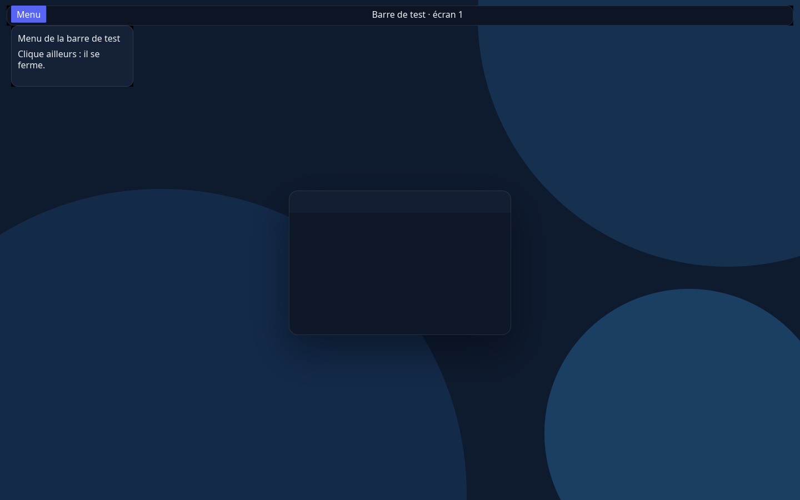 |
| 1.5 |  |
| 2 |  |
| Two screens, 1 and 2, `scene maximized` maximized on the second (in Xephyr, 1280 × 800): no shadow on the first | 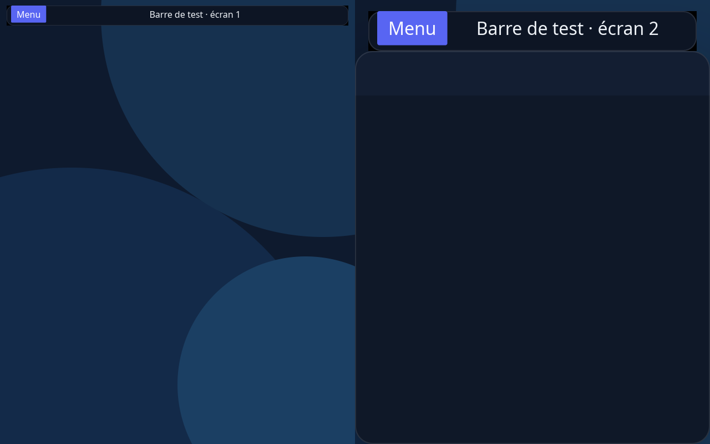 |

The black corners around the bar and its menu are the test bar's own: iced draws with
tiny-skia through softbuffer 0.4.8, whose Wayland backend only uses `XRGB8888` buffers, so the
surface is opaque and its transparent pixels come out black (see the layer-shell toolkit
limits above).

The real session (lot D-14) has one output per connector with a screen, side by side in the
order they are found, each with a frame of its own (see "Real session").

### Changing the screens (ADR 0025, lot D-26b)

The compositor offers `wlr-output-management-unstable-v1`, version 3 (`src/output_management.rs`):
every screen is a head with its connector name, its EDID make, model and serial number, its
modes (the preferred one first), and whether it is on with its mode, place, rotation and scale.
A change of any of them is sent again, followed by `done` and a new serial. A client sends a
whole configuration and tests or applies it; Control Room's « Écrans » page, `wlr-randr` and
`kanshi` speak it. What a client may get wrong is a protocol error, as the protocol says: a mode
of another head, a property set twice, a head configured twice or left out; a scale that is not
positive. A configuration made on an older serial is cancelled.

`src/displays.rs` checks the whole configuration before anything changes (`check_screens`):
every screen known, at least one on, a mode the screen lists (a refresh of 0, or within half a
hertz, finds the mode of that size), a rotation only where the screen can turn, a scale from 0.5
to 4, a place within 65 536 points of the origin. `apply_screens` gives the hardware its part
first: in the real session, `DrmCompositor::use_mode`, the rotation in the screen's
`OutputModeSource`, or `clear` for a screen switched off; a refusal there puts back what had
already changed and the configuration fails. The space follows: modes, scales and rotations,
the screens at their places, windows moved with their screen, snapped and maximized ones
refitted. A screen switched off loses its `wl_output` but stays a head, off, until it is lit
again or unplugged. The main screen is the one at the origin.

| Backend | Modes | Rotation | Off |
| --- | --- | --- | --- |
| Real session | Every mode of the connector | Yes | Yes |
| `--headless`, tests | Its size, 1280 × 800, 1440 × 900, 1920 × 1080, 2560 × 1440 | Yes | Yes |
| `--nested` | The slice of the window only | No | No |

**Saved per screen.** In the real session, every screen is named by its EDID (`src/edid.rs`:
the first block of 128 bytes, header and checksum checked; the maker's three letters, the name
and serial descriptors, else the product code and serial number). A configuration that has held
for `SAVE_AFTER` (20 seconds, longer than the 15 of Control Room's confirmation) is written to
`$XDG_CONFIG_HOME/sherlockos/displays.conf` (`desktop_config::displays`), whole, off the event
loop, through `mime_apps::write_atomically`: a session that dies while a change waits for its
confirmation keeps the setting that worked. When a screen is plugged in, or at start, its saved
mode, rotation, scale and place are taken again; a screen saved off is lit anyway, so that a
machine never starts black. The file keeps the 32 screens met last; it is bounded (64 KiB, names
of 64 characters, sizes, refresh, scale and places checked) and a wrong line is left aside.

## XWayland

XWayland is an X11 server that is also a Wayland client of the compositor. Each X11 window has
a Wayland surface there, which the xwayland-shell protocol associates with the window. Smithay
provides the launch (`XWayland`) and the X11 window manager (`X11Wm`), which talks to the X
server on behalf of the compositor. X11 windows enter the same `Space` as Wayland windows, as
`Window`s: layout, gestures, rendering and animations make no difference, except in the few
places where a state is read or sent.

**Started at launch.** XWayland starts with the compositor, not at the first connection of an
X11 client. Reasons:

- The command launched by `--nested` must know `DISPLAY`, and may itself be an X11
  application: it starts once XWayland is ready, with `DISPLAY=:N` and `WAYLAND_DISPLAY`.
- Smithay 0.7 can only launch XWayland right away. Starting on demand would require listening
  on the X11 sockets ourselves and handing the first connection to the server: more code, for
  little gain.
- The cost is modest: on the reference laptop, XWayland is ready in 0.2 s and takes about 85 MB
  of resident memory (shared libraries included), without an X11 client.

The display number is the first free one (`:1` under an X11 session that holds `:0`). It is in
the log: `XWayland ready display=1`. Xwayland's messages go to the compositor's standard error,
mixed with its logs. At startup, warnings from xkbcomp are expected. With linux-dmabuf (lot
D-06, see "GPU buffers"), Xwayland's glamor finds the render node in the default feedback and
draws on the GPU: `(II) GLX: Initialized glamor GL provider`. Without it (software rendering,
or before D-06), glamor gives up (`GBM Wayland interfaces not available`, and `nv_gbm` errors
on a machine with the NVIDIA driver) and Xwayland draws in software (`DRISWRAST`). At shutdown,
`(EE) failed to read Wayland events` too: the compositor closes its connection. Without `Xwayland` on the machine, the log says so
(`no X11 applications`), and the command starts without `DISPLAY`: it does not inherit the host
session's, where its X11 windows would open outside the compositor.

**Shutdown.** When quitting, the compositor removes XWayland and its Wayland socket from the
loop (`State::shutdown`): the X server stops, its lock (`/tmp/.X<N>-lock`) and its socket
(`/tmp/.X11-unix/X<N>`) go away, and so do the Wayland socket (`$XDG_RUNTIME_DIR/wayland-N`) and
its lock. It has to be done by hand: the `X11Wm` source keeps a handle to the loop, which is
therefore never freed, nor anything in it. If `X11Wm` does not start, the compositor cuts
XWayland's connection right away and stops it: X11 applications do not show up, but the
session goes on. Killed by a signal (Ctrl + C in the terminal), the compositor leaves the lock
behind; Smithay takes it over at the next launch, since its process no longer exists. The
compositor creates `/tmp/.X11-unix` if it is missing, with the permissions systemd gives it
(1777).

**Managed windows.**

- A window that asks to be mapped is centered on the screen, at the size it asks for. It shows
  up (with the opening animation) and gets the keyboard when XWayland associates its surface
  with it: before that, it would not have received the keyboard input.
- The keyboard goes through the Wayland surface and through the X11 focus (`SetInputFocus` or
  `WM_TAKE_FOCUS`, depending on what the window accepts). A window that is raised is raised for
  the X server too.
- The compositor places the window: it sends the X server its place and size on every move,
  snap or resize. A floating window gets the size it asks for, never the place. Maximized,
  snapped or fullscreen, it keeps the one it was given.
- The maximized and fullscreen states are those of `_NET_WM_STATE`, which the window knows
  about, like those of xdg-shell for a Wayland window. Its requests (`_NET_WM_STATE` and
  `_NET_WM_MOVERESIZE`, for example from a browser's title bar) go through the same paths as
  those of a Wayland window. Since the X server gives no serial, a requested gesture is only
  granted while a button is pressed on the surface of that very window. A surface of XWayland is
  not enough: all X11 clients are a single Wayland client, and another X11 program could
  otherwise move its window during a click in xterm.
- An X11 window takes its new size as soon as it is sent. During a resize, its place is
  therefore realigned right away, without waiting for its content.
- The title is `_NET_WM_NAME` or `WM_NAME`.

**Menus and tooltips.** Override-redirect windows place themselves, above the others. They are
drawn as they are, like Wayland menus: no corners, border, shadow, animation or grab band. A
click inside them does not move the keyboard.

**Clipboard.** The compositor advertises `wl_data_device_manager` (CLIPBOARD) and the primary
selection (`zwp_primary_selection_device_manager_v1`, PRIMARY). The client that has the keyboard
reads and sets both. Exchanges with X11 go through `X11Wm`:

- A Wayland client sets a selection: the window manager takes it on the X side. An X11 client
  that reads it receives the Wayland client's data.
- An X11 client sets a selection: the compositor sets it on the Wayland side on its behalf. A
  Wayland client that reads it receives the X11 client's data.
- Like a Wayland client, an X11 client only reads a selection coming from Wayland, and only sets
  its own on the Wayland side, if an X11 window has the keyboard. A background X11 program
  therefore cannot change what the user pastes into a Wayland application. The rule is strict,
  with no exception for command line tools: `xclip -i` launched from a Konsole (Wayland) sets
  nothing on the Wayland side. The log says so at the `debug` level: `X11 selection refused`.
- Text goes through smithay, which maps `text/plain;charset=utf-8` to `UTF8_STRING` and
  `text/plain` to `TEXT`. The other types (`image/png`, `text/uri-list`, `text/html`) keep their
  name as X11 atom. From Wayland to X11, smithay passes them on. From X11 to Wayland, smithay 0.7
  looks their atom up in a property that nothing writes, and the paste failed: the compositor
  reads them itself (`src/x11_paste.rs`), as an X11 client of XWayland, in a thread per paste
  with its own connection, and writes what comes into the Wayland client's pipe. Bounded since
  lot D-29b: 4 such pastes at once (one more closes the client's pipe at once, the client
  reads nothing), 256 MiB and 60 s each, and the client's pipe written without blocking, each
  piece within 5 s: a client that asks for pastes and never reads them cannot pile up threads
  nor connections to XWayland, whose number of clients is limited. Each paste ends with its
  thread, its connection and its window.
- Large contents (lot D-29, measured with 3 and 4 MB in `tests/clipboard.rs`): the X11 side goes
  by INCR, in 64 KiB pieces, both ways, without blocking the loop. smithay opens its pipe
  non-blocking at both ends and hands one to the Wayland client: a client that writes plainly
  (as `wl-copy` does) stopped at the first full pipe, and X11 got the first 64 KiB of a picture.
  The compositor makes that end blocking again before handing it over.
- A screenshot copied by the compositor (lot D-35c) is offered to X11 too, as `image/png`.
- **Locked session: nothing passes.** No Wayland client is offered a selection, not even the lock
  program, which has the keyboard; an offer received before the lock gives nothing when read;
  an X11 client neither reads nor sets one. The selections may still change (a screenshot taken
  just before lands), and XWayland still learns of it, but no one reads them before the unlock.
  Limit: a Wayland client that kept an offer from another Wayland client, received before the
  lock, reads it straight from that client, without the compositor.
- smithay 0.7 calls `focus_changed` for a new keyboard focus only. When nobody has the keyboard
  (lock without its surface yet, `focus(None)`), the compositor takes the selections away from
  the client that had it, which kept being offered them before lot D-29.
- **The hook for the clipboard history (lot D-42).** Every new selection, CLIPBOARD and PRIMARY,
  from a Wayland client, an X11 application or the compositor, passes through
  `State::selection_set` (`handlers.rs`) with its types and its origin (`SelectionOrigin`: the
  Wayland client, X11, or the compositor). `is_secret` recognizes a secret copied by a password
  manager (`x-kde-passwordManagerHint`). From X11, smithay passes on only the types with a `/`:
  that hint does not cross from an X11 application.
- **Drag and drop between X11 and Wayland: not done, lot D-29c.** smithay 0.7 has no XDND: the
  window manager would have to speak it itself (`XdndAware` proxy window, `XdndEnter`,
  `XdndPosition`, `XdndStatus`, `XdndDrop`, `XdndFinished`, the `XdndSelection` transfer) and
  bridge it to `wl_data_device`'s drag and drop, in both directions. Between Wayland
  applications (Evidence, Dolphin, Chrome), drag and drop works with smithay's.

## Clipboard history

Lot D-42, `src/clipboard_history/`. What is copied, in Wayland and X11 applications, is kept for
the Super + V panel of the shell (ADR 0030 for pasting).

- **What is read.** Every new CLIPBOARD selection passes through `State::selection_set`. Once
  it is in place, the compositor reads the one type worth keeping, the way a client pastes it:
  `text/uri-list` first (files when every address is `file://`), then `image/png` or
  `image/jpeg`, then `text/plain;charset=utf-8` or `text/plain`. A Wayland client's selection is
  asked from it (`request_data_device_client_selection`); an X11 one goes through the bridge of
  lot D-29; the compositor's own (a screenshot) is written by the loop. The primary selection is
  never kept.
- **Off the loop.** A thread per read (`MAX_READS` at most, 4) reads the pipe, non-blocking, with
  a deadline of 3 s, and stops past the limit of its type: 1 MiB of text, 256 KiB of addresses,
  16 MiB of picture. Too large is not kept at all, never cut. A picture is decoded with limits
  (16384 px a side, 256 MiB of pixels) for its thumbnail, 160 px on its longest side, in PNG.
  What was read comes back to the loop by a channel; a read that ends after a newer one is
  dropped.
- **The history** (`model.rs`): newest first, 50 items at most and 128 MiB of content, the
  oldest unpinned going first. The same content copied again goes back to the top with its id
  and its pin. « Tout effacer » keeps the pinned items. Each item has its kind (text, link,
  files, picture), a preview of 4 lines and 300 characters at most, its thumbnail, the app_id or
  X11 class of the window that had the keyboard, and its time.
- **Never kept:** anything while the session is locked (checked when the copy is seen and when
  its read ends), a secret: a selection that offers `x-kde-passwordManagerHint` (KeePassXC, KDE)
  or the nspasteboard types `org.nspasteboard.ConcealedType` and `TransientType`, or a copy from
  a password manager known by its app_id or class (KeePassXC, Bitwarden, 1Password, Enpass,
  Secrets, Proton Pass, LastPass): from X11, smithay drops the hint, whose name has no `/`.
- **Put back** (`State::put_back`): the item becomes the compositor's own selection, in every
  type it was read as (a text as `text/plain;charset=utf-8` and `text/plain`, files as
  `text/uri-list`, `x-special/gnome-copied-files` and their paths as text), offered to X11 too,
  and moves to the top without being read again. Refused while locked.
- **The setting**, `clipboard.conf` (`desktop_config::clipboard`), read again within a second
  of a change: `history = on|off` (on by default; off forgets everything at once) and
  `keep-on-disk = on|off` (off by default: memory only).
- **On disk** (`disk.rs`), with `keep-on-disk = on` only: the whole history, pinned items
  included, in `$XDG_STATE_HOME/sherlockos/clipboard-history` (mode 0600), written by a thread
  of its own after each change (the last state only), through a file renamed over it; read back
  in a thread when the setting is on, with the history's limits. Turned off, the file goes.
- **For the shell** (`shell/clipboard.rs`): `sherlock_clipboard_history_v1`, only on the shell
  socket (ADR 0021), lists the items (their thumbnail in a memfd), and takes `paste`,
  `set_pinned`, `remove` and `clear` from the Super + V panel. Super + V (Alt + V nested) starts
  `sherlockos-clipboard` as Super + Space starts the launcher; pasting follows ADR 0030.

## GPU buffers (linux-dmabuf)

A client that draws on the GPU hands over its image as a dmabuf: GPU memory shared by file
descriptor, without a copy. Mesa's Vulkan driver presents on Wayland only this way, and Mesa's
EGL wants the default feedback (version 4 or later) to know which chip to allocate on. Before lot
D-06, the compositor only offered `wl_shm`: the shell, drawn with wgpu on Vulkan (ADR 0018),
found no way to present and fell back to software rendering, whose buffers have no alpha, so
the author saw black around the dock and the rounded corners. Games, browsers and XWayland's
glamor need it as well.

- **Global.** `zwp_linux_dmabuf_v1` in version 5, the one smithay 0.7 gives with a default
  feedback (version 4 plus the check that every plane has the same modifier). Clients that bind
  version 3 receive the same formats as `modifier` events.
- **Default feedback.** One tranche. The main device and the tranche's target device are the
  node of the chip the compositor renders on, read from its EGL display
  (`EGL_EXT_device_drm_render_node`, or the primary node if EGL does not name the render node).
  The formats are those its GLES renderer can import (`ImportDma::dmabuf_formats`), modifiers
  included. The log names the node and its kernel driver (read from sysfs), the number of pairs
  and the formats: `linux-dmabuf offered node=/dev/dri/renderD128 driver="amdgpu" formats=358`;
  each pair is logged at the `debug` level (`RUST_LOG=info,compositor::winit=debug`).
- **Import.** Each buffer a client creates goes through the renderer first (`import_dmabuf`,
  which makes an EGL image of it). Imported, it is drawn like any other surface: clipped to the
  rounded rectangle by `clip.frag`, external textures (YUV formats) included. Refused, the
  client receives `failed` (for `create`) and may fall back to `wl_shm`; for `create_immed`, the
  protocol leaves no other answer than the `invalid_wl_buffer` error. The compositor never stops
  for a buffer: the refusal is logged at the `debug` level (`compositor::dmabuf`).
- **Checks before smithay.** Smithay 0.7 checks the format (announced or `invalid_format`), the
  planes against the size of their file (`out_of_bounds`) and the size, with two holes that
  `src/dmabuf.rs` closes before handing the request to smithay:
  - after a width or a height below 1, smithay only sends `invalid_dimensions` and goes on: with
    a height of 0, an offset plus a stride overflows, which is a panic in a debug build (seen in
    `tests/dmabuf.rs`, at `smithay-0.7.0/src/wayland/dmabuf/mod.rs:1177`), and the buffer still
    reaches the importer;
  - it checks the full height only for the plane the client numbers 0, then numbers the planes
    again in the order they came: a single plane sent with index 1, over a file of one row,
    reached the importer as a full buffer.

  The compositor keeps the planes each `zwp_linux_buffer_params_v1` receives (index, offset,
  stride, size of the file by `lseek`), and at `create` or `create_immed` checks them as wlroots
  and weston do: indices from 0 to n - 1 and at least the colour planes of the format
  (`incomplete` otherwise), then each colour plane inside its file, `offset + stride × rows`
  with the rows of its subsampling (`out_of_bounds`). A metadata plane that a modifier adds
  (AMD's DCC) is checked for its first row only, as smithay does. The same check runs again on
  the buffer smithay built, just before the import: a buffer that gets past the first check, or
  whose file cannot be seeked, gets `failed` and never reaches the renderer. The rest of smithay
  0.7.0's `delegate_dmabuf!` is written out next to it, to review at each smithay update.
- **Without a GPU.** If the renderer is software (llvmpipe: Xephyr, the CI) or EGL does not name
  its device, the protocol is not offered and the log says why: clients keep `wl_shm`, as
  before.

In nested mode, the compositor renders on the chip of its host window, the one the host session
gives EGL. Under KWin (Wayland), that is KWin's main device; under X11, the chip that drives the
screen. With `__EGL_VENDOR_LIBRARY_FILENAMES` set to Mesa's file (see "Measuring"), NVIDIA's EGL
is never loaded by the compositor. The renderer is shared between the winit backend and the
importer (`Rc<RefCell<…>>`): the importer runs while the clients are read, never during a frame.

**XWayland.** XWayland is a client like the others: it gets the default feedback, and glamor
opens the render node it names (`(II) GLX: Initialized glamor GL provider`) instead of falling
back to software. Before D-06, on the reference laptop, glamor gave up with `GBM Wayland
interfaces not available` and two `nv_gbm` errors, then `DRISWRAST`. Smithay clears XWayland's
environment (only `PATH` and `XDG_RUNTIME_DIR` remain), so `__EGL_VENDOR_LIBRARY_FILENAMES` does
not reach it: XWayland loads NVIDIA's EGL libraries (`libEGL_nvidia`, `libnvidia-egl-gbm`), as it
did before, but opens no NVIDIA device file and uses the AMD render node only (see below).

**Security.** The global is open to every client, like `wl_shm`. Each imported buffer holds an
EGL image of the renderer as long as the client keeps its `wl_buffer`: a client can use GPU
memory as it can use shared memory. Not limited in this lot.

**Follow-ups.**

- **`DmabufBlocker`.** A surface commit does not wait for the client's GPU work
  (`Dmabuf::generate_blocker` and `add_blocker` are not called): with implicit synchronization,
  a client can make a compositor frame wait on its own GPU load, up to the kernel timeout (about
  10 s on amdgpu, then a GPU reset). In nested mode, on a GPU shared with the host, the gain is
  small; the DRM backend needs it. Not done by lot D-14, which offers linux-dmabuf in the real
  session too: the next lot on the real session.
- **File descriptors.** Each unused `zwp_linux_buffer_params_v1` holds up to 4 descriptors until
  the client destroys it or leaves. A client can pile them up to the compositor's
  `RLIMIT_NOFILE` (often 1024), after which no client can connect. Not specific to dmabuf (any
  fd passing allows it). Leads: raise the soft limit at startup, or cap the `params` per client.

**Checked on the reference laptop**, in a headless KWin 6.3 (`kwin_wayland --virtual`,
1440 × 900) in `bwrap` with a `/dev/dri` that only holds the AMD render node, its own D-Bus and
XDG folders, nothing shown on the screen. The compositor itself ran outside `bwrap`, seeing
every DRM node, with Mesa's EGL only, and the wallpaper `first-clue`:

- the renderer is `AMD Radeon Graphics (radeonsi, renoir)`, and the offer is on
  `/dev/dri/renderD128`, driver `amdgpu`: 358 format and modifier pairs over 47 formats
  (`AR24`, `XR24`, `AB24`, `XB24`, `AR30`, `XR30`, `AB30`, `XB30`, 16-bit and half-float
  formats, `NV12`, `P010`, `YUYV` and the other YUV formats), each with `Linear`, the implicit
  modifier and AMD's tiled modifiers (9 pairs for `AR24`);
- `vkcube --wsi wayland` (RADV, `VK_DRIVER_FILES` restricted to `radeon_icd.json`) shows up;
- the bar and the dock of lot D-02 (branch commit `22efe3c`, then main once D-02 was merged,
  `a5947ef`) choose Vulkan on RADV, read the default feedback, create `AR24` buffers with
  `create_immed`, and are drawn with their transparency: rounded corners and glass over the
  wallpaper;
- the compositor, XWayland, the bar and the dock hold `/dev/dri/renderD128` only, no
  `/dev/nvidia*`, and only XWayland maps NVIDIA libraries (see above);
- `/sys/bus/pci/devices/0000:01:00.0/power/runtime_status`, read every 100 ms from before the
  KWin start to after the last stop: `suspended` throughout. The last trial (main's bar and dock,
  30 seconds under `timeout`, clients stopped before the compositor) read it with the CPU and
  AMD temperatures and `gpu_busy_percent` (12 % at most): `suspended` before, during and after.

| What | Screenshot |
| --- | --- |
| Bar and dock of D-02, before this lot (compositor of main): software rendering, black around the dock and the corners of the bar |  |
| Bar and dock of main, with linux-dmabuf: Vulkan on the AMD chip, transparent |  |
| Corner of the dock, enlarged 8 times: rounded and smoothed over the wallpaper, glass tinted by what is behind | 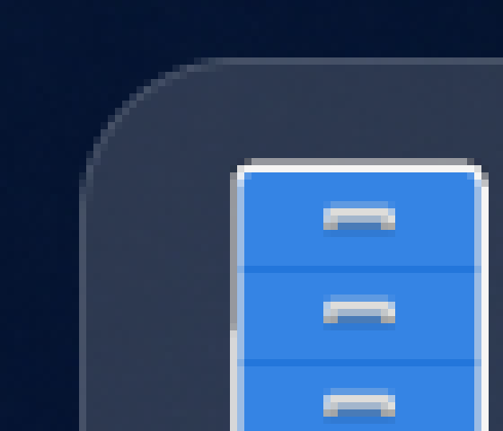 |
| `vkcube --wsi wayland` | 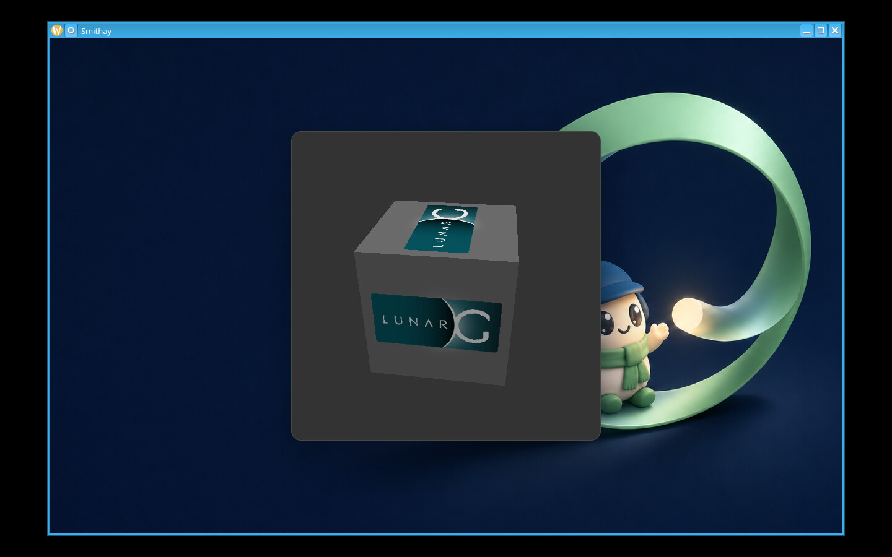 |

The KWin window decoration around the frame is KWin's: our compositor is one of its windows.

## Rendering

Each frame is redrawn in full with Smithay's GLES renderer (`GlesRenderer`), in the compositor's
single thread. `render::Scene` compiles three programs at startup and lays out the elements from
front to back, as Smithay expects them:

1. anchored surfaces of the overlay layer, then those of the top layer, each with its menus in
   front; on a screen with a fullscreen window, the top layer goes just behind that window,
   unless an edge brought it back (see "Fullscreen covers the bar and the dock");
2. the windows during their minimize effect (lots D-19 and Q-14), under the bar and the dock;
3. the snap preview: translucent green rounded rectangle, 2 px green border;
4. for each window, from the topmost to the lowest: its menus (`xdg_popup`, neither clipped nor
   scaled), its border, its title bar if the compositor draws it, its clipped content, its
   shadow; while Mission Control is shown, its own items instead (see "Mission Control");
5. anchored surfaces of the bottom and background layers;
6. the wallpaper, or without one the three background discs (see "Wallpapers");
7. the desktop color, which fills the rest.

**Screens and scale (lot D-12).** Each screen has its own list of elements, built in pixels of
the frame by its `View`: its area of the space, its slice of the frame, its scale. Rectangles are
converted corner by corner, so that touching rectangles still touch. Radii, border widths,
shadow offset and blur, and the snap preview border are multiplied by the scale: at 1.5, a
window has a radius of 24 pixels, a border of 1.5 and a shadow offset by 42 and blurred over 105,
exactly the 1.5× of the board. Client surfaces are built at scale 1 from their origin, then
scaled around it (`RescaleRenderElement`), with the animation's stretch when there is one: a
client that draws at the screen's scale is drawn pixel for pixel. In nested mode, the
compositor draws the host frame itself rather than through smithay's `OutputDamageTracker`: it
clears the frame, then draws each screen's elements from back to front, each one limited to its
screen's slice (the damage given to `draw`). The real session draws through each screen's
`DrmCompositor`, which redraws only the damage (see "Frames of the real session"). The frame is
drawn at scale 1: the elements' "logical" coordinates are frame pixels.

| Program | Kind | What it draws |
| --- | --- | --- |
| `shape.frag` | Pixels | Rounded rectangle, filled and bordered, smoothed over one pixel: window borders (without fill), background discs (radius of half the side), snap preview |
| `shadow.frag` | Pixels | Drop shadow of a rounded rectangle blurred by a Gaussian, cleared under the window |
| `clip.frag` | Texture | Client content multiplied by the coverage of its window's rounded rectangle |
| `genie.frag` | Texture | A window during its genie, deformed toward its dock icon (see "Minimize effect") |

The values, all taken from `sherlock-ui`. The colors are those of the palette shown,
`color::palette()`, which follows the theme (see "Theme"); the dark values are given here:

| Element | Value (dark) | Token |
| --- | --- | --- |
| Background | `#0E1A2E` | `desktop` |
| Discs | `#132A49`, `#16314F`, `#1B3F63`, places and diameters from the Main board | `desktop_discs`, `metrics::DESKTOP_DISC_GEOMETRY` |
| Corners | Radius 16, reduced for a window smaller than two corners | `metrics::WINDOW_RADIUS` |
| Border | 1 px `rgba(255,255,255,0.10)`, inside the window as in CSS | `metrics::BORDER_WIDTH`, `border` |
| Shadow | `0 28px 70px rgba(3,8,18,0.55)` | `metrics::SHADOW_OFFSET`, `metrics::SHADOW_BLUR`, `shadow` |
| Snap preview | `rgba(133,197,149,0.16)`, border 2 px `#85C595` | `window::snap_preview_fill()`, `snap_preview_border()` |

**Background.** On a 1440 by 900 screen, the discs are exactly at their place on the board:
(-260, 340) diameter 1100, (860, -420) diameter 900, (980, 520) diameter 520, the last one in
front. On another screen, their centers follow the screen on each axis and their diameter
follows the larger of the two ratios, so that they stay round.

**Corners.** The client content is really clipped: `RoundedSurface` wraps each surface of the
window and, while drawing it, replaces Smithay's texture program with `clip.frag`. The clip is
computed from `gl_FragCoord`, in frame pixels: it holds for subsurfaces as for the main surface,
at any scale. The windowed backend flips the frame (`Flipped180`); `clip_in_frame` applies the
same transform to the clip rectangle. What the client draws outside its geometry (GTK
client-side shadows) is cut: the compositor draws the shadow.

**Maximized and fullscreen (lot D-18c1).** A maximized or fullscreen window has no corners,
border or shadow: it fills its area edge to edge. A snapped window (half, quarter) and a floating
one keep them. The change is animated: `Visual::decoration` goes from 1 to 0 on
`DECORATION_SPRING`, and back when the window leaves that state; the radius is multiplied by it,
the border and the shadow fade by it. The spring is critically damped: the radius never goes
below 0, the shadow never above its own. A window maximized before it shows is drawn without
them from its first frame, without animation.

**Shadow.** Like `box-shadow`: the window rectangle, shifted 28 down, blurred by a Gaussian with
a standard deviation of 35 (half the blur, as browsers do). The element extends 70 around that
rectangle. The computation follows Evan Wallace ("Fast Rounded Rectangle Shadows"): exact
integral in x, four samples in y. The shadow is not drawn under the window, which matters for a
translucent client and during fades.

**Cost.** Since lot P-01, a clipped surface keeps the opaque region its client declares, inside
the clip and without the four rounded corners (`render::rounded_opaque`, one pixel more for the
smoothing): what an opaque window covers is not drawn, neither the windows below, nor its own
shadow under it, nor the wallpaper under a maximized window. A translucent client (the bar, the
dock) declares nothing and hides nothing. In nested mode the host frame is still redrawn in
full at each of its frames.

### Animations

The `sherlock_ui::motion` module holds the physics, as pure computation and without iced, so
that the compositor and the shell share the same springs:

- `Spring`: damped spring of mass 1, defined by its stiffness and its damping. `solve` gives the
  offset and the velocity at any time through the exact solution of the equation (underdamped,
  critically damped or overdamped), without a time step: a late frame does not change the
  trajectory.
- `Animation`: a value driven by a spring. `retarget` changes target while keeping value and
  velocity: nothing jumps when the target moves along the way.
- `Fade`: a fade over a fixed duration, quick start and soft landing (cubic). When interrupted,
  it starts again from its current value.

| Token | Value | Damping ratio | Use |
| --- | --- | --- | --- |
| `SNAP_SPRING` | stiffness 500, damping 33.5 | 0.75, 3 % overshoot | Snap, maximize, restore |
| `WINDOW_OPEN_SPRING` | stiffness 625, damping 50 | 1.0, no overshoot | Scale of a window opening, from `OPEN_SCALE` (0.92) to 1 (lot D-34) |
| `PREVIEW_SPRING` | stiffness 700, damping 42 | 0.79 | Snap preview |
| `DECORATION_SPRING` | stiffness 700, damping 53 | 1.0, no overshoot | Corners, border and shadow of a window maximized, fullscreen, or leaving it |
| `FADE` | 150 ms | | Opacity of the preview appearing and fading out |
| `WINDOW_OPEN_FADE` | 200 ms | | Opacity of a window opening (lot D-34) |
| `WINDOW_CLOSE` | 150 ms | | Scale and opacity of a window closing (lot D-34) |

`docs/contexte.md` only gives « ressorts » (springs), « léger dépassement » (slight overshoot)
and hovers of 110 to 150 ms: these values are choices of the lot. Each spring covers 90 % of the
way in less than 150 ms and settles within 1 % in less than 300 ms (tests of `motion`). The fade
lasts one hover.

`anim.rs` applies them to windows:

- **Opening.** At its first frame, the window grows from 0.92 to 1 around its center and goes
  from transparent to opaque. Its shadow and its border follow. See "Opening and closing".
- **Snap and restore.** `rearrange` (snap, maximize, fullscreen, restore) calls
  `animate_next_change`. The flag only holds for the next frame, where it is consumed in every
  case: if the geometry has changed there, it starts from the last drawn geometry on four
  springs, position and size; otherwise nothing is animated. An animation already running
  simply changes target. The target then follows the real geometry: the position changes right
  away, the size when the client answers, and the spring carries on without a jolt. During the
  animation, the client buffer is stretched into the animated rectangle
  (`RescaleRenderElement`). Once settled, it is drawn at scale 1.
- **Size given, not taken yet (lot D-18c1).** `rearrange` tells the motion the rectangle it gives
  the window (`animate_to`). From the next frame on, the window slides to that rectangle without
  waiting for the client: a change of the size alone (an exclusive zone that comes or goes under
  a maximized window) is animated too, and no frame shows the old size at the new place. Until
  the client draws at that size, its buffer is stretched there. A client that keeps another size
  for `anim::SIZE_WAIT` (1 s) is no longer waited for: the window slides back to the size it
  drew. Restored to a size its client chooses, the window slides once that size is known, as
  before.
- **Drag and resize.** They are never animated: the start of a gesture stops any geometry
  animation (`WindowMotion::follow`), and the window follows the pointer without delay. A
  snapped or maximized window pulled out by dragging it gets its previous size back at once,
  under the pointer, as before this lot.
- **Snap preview.** It appears by growing from 0.92 to 1 and fading in, slides from one zone to
  another, and fades out at its last place.
- **Workspaces.** The row of workspaces slides on `SNAP_SPRING` (see "Workspaces" under "Shell
  protocol").

Nothing flickers: a window appears from zero opacity, and each animation starts from what was
drawn in the previous frame.

### Minimize effect (lots D-19, D-19b)

Minimized, by the dock, its keys or its application, a window is sucked into its dock icon,
as by macOS's genie; activated, it comes back out the same way, backwards. `src/genie.rs`.

- **Genie** (lot D-19b). The icon is the rectangle the dock gives with `set_rectangle`
  (`State::icon_rectangle`, see "Shell protocol"); the dock's edge is the edge of the icon's
  screen nearest to it (`genie::Side`), so the same genie, turned, goes down, up, left or
  right. The effect lasts `motion::MINIMIZE` (300 ms since lot Q-14), at a constant pace, the
  same both ways. Each row of the window goes from its place to the same row of the icon along
  an accelerating curve (`x²`): the edge nearest the dock leaves first, the far edge 40 % of
  the way later, so the window is pulled into the icon and flows after it, faster and faster.
  The sides close in a funnel whose sides are half a period of a sinusoid: the window's width at
  its far edge at rest, the icon's width at the edge of the dock's glass; the funnel bends in
  over the first 40 % of the way. The shadow fades out over the first 30 %, and what is left
  fades over the last 10 %.
- **Behind the glass** (lot D-19b). Nothing of the window shows past the edge of the dock's glass
  toward the screen's middle, `genie::GLASS_MARGIN` (the dock's padding less its border, 11
  logical pixels) from the icon: the window enters the glass exactly over its icon, as wide as
  it, and is cut there, neither seen through the translucent glass nor under the dock. A window
  that reaches behind the glass at rest is not cut at once: the cut goes up to the glass edge
  over the first quarter of the way. A magnified icon changes nothing: the cut stays at the edge
  of the glass, under the icon that grows past it. Until D-19b the window went down into the
  icon rectangle behind the glass, and showed through it.
- **Drawing: a shader rather than a mesh.** The window is first drawn as at rest into a texture
  of its size in pixels (its content clipped to its rounded corners, its border, and the title
  bar the compositor draws for it since lot D-08); then a single rectangle covers the area the
  deformed window takes (`Genie::bounds`, nothing once all of it is behind the glass), and
  `genie.frag` computes for each of its pixels the point of the window it shows: the exact
  inverse of the deformation. Each row stays a segment across the way: the shader finds the
  row drawn at its place by halving (20 steps, the rows never cross), then the column between
  the sides of the funnel there. Smithay's GLES renderer takes fragment programs of our own but
  no vertices of our own, and a mesh of strips drawn as triangles bends the texture along the
  diagonal of each trapezoid. The edges are smoothed over one pixel on the screen. `Genie`
  holds the same computation in Rust (`Genie::point`), for the area and the tests; the two must
  stay in line.
- **Under the dock** (lot Q-14). The genie is drawn behind the anchored surfaces of the top and
  overlay layers (bar, dock, notifications), in front of the other windows. From the back: the
  wallpaper, the windows, the genie, then the bar, the dock and the notifications.
- **Without an icon** (no dock, or a window without an icon in it), the scale effect: the window
  shrinks to `motion::MINIMIZE_SCALE` (a fifth) toward the bottom of its screen, centered under
  itself, and fades out; drawn like a window, stretched (`RescaleRenderElement`), with its
  corners, border and shadow. The choice is made when the effect starts; an icon that goes away
  on the way is replaced by the last one seen.
- **Turned around.** Restored while it goes into its icon, or minimized again while it comes
  back, the window leaves from where it is, without a jump, and takes the time left for the way
  back (`genie::Progress`).
- **Input.** A minimized window is out of reach at once. While it comes back, the pointer does
  not reach it either: its drawing is not its place (`State::minimize_progress`); it reaches it
  from the first move after the end. The keyboard goes to it at once, as before this lot, so
  that what is typed right after the click on the dock is not lost.
- **Cost.** One frame per vertical blank while it runs (it counts as an animation for
  `pacing::Pacing`), nothing once it is over. The genie is one element under a stable identity
  (`damage::Part::Genie`), whose commit moves at every step: the damage is its old and its new
  area, so the whole way, from the window to the icon, is redrawn and nothing else. The texture
  of a window is kept while its effect runs, and freed after. While it goes into its icon, the
  window is minimized: its application gets one frame callback a second, and the genie shows
  its last content.

**Setting.** `--minimize-effect genie|scale|none` (genie by default), and
`State::set_minimize_effect` while the session runs, for Control Room (lot D-26), which offers
the three choices, by these names (`genie::Effect` reads them). `none` hides and shows the window
at once, as before this lot. A change applies to the next minimize; an effect running goes on.

### Opening and closing (lots D-34, C-01)

As on macOS. A window that opens grows from `WINDOW_OPEN_SCALE` (0.90) to 1 around the center
of the whole window and goes from transparent to opaque, both over `WINDOW_OPEN` (250 ms) on
`WINDOW_OPEN_EASE`, a cubic ease-out without a bounce: half the way in 50 ms, 94 % in 150. A
window that closes shrinks to `WINDOW_CLOSE_SCALE` (0.92) and fades out over `WINDOW_CLOSE`
(180 ms) on `WINDOW_CLOSE_EASE`, a quadratic ease-in (close to CSS `ease-in`), then is freed.
The durations, scales and curves are in `sherlock_ui::motion`; `src/window_anim.rs` and
`src/anim.rs`.

| Opening, at 0, 50, 100, 150, 200 and 250 ms |
| --- |
| 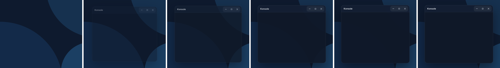 |

| Closing, at 0, 36, 72, 108, 144 and 180 ms |
| --- |
| 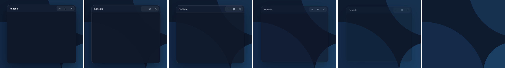 |

What lot C-01 found, image by image, in D-34's animations, and changed:

- **The title bar did not follow.** The content was scaled around its own center, and the
  bar of 42 put above it at its full height: the bar shrank in width only and slid over the
  content. Now the whole window, bar included, is scaled around its center
  (`anim::scaled_whole`): the bar keeps its share of the height. Its texture is drawn at its
  size at rest and stretched, so the opening does not draw it again at each frame.
- **The closing window was cut, not shrunk.** Its last image was drawn into a smaller
  rectangle without saying which part of the texture to take: smithay then takes the part of
  the size of the rectangle, from the top left. The window lost its right and bottom edges,
  its corners and its border, and only its top left corner seemed to move. The whole texture
  is now stretched into the rectangle.
- **The shadow did not follow.** Its offset (28) and blur (70) stayed those of the window at
  rest around a smaller window. They are now multiplied by the scale of the window, opening
  and closing, and so are its corners.
- **An empty window could open.** The opening started at the first frame of a window shown,
  and an X11 window is shown when XWayland gives it its surface, before its first buffer: its
  title bar opened alone. Nothing is drawn of a window before its client has given a buffer;
  the opening starts with that first content. A window without content takes no click either,
  on its bar or its edges, and an X11 window takes the keyboard at its first buffer, not
  before (lot C-01b).
- **Curves.** The opening was a critically damped spring (no bounce) for the scale with a
  200 ms fade, and the closing a 150 ms ease-out: it left fast and lingered nearly
  transparent. Now one timed curve each, an ease-out to open and an ease-in to close.
- **Scales.** 0.92 to open, now 0.90; 0.92 to close, kept.
- **No flash.** The first frame of an opening draws nothing (opacity 0), and the window is not
  drawn before; the test below checks it on the pixels.

- **Closing.** The client has already destroyed its window when the compositor learns it
  (`toplevel_destroyed`, or the unmap of an X11 window): its buffer goes away with its surface.
  Before the window leaves the space, the backend draws it as at rest into a texture of its size
  in pixels, at the scale of its screen, corners, border and title bar included, through the
  offscreen path of the genie (`genie::offscreen`). The `Snapshotter` the backend plugs into
  the state (`State::set_snapshotter`) does it with its renderer, while the clients are read,
  never during a frame. That texture, the ghost, is drawn in front of the other windows,
  stretched (`render::Item::Snapshot`), with a shadow at its scale. A client that removed its
  content before destroying its window (a null buffer) leaves nothing to draw: the window goes
  at once. Dialogs are toplevels like the others and close the same way; an X11 window
  withdrawn while shown too (`tests/xwayland.rs`).
- **Input.** The ghost is out of the space: it takes no click, no hover, no keyboard; the
  pointer goes through it to what is below. A window that opens takes input at once, as before.
- **Menus and popups (lot C-01).** The menus and popups of a window (`xdg_popup`) appear with
  a fade of `MENU_FADE` (110 ms), without moving: from their first drawing with content, a
  frame at each blank meanwhile. They go at once: when a menu is closed, its client has
  already taken its content away, and keeping its last image (as for a window) would leave a
  ghost over what the click reaches; the menus of the bar and the dock (their own surfaces)
  have their own animations. X11 menus (override-redirect windows) appear at once.
- **Menus and panels of the shell (lot UI-06).** The `xdg_popup`s of anchored surfaces, the
  bar's panels and menus and the dock's menus, fold back by themselves on Escape, on their
  button or on an entry chosen. But when the compositor closes them (a click elsewhere, a
  workspace switch, Mission Control, the lock) iced_exwlshell destroys them at once on
  `popup_done`, and a client that opens one menu in place of another drops the first at once.
  So the compositor keeps their last image (`src/popup_anim.rs`): at the dismissal
  (`State::dismiss_popups`, before `popup_done`) or when the client destroys the popup
  (`XdgShellHandler::popup_destroyed`), while its buffer is still there, the backend draws the
  popup into a texture (`set_popup_snapshotter`, the window snapshotter's offscreen path). That
  image shrinks to `motion::POPUP_CLOSE_SCALE` (0.96) around its center and fades out over
  `motion::POPUP_CLOSE` (150 ms) on `WINDOW_CLOSE_EASE`, in front of the anchored surfaces, then
  is freed with the window ghosts (`end_popup_closings`). It takes no input: the click that
  closed the menu reaches what is under it. Once per popup: a menu dismissed, then destroyed
  by its client, closes once. A popup that faded out by itself leaves a transparent image, and
  nothing shows; a popup without a buffer leaves none. Off with `--window-animations off`, and
  while locked. Reopened during that fade, the menu opens by its own animation, over its
  fading image.
- **Not animated:** X11 override-redirect windows, anchored surfaces (bar, dock), fullscreen
  windows, a window closing on another workspace, minimized, or while Mission Control is open.
- **Cost.** One frame per vertical blank while a window opens or closes (it counts as an
  animation for `pacing::Pacing`), nothing at rest. The ghost is one element under a stable
  identity (`damage::Part::Closing`): the damage is its old and new area, inside the window's.
  Its texture is freed by `State::end_closings` after each loop iteration once the closing is
  over. The cursor plane (lot P-01) is untouched.

**Setting.** `--window-animations on|off` (on by default), and `State::set_window_animations`
while the session runs, for Control Room. Off, windows appear and go at once. A window already
closing finishes.

**Tests.** `motion.rs` (sherlock-ui): the durations, scales and curves. `anim.rs`: the opening
grows and fades in together without a bounce, still moving at 200 ms, over at 250; the bar
scales with the window around the center of both; a skipped opening shows at once.
`window_anim.rs`: the closing shrinks and fades in 180 ms, each step longer than the one
before. `tests/shell.rs` (lot UI-06): a menu of the dock dismissed by a click elsewhere closes
with its last image, which goes after its fade; one dropped by its client too; none with the
animations off. `tests/headless.rs`: a window closing over another one takes no click, the one below
does; frames are due while it closes, not after, and nothing is kept; a fullscreen window opens
and closes at once; so does any window with the setting off.
`the_opening_and_the_closing_are_drawn_halfway` draws a decorated window through its opening
and its closing with Mesa's software renderer, like the genie test: nothing at the first frame,
the top of its bar coming down to its place without passing it, opaque at 250 ms, gone at
180 ms, and the ghost's texture held then freed. It saves `window-opening.png`,
`window-closing.png` and the two boards of six steps above (`window-opening-steps.png`,
`window-closing-steps.png`) in `target/tmp`; the boards are copied into `screenshots/`.

**Manual test.** Nested (`--nested`) or in the real session: open Konsole, a GTK application
and `xterm`; each grows and fades in. Close them (Super + Q, or their close button): each
shrinks and fades out. A fullscreen game, a menu, a tooltip appear at once. With
`--window-animations off`, nothing is animated.

### Raise (lot D-19d)

A window that comes to the front from behind another one, whatever brings it there (the dock,
the window switcher, a click, Mission Control, its application), no longer jumps there. As it is
raised (`State::focus`, through `State::start_raise` in `src/window_anim.rs`):

- if a window above it on its workspace covers part of it (the whole windows, title bars
  included), it grows from `motion::RAISE_SCALE` (0.97) to 1 around its center on
  `motion::RAISE_SPRING` (ratio 1.0: no visible bounce, settled in about 200 ms), and its shadow
  grows and softens from `motion::RAISE_SHADOW` (0.6) of its offset and blur to its own
  (`Visual::shadow`);
- the windows it now covers step back to `motion::RECEDE_SCALE` (0.995) around their center
  and come back, over `motion::RECEDE` (200 ms), along half a sinusoid (`motion::recede`);
- nothing when it was fully visible, for a fullscreen window, with `--window-animations off`,
  or while its genie runs: a window restored from the dock comes back by the genie only.

The window is in front and has the keyboard at once; the pointer reaches it at its real place.
Raised again before the end, or raised while it steps back, a window goes on from the scale it
is drawn at, without a jump (`WindowMotion::raise`). One frame per blank while it runs, none at
rest. No board draws it: the values are choices of the lot, to review on the machine.

**Manual test.** Two overlapping windows: click the one behind, or pick it in the dock or in
Mission Control; it grows into place and the other steps back. A window already fully visible comes
to the front without animation.

### What rendering does not do yet

- **Blur** behind glass surfaces (dual Kawase, radii of 24, 28 and 30 px): postponed, the lot
  was already over its size. Its place for anchored surfaces is ready (`Scene::push_backdrop`,
  lot D-12). It needs an offscreen render of what is behind the surface, at reduced
  resolution, then blur passes; the snap preview would be its first client.
- **Hovers**: the compositor has nothing to hover yet. The `motion::FADE` token is already at
  the duration of a hover.

## Server-side decorations (lot D-08)

The compositor draws the title bar and the three buttons of the windows whose application
leaves its decoration to it, in the style of the boards: Konsole and the other Qt and KDE
applications no longer show Qt's fallback decoration, and X11 windows get a frame. The code is
in `src/decorations/`; colors, measures and the double click delay in `sherlock_ui::decorations`.

**Who gets one.**

| Client | Protocol | Result |
| --- | --- | --- |
| Qt 6 (Konsole, KWrite) | `zxdg_decoration_manager_v1`, asks for `server_side` | Our bar |
| GTK 3 without a header bar, Qt 5 of KDE | `org_kde_kwin_server_decoration_manager` | `Server`, the default mode: our bar |
| Chromium, Evidence (winit, `decorations: false`) | xdg-decoration, `set_mode(client_side)` | Their own: no second bar |
| Firefox (GTK 3, tabs in its title bar) | KDE's protocol, asks for `Client` | Its own |
| GTK 4, libadwaita (Zenity) | Neither | Its own |
| X11 window (xterm, xeyes, Konsole on X11) | `_MOTIF_WM_HINTS`, window type | A bar, unless it asks for none (Firefox on X11), places itself (override-redirect), or is a menu, tooltip, notification or splash screen |

Tried on the author's machine (Debian 13, Qt 6.8.2, GTK 4.18.6, GTK 3.24.49), with the compositor
running without a screen: each application above asked what the table says. Electron was not
tried: none is installed.

A new xdg decoration, or one whose client drops its preference (`unset_mode`), gets
`server_side`; a client that asks for `client_side` keeps it: the compositor only forces its bar
on clients that let it. The mode goes with the next configure. A window that gains or loses its
bar while maximized or snapped is placed again.

**Geometry.** The space keeps the geometry of the content, the one the client knows. The bar
sits above it: 42 pixels, the window border (1), the bar (40) and its divider (1), as on the Main
board. The whole window, the frame, is the content and its bar: it is what gets centered,
maximized and snapped (the content takes the zone but the top 42), what the grab band surrounds,
and what the corners, the border, the shadow and the clip of the content go around. A fullscreen
window has no bar. Maximized, its corners are square (D-18c1), the bar included.

**Look.** Like the title bar of Evidence and the boards: `title_bar` background, rounded top
corners, `divider` line under it; the title on the left from 15 (border and padding of 14), Inter
13 semibold in `text_primary`, cut with an ellipsis before the buttons; the pill (`controls`,
radius 10, padding 2) of three buttons, 9 from the right edge, with the icons of
`sherlock_ui::icon`. Maximized, the maximize button shows the restore icon
(`decorations::RESTORE_ICON`). The colors are those of the palette shown, which follows the
theme with a fade (see "Theme").

**Buttons (lot C-01).** The author found them too small and too still. They are now 32 by 28
(radius 8, 2 apart; the boards draw 28 by 24), the pill 104 by 32, and their icons 16 px with
the stroke of 2 of the boards' window buttons (1.3 px), in `text_secondary`. The pointer on the
pill shows the three icons in `text_primary`, with the fade of a hover (`HOVER_FADE`, 150 ms).
A button under the pointer takes its color with that fade (`hover`; the close button the red
of destructive actions, `salmon`, its icon in `text_on_cream`) and grows to `HOVER_SCALE`
(1.06) on `BUTTON_SPRING`, with a slight bounce; held down, it sinks to `PRESS_SCALE` (0.92)
and takes `pressed`. The boards show no hover: these are choices of the lot, in
`sherlock_ui::decorations`. Each window's buttons have their motion (`decorations::Motion`),
aimed when the pointer changes and read at each frame; the bar texture is made again only
while it moves, and its look is rounded (thousandths of scale, 255ths of color) so that a
settled button gives the same texture.

| | At rest | Minimize | Maximize | Close |
| --- | --- | --- | --- | --- |
| Dark |  | 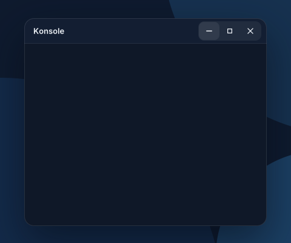 | 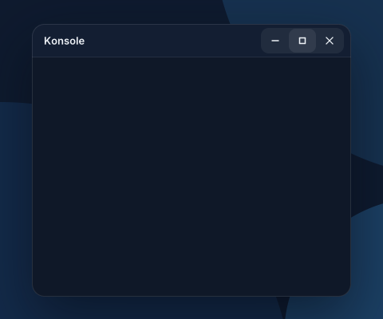 | 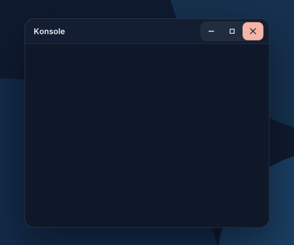 |
| Light | 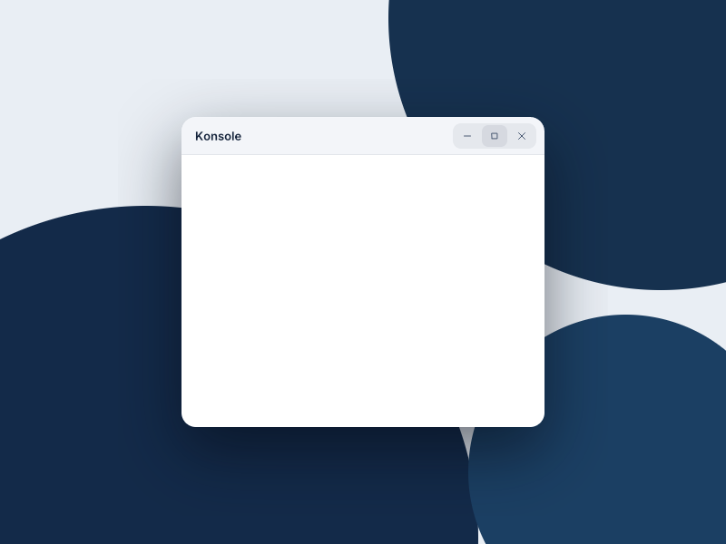 | 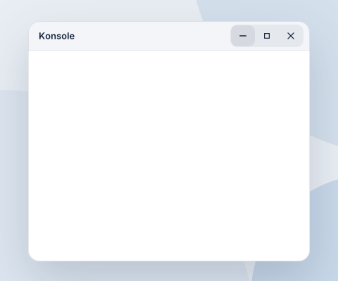 |  | 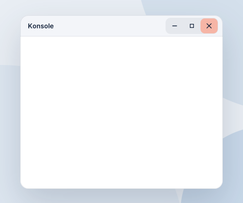 |

**Behavior.**

- A click on a button minimizes, maximizes or restores, or asks the application to close
  (`xdg_toplevel.close`, `WM_DELETE_WINDOW`). It acts on release, if the pointer is still on it.
- A double click on the bar (two presses within 400 ms, `decorations::DOUBLE_CLICK`, less than
  4 pixels apart) maximizes, or gives back the previous place.
- Dragging the bar, or the pill between its buttons, moves the window, with the snapping of
  every move: dropped at the top, it is maximized; pulled out of a zone, it gets its size back
  with the pointer on its bar. It never goes under the top bar (see "Moving and resizing").
- The client sees none of these presses. The cursor over the bar is the arrow.
- A right click does nothing yet: the menu (minimize, maximize, always on top, move to a
  workspace, close) is a follow-up.

**Drawing and damage.** The bar is drawn on the processor into one texture (`raster.rs`):
tiny-skia fills the shapes and strokes the icons, ab_glyph lays out and rasterizes the title.
Both crates were already built into the compositor (smithay's winit backend pulls them, through
sctk-adwaita): nothing new is compiled. cosmic-text, which iced uses, would shape and fall back
on other fonts, but it is not in the compositor and its font system is much heavier for one line
of text. ab_glyph kerns without shaping: enough for the scripts Inter covers. A glyph Inter lacks
(CJK, emoji) shows as a box.

The texture depends on its `Look`: size in pixels, scale, radius, title, buttons lit, colors.
Each frame builds the look; the texture is made again only when it changes (a title, a hover,
a resize, the corners while maximizing), one per window and scale. Its element keeps its
identity under `Part::TitleBar` (see "Damage"), so a bar that did not change is not drawn
again, and nothing is drawn at rest. Its opaque region is the bar but its top corners.

**Tests.** `decorations` (unit): the buttons sit at the right of the bar, 32 by 28, the pointer
finds them and the pill; a hovered button lights up and grows with a slight bounce, sinks when
pressed, and comes back to rest. `raster` (unit): the window icons are read, a long title ends with an ellipsis.
`tests/headless.rs`: a client asking through xdg-decoration gets `server_side`, then
`client_side` when it asks, KDE's protocol answers `Server`; a drag of the bar moves the window,
a double click maximizes it under its bar (800 by 558), the restore button gives back its place,
a drop at the top maximizes, a press that leaves its button does nothing, minimize then close.
`tests/xwayland.rs`: the X11 window has its bar (content 42 lower, maximized at 42), the menu
has none, `_MOTIF_WM_HINTS` without decorations removes it. `tests/perf.rs`: the ten windows of
the bench have the bar; hovering a button redraws that bar only, and nothing at rest.
`captures_of_a_decorated_window` (ignored, needs Mesa's EGL) renders the scene into a texture
with the software renderer and writes `screenshots/decorations-<theme>.png` and
`decorations-<theme>-<button>.png`, at rest and with each button hovered, checking the red of
the close button:

```sh
cargo test -p compositor --test headless -- --ignored captures_of_a_decorated_window
```

## Wallpapers

The wallpapers are in `assets/wallpapers/`, one original per wallpaper, named by its id. Their
names as the interface shows them, their category, the theme they are made for and their
pendant in the other theme are in `sherlock_ui::wallpapers`, the index that Control Room's
picker (lot D-26) will read.

| Id | Name | Category | Theme | Pendant |
| --- | --- | --- | --- | --- |
| `first-clue` | « Le premier indice » | « Par défaut » | Dark | `first-clue-light` |
| `ring` | « L'anneau » | « Emblèmes » | Dark | |
| `jade-relief` | « Relief de jade » | « Emblèmes » | Dark | |
| `aurora` | « Aurore polaire » | « Emblèmes » | Dark | |
| `paper-eclipse` | « Éclipse de papier » | « Emblèmes » | Light | |
| `rain-trail` | « La piste sous la pluie » | « Enquêtes » | Dark | |
| `missing-page` | « La page disparue » | « Enquêtes » | Dark | |
| `last-train` | « Le dernier train » | « Enquêtes » | Dark | |
| `first-clue-light` | « Premier indice » | « Par défaut » | Light | `first-clue` |
| `porcelain` | « Porcelaine » | « Emblèmes » | Light | |
| `lagoon` | « Lagon » | « Emblèmes » | Light | |
| `folded-paper` | « Papier plié » | « Emblèmes » | Light | |
| `greenhouse` | « La serre » | « Enquêtes » | Light | |
| `observatory` | « L'observatoire » | « Enquêtes » | Light | |
| `rowboat` | « La barque » | « Enquêtes » | Light | |

All originals are 3840 × 2160. The default wallpaper is the pair `first-clue` (dark) and
`first-clue-light` (light); the other pairs will come from the author. `for_theme(id, variant)`
gives the id to show in a theme: the pendant when the wallpaper has one and was made for the
other theme, the wallpaper itself otherwise.

**Why `assets/` at the root.** The originals are data, not code: no crate compiles them in
(`include_bytes!` would put 25 MB in every binary that reads the index). The image factory
(distro) and the variant generator read them from there, and `sherlock-ui` stays a library of
code.

**Storage of the originals.** One original per wallpaper, never the variants. The author's
images are PNG; they are stored as JPEG quality 95 without chroma subsampling (4:4:4), which is
2.3 to 2.9 times lighter than lossless WebP for the same look. Measured with ImageMagick
7.1.1 (libjpeg-turbo 2.1.5, libwebp 1.5.0), in bytes:

| Id | PNG of the author | Lossless WebP | JPEG 95, 4:4:4 | PSNR of the JPEG |
| --- | ---: | ---: | ---: | ---: |
| `first-clue` | 3 493 222 | 2 517 310 | 1 027 575 | 50.3 dB |
| `jade-relief` | 6 877 563 | 4 933 206 | 1 681 408 | 49.5 dB |
| `aurora` | 4 449 886 | 3 181 034 | 1 303 022 | 50.0 dB |
| `paper-eclipse` | 8 255 911 | 6 000 624 | 2 077 363 | 48.7 dB |
| `rain-trail` | 8 244 986 | 5 996 404 | 2 426 269 | 47.9 dB |
| `missing-page` | 8 985 211 | 6 594 314 | 2 424 029 | 48.2 dB |
| `last-train` | 9 455 659 | 7 014 710 | 2 730 627 | 47.5 dB |
| `first-clue-light` | 3 884 393 | 2 449 674 | 998 931 | 50.4 dB |
| `porcelain` | 5 202 221 | 3 437 448 | 1 177 150 | 50.2 dB |
| `lagoon` | 5 440 581 | 3 442 574 | 1 355 700 | 49.9 dB |
| `folded-paper` | 4 663 243 | 3 104 744 | 1 123 654 | 50.1 dB |
| `greenhouse` | 8 761 192 | 5 868 046 | 2 148 273 | 48.7 dB |
| `observatory` | 6 851 029 | 4 484 750 | 1 688 785 | 49.3 dB |
| `rowboat` | 6 243 708 | 3 862 736 | 1 699 568 | 49.4 dB |
| `ring` (JPEG source) | | 2 768 312 | 1 261 945 (copied as is) | |
| Total | 90 808 805 | 65 655 886 | 25 124 299 | |

Above 40 dB the difference does not show: on the earlier 1672 × 941 originals, a crop of the
dark gradient under the ring of `first-clue`, contrast stretched 3.3 times, showed the same
grain in the PNG and in the JPEG. A JPEG source (the ring) is copied without being encoded
again, which would only lose quality. Keeping JPEG also lets the compositor and the generator
decode the originals with the PNG and JPEG codecs only. `assets/wallpapers/import.sh
<collection> [ring]` imports one of the author's collections (dark or light) again, with the
names of `assets/wallpapers/sources.json` (the author's file names, kept as data); the same
source gives the same bytes.

**Variants.** `just wallpapers [folder]` (default `target/wallpapers`) runs
`wallpaper-variants` (crate `desktop-config`, feature `variants`), which writes for each
original `<folder>/<id>/1920x1080.png`, `2560x1440.png` and `3840x2160.png`:

- the middle of the original cut to 16:9, as `cover` shows it;
- for 1920 and 2560: reduced with Lanczos 3, in floating point, then brought back to 8 bits
  with a triangular dither of one step (seeded noise): the rounding error becomes a fine grain
  instead of steps in the dark gradients, and the result is the same byte for byte from one
  run to the next;
- for 3840: the 4K original itself, decoded and written as PNG, without resampling or dither.
  An original smaller than a definition (an image of the user's) would be enlarged the same
  way as the others are reduced.

The variants are not versioned: the image factory will generate them and install them in
`/usr/share/sherlockos/wallpapers/` (lot of the session on our base). On the reference laptop, the
fifteen wallpapers take 174 seconds (8 to 13 per wallpaper, on one core) and 202 MB: 38 MB at
1920, 64 MB at 2560, 99 MB at 3840. The dithered grain keeps PNG from compressing the reduced
variants much, which is also why they are generated and not stored. Generating
them at the first launch would cost that time at the start of the session; at build time, it
costs nothing in the session.

### Setting

`$XDG_CONFIG_HOME/sherlockos/wallpaper.conf` (`~/.config/sherlockos/…` by default). `sherlockos` stands for
the name of the OS, not chosen yet: it is written once, in `desktop_config::DIR`.

```text
# A wallpaper of the collection, by id: first-clue by default.
wallpaper = ring
# true (default): in the other theme, its pendant if it has one.
follow-theme = true
# Or an image of your own (PNG or JPEG), or a folder of variants named
# <width>x<height>.png: it comes before `wallpaper`.
path = /home/me/Images/wall.png
# cover (default), contain or center.
mode = cover
```

- Without a file, or without `path` and `wallpaper`: the default pair, which follows the theme.
- A wallpaper of the collection is looked for in `$SHERLOCKOS_WALLPAPERS/<id>` when that
  variable is set (an absolute path), then in `$XDG_DATA_HOME/sherlockos/wallpapers/<id>`, then
  in each `$XDG_DATA_DIRS` (`desktop_config::wallpaper::dirs`). `sherlockos-session` sets
  `SHERLOCKOS_WALLPAPERS` to the `wallpapers` folder beside the programs' folder when there is
  one: `target/wallpapers`, which `just wallpapers` writes, when the session runs from the
  repository with `SHERLOCKOS_BIN=target/release`. A wallpaper not found is logged as a
  warning, with the folders searched.
- **Why the default was lost (lot C-01).** Lot Q-10 renamed the folder of the desktop from
  `nom-os` to `sherlockos` (`desktop_config::DIR`). A trial of the session that still links
  the variants as `<data>/nom-os/wallpapers` is no longer found, and the board's background
  (color and discs) shows instead of « Le premier indice ». The variable above finds
  `target/wallpapers` without any link.
- `Config::choice(variant)` (crate `desktop-config`) gives what to show in a theme: the user's
  path, or the installed wallpaper to look for. The compositor keeps the theme in
  `Wallpaper::set_theme`, called at each change of the appearance file (see "Theme"): with
  `follow-theme = true`, the default first-clue becomes first-clue-light, and back.
- `cover` fills the screen, centered, and cuts what overflows. `contain` shows the whole image,
  centered, with the desktop color in the bands. `center` puts one image pixel on one screen
  pixel, centered.
- The file is checked every 2 seconds (one `stat`, modification time and length): when it
  changes, it is read again and the wallpaper changes, without restarting.
- A wrong line (unknown key, mode or `follow-theme` value) is logged with its number, and the
  default setting applies. A missing image, a wallpaper that is not installed, a folder without
  variants or an image that does not decode is logged, and the background of the board shows:
  color and discs. Never a crash.

### Rendering

- **Variant.** Each screen takes the variant made for its size in pixels, that is its size
  in points times its scale: the smallest one that `cover` (or `contain`) does not enlarge,
  or else the largest. 1440 × 900 at scale 1 takes 1920 × 1080; the same screen at scale 2
  (2880 × 1800) takes 3840 × 2160.
- **Placement.** Computed in the pixels of the screen's slice of the frame, so the scale is
  already in it: a screen at 1 and a screen at 2 of the same size in pixels show exactly the
  same part of the image.
- **Loading.** The image is decoded on a thread of its own (a 4K PNG takes a while): the
  frames go on, with the image shown before, or the board's background at start, until it is
  ready. The decoder refuses an image
  larger than 8192 pixels on a side or needing more than 256 MiB (a PNG "decompression bomb"),
  and a thread that the system refuses is logged: both give the board's background. It is then uploaded once as a
  texture, shared by the screens that use the same variant, and drawn every frame as one
  textured rectangle. A texture that no screen uses any more is freed.
- **Change of image (lot D-05c).** A new source (another wallpaper, the pendant of the other
  theme) keeps, for each screen, the texture it shows (`Textures::layers`). Once the new image
  is uploaded, it fades in over the old one over `motion::THEME_FADE` (250 ms, the cubic of
  `Fade`), then the old texture is freed: two textured rectangles during the fade, one after,
  and no frame asked for once it is over. A setting whose source does not change (the file
  written again, `mode` alone, a theme without a pendant) keeps its images: no reload, no
  flash. A source that gives the board's background (not installed, broken) shows it at once.
- **Cost at rest.** One textured rectangle per screen in place of the three discs, and one
  `stat` every 2 seconds.
- **Blur (lot D-11b).** The wallpaper is an element of the same list as the rest of the scene,
  drawn first into the same frame: whatever the blur reads behind a glass surface
  (`Scene::push_backdrop`) contains it, as it contains the windows.

Screenshots, in Xephyr (software rendering), with `scene small` and the variants of
`just wallpapers`, default setting unless said otherwise:

| Screen | Screenshot |
| --- | --- |
| 16:9, 1920 × 1080, scale 1 |  |
| 16:10, 1440 × 900, scale 1 |  |
| 16:10, 2880 × 1800, scale 2 (variant 3840 × 2160) | 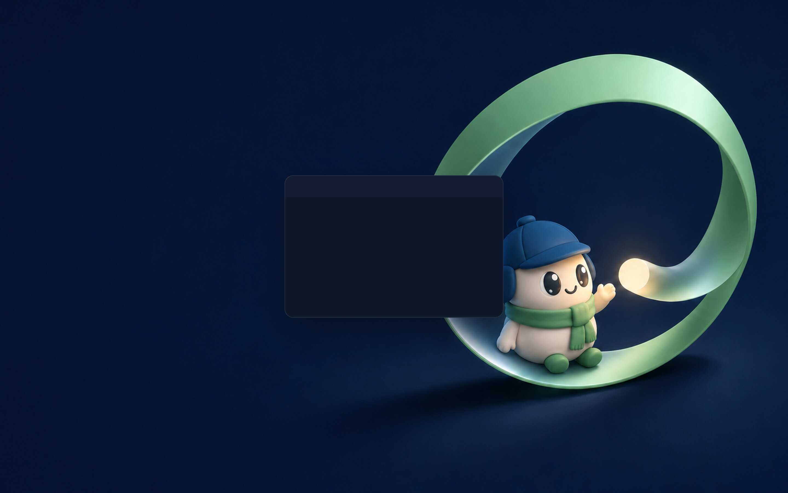 |
| Two screens of 1440 × 900, scales 1 and 2: the same framing on both | 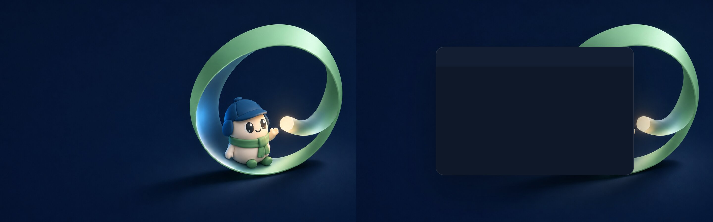 |
| `wallpaper = first-clue-light`, `follow-theme = false` | 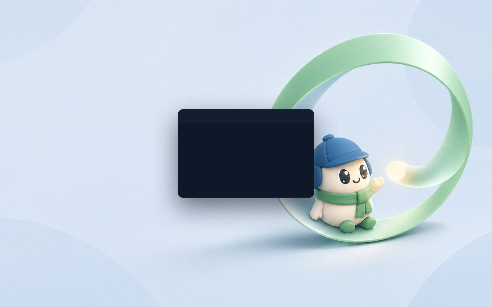 |

**Measurement.** `--measure` with the ten windows of the measurement scene, in Xephyr at
1440 × 900 (llvmpipe, the only renderer there), average render time of all frames, per run
main before this lot 15.10, 12.76 ms; this lot with the default wallpaper 14.15, 15.08,
14.09 ms; this lot with the board's background 16.14, 14.47 ms. The spread between runs is
larger than the difference: no regression seen. Software rendering does not hold 60 frames per
second in any of the three, so the late frame criterion has to be checked on the AMD chip of
the reference laptop (see "Measuring").

Notes:

- In `center` mode, a wallpaper of the collection always loads its largest variant (the factor
  is 1 for all of them) and shows its middle, one image pixel per screen pixel.
- The settings file is read as it is found: a program that writes it (Control Room) must write
  a temporary file and `rename` it, or a half-written file may be refused for 2 seconds.
- Variants installed after the start are seen at the next change of the settings file.
- A new setting, a new theme and a decoded image ask for a frame (`State::queue_redraw`): the
  real session draws on damage (see "Frames of the real session").

Left for lot D-04b, from the review of D-04:

1. **No flash when the source changes.** Done by lot D-05c, but for a scale change of a screen,
   which still drops its texture: the board's background shows while the new variant decodes.
2. **Development fallback on the original.** In a debug build, when the wallpaper is not
   installed, show `assets/wallpapers/<id>.jpg`; and reduce on the decoding thread an image
   more than twice the screen (`thumbnail`), against the aliasing of the GPU's bilinear
   reduction without mipmaps (also for a large `path =` image).
3. **The 3840 variant as JPEG.** It is the original decoded and written as PNG: 99 MB in the
   system image instead of 25 MB of JPEG, and slower to decode. Copy the original as
   `3840x2160.jpg` and let `variants()` accept `.jpg`; to see with the image factory.
4. **Alpha.** The texture is imported as `Xbgr8888`: a transparent PNG of the user's shows the
   color stored under its transparent pixels. Compose it over `color::DESKTOP` when decoding,
   or import as premultiplied `Abgr8888`.

To try it, with the variants in a test folder:

```sh
just wallpapers
mkdir -p /tmp/wallpaper-test/share/sherlockos
ln -s "$PWD/target/wallpapers" /tmp/wallpaper-test/share/sherlockos/wallpapers
XDG_DATA_HOME=/tmp/wallpaper-test/share cargo run -p compositor -- --nested
```

Then write `wallpaper = ring` and `mode = contain` in `~/.config/sherlockos/wallpaper.conf`: the
wallpaper changes within 2 seconds.

## Theme (lot D-05c)

The compositor follows the theme of the appearance file (`docs/appearance.md`) live, like the
shell programs. `theme::follow` makes the theme of the file active before the first frame, then
receives each change from `appearance_config::follow_themes` (inotify and the timer of the
automatic mode, no polling) through a calloop channel, and calls `State::set_theme`:

| What | How it follows |
| --- | --- |
| Colors | A `color::ThemeFade` fades `color::palette()` over `motion::THEME_FADE` (250 ms), in 32 steps. Background, discs, window borders, shadows, snap preview and title bars read the palette shown when the frame is built: nothing else holds a color |
| Wallpaper | `Wallpaper::set_theme`: a wallpaper that follows the theme takes its pendant, decoded then crossfaded (see "Wallpapers") |
| Cursor | Real session: `Cursors::follow` reads the house theme of the new theme, `sherlockos` or `sherlockos-light`, at the next frame (see `docs/cursor.md`) |

The fade is ticked at the start of each frame (`State::tick_theme`, in `Scene::screens`): while
it runs, each screen draws at each blank; the frame where it ends draws the final palette, and
nothing is asked for afterwards. A change of theme damages the whole screen during the fade
(background, discs, every border, shadow and title bar change color); the real session's
`DrmCompositor` also redraws in full when its clear color changes. A title bar is drawn again on
the processor at each step of the fade (its colors are in its `Look`): at most 32 times per
window, then never.

The palette is global to the process (`color::set_active`, `ThemeFade`): the bench that changes
the theme (`tests/perf.rs`) runs alone, the others wait for it.

Clients draw their own colors: GTK follows the session's dconf database (`toolkit-theme
follow`, `docs/third-party-theming.md`), the shell programs follow the appearance file. The
dock is checked by `the_dock_follows_a_new_theme_in_the_file` (`desktop/dock/tests/render.rs`):
glass, separator, dots, label and focus ring read the palette shown, Sherlock's tile keeps its
cream in both themes, as on the boards.

**Tests.**

- `tests/theme.rs`: `Theme=` rewritten in an appearance file of the test: the light palette
  after the fade, the redraw asked for, the wallpaper changed to first-clue-light, then back.
- `tests/perf.rs`, `a_theme_change_fades_everything_then_rests`: the whole screen is damaged
  during the fade, frames at each blank, then no frame is even built at rest.
- `wallpaper.rs` (unit): the new image fades in over the old one and the old one goes away;
  the same source keeps its images. `cursor.rs` (unit): the house theme follows the desktop.
- `captures_of_the_desktop_in_both_themes` (ignored, needs Mesa's EGL and the dock built):
  the scene with the default wallpaper pair, a decorated window and the real dock hovered over
  Sherlock, rendered with the software renderer, dark, then light after rewriting `Theme=`.
  The dock draws in software there too: its buffers have no alpha (see "Layer-shell toolkit of
  the shell"), so the room around its glass is black; in the real session it draws with
  Vulkan and stays transparent.

```sh
cargo build -p dock
cargo test -p compositor --test headless -- --ignored captures_of_the_desktop
```

| Dark | Light, after the change |
| --- | --- |
| 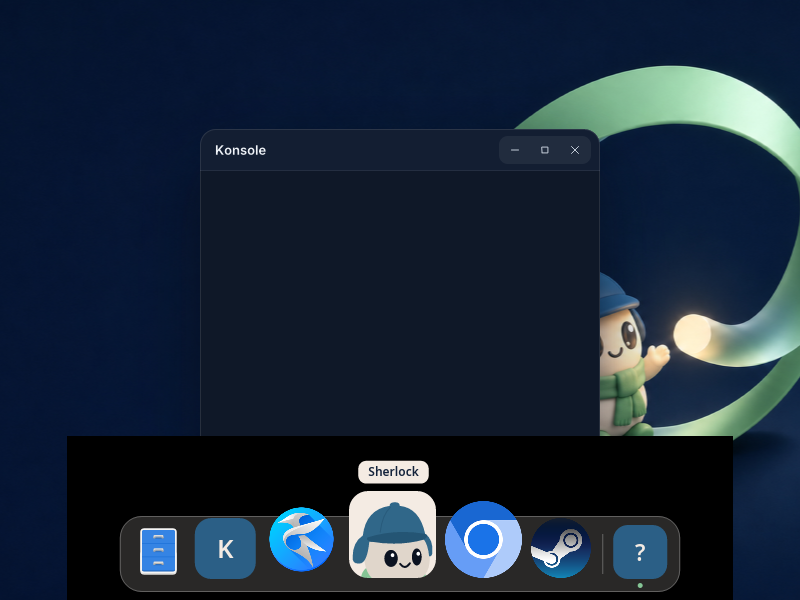 | 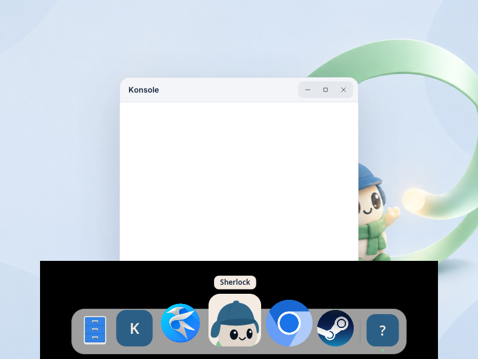 |

## Running

```sh
cargo run -p compositor -- --nested
```

A window opens in the current session, Wayland or X11. Everything after `--nested` is a
command, launched once XWayland is ready, with the compositor's socket in `WAYLAND_DISPLAY` and
its X11 display in `DISPLAY`. What this command launches in turn inherits both. For a terminal:

```sh
cargo run -p compositor -- --nested env QT_QPA_PLATFORM=wayland konsole --separate
```

Logs go to standard error, at the `info` level by default. `RUST_LOG` sets it, for example
`RUST_LOG=compositor=debug,smithay=warn`. The socket name shows up at startup. At the `debug`
level, each gesture logs its start and its end, with its type (pulled edges, or none for a
move) and its source (gesture key or client request). A refused client request is logged too.

`--workspaces N` sets the number of workspaces (1 to 9, 3 by default).

Two screens, the second one at scale 2, with the test bar on both (built beforehand, see
`prototypes/bar-test`):

```sh
(cd prototypes/bar-test && cargo build --release)
cargo run -p compositor -- --nested --outputs 2 --scale 1 --scale 2 \
  prototypes/bar-test/target/release/bar-test
```

`QT_QPA_PLATFORM=wayland` forces Konsole to speak Wayland: in an X11 session, Qt would choose
X11, and Konsole would go through XWayland. `--separate` keeps the command from joining a Konsole
that is already open.

### Without a screen (`--headless`, lot D-36)

```sh
cargo run -p compositor -- --headless konsole
```

No window opens anywhere: the compositor makes one virtual screen of 1440 × 900 per `--scale`
(one at scale 1 by default), draws nothing, and sends each window and anchored surface its
frame callbacks every 16 ms. Real applications run against its protocols, to see what they ask
for (`WAYLAND_DEBUG=1`, `RUST_LOG=compositor=debug`), without showing a window on the author's
screen. Like the real session, it restricts EGL to Mesa for itself and what it launches, and
starts XWayland only with `--xwayland`.

### An X11 application

```sh
cargo run -p compositor -- --nested xterm
```

Or, from the compositor's Konsole, which already has the right `DISPLAY`: `xterm &`,
`xeyes &`. From another terminal, the display from the log must be given: `DISPLAY=:1 xterm`.

### Zen

Zen is installed as a Flatpak (`app.zen_browser.zen`). Its permissions already include the
`wayland` and `fallback-x11` sockets, and the home folder. Flatpak passes it the compositor's
socket, read from `WAYLAND_DISPLAY`. Two precautions:

- `--new-instance`: otherwise, if Zen is already running in the host session, the command hands
  it the page, and the window opens in the host session, outside the compositor.
- `--profile`: a separate profile, because the everyday one is locked by the Zen of the host
  session. The test folder below is in Zen's data, which the sandbox sees.

In native Wayland, which Zen picks on its own when `WAYLAND_DISPLAY` is set:

```sh
mkdir -p ~/.var/app/app.zen_browser.zen/compositor-test
cargo run -p compositor -- --nested flatpak run app.zen_browser.zen \
  --new-instance --profile "$HOME/.var/app/app.zen_browser.zen/compositor-test"
```

In X11, through XWayland: the Wayland socket is taken away from the sandbox and the X11 one is
given to it.

```sh
cargo run -p compositor -- --nested flatpak run --nosocket=wayland --socket=x11 \
  --env=MOZ_ENABLE_WAYLAND=0 app.zen_browser.zen \
  --new-instance --profile "$HOME/.var/app/app.zen_browser.zen/compositor-test"
```

The log says which of the two is running: `X11 window title="Zen Browser"` in X11, nothing like
it in Wayland. Close Zen before the compositor: closed first, the compositor may leave Zen
processes behind (`ps -eo pid,args | grep compositor-test` shows them).

### Clipboard from the command line

`wl-copy` and `wl-paste` (`wl-clipboard` package) are Wayland clients, `xclip` an X11 client.
An X11 window must have the keyboard, in both directions: launch the compositor with `xterm`,
and do not click elsewhere. With the numbers from the log:

```sh
WAYLAND_DISPLAY=wayland-1 wl-copy "from Wayland"; DISPLAY=:1 xclip -o -selection clipboard
echo -n "from X11" | DISPLAY=:1 xclip -i -selection clipboard; WAYLAND_DISPLAY=wayland-1 wl-paste
```

With `--primary` for `wl-copy` and `wl-paste`, and `-selection primary` for `xclip`, it is the
primary selection.

## Real session

Without `--nested`, the compositor takes the screens, the keyboard, the mouse and the touchpad of
the machine (lot D-14). It is started from a text console (TTY) or by the login screen (SDDM on
the author's Debian), never from inside another graphical session: when `DISPLAY` or
`WAYLAND_DISPLAY` is set, it refuses to start and suggests `--nested`. Inside Plasma it would
take the seat's screens and input devices from it.

How it works (`src/udev.rs`):

- **Session.** Smithay's `LibSeatSession` (libseat, with logind or seatd behind it) opens the
  devices without root and says when the console is left or entered again.
- **Card.** `card::choose` reads `/sys/class/drm` like `sherlock_ui::gpu` (vendor, driver,
  `boot_vga`, connector `status`), which never wakes a card. It takes the `boot_vga` card with a
  screen plugged in, or else the `boot_vga` card, or else any card with a screen. **An NVIDIA
  card is never chosen nor opened**: on the reference laptop, the AMD chip drives the internal
  screen and the RTX stays asleep. Only the chosen card is opened: screens wired to another card
  (some laptops wire their HDMI port to the NVIDIA card) stay dark.
- **EGL.** Before anything else, the compositor sets `__EGL_VENDOR_LIBRARY_FILENAMES` to Mesa's
  vendor file (`50_mesa.json`, looked for in `/etc/glvnd/egl_vendor.d` and
  `/usr/share/glvnd/egl_vendor.d`), unless the user set it: libglvnd never loads NVIDIA's EGL
  library, which comes first on Debian. The programs it launches keep it (Konsole, Firefox and
  every EGL client would otherwise load NVIDIA's first); a user who set the variable keeps
  their own value. A game meant for the NVIDIA card has to be launched with the variable unset,
  for now by hand.
- **XWayland: with `--xwayland`, which the start script gives by default (lot D-35b).** Smithay starts Xwayland with an empty
  environment; `src/mesa.rs` gives it the EGL restriction and `GBM_BACKENDS_PATH` pointing to
  `$XDG_RUNTIME_DIR/sherlockos/gbm-backends`, a folder of links to the system's GBM backends without
  NVIDIA's (`nvidia-drm_gbm.so`), so that libgbm falls back to Mesa's. Measured with
  `tests/xwayland.rs` on the reference laptop (Xwayland 24.1.6), sampling the descriptors of
  Xwayland every 10 ms:

  | Xwayland's environment | `nv_gbm` errors | NVIDIA nodes seen open |
  | --- | --- | --- |
  | Empty (before, measured by the review of the lot) | 2 | not measured |
  | EGL restricted to Mesa | 1 | `card1` |
  | GBM backends without NVIDIA's | 0 | `card1`, `renderD129` |
  | Both | 0 | `card1` |
  | Both, and glamor off (`XWAYLAND_NO_GLAMOR=1`) | 0 | `card1` |

  The test has no renderer, hence no linux-dmabuf. Without the default feedback of lot D-06,
  Xwayland still opens the NVIDIA card's node at startup, whatever it is given, and opening it
  may wake the card. The feedback, which the real session now offers, names the AMD node; lot
  D-06 saw XWayland open no NVIDIA device with it in nested mode, but that is not measured in
  the real session yet. The compositor starts XWayland only with `--xwayland`: without it, X11
  applications do not show up, and the launched command gets no `DISPLAY`. Since lot D-35b the
  start script gives `--xwayland` by default, for Steam and the X11 builds of some applications
  (Discord); `SHERLOCKOS_XWAYLAND=0` leaves it out. Nothing else in the session stands against it:
  the compositor already ran XWayland in nested mode and with `--xwayland`. Whether Xwayland
  keeps off the NVIDIA card in the real session is still to be seen on the reference laptop
  (lot D-35b asks for that test before its merge). Nested mode starts it as before, with the
  same environment.
- **Screens.** Every connector with a screen gets a CRTC, its preferred mode and a
  `DrmCompositor` (GBM buffers, `XRGB8888`). They sit side by side in the space, in the order
  the card lists them; `--scale S` sets their scale, one per screen in order, the last one
  repeated (1 by default). udev reports screens plugged in or out; the connectors are read again
  then. A screen unplugged takes its anchored surfaces with it (their program gets `closed`),
  the screens on its right close ranks, the pointer comes back on a screen, and the windows no
  screen shows any more come to the screen under the pointer: snapped and maximized ones take
  its work area, the others are centered in it. Its `wl_output` global is hidden at once and
  destroyed five seconds later, so that a client binding it right then gets no error. If no
  screen can be driven at startup, the compositor leaves with `no screen driven` rather than
  stay dark (opening the card switched its screens off).
- **Rendering.** The same scene as the windowed backend (`Scene::screens`), built for each
  screen in its own frame, at scale 1 in the `DrmCompositor` (the scene already applies the
  screen's scale). Everything is composited: no plane is given to a client buffer, since the
  rounded clip would be lost; the cursor alone goes on the screen's cursor plane when it fits
  there, so that moving the pointer draws nothing. A screen draws only when something changed,
  at the pace of its vertical blank, and only what changed (see "Frames of the real session").
  The cursor is drawn in
  front of the scene, from the house cursor theme (`sherlockos`, `sherlockos-light` for the light
  desktop; the user's `XCURSOR_THEME` or the system's `default` when it is not installed;
  `XCURSOR_SIZE`, 24 by default, times the screen's scale, the nearest size above), in the
  shape `cursor_icon` asks for; a client that draws its own cursor image gets the arrow, as in
  nested mode. A transition of the cursor (a new shape, a shake) draws at each blank while it
  runs; the waiting cursors draw only when their next image is due, woken by a timer. See
  `docs/cursor.md`. linux-dmabuf
  (lot D-06) is offered on the render node of the driven card, with its renderer's formats, as
  in nested mode; the `DmabufBlocker` it lacks is still to come (see "GPU buffers"). A frame that
  fails is logged at its 1st, 2nd, 4th, 8th… failure in a row, not on every frame.
- **Input.** libinput, on the session's seat: keyboard (see "Behavior" for the layout; a layout
  xkb refuses falls back to AZERTY with a warning), mouse,
  touchpad with its setting and its gestures (see "Touchpad"). The pointer moves by steps and stays on the screens. The gesture
  key is Super.
- **Console switch.** Ctrl + Alt + F1 to F12 switch console. When the session is left, input
  and drawing stop, and the keys still held are released for the clients; when it comes back,
  the screens are reset, read again (a screen may have been plugged in meanwhile) and redrawn.
- **Way out.** **Ctrl + Alt + Backspace stops the compositor**, whatever has the keyboard: the
  emergency exit when nothing answers any more. These keys never reach a client. In nested mode
  they do nothing (the host session keeps its consoles, and closing the window stops it).
- **Leaving.** The screens and the card are released first, which gives the console back its
  display state, then the seat (`RealSession::close`).

The compositor links to libseat, libinput, udev and GBM: on Debian, `libseat-dev`,
`libinput-dev`, `libudev-dev`, `libgbm-dev` and `libdrm-dev` to build it, and `libseat1` to run
it.

### From a text console

1. Build: `cargo build --release -p compositor -p bar -p dock -p notifications`.
2. Switch to a free console: Ctrl + Alt + F3, and log in.
3. Launch, with the log in a file:

   ```sh
   cd ~/IdeaProjects/sherlockOs
   RUST_LOG=info,compositor=debug target/release/compositor \
     sh -c 'target/release/bar & target/release/dock & exec konsole' 2> /tmp/compositor.log
   ```

   Or the whole session, as the login screen starts it:
   `SHERLOCKOS_BIN=$PWD/target/release SHERLOCKOS_DATA=$PWD/desktop/sherlock-ui desktop/compositor/session/sherlockos-session`
   (`SHERLOCKOS_DATA`: where the application icons are, see `docs/sherlock-ui.md`).
   With `--xwayland` after `compositor`, X11 applications too (the script gives it unless
   `SHERLOCKOS_XWAYLAND=0`), at the risk of waking the NVIDIA card (see above).

4. To come back: Ctrl + Alt + Backspace stops the compositor and gives the console back.
   Ctrl + Alt + F1 or F2 goes back to the login screen or to Plasma, which keeps running; the
   compositor waits on its console, Ctrl + Alt + F3 comes back to it.

### From the login screen (SDDM)

`just install-session` builds the compositor, the bar, the dock, the launcher, the notification
daemon and Evidence in release, then **prints** the commands that install the session, without
running them:

- the six programs and the start script `sherlockos-session` go to `/usr/local/libexec/sherlockos/`;
- the entry `sherlockos.desktop` (`Name=SherlockOS`) goes to `/usr/share/wayland-sessions/`, where
  SDDM lists the Wayland sessions;
- Evidence's desktop entry goes to `/usr/local/share/applications/`, where the dock and the
  launcher find it; it runs `evidence`, which the session finds in its `PATH`;
- the application icons, a hicolor theme, go to `/usr/local/share/sherlockos/icons/` (D-03);
- the portal setting `sherlockos-portals.conf` goes to `/usr/local/share/sherlockos/xdg-desktop-portal/`
  (D-35b, see "Everyday services");
- `sudo apt install libseat1` is added when libseat is missing, and `sudo apt install` of the
  portals, the keyring and the polkit agent that are missing (D-35b).

At the next login, SDDM offers « SherlockOS » next to Plasma in its session menu. The start script
sets `XDG_CURRENT_DESKTOP`, `XDG_SESSION_DESKTOP` (both `SherlockOS`) and `XDG_SESSION_TYPE=wayland`,
adds the folder of the programs at the end of `PATH` (the launcher and `evidence` are found
there) and `/usr/local/share/sherlockos` at the start of `XDG_DATA_DIRS` (the icons), then
launches the compositor, which launches the bar, the dock and the notification daemon once it
is ready. They start again when they stop (ADR 0005), as long as the compositor
is there, after 1, 2, 4, 8 then 16 seconds; one that stopped 5 times within 60 seconds is given
up, with a line in the log (`session: … given up`).
To remove the session: `sudo rm -r /usr/local/libexec/sherlockos /usr/local/share/sherlockos /usr/share/wayland-sessions/sherlockos.desktop /usr/local/share/applications/evidence.desktop`.

Why `desktop/compositor/session/` and not `distro/`: these files start the compositor and the
shell built from this workspace, and are tried on the author's Debian before the base exists.
The package recipes of `distro/` will install them from here.

### D-Bus session bus (lot D-18d)

Started from a text console while Plasma stays open on another one, the session used to share
Plasma's D-Bus session bus (`/run/user/1000/bus`: one bus per user, whatever the session).
Konsole then took 25 to 50 seconds to show its window. The cause, found without a screen:

- Qt chooses its platform theme from `XDG_CURRENT_DESKTOP`; with `SherlockOS` it takes the generic
  theme, which gives each window a D-Bus global menu (`QDBusMenuBar`) as soon as the name
  `com.canonical.AppMenu.Registrar` has an owner on the bus. On the author's bus it does:
  `kded6`, the appmenu module of the X11 Plasma session (checked by asking the bus daemon for
  the owner of the name; nothing was sent to `kded6`).
- The window registers with `RegisterWindow` and waits for the answer (`waitForFinished`): the
  default timeout of D-Bus, 25 seconds, then `UnregisterWindow` when it closes. The log of the
  author's session showed `Failed to register window menu, reason:
  org.freedesktop.DBus.Error.NoReply`.
- Reproduced on a private bus with a headless KWin (`kwin_wayland --virtual`), Konsole 25.04.2
  and Qt 6.8.2, `XDG_CURRENT_DESKTOP=SherlockOS`: with a registrar that never answers (a script that
  owns the name), the window had no content after 40 s and Konsole logged the same `NoReply`;
  without the registrar, its first content came 0.42 s after the start, and Konsole made no
  other call that waits on Plasma.

The shared bus breaks other things too: the notification daemon finds
`org.freedesktop.Notifications` taken by Plasma and stops (`docs/notifications.md`), and an
application that keeps a single instance through the bus may open its window in the Plasma
session instead (not tried). So `sherlockos-session` starts the session on a bus of its own
when logind lists another graphical session (type `x11`, `wayland` or `mir`, not closing) of
the same user; the session it runs in does not count. The script starts the bus daemon itself
(`dbus-daemon --session --fork`), exports its address and stops it when the session ends. It
does not go through `dbus-run-session`: with the compositor run under it, libseat could not
take the screen on the author's machine ("Resource temporarily unavailable" when opening the
card), while the same session on the shared bus started. The traffic was
read with `dbus-monitor` on the private bus only: the author's bus is never listened to. Once the
compositor is ready, `dbus-update-activation-environment WAYLAND_DISPLAY DISPLAY` gives the
display to the services the bus starts (the portals): without it, on a private bus, the
portal started by Konsole crashed again and again, and Konsole waited 9 seconds for it. With
it, 0.42 s. Alone on the machine (the OS itself, or Plasma logged out), the session keeps the
user's bus.

`SHERLOCKOS_SESSION_BUS=own` or `shared` forces the choice (`auto` by default). The log says
`session: D-Bus session bus of its own` when the session has one. Not chosen: disabling the
global menu alone (Qt's generic theme has no switch for it; `KDE_NO_GLOBAL_MENU` only exists
for Plasma's theme, which the Qt theme batch may pick), since it would leave the notification
daemon and the single-instance applications in the other session. Not checked yet: the
session started from SDDM while Plasma runs on another console, which takes the same path.

### Everyday services (lot D-35b)

What a desktop needs besides its own programs, started by `sherlockos-session` when it is
installed. Each choice is written in the session log (`~/.local/state/sherlockos/session.log`).

- **Polkit agent.** The window that asks for the password when an action needs one (mounting a
  disk, a setting of the system). The script starts the first one installed, in this order:
  `polkit-kde-authentication-agent-1` (`/usr/lib/x86_64-linux-gnu/libexec/` on Debian, or
  `/usr/libexec/`), `polkit-gnome-authentication-agent-1` (`/usr/lib/policykit-1-gnome/` or
  `/usr/libexec/`), then `lxpolkit` from `PATH`. It starts with the shell programs, once the
  display is there, and starts again like them when it stops. `SHERLOCKOS_POLKIT_AGENTS` replaces
  the list (paths, or names looked for in `PATH`). Without any, the log says
  `session: warning: no polkit agent installed`, and polkit refuses what needs a password. The
  agent registers with polkit for this login session only: the Plasma session beside it keeps
  its own.
- **Keyring.** Applications keep their passwords through the Secret Service on the session bus.
  `gnome-keyring-daemon --start --components=secrets` starts before the compositor, on the bus
  of the session, and the variables it prints (`GNOME_KEYRING_CONTROL`…) are exported to the
  whole session. Without it, `kwalletd6` starts with the shell programs. On a bus of its own
  (see "D-Bus session bus"), the session does not reach the keyring or the wallet of a Plasma
  session open beside it: it has its own keyring, whose password is asked the first time it is
  unlocked (nothing unlocks it at login: the login screen's PAM module is not set up for this
  session). Alone on the machine, the session uses the user's bus, and the keyring already
  running there, if any.
- **Old X11 tray icons** (lot D-45b). Programs that only know the X11 tray (XEmbed), such as
  AnyDesk 7.1.4 with its `GtkStatusIcon`, would show no icon in the bar. When `xembedsniproxy`
  is installed (KDE's, shipped with `plasma-workspace` on Debian 13), the script starts it with
  the shell programs, a second after the bar, on XWayland's display, and starts it again like
  them when it stops: it turns each X11 tray icon into a `StatusNotifierItem` registered with the
  bar's watcher (see "Notification area" in `docs/bar.md`). The log says `session: X11 tray
  icons: <path>`. Not started without XWayland, nor with `SHERLOCKOS_XEMBED=0`. The autostart of
  the session (`desktop/autostart`, lot D-44, still in review) leaves its `/etc/xdg/autostart`
  entry out (`OnlyShowIn=KDE`, and the list of what the session starts itself), so it never runs
  twice. A proxy of our own may replace it later if needed. To check on the machine: whether
  the icons come back after the bar restarts, since the proxy registers each icon once.
- **Portals.** `xdg-desktop-portal` is started by the bus when an application asks for it (a
  file chooser from Flatpak or Firefox, for instance). It reads `sherlockos-portals.conf` (the name of `XDG_CURRENT_DESKTOP`, `SherlockOS`, in lower case)
  (`desktop/compositor/session/`), which `just install-session` puts in
  `/usr/local/share/sherlockos/xdg-desktop-portal/`: GTK's backend for everything (it works
  without GNOME or Plasma running), gnome-keyring for the secrets. So that the portal finds this
  file and the display, the script gives the activation environment of the bus
  `WAYLAND_DISPLAY`, `DISPLAY`, `XDG_CURRENT_DESKTOP`, `XDG_SESSION_DESKTOP`, `XDG_SESSION_TYPE`
  and `XDG_DATA_DIRS`, with `--systemd` on the user's shared bus (the portals are systemd user
  services there). The setting is never written into the home folder. Reading it from
  `XDG_DATA_DIRS` needs xdg-desktop-portal 1.18 or later (Debian 13 has 1.20).
- **Screen sharing and screenshots** through the portals are not there yet: the
  `xdg-desktop-portal-wlr` backend needs the `wlr-screencopy` protocol (or
  `ext-image-copy-capture`), which Smithay 0.7 does not provide, and which this lot leaves to a
  lot of its own. The screenshots of the compositor itself (Print Screen) come with lot D-35c.

Debian packages to install for all of it (the author installs them; `just install-session`
prints the line for those missing): `xdg-desktop-portal`, `xdg-desktop-portal-gtk`,
`gnome-keyring`, `polkit-kde-agent-1` (or `policykit-1-gnome`, or `lxpolkit`).

The script is tested with fake programs under `env -i` (`tests/session.rs`): XWayland given by
default and left out with `SHERLOCKOS_XWAYLAND=0`, the keyring started and its variables exported,
the first agent found started, the warning without any, the activation environment.

### When something goes wrong

- **Nothing answers.** Ctrl + Alt + Backspace stops the compositor, and the session with it: SDDM
  comes back, or the console.
- **The keyboard does not answer either.** In a graphical session the kernel leaves the
  console keys to the compositor: if it no longer reads the keyboard, Ctrl + Alt + Fn does
  nothing either. Then, in order:
  1. from another machine, `ssh` and `pkill compositor`;
  2. the kernel's SysRq keys, which Debian allows (`kernel.sysrq = 438`): Alt + SysRq (Print
     Screen) + R gives the keyboard back to the kernel; then Ctrl + Alt + F2 switches console
     (logind releases the console without waiting for the compositor); log in there and
     `pkill compositor`. Do not use Alt + SysRq + K under SDDM: it kills the programs that
     hold the console, which is then logind, not the compositor (from a console where you
     launched the compositor yourself, K does stop it);
  3. last resort, a long press on the power button.
- **The session does not start.** SDDM comes back at once: the reason is at the end of the log.
- **Back to Plasma.** Pick Plasma in SDDM's session menu: it stays the default as long as it was
  the last one used. To remove our entry from the menu, the `sudo rm` above.

### Logs

| Started from | Log |
| --- | --- |
| A console, `compositor` | Its standard error: `2> /tmp/compositor.log` as above |
| `sherlockos-session` (SDDM or a console) | `~/.local/state/sherlockos/session.log`; the previous session, or the first 5 MiB of a long one, in `session.log.old` |
| SDDM, before the script runs | `~/.local/share/sddm/wayland-session.log`, and `journalctl -b -u sddm` |

The level follows `RUST_LOG`; the start-up lines name the card (`real session card=/dev/dri/…`),
each screen with its mode and scale (`screen plugged in`), the input devices and the cursor
theme. Each console switch logs `session paused` and `session active again`.

### Left for later

- Screens plugged in again after the last one was unplugged: windows keep their place, and
  those outside the new screens are not brought back (no crash: the pointer and the layout
  handle having no screen).
- The author's test of Xwayland in the real session, now on by default (lot D-35b): does it keep
  off the NVIDIA card with the dmabuf feedback?
- Screen sharing and screenshots through the portals: the compositor offers no capture
  protocol yet (see "Everyday services").
- `DmabufBlocker` in the real session (see "GPU buffers").

### Frames of the real session (lot P-01)

Before this lot, each screen drew a frame at every vertical blank, and a frame that changed
nothing was tried again 16 ms later: at rest the loop woke up 60 times a second or more. The
compositor's own elements (borders, shadows, discs) took a new identity in every frame, so the
damage tracker saw them new every time and the whole screen was composited at every blank, 144
times a second on the reference laptop's screen. Now:

- **Nothing at rest.** Every change that may show moves `State::redraw_epoch` on
  (`State::queue_redraw`): a client request (any: a commit, a window closed, a shell request),
  an input event, a screen plugged in or out, a wallpaper loaded, a batch of X11 events, and the
  methods that change the desktop (workspaces, focus, minimize, snap gap). It also wakes the real
  session up through a calloop `Ping`. A screen builds a frame only if the epoch moved since its
  last one, or if an animation runs (`pacing::Pacing`). At rest no frame is built and the loop
  sleeps in `epoll`; the only timers left are the frame callbacks of hidden windows (once a
  second) and the wallpaper setting check.
- **At the pace of the vertical blank, never waiting for it.** A frame with damage goes to the
  screen (`queue_frame`, non-blocking); its vertical blank comes back as a DRM event and lets the
  next frame be built. A frame without damage, or one that failed, is not shown: a timer at the
  screen's refresh period (from its mode, 144 Hz → 6.9 ms) stands for the blank, sends the frame
  callbacks of the clients that asked for one, and lets the next frame be built. A change during
  a pending frame waits for its blank: at most one frame per blank.
- **Only what changed.** The elements the compositor draws keep their identity from one frame to
  the next (`damage::Ids`, one per screen): a key by window (its main surface) and part
  (border, shadow, preview, disc), and a commit that moves on only when what it draws changes
  (`damage::Stamped`). The damage tracker of the `DrmCompositor`, with the buffer age, then
  redraws: the area of a window that draws again; the old and new places of what moves; the
  whole of what appears, goes, or changes place in the stacking order. A workspace slide or a
  window that opens therefore redraws the whole screen, an animated dock its own rectangle.
- **Frame callbacks.** Clients get theirs when their frame goes to the screen, or at the
  estimated blank when nothing was shown; hidden windows once a second, by a timer of their own.

## Touchpad

Lot D-31 makes the touchpad behave like a Mac's: its setting in a file that Control Room's
Touchpad page will write, and gestures that follow the fingers.

### Setting

`$XDG_CONFIG_HOME/sherlockos/touchpad.conf` (`~/.config/sherlockos/touchpad.conf`), read by
`desktop_config::touchpad`, in the same `key = value` form as `wallpaper.conf`. Every key is
optional; without the file, the defaults below apply.

| Key | Default | Values | Effect (libinput) |
| --- | --- | --- | --- |
| `tap-to-click` | `true` | `true`, `false` | A tap clicks: one finger left, two right, three middle |
| `tap-and-drag` | `true` | `true`, `false` | Tap, then slide with the finger down: drags |
| `drag-lock` | `false` | `true`, `false` | The drag goes on a moment after the finger lifts |
| `natural-scroll` | `true` | `true`, `false` | Two finger scrolling moves the content with the fingers |
| `disable-while-typing` | `true` | `true`, `false` | The touchpad is off while the keyboard is typed on |
| `speed` | `0` | `-1` to `1` | Pointer speed |
| `acceleration` | `adaptive` | `adaptive`, `flat` | Faster movements go further, or not |
| `click` | `fingers` | `fingers`, `areas` | A press clicks by the number of fingers (clickfinger), or by where it presses (bottom right corner: right button) |
| `swipe-down` | `nothing` | `nothing`, `minimize` | What three fingers down do out of Mission Control (`minimize` was the default before lot D-33) |

Two finger scrolling is always on. The setting applies to touchpads only (the devices that tap),
when they are plugged in, and again within 2 seconds of a change of the file (modification time
and length looked at every 2 seconds, as `wallpaper.conf`). A wrong line, an unknown key or a
speed out of range gives the defaults, with a warning naming the line in the log. What a
touchpad does not support is skipped (`debug` level): a touchpad without a physical button has
no button areas. `State::set_touchpad` applies a setting directly, for the tests and for
Control Room later.

### Gestures

libinput recognizes swipes, pinches and holds, with their number of fingers. **Gestures of three
fingers or more belong to the compositor**; the others go to the client under the pointer,
through `zwp_pointer_gestures_v1` (version 3): a two finger pinch zooms in Firefox, Evince or
Eye of GNOME, a hold stops a kinetic scroll. Two fingers that move scroll (libinput): a touchpad
gives no two finger swipe, but a device that would is passed on.

| Fingers | Gesture | Effect |
| --- | --- | --- |
| 3 | Left or right | The row of workspaces follows the fingers, then lands on the neighbour or comes back |
| 3 | Up | Opens Mission Control, which follows the fingers (see "Mission Control") |
| 3 | Down | Closes Mission Control; out of it, nothing, or minimizes the window that has the keyboard with `swipe-down = minimize` |
| 3 | Pinch, hold | Reserved |
| 4 | Pinch in, out | Opens, closes the applications view (lot D-41c, `docs/apps.md`) |
| 4 and more | Any other | Reserved |
| 1 and 2 | Pinch, hold, swipe | To the client under the pointer |

"Reserved" means taken without effect: no client receives it, so that giving it a role later
changes nothing for applications.

**Following the fingers** (`gestures::Swipe`, pure computation). A three finger swipe picks its
direction once the fingers travelled 16 units (`LOCK_DISTANCE`, libinput's units: a pixel of a
1000 dpi pointer, accelerated): the larger axis wins, and stays. Left or right, the row of
workspaces is held where the fingers put it (`WorkspaceSlide::hold`), without a spring: 400 units
of travel (`WORKSPACE_DISTANCE`, GNOME's value) move it by a whole workspace, in the natural
direction (fingers to the left, the workspace on the right comes in). The view starts where it
is, even in the middle of a slide. It reaches the neighbours of the active workspace freely;
beyond them, and past the ends of the row, it resists like iOS's rubber band (`1 − 1/(0.55 x +
1)` of a workspace for `x` workspaces of travel): the elastic rebound at the end of the list.
While held, a frame is drawn at each movement of the fingers, none when they rest.

**Letting go.** When the fingers lift, the velocity is that of the last 100 ms of movement
(`VELOCITY_WINDOW`): fingers that stopped before lifting throw nothing. The view lands on the
workspace nearest to where that velocity carries it in 0.2 s (`PROJECTION`), among the
neighbours: a quick flick of a quarter of the way goes on to the next one, a slow drag of a
quarter comes back, past the middle it goes on. That workspace becomes active (keyboard,
pointer, menus, as with the keys), and the row leaves from where the fingers left it, at their
velocity (at most 6 workspaces a second, `MAX_VELOCITY`; none past the bounds), on
`SNAP_SPRING` (`WorkspaceSlide::release`, `motion::Animation::with_velocity`): the slide of lot
D-18w, driven by position during the gesture, then let go with the velocity. A swipe that
libinput cancels comes back to the active workspace. A key that changes workspace during the
swipe lets the row go from where it is.

**Up and down** act when the fingers lift, after 100 units of vertical travel
(`VERTICAL_DISTANCE`), unless libinput cancelled the swipe.

Nested mode (`--nested`) receives no gesture: winit does not report them.

### Tests

`desktop-config` (settings read, written back, refused with their line), `src/touchpad.rs` (the
setting turned into libinput settings, the file read again when it changes, defaults for a
wrong file), `src/gestures.rs` (direction locked past 16 units, rubber band, velocity and
landing: slow, thrown, stopped before lifting, never past the neighbour), `src/anim.rs` (a held
row shows both workspaces where the fingers put it, without animation; let go, it leaves at the
velocity of the fingers; a key during the swipe), `sherlock-ui/src/motion.rs` (a value thrown
leaves at its velocity), and `tests/gestures.rs`, where a fake input backend hands simulated
libinput events to `State::process_input_event`:

- **Three fingers.** The row follows the fingers, at a fifth of a workspace after 80 units, does
  not move while they rest, and lands on the next workspace when thrown, leaving at their
  speed; slow, it comes back; past the middle it goes on; cancelled, it comes back; below the
  lock distance nothing moves.
- **The ends of the row.** Fingers to the right on the first workspace: the row resists, then
  springs back; at the other end, one workspace at a time up to the third.
- **Reserved.** Four fingers, three up, three down without a window: no workspace change.
- **Applications view.** Four fingers pinching in start `sherlockos-apps --show`, spreading out
  `--hide`, once per pinch, past 0.75 or 1.33 of the fingers' spread (lot D-41c).
- **To the client.** A client binds `zwp_pointer_gestures_v1` and its swipe, pinch and hold
  objects, with a window under the pointer: it receives a two finger pinch (begin, scale, end),
  a hold (cancelled) and a two finger swipe; it receives nothing of three or four finger swipes,
  pinches or holds.
- **Three fingers down.** Not far enough, or by default: the window stays; with
  `swipe-down = minimize`, it is minimized.

### Manual test on the reference laptop

1. Start the session from a console (see "From a text console"), with
   `RUST_LOG=info,compositor=debug`: the log names the touchpad (`input device`) and the setting
   (`touchpad config=…`).
2. Tap to click, tap and slide to drag a window, scroll a page in Firefox with two fingers (the
   content follows the fingers), pinch to zoom in it.
3. Type in Konsole while resting a palm on the touchpad: the pointer does not move.
4. With three windows on three workspaces: three fingers left, slowly, and stop halfway: both
   workspaces show, side by side, where the fingers are. Lift: it comes back. Flick: it goes to
   the next one. On the first workspace, three fingers right: it resists and springs back.
5. Three fingers down on a window: nothing. Write `swipe-down = minimize` in
   `~/.config/sherlockos/touchpad.conf`: within 2 seconds the log shows the new setting, and the
   gesture minimizes the window. `natural-scroll = false`: the scrolling turns around.

## Mission Control

Lots D-33a and D-33b: every window of the active workspace side by side, under the strip of the
workspaces, as macOS does, in the style of the desktop. D-33b adds the strip, dragging a window
to another workspace, and the view that follows the fingers. No board draws it: the measures are choices of the
lot (`sherlock_ui::mission_control`), to review with the design.


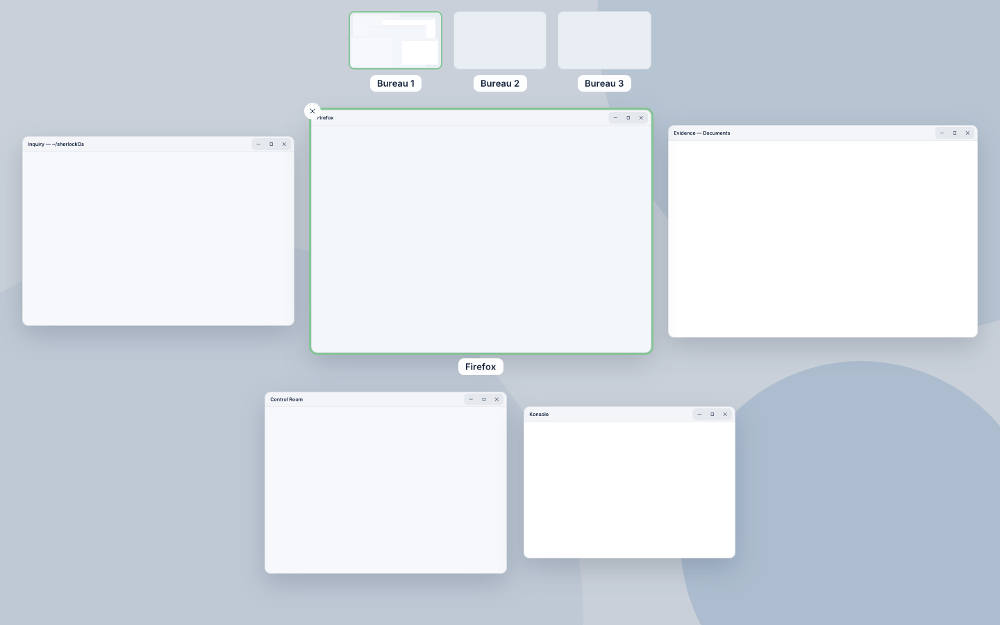

### Opening and closing

| Input (Alt in place of Super with `--nested`) | Effect |
| --- | --- |
| Super alone, pressed then released with nothing in between | Opens, or closes |
| Super + Tab | Opens, or closes |
| Escape | Closes |
| Three fingers up | Opens; the view follows the fingers |
| Three fingers down | Closes; the view follows the fingers |
| A click on nothing | Closes |
| A click on a window | That window comes on top with the keyboard, and the view closes |
| A click on a thumbnail | Goes to that workspace, and the view closes |

Super is not alone if another key or a mouse button is pressed before it is released: Super + 1,
Super + drag, Super + arrow never open the view. The client under the keyboard still sees the
press and the release of Super, as before. Super + Tab was free; Tab and Escape, like the other
shortcuts, do not reach the client.

**Following the fingers.** Once a three finger swipe picks the vertical direction (see
"Touchpad"), the view is held where the fingers put it: 300 units up open it fully
(`gestures::OVERVIEW_DISTANCE`), from closed, or from open going down. When the fingers lift
past the trigger of the vertical swipe (100 units, `VERTICAL_DISTANCE`), up opens and down
closes; short of it, or cancelled by libinput, the view goes back to where it was. Either way it
leaves from where the fingers left it, on `mission_control::SPRING` (the snap spring). Three
fingers down on the desktop open nothing: they do what `swipe-down` says, nothing by default.

**What it may not do.** It does not open during a move or resize gesture, nor while an anchored
surface keeps the keyboard (a lock screen).

### The view

- **The windows** of the active workspace, not minimized, X11 menus aside, each on the screen
  under its center: each screen shows its own. They fill the work area under the strip, with a
  margin of 32 (`MARGIN`).
- **The grid** (`layout::arrange`, pure computation): every window takes the same scale, so that
  their sizes compare as on the desktop, at most 0.8 (`MAX_SCALE`): even alone, a window shrinks
  a little. Each number of rows from 1 to n is tried; the windows are cut into rows by the
  height of their center, as evenly as possible, each row from left to right by the center:
  the number of rows that gives the largest scale wins, the fewest rows on a tie. Rows are
  centered, windows centered in their row, 24 apart (`GAP`), each with room for its title below.
  Nothing overlaps, and each window travels little: what is above stays above, what is on the
  left stays on the left.
- **Each window** is drawn with its title bar (lot D-08), its border, its corners and a shadow
  at its scale; its title is written below it, in a pill of menu glass. Under the pointer, it
  has a border of the accent color, 3 px outside its frame (`HIGHLIGHT_WIDTH`). A maximized
  window gets its corners back as it shrinks.
- **The wallpaper** is dimmed by the scrim of the theme (`palette().scrim`), more as the view
  opens. No blur: the compositor has none yet (see "What rendering does not do yet").
- **The strip**, at the top of the work area: one thumbnail per workspace, as wide as the screen
  for 84 of height (smaller if they do not fit), with the wallpaper, the windows of that
  workspace in small, and its name below (« Bureau 2 », `strings::mission_control`). The active
  workspace has a border of the accent color, 2 px; so has the thumbnail a dragged window is
  over. The strip comes down from above the screen as the view opens.
- **Animation.** Each window goes from where it is drawn on the desktop to its slot in the grid
  as the view opens, and back as it closes; the titles, the strip and the dim fade with it. A
  window chosen by a click is raised first, then every window goes back to its place.

### Dragging to another workspace

A window pressed and moved past the drag threshold (4 px) follows the pointer, in front of
everything, without its title. Dropped on a thumbnail, it moves to that workspace
(`State::move_to_workspace`) and leaves the grid; the view stays open. Dropped elsewhere, it
goes back to its slot. A click on a thumbnail goes to that workspace without the slide of the
row (`State::stop_workspace_slide`): the view closes on the windows of the arriving workspace.
The bar follows through `ext-workspace-v1`, as for any switch.

### Input while it is open

- **Keyboard.** No window has it: `set_keyboard_focus` gives none while the view is open, and
  the clients get `leave`. A window that opens in the view does not get it either; the view
  gives the keyboard back when it closes: to the window clicked, or else to the window that had
  it last (`State::top_window`), the new window if one opened. An anchored surface with an
  exclusive keyboard keeps its own, as always.
- **Pointer.** It is on no client: neither the windows nor the bar and the dock receive motion,
  buttons, scrolling or gestures. The cursor is the arrow.
- **Windows that come and go.** A window opened in the view takes its slot in the grid (with its
  opening animation), one closed leaves it; the grid is computed again at each frame, so the
  others jump to their new slot (see below).

### Rendering

The thumbnails are the windows' own surfaces, scaled by the renderer (`render::Item::Window`
with a smaller rectangle): no copy on the processor. The title bar is the texture of the desktop
(`decorations::Textures`), stretched, made again only if its look changes; the titles are
textures of their own (`mission_control::Labels`), made once per text. The wallpaper of a
thumbnail is the screen's texture, drawn into the thumbnail and cut to its rounded corners by
the clip program (`render::RoundedSurface` over a texture). X11 and Wayland windows go through
the same items.

`mission_control::push_items` takes the place of the windows in `render::items`, behind the bar
and the dock: the bar and the dock stay as they are, undimmed. While the view opens or closes,
a frame is drawn at every vertical blank; open and at rest, nothing is drawn (lot P-01): only
an input event (a hover) or a client draws a frame.

### Tests

`src/mission_control/layout.rs`: 1, 2, 5 and 12 windows of every size, and 12 on a small
screen, never overlap (titles included), stay in the area, keep their proportions and one
scale; a window alone shrinks to 0.8 and is centered; the grid keeps the order of the desktop
(left stays left, top stays top). `src/mission_control/label.rs`: a label fits its text and
draws it. `tests/mission_control.rs`, like `tests/headless.rs`, with a client of decorated
windows on a screen of 1440 × 900:

- **Keys.** Super alone opens (animated, then fully open) and takes the keyboard; Escape closes
  and gives it back; Super + Tab opens and closes; Super with A or with a click between is not
  alone; Super alone twice opens and closes.
- **Three fingers.** 150 units up: half open, held without an animation, following the fingers
  back down; lifted past the trigger, it opens the rest of the way from there; 30 down stays
  open; 150 down closes and gives the keyboard back; 40 up, or cancelled, stays closed.
- **Click.** The left window is on the left; a click on it raises it with the keyboard and
  closes the view; a click on nothing closes it.
- **Input.** Keys typed and a click on a window during the view: the client receives no key,
  no button, has neither keyboard nor pointer; the cursor is the arrow; closed, keys go through.
- **Drag.** A window dragged onto the second thumbnail goes to workspace 2 and leaves the grid,
  the view open; a click on that thumbnail goes there, without a slide, the window with the
  keyboard.
- **Windows that come and go.** A window opened in the view joins the grid without the
  keyboard, one closed leaves it; closed, the view gives the keyboard to the new window.
- **No frame at rest.** The scene animates while the view opens and not once it is open; the
  epoch does not move with time alone.
- **Two screens.** Each shows its own window and its strip; a click on the second screen's
  window chooses it.

`tests/xwayland.rs` opens the view with the X11 window: it is in the grid, its menu is not, and a
click gives it the keyboard back. `tests/gestures.rs`: three fingers down minimize only with
`swipe-down = minimize`.

`captures_of_the_view_with_five_windows` (ignored, needs Mesa's EGL) draws the scene with five
decorated windows, the pointer on one, into `screenshots/mission-control-dark.png` and
`-light.png`, and checks the accent border:
`cargo test -p compositor --test mission_control -- --ignored`.

### Manual test

1. Start the session (nested: `--nested`, the gesture key is then Alt), open four or five
   windows, Konsole (Qt), a GTK application and an X11 one (`xterm`).
2. Super alone: the windows shrink into the grid on a spring, titles below, the strip comes
   down, the wallpaper dims. Hover: the accent border follows the pointer. Click a window: it
   comes on top with the keyboard, the others go back to their place.
3. Super + Tab, then Escape. Typing in the view reaches no application.
4. Three fingers up slowly, stop halfway: the windows stay halfway. Lift: the view opens. Three
   fingers down: it closes.
5. Drag a window onto the second thumbnail: it leaves the grid. Click the second thumbnail: the
   bar shows workspace 2, the window there has the keyboard.
6. With two screens, each shows its windows.
7. `RUST_LOG=compositor=debug`: the log says when the view opens and closes.

### Left for later

- **The grid moves at once** when a window opens or closes in the view: the others jump to
  their new slot instead of sliding there.
- **Keyboard navigation** in the view (arrows, Enter) and the search that filters the windows
  (proposition 2.3) are not there.
- **Blur** of the wallpaper: the dim stands for it until the compositor blurs (lot D-11b).

## Session lock (lot D-25a)

The compositor implements `ext-session-lock-v1` (smithay's `session_lock`, with checks of our
own), applied strictly: the security model is ADR 0023. Code: `src/lock.rs`; colors and texts:
`sherlock_ui::lock`.

- **Locking.** Super + L locks the session at once, then starts the lock program,
  `sherlockos-lock` (beside the session's programs, `$SHERLOCKOS_BIN`, or in the `PATH`). The
  compositor opens the program's connection itself (a socket pair, one end handed over through
  `WAYLAND_SOCKET`) and accepts a lock only from that connection, the program alive: no other
  client may lock, the session locked or not (`swaylock` started by hand is refused).
- **Triggers (lot D-25a3, `src/triggers.rs`).** The session also locks:
  - after a delay without input (keyboard, pointer, touchpad), set in
    `~/.config/sherlockos/lock.conf` (`idle-minutes = 5` by default, `0` for never, read again
    within a second when it changes; `desktop_config::lock`, which Control Room will write);
    no application can hold it off yet (no `idle-inhibit` protocol);
  - on logind's `Lock` signal for this session (`loginctl lock-session`: « Verrouiller » in
    the launcher and the bar);
  - before the sleep: the compositor holds a `delay` inhibitor of logind; on
    `PrepareForSleep(true)` it locks, and releases the inhibitor once every screen shows the
    lock, or after 1.5 s (a console away draws nothing); a new inhibitor is taken at wake-up;
  - when the lid closes (libinput's switch), whether logind puts the machine to sleep for it
    or not.
  logind's `Unlock` signal is ignored: only the lock screen ends the lock. logind is read on
  a thread of its own, in the real session only; without it, the log says so and the other
  triggers remain.
- **What is drawn.** Each screen shows its lock surface, in front of the background of the
  system screens (`#0A1424` in the dark theme), or that background alone. Nothing else, except
  the on-screen display of the volume and brightness keys: no window, bar, dock, menu, Mission
  Control or screenshot area. Screens plugged in while locked show the background until the
  lock program gives them a surface. Lock surfaces get their size (the screen's), their scale
  and frame callbacks like the other surfaces.
- **`locked`.** Sent once every screen has shown a frame built while locked, at its vertical
  blank (nested mode: after the host frame). The console away, it waits for its return.
- **Cursor.** The shape the lock surface under the pointer names, else the arrow: never the
  resize arrows of the hidden windows.
- **Input.** The keyboard goes only to a lock surface (that of the screen under the pointer,
  which a press on another screen changes), the pointer only to the lock surface under it.
  Grabs, menus, gestures and Mission Control are cancelled at the lock; touchpad gestures do
  nothing. The only keys the compositor still takes: Ctrl + Alt + F1 to F12 (console switch),
  Ctrl + Alt + Backspace (stops the compositor, which ends the session, it does not open it),
  the volume, microphone and brightness keys, and Enter on the rescue screen.
- **Unlocking.** Only `unlock_and_destroy` from the lock that holds the session, once `locked`
  was sent; any other is the `invalid_unlock` protocol error. A second lock is refused
  (`finished`).
- **When the lock program dies.** The session stays locked on the background. The program is
  started again after 500 ms, on a new connection; the dead program's is forgotten. A lock
  given up before `locked` takes its surfaces with it. A program that ends without locking, or
  does not lock within 10 seconds, is a failure. After 3 failures, the same program in its
  rescue mode, `sherlockos-lock --rescue` (lot D-25c: a plain password field checked by PAM, in
  software, without Sherlock nor background), started the same way, on a connection the
  compositor opens, 3 times; then `swaylock --color 0a1424` if it is in the `PATH`; and only
  then the compositor's own screen, which cannot unlock: « Verrouillé » and « Appuie sur Entrée
  pour réessayer », Enter starting the programs again. `State::lock_stage` says which one runs.
- **When the lock program hangs** (lot D-25f). A key or a click while locked pings the program
  that holds the lock (`xdg_wm_base.ping`, at most once a second): its event loop answers. Without
  an answer within 5 s (`PING_TIMEOUT`), it is killed: its lock goes without an unlock, so the
  session stays locked and the next program starts, as when it dies; after 3 such failures, the
  rescue mode. The compositor knows the program's shell client from the binding of
  `xdg_wm_base` on the connection it opened. A program that never binds it (`swaylock`) is not
  pinged.
- **The console switch** (Ctrl + Alt + F1 to F12) works while locked, as on the other
  compositors: the session stays locked, and another console can start things again.
- **The log on disk.** `sherlockos-session` names its log in `SHERLOCKOS_LOG`; at each lock and
  unlock, every 5 s while locked (`LOG_SYNC`) and when a hung program is killed, a thread of the
  compositor has it written to disk (`fsync`, `log_sync.rs`), 300 ms later so that the pipe's
  reader has appended the last lines: a forced restart no longer loses the end of a lock.

Tests (`tests/session_lock.rs`, headless, a lock client in the test process): only the lock
surface is drawn once locked, and only it gets the keys and clicks; Mission Control does not
open; a window and an overlay surface with an exclusive keyboard created while locked are
neither drawn nor given input; a refused lock cannot unlock, the lock that holds the session
can, and the window gets the keyboard back; an unlock before `locked` is refused; a killed
lock client leaves the session locked, the lock programs fail three times, the rescue program
too, and the rescue screen shows, Enter trying again; an ordinary client cannot lock an
unlocked session; once the lock program is dead, a client that connects can neither lock nor
unlock, the next lock program can; the surfaces of a lock given up before `locked` are no
longer drawn nor given keys; Super + L locks at once; the session locks after the delay without
input, never with `0`; with a fake logind on a private bus, the `Lock` of this session locks and
another session's does not, and `PrepareForSleep` locks, keeps the inhibitor until the locked
frame is shown, then a new one is taken at wake-up; on four screens side by side (1366 × 768,
1920 × 1080, 2560 × 1600 at 1.5, 3840 × 2160 at 2), each gets a lock surface of its own logical
size, drawn on it alone over the whole screen, and the rescue screen is centered on each, at its
scale; a lock program that answers its pings stays, one that hangs (a client that reads
nothing any more) is killed after the time limit and another starts, the session staying locked
and the log written to disk; Ctrl + Alt + F2 switches console while locked and reaches no client.

Manual test, on the reference laptop (rule 9, after lot D-25a2 brings the lock screen):

1. In a real session, Super + L: the lock screen shows, nothing of the desktop is visible.
2. `pkill -KILL sherlockos-lock` from another console: back on the session's console, it is
   still locked (background, then the lock screen again).
3. Ctrl + Alt + F3 then back: still locked. Plug a screen in while locked: it shows the
   background or the lock, never the desktop.
4. Ctrl + Alt + Backspace while locked: the session ends, SDDM or the console comes back.

## Measuring

### The event loop (lot P-01)

Every iteration of the loop is measured, in the real session as in nested mode, without a line
per frame (`src/perf.rs`): the time waiting for an event, and the time spent in each part of the
work:

| Part | What |
| --- | --- |
| `clients` | Reading the requests of the Wayland clients (commits, dmabuf imports) |
| `input` | Keyboard, mouse and touchpad events (real session) |
| `scene` | Building the elements of a frame, which uploads the client buffers that changed |
| `draw` | Drawing the frame through the `DrmCompositor` and handing it to the screen |
| `screens` | Screens plugged in or out, console switches |
| `shell` | Telling the bar and the dock what changed |
| `refresh` | The cleanup after each iteration, and flushing the clients |
| `other` | Sources that are not measured: timers, XWayland |

- **Every 5 seconds**, at the `debug` level of `compositor::perf`, one line: iterations, share of
  the time spent working, longest iteration, frames shown and frames without damage, then each
  part with its count, average and maximum. The line comes with the first iteration after the
  5 seconds: at rest, within a second (the timer of hidden windows).
- **At once**, at the `warn` level: an iteration that keeps the loop busy more than 25 ms
  (`perf::STALL`), with the time of each part, at most one line a second (`stalls` counts those
  held back). That is when libinput writes "your system is too slow".
- **When the session ends**, at the `info` level: the totals of the whole session.

**Procedure on the reference laptop**, in the real session:

1. Build in release (`cargo build --release -p compositor -p bar -p dock -p notifications`),
   and start the whole session from a free console with the log level (`compositor=debug`
   includes it too):

   ```sh
   RUST_LOG=info,compositor::perf=debug SHERLOCKOS_BIN=$PWD/target/release \
     desktop/compositor/session/sherlockos-session
   ```

   The log is `~/.local/state/sherlockos/session.log`.
2. Use the desktop for a few minutes: rest without touching anything for 30 s, move the pointer,
   hover the dock, open Kate and Nautilus, snap and maximize them with Super + arrows, drag and
   resize a window, switch workspaces.
3. Read the log: `grep -E 'compositor::perf|too slow' session.log`. At rest, the 5 s lines show a
   handful of iterations and no frame; `loop busy for` lines name the part that blocks; the line
   `event loop, whole session` sums it all up. Attach these lines to the merge request.

**Without a screen**, `tests/perf.rs` runs the real session's frame cycle on a fake screen of
1440 × 900 at 60 Hz with ten opaque windows, the bar and the dock, without a GPU
(`DummyRenderer`): frames built and shown, damage and pixels drawn, CPU time of a frame. The
bench prints them before and after lot P-01 (before: new identities in every frame, a frame at
every blank, no opaque region):

```sh
cargo test --release -p compositor --test perf -- --ignored --nocapture
```

### Frames (`--measure`)

`--measure`, right after `--nested`, writes to the log every second the number of frames, the
frame rate, the average and maximum render time, the longest interval between two frames and
the number of late frames, that is frames that came more than 16.67 ms after the previous one
(frame rate of 60 frames per second, `motion::FRAME_RATE`). The render time goes from building
the elements to the end of the GPU's work: when measuring, the compositor waits for the end of
the render before presenting the frame. When the launched command ends, the session stops and
writes two summaries: all frames, and those drawn during an animation.

The measurement scene, `examples/scene.rs`, opens ten windows centered on each other, then
maximizes the topmost one and gives it back its size every 700 ms, twelve times: each change is
an animated snap, with its ten shadows and its ten clips. It lasts about ten seconds.

```sh
cargo build --release -p compositor --bin compositor --example scene
__EGL_VENDOR_LIBRARY_FILENAMES=/usr/share/glvnd/egl_vendor.d/50_mesa.json \
  target/release/compositor --nested --measure target/release/examples/scene
```

On the reference laptop, the compositor must run on the AMD chip:

- Smithay's log names the renderer at startup, `GL Renderer: "AMD Radeon Graphics
  (radeonsi, …)"`;
- `__EGL_VENDOR_LIBRARY_FILENAMES` only lets libglvnd load Mesa's EGL: NVIDIA's, which takes
  priority on Debian (`10_nvidia.json`), is not even opened;
- `cat /sys/bus/pci/devices/0000:01:00.0/power/runtime_status` must stay `suspended` before,
  during and after. The address of the NVIDIA card is the device whose `vendor` is `0x10de`
  and whose `class` starts with `0x03` (display):
  `grep -l 0x10de /sys/bus/pci/devices/*/vendor | xargs -n1 dirname | while read d; do grep -q '^0x03' $d/class && echo ${d##*/}; done`.
  Do not use `lspci`: it reads the PCI configuration space of every device, which wakes a
  sleeping NVIDIA card (seen in lot D-02).

Without `DRI_PRIME`, Mesa renders on the default chip, the one driving the screen: the AMD.
`DRI_PRIME=0` is refused by Mesa (`Invalid value (0) for DRI_PRIME`): do not set it. The
renderer log is authoritative.

Under Plasma X11, Mesa syncs the host window's presentation to the laptop screen: the frame rate
caps at its refresh rate, and the render time also counts the wait for the previous frame, so
that it gets close to the interval between two frames. To see the real cost of rendering,
`vblank_mode=0` (a Mesa variable) lifts this wait. At the `debug` level
(`RUST_LOG=info,compositor=debug`), each late frame is logged with its time, its interval and its
render time: a delay with a short render comes from somewhere other than rendering.

The criterion is "60 frames per second held": no late frame in the summary of animated frames.
The frame rate itself follows the host screen: the winit window is presented at the pace of the
laptop screen. The measured figures are in the merge request of lot D-11.

## Comparing with the Main board

1. Open `docs/design/planches/Main.dc.html` in Chromium, with a 1440 by 900 window, or take a
   screenshot of it:
   `chromium --headless --disable-gpu --hide-scrollbars --window-size=1440,900 --screenshot=board.png docs/design/planches/Main.dc.html`.
2. Launch the compositor without a command, set its host window to 1440 by 900, and only then
   open the window the size of the board's editor (836 × 652). The compositor centers a window
   at its first content, on the screen it has at that moment: the order matters. The socket
   name is in the log (`compositor ready socket="wayland-1"`).

   ```sh
   cargo build -p compositor --bin compositor --example scene
   target/debug/compositor --nested &
   wmctrl -r Smithay -e 0,-1,-1,1440,900
   WAYLAND_DISPLAY=wayland-1 target/debug/examples/scene board &
   import -window "$(xwininfo -name Smithay | awk '/Window id/ {print $4}')" compositor.png
   ```

   Check that the screenshot is 1440 by 900. For a host of W by H, the window is at
   ((W - 836) / 2, (H - 652) / 2): its bottom left corner is at ((W - 836) / 2, (H + 652) / 2).

3. Compare:
   - the background and the discs, to the pixel: same places, same colors;
   - the bottom left corner of the window: (36, 716) on the board, (302, 776) in the compositor
     at 1440 by 900. Both corners are on the `#132A49` disc. Crop around each one and put the
     two side by side: radius, 1 px light border (`(39, 47, 61)` on the window body in both),
     shadow shifted down that fades out over 70 px.

## Testing

```sh
just verify
```

| Test | What it checks |
| --- | --- |
| `src/layout.rs` | Centering, moving, resizing by each edge, opposite corner fixed during the whole gesture, client minimum and maximum sizes. Grab band: each side, each corner, wider at the corners, nothing inside, narrow window. Snapping: top, left and right edges, four corners, geometry of each zone with and without the gap, return to the previous size under the pointer |
| `sherlock-ui/src/color.rs` | Colors premultiplied by their opacity |
| `sherlock-ui/src/motion.rs` | Springs: convergence to the target, slight and bounded overshoot (between 0.5 and 4 %), response time (90 % in less than 150 ms, settled in less than 300 ms), target change without a jump in value or velocity, no overshoot for a critically damped or overdamped spring. Fade: duration of a hover, resumes without a jump. Raise spring settled in about 200 ms without overshoot |
| `src/anim.rs` | Centered opening starting from zero opacity. Animated snap of the position then of the size, drag followed without delay before and after. Flag consumed even without a change or during an animation, stopped by a gesture. A size given slides at once, before the client takes it, and a refused size is let go after `SIZE_WAIT` without a jump. Decoration lost on a spring when maximized, none from the start, turning around halfway. Preview that appears, slides and fades out. Raise: scale and shadow growing to rest, step back there and back, turned around without a jump |
| `src/render.rs` | An opaque window hides what is below but its rounded corners; a translucent one hides nothing. Discs at their place on the board at 1440 by 900, round on another screen. Shadow dimensions of the board's window, at scale 1 and 1.5. Corner radius, reduced for a small window. Clip flipped with the frame. Space to frame conversion of a screen at scale 2 and 1.25, without gaps |
| `src/genie.rs` | Genie at 0 (the window), 0.5 (the bottom gone in first, the top narrower and lower, rows in order) and 1 (all of it behind the glass); at every frame nothing past the glass, and the window as wide as the icon where it enters it; each point moving toward the icon without a jump; a window behind the glass at rest not cut at once; the same genie turned for a dock at the top, left and right; scale effect without an icon; turned around halfway without a jump; the setting's names |
| `tests/genie.rs` | The genie drawn for real at 0.5 and under a translucent dock, see below |
| `src/stats.rs` | Frame rate, late frames, summary of animated frames |
| `src/wallpaper.rs` | Placement at each screen's scale, variant per screen size in pixels, default wallpaper from the data folders and its pendant after `set_theme`, board's background for a missing or undecodable image, setting read again when it changes, image of an older setting dropped |
| `desktop-config` | Settings read and written back, wrong lines refused with their number, missing file, XDG folders, choice per theme (default pair, fixed wallpaper, wallpaper without a pendant, user's path), variant choice (16:9, 16:10, scales 1 and 2, contain), cover / contain / center geometry, dither of a dark gradient (mean kept, reproducible), 4K variant identical to its original |
| `sherlock-ui/src/wallpapers.rs` | Every wallpaper of the index has its original, unique ids, pairs that point back to each other across themes, `for_theme` |
| `src/card.rs` | Card choice on a fake `/sys/class/drm`: AMD alone, AMD and NVIDIA (the NVIDIA card never chosen, even alone or `boot_vga`), Intel and a dedicated AMD card, no screen plugged in, no `boot_vga` |
| `src/keyboard.rs` | AZERTY without a setting, Debian's `/etc/default/keyboard` and `vconsole.conf` read, `XKB_DEFAULT_LAYOUT` left to xkbcommon, an unknown layout refused by xkb where AZERTY is accepted (the fallback) |
| `src/options.rs` | Real session without `--nested`, scales repeated, the command and its own options, wrong options refused; the real session refused under `DISPLAY` or `WAYLAND_DISPLAY` with a message naming `--nested`; XWayland only with `--xwayland` in the real session |
| `src/input.rs` | Ctrl + Alt + Fn and Ctrl + Alt + Backspace in a real session, nothing in nested mode |
| `src/mesa.rs` | Mesa's EGL vendor file found and NVIDIA's left out; Xwayland's environment: the EGL restriction and a GBM folder without NVIDIA's backend (an older link to it removed), nothing more without a runtime folder |
| `src/udev.rs` | The pointer kept on screens of different heights |
| `src/pacing.rs` | Nothing drawn at rest, one frame per change, none while a frame waits for its blank, an animation drawn at every blank until its end, a frame without damage waiting for the estimated blank, a failed or reset screen drawing again |
| `src/damage.rs` | An element keeps its identity and its commit while its parameters stay, a new commit when they change, forgotten after a frame without it; one identity per part |
| `src/perf.rs` | An iteration split into wait, parts and the rest; totals per part counted where it ran; the loop measuring its parts and frames |
| `tests/perf.rs` | Frame cycle and damage without a screen, see below |
| `src/dmabuf.rs` | Device numbers split as glibc does, for the driver in the log |
| `tests/headless.rs` | Without a screen or backend, see below |
| `tests/dmabuf.rs` | linux-dmabuf without a GPU, see below |
| `tests/xwayland.rs` | XWayland and an X11 client, without a screen or backend, see below |
| `tests/clipboard.rs` | Clipboard and primary selection between a Wayland client and X11 clients (x11rb): text, pictures of several MB (INCR), screenshot, nothing while locked (lot D-29) |
| `tests/gestures.rs`, `src/gestures.rs`, `src/touchpad.rs` | Touchpad gestures and setting, see "Touchpad" |
| `tests/mission_control.rs`, `src/mission_control/` | Mission Control, see "Mission Control" |

The tests in `tests/headless.rs`:

- **A window raised from behind grows, the other steps back** (lot D-19d): in front with the
  keyboard at once, its scale and shadow growing to 1, the other window at its furthest step
  back halfway, then rest. Fully visible, or with animations off: nothing plays. Turned around
  halfway: no jump, both at rest at the end. `board_of_the_raise` (ignored, Mesa's EGL) saves
  six steps in `target/tmp/raise-board.png`.

- **Configure.** A client creates a titled window and receives its configure. It is maximized,
  goes fullscreen, comes back, then closes.
- **Move by the title bar.** A client shows content: its window is centered. It requests a move
  with a wrong serial, which is refused. With the serial of its press, the window follows the
  pointer until the release.
- **Snap at the top.** Dropped against the top edge, the window is maximized: the preview covers
  the screen and the client receives 800 × 600 with `maximized`. Moved again, it gets its
  previous size back.
- **Snap in a corner, then on a side.** The window dropped in the bottom right corner takes that
  quarter. Dropped then against the left edge, it takes the left half. Super + Down gives it
  back its place from before the drag.
- **Maximized before its content.** When moved, it receives 0 × 0 without `maximized`: the
  client chooses. Snapped then restored, it receives 0 × 0 again, not the screen size.
- **Grab band.** The cursor changes over the band. A press in the bottom right corner resizes
  the window. A right click during the gesture does not end it.
- **Resize requested by the client.** An `xdg_toplevel.resize` by the bottom right corner makes
  the size follow.
- **Fullscreen.** Neither move nor resize, and no band.
- **Shortcuts.** Super + arrows snaps left, maximizes, gives back the previous size. The client,
  which has a keyboard, receives Super but never the press nor the release of the intercepted
  arrows. Super + Shift + Left reaches it and snaps nothing.
- **Bar anchored at the top.** A maximized window; a client creates a layer-shell surface
  anchored at the top and both sides, 36 high, margins of 10 and 12, exclusive zone of 36. It
  receives a configure of 776 × 36, draws, and the work area becomes (0, 46, 800, 554): the
  maximized window is configured at 800 × 554 in (0, 46). Snapped left, it takes 400 × 554 in
  (0, 46). A click on the bar gives it the keyboard (on demand).
- **Exclusive zones stacked.** Two bars at the top and a dock of 76 at the bottom: work area
  (0, 92, 800, 432), and the maximized window follows. A surface with a zone of -1 changes
  nothing. Closing the second bar gives (0, 46, 800, 478), closing them all the whole screen.
- **Zones too large.** A zone of 100 000, `i32::MAX` with a margin of 10, a margin of
  `i32::MAX`: each surface is closed, the work area stays whole, the maximized window does not
  move and snapping still works. A size beyond 2^31 ends the client with `invalid_size`, and
  the compositor goes on.
- **Zones that cover the screen.** 300 at the top and 300 at the bottom on 600: the work area
  is the minimum of sherlock-ui, (0, 300, 800, 240), where maximizing and snapping happen. One
  more pixel of zone is refused.
- **Null buffer.** The bar, with the keyboard, commits a null buffer: the maximized window
  takes 800 × 600 again and the keyboard goes back to it. Committed again, the bar gets a new
  configure, draws, and the window goes back under it.
- **Maximized before the bar.** A window maximized before its first content receives
  800 × 600; the bar arrives; the window, still without content, receives 800 × 554, and its
  first content lands in (0, 46). The same on the second of two screens, in (800, 46), the
  first screen keeping its whole work area.
- **Exclusive keyboard.** An overlay surface of 1 × 1 with an exclusive keyboard takes it at
  its first content and keeps it after a click on the window, until it is destroyed.
- **The bar's client goes away.** A second client shows a bar, then disconnects: its zone comes
  back to the maximized window.
- **Two screens.** A second screen of 800 × 600 to the right. With the pointer on it, its work
  area is the one for new windows. The window, dragged with the gesture key to the right edge
  of the second screen, is shown the right half of that screen in the preview and takes it
  (400 × 600 in (1200, 0)); maximized by the shortcut, it fills the second screen.
- **Snapping gap.** The tests above give the zones with their 8 pixel margins: the left half of
  800 × 600 is 388 × 584 in (8, 8), the bottom right quarter 388 × 288 in (404, 304).
- **A screen unplugged.** A window dragged onto a second screen comes back centered on the
  first when the second is removed, with the pointer. Plugged in again, the second screen is
  back on the right; the window, maximized on it, is maximized on the first when it goes away
  again.
- **Fractional scale.** A screen of 800 × 600 pixels at 1.5 is 533 × 400 in the space.
  `wp_fractional_scale_manager_v1`, `wp_viewporter` and `zxdg_output_manager_v1` are announced,
  and a new window's surface receives a preferred scale of 180 (1.5 in 120ths). With a screen
  at 1 and one at 2 sharing a frame of 1440 pixels, the pixel (720, 10) is the point
  (720, 5) of the space and (1439, 899) the point (1079.5, 449.5).
- **What is drawn follows the gestures.** `State::window_visual` gives the drawn geometry at a
  chosen time, without rendering. Maximized then restored during the animation, the window
  dragged afterwards is drawn under the pointer on every frame. Snapped left twice in a row,
  then resized by its band, it is drawn at its new size. Snapped then pulled out by dragging it
  fast, it stays under the pointer.
- **Pulled out, it stays where it is dropped** (lot D-18d). Maximized, then snapped left, above
  a dock of 76 that then hides (zone -1): pulled by its title bar, the window comes off at
  100 × 80 under the pointer and stays where it is let go, also once the dock takes its zone
  back; drawn at its place on every frame. A client that unmaximizes itself while its title
  bar is dragged 14 px, before or after asking for the move, comes off under the pointer and
  ends in (370, 190) after a drag to (420, 200), not from (350, 260) where it was before being
  maximized (this test failed before the fix). A double click on its title bar, the client
  unmaximizing at the second press without a move, puts it back in (350, 260).

The integration test runs the compositor and the client in the same thread, over a pair of Unix
sockets: it depends neither on a screen nor on `XDG_RUNTIME_DIR`. It loads `libwayland-client`
at runtime, like the winit backend.

The test in `tests/xwayland.rs` launches a real XWayland (`Xwayland` is needed on the machine,
and the CI installs the `xwayland` package). The compositor loop runs in the test thread, an
X11 client written with x11rb in another one. The client opens a titled 200 × 100 window and an
override-redirect menu at (50, 60). The test checks, looking both at the compositor's space and
at what the X server knows about the window:

- the title, and the window centered, at the same place for the compositor and for the X
  server;
- the keyboard given to the window as soon as it has its surface;
- the menu at the place it chose, drawn as is, without taking the keyboard;
- Super + drag up to the top edge: window maximized, `_NET_WM_STATE` included, over the whole
  screen; Super + Down: back to its previous place;
- the grab band: the bottom right corner pulled, the top left corner in place;
- a move requested by the window (`_NET_WM_MOVERESIZE`): refused during a press on the menu,
  which belongs to the same Wayland client; granted during a press on the window;
- the clipboard: the window without the keyboard sets neither CLIPBOARD nor PRIMARY on the
  Wayland side; with the keyboard, it sets both;
- closing: the client leaves, its windows go away, nobody has the keyboard;
- clean shutdown: XWayland removes its socket, and the compositor's Wayland socket (opened in
  the temporary directory, since the CI has no `XDG_RUNTIME_DIR`) and its lock go away.

The tests in `tests/perf.rs` (lot P-01) run the real session's frame cycle on a fake screen of
1440 × 900 at 60 Hz, in real time: `Pacing` says when a frame is due, `render::items` builds the
scene, `Ids` gives the compositor's elements their identity, and smithay's damage tracker, the
one inside each `DrmCompositor`, computes the damage; `DummyRenderer` (smithay's
`renderer_test` feature, for the tests only) stands for the GPU. A client shows ten opaque
windows of 800 × 600, a bar and a dock:

- **Nothing is drawn at rest.** Once the openings are over, 30 blanks build no frame, and the
  epoch does not move.
- **A window that draws redraws only its area.** One frame, whose damage is exactly the window's
  rectangle, then rest again.
- **The animated dock redraws only the dock.** Drawing again at each frame callback, it gets a
  frame at every blank, each damaging the dock's rectangle only.
- **A workspace switch redraws everything while it slides.** A frame at each blank during the
  slide, whose damages cover the whole screen, then rest.
- **A minimized window sweeps into its icon, then rests** (lot D-19). The window on top, given
  an icon in the dock, is minimized: its genie is drawn behind the dock and in front of the
  other windows (lot Q-14), a frame at each blank, the damages cover the window and the icon,
  then nothing at rest and no genie left.
- **Without an icon, the window shrinks toward the bottom**: drawn as a window, smaller, lower
  and fading, then rest.
- **Restored halfway, it comes back from where it is**: the progress does not jump and goes
  back; meanwhile the pointer over its place does not reach it; at the end it is drawn at its
  place, the pointer reaches it, and nothing is drawn at rest. The pointer reaches it even
  when it did not move: the loop iteration after the effect gives the pointer to what is
  under it, as after a move, so a click goes to the window and not to what was there during
  the effect (`tests/headless.rs`, lot Q-11).

The test in `tests/genie.rs` draws `genie.frag` for real without a screen: Mesa's software
renderer (llvmpipe), through its EGL device (`EGL_MESA_device_software`), draws a window of
240 × 160 with a title bar and a grid, halfway to an icon of 32 × 32, into a texture read back.
The title bar and the body are where `Genie::point` puts them, the desktop just outside the
narrowed sides, above the window that moved down and past the edge of the glass. The image is
saved in `target/tmp/genie-half.png`. The whole way, in eight steps, is saved in
`target/tmp/genie-steps.png`, under a translucent dock and its icon drawn in front of the genie
as the compositor orders them (lot Q-14): at every step, the glass and what is under it are
pixel for pixel as without the window. Without Mesa's EGL (`libegl-mesa0`) the test says it
has nothing to draw with, and fails on the CI, which installs it.

**Board with the real dock** (lot D-19b, ignored: it needs `cargo build -p dock`, Mesa's EGL and
lavapipe). `cargo test -p compositor --test headless -- --ignored genie_board` runs the real
dock against the test compositor, on its own folders, with a decorated window whose
application has an icon in it, minimizes it and draws eight steps of the way with Mesa's
software renderer. The dock draws with wgpu on lavapipe (Mesa's software Vulkan), so that its
glass is translucent as on the machine: the test hands lavapipe's manifest under the name the
dock keeps on a machine with an AMD chip (ADR 0018) and through `VK_DRIVER_FILES` elsewhere.
In `target/tmp`: `genie-board.png` (bottom of 1920 × 1080, dark then light), `genie-left.png`
and `genie-right.png` (1280 × 800), `genie-small.png` (800 × 600) and `genie-hover.png` (the
pointer on the icon, magnified).

The tests in `tests/dmabuf.rs` run like those of `tests/headless.rs`, with a fake renderer that
accepts or refuses each import and records it (the CI has no GPU):

- **Not offered without a renderer.** `wl_shm` is there, `zwp_linux_dmabuf_v1` is not.
- **Global and default feedback.** Version 5. The main device and the single tranche's target
  are the given device; the tranche's indices, read in the format table, give back exactly the
  announced pairs (linear and tiled). A client of version 3 receives them as `modifier` events.
- **Refused buffer.** A one-plane `AR24` buffer of 64 × 48 (backed by a plain file) refused by
  the renderer: the client receives `failed`, keeps its connection, and the renderer saw that
  size and format. Accepted, the same request gives a `wl_buffer`, which a surface attaches and
  commits.
- **Invalid parameters.** An `NV12` buffer that was not announced (`invalid_format`), a height of
  0 with a stride of 2^32 - 1 at offset 4 (`invalid_dimensions`, the case that panics inside
  smithay without our check), a plane larger than its file (`out_of_bounds`): each ends the
  client with that error, never reaches the renderer, and a new client still finds the global.

What the tests do not see: the real session on the hardware (libseat, DRM, libinput, console
switches, screens plugged in for real), tried by hand on the reference laptop (see "Real
session"); the GLSL programs and the image they produce (the CI has no GPU; the genie is drawn
in software by `tests/genie.rs`), the real import of
a dmabuf by the GLES renderer (checked by hand, see "GPU buffers"),
the real shape of the host window's cursor, and the transfer of clipboard data between Wayland
and X11, checked by hand and from the command line (see "Running"). For those, the manual
procedure below, the measurement and the comparison with the board are needed.

## Manual test

In nested mode, under Plasma X11, the gesture key is Alt:

```sh
RUST_LOG=compositor=debug cargo run -p compositor -- --nested env QT_QPA_PLATFORM=wayland konsole --separate
```

1. **Typing and focus.** Type in Konsole. Open a second Konsole (Ctrl + Shift + N), then click
   from one window to the other.
2. **Band cursor.** Slowly bring the pointer towards the right edge of Konsole, from the
   outside. A few pixels from the edge, the cursor becomes a horizontal double arrow. Go around:
   vertical double arrow at the top and bottom, diagonal arrows near the corners, even a little
   diagonally outside the window.
3. **Resize by the band.** For each of the four sides and the four corners, press just outside
   the window and drag. The edge or corner follows the pointer, and the opposite corner does not
   move. The log shows `gesture start` with `source=Border`.
4. **Qt edges.** Resizing by the 3 inner pixels that Qt draws still works (`source=Client`).
5. **Konsole cursor.** Over the text, the cursor is the one Konsole asks for, normally a text
   bar. Over the title bar, an arrow.
6. **Move.** Drag the title bar: the cursor takes the "move" shape during the gesture. Do the
   same with Alt + drag.
7. **Snap at the top.** Drag the title bar up to the top edge of the compositor window. Going
   past that edge counts too: under X11, the host window follows the pointer as long as the
   button is pressed. A translucent green rectangle covers the whole area. Release: Konsole is
   maximized.
8. **Restore.** Grab the title bar of a maximized Konsole, on the right side, and drag down. It
   gets its previous size back, and the pointer stays on its title bar, on the right side.
9. **Halves.** Drag up to the left edge, then up to the right edge. The preview covers the
   targeted half, and the window takes it on release.
10. **Quarters.** Drag into each of the four corners. The preview covers that quarter, and the
    window takes it on release. Near a corner, along the edge, it still counts as the corner.
11. **Alt + drag.** Redo step 7 with Alt + drag in the middle of the window.
12. **Overlapping windows.** Put a Konsole partly above the other one. Press just outside the
    edge of the lower one, at a spot covered by the upper one. The upper window gets the click,
    the cursor stays Konsole's, and nothing is resized.
13. **Resize a snapped window.** Snap a window to the left, then pull its band to the right. It
    is no longer snapped: moving it no longer changes its size.
14. **Shortcuts.** In Konsole, type `echo one two three` without pressing Enter, and put the
    shell cursor on `two` with the arrows. Then:
    - Alt + Left, then Alt + Right: left half, then right half;
    - Alt + Up maximizes, a second time gives back the previous size;
    - Alt + Down gives back the previous size.

    Throughout, the shell cursor does not move, no `;3D` or `;3C` shows up, and nothing repeats
    after the release. Alt + Shift + Left, on the other hand, snaps nothing: the key goes to
    Konsole.
15. **Mere click.** On a maximized Konsole, an Alt + click without moving changes nothing.
16. **Fullscreen.** Put Konsole in fullscreen (Ctrl + Shift + F11). Neither Alt + drag, nor
    Alt + right click, nor the band move or resize it. Alt + arrows do nothing either. Leave
    fullscreen.

Alt + arrows conflicts with applications that use them, in nested mode only: these keys no
longer reach the application. For example, in a browser, Alt + Left goes back to the previous
page, and JetBrains IDEs switch tabs with Alt + Left or Right. In a real session, it will be
Super + arrows.

### X11 applications

From the compositor's Konsole (command above), which already has the right `DISPLAY`:

```sh
xterm -xrm 'XTerm*selectToClipboard: true' &
xeyes &
```

`selectToClipboard` makes xterm copy the mouse selection into CLIPBOARD, and paste CLIPBOARD with
Shift + Insert and the middle click: without it, xterm only knows PRIMARY.

1. **Mapping.** xterm and xeyes appear in the center, with the opening animation, the rounded
   corners, the border and the shadow. The eyes follow the pointer.
2. **Click to focus.** Click from one window to the other and type: the text goes to the
   clicked one. The xterm cursor is a solid block when it has the keyboard, hollow otherwise.
3. **Gestures.** Redo with xterm steps 3, 6, 7, 9, 10, 11, 13 and 14 of the list above: grab
   band, Alt + drag, snap at the top, halves, quarters, resizing a snapped window, Alt + arrows.
   The xterm content follows the window size.
4. **Menus.** Ctrl + left click in xterm: its menu opens under the pointer, without shadow or
   corners. Pick an entry: it applies, and the keyboard stays with xterm.
5. **Clipboard, Wayland to X11.** In Konsole, select a word and Ctrl + Shift + C. Click in xterm
   and Shift + Insert: the word shows up.
6. **Clipboard, X11 to Wayland.** In xterm, select a word with the mouse. Click in Konsole and
   Ctrl + Shift + V: the word shows up.
7. **Primary selection.** Launch an xterm without `-xrm`. Select a word in Konsole, then middle
   click in that xterm: the word shows up. And the other way round. Finally, in Konsole, type
   `echo -n intruder | xclip -i -selection clipboard`, then Ctrl + Shift + V: the old content
   is pasted, not `intruder`, because no X11 window has the keyboard.
8. **Closing.** `exit` in xterm: the window goes away, and the keyboard goes back to the window
   on top.
9. **Zen.** Close the compositor and launch it again with one of the two Zen commands (see
   "Running"). Zen opens in the center. Browse, open a menu (right click in the page, main
   menu), go fullscreen (F11) and back, maximize the window with Alt + Up. From another
   terminal, `DISPLAY=:1 xterm -xrm 'XTerm*selectToClipboard: true'` (number from the log) opens
   an xterm next to it: copy the page address in Zen and paste it into xterm.
10. **Shutdown.** Close the compositor window. `ls /tmp/.X11-unix/` no longer shows the `X<N>`
    socket from the log, `ls $XDG_RUNTIME_DIR` no longer shows `wayland-N` nor
    `wayland-N.lock`, and `pgrep Xwayland` finds nothing.

### Anchored surfaces, screens and scale (lot D-12)

Build the test bar once (`(cd prototypes/bar-test && cargo build --release)`), then:

```sh
cargo run -p compositor -- --nested --outputs 2 --scale 1 --scale 2 \
  sh -c 'prototypes/bar-test/target/release/bar-test & exec env QT_QPA_PLATFORM=wayland konsole --separate'
```

1. **Bar on both screens.** The window is split in two screens. Each one has the test bar at
   the top, 10 from the top and 12 from the sides, opaque with black corners (iced in software
   rendering, see the layer-shell toolkit limits), « écran 1 » on the left, « écran 2 » on the
   right. The one on the right is twice as big and as sharp.
2. **Maximize under the bar.** Alt + Up on Konsole: it fills its screen below the bar, without
   covering it. Alt + Left: the left half, below the bar too. Drag it to the top edge of the
   other screen: maximized on that screen, below its bar.
3. **Menu of the bar.** Click « Menu » on a bar: a menu opens below the button, above Konsole.
   Click on Konsole: the menu closes, and Konsole gets the click. Open it again and click on
   the desktop: it closes.
4. **Keyboard.** Click on the bar, then type: nothing reaches Konsole. Click on Konsole: typing
   goes to it again.
5. **Scale.** Relaunch with `--scale 1.25`, then `--scale 1.5`, with a single screen: the bar,
   Konsole's corners, border and shadow keep their proportions and stay sharp.
6. **X11.** From Konsole, `xterm &`: it opens centered on the screen under the pointer; Alt + Up
   maximizes it below the bar of that screen.

### GPU clients (lot D-06)

On the reference laptop, with the bar and the dock built from lot D-02 (ADR 0018) or later, and
`vkcube` (`vulkan-tools` package):

```sh
cargo build -p compositor -p bar -p dock
__EGL_VENDOR_LIBRARY_FILENAMES=/usr/share/glvnd/egl_vendor.d/50_mesa.json \
  target/debug/compositor --nested sh -c 'target/debug/bar & target/debug/dock & \
  exec env VK_DRIVER_FILES=/usr/share/vulkan/icd.d/radeon_icd.json vkcube --wsi wayland'
```

1. **Offer.** The log says `linux-dmabuf offered node=/dev/dri/renderD128 driver="amdgpu"`, after
   `GL Renderer: "AMD Radeon Graphics …"`.
2. **Transparency.** The bar floats 10 pixels from the top with rounded corners, the dock shows
   its corners and its glass over the wallpaper: no black rectangle around them.
3. **Vulkan.** The vkcube window turns, with the compositor's rounded corners and shadow.
4. **XWayland.** The log has `(II) GLX: Initialized glamor GL provider`, and no `nv_gbm` error.
5. **NVIDIA.** `cat /sys/bus/pci/devices/0000:01:00.0/power/runtime_status` gives `suspended`
   before, during and after.
