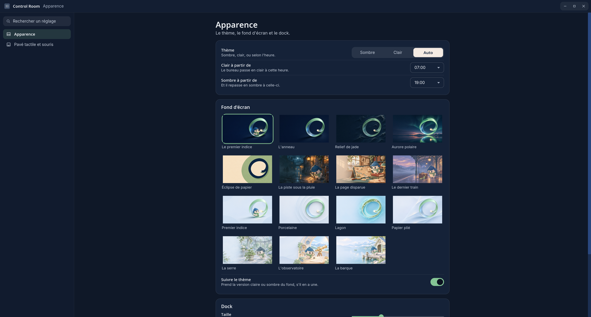
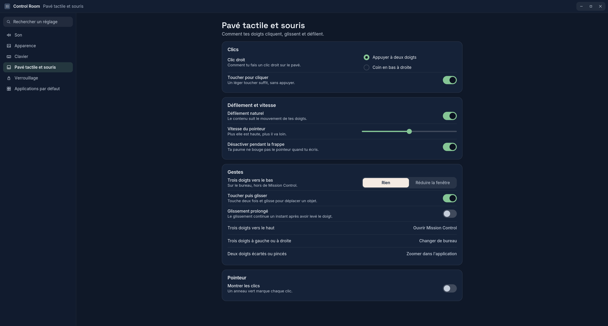
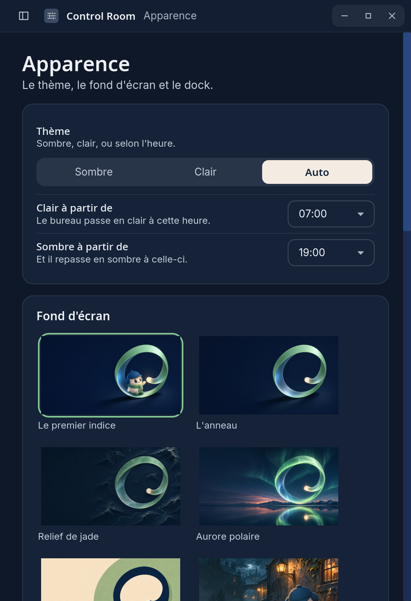
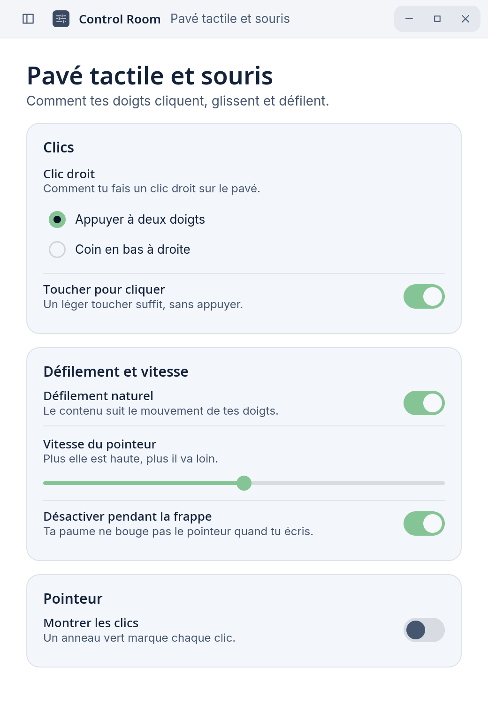

# Control Room

Control Room is the settings application of the desktop (lot D-26a). Each setting is written to
the file that its program already reads and follows live: nothing has to be restarted, and every
setting survives a restart. The look follows the « Réglages » board
(`docs/design/planches/Reglages.dc.html`): a sidebar of 240 with the search on top, the page on
the right in cards. Its sizes, motions and French texts are in `sherlock_ui::control_room`.

```sh
cargo run --release -p control-room
just install-control-room   # binary in ~/.local/bin, desktop entry, icon
```

To try it without touching your own settings, give it a configuration folder of its own:
`XDG_CONFIG_HOME=$(mktemp -d) cargo run --release -p control-room`.

## Pages

This first part (D-26a1) has two pages. Sound, default applications and lock come with D-26a2,
displays with D-26a3.

| Page | Setting | File | Read by |
| --- | --- | --- | --- |
| « Apparence » | Theme: Sombre, Clair, Auto, and the hours of Auto (half-hour steps) | `$XDG_CONFIG_HOME/appearance/appearance.conf` | Every program (`appearance-config`) |
| « Apparence » | Wallpaper among the installed ones, « Suivre le thème » | `$XDG_CONFIG_HOME/sherlockos/wallpaper.conf` | Compositor |
| « Apparence » | Dock: size, magnification and its strength, hiding, edge | `$XDG_CONFIG_HOME/dock/dock.conf` | Dock |
| « Pavé tactile et souris » | Right click: « Appuyer à deux doigts » (default) or « Coin en bas à droite »; tap to click; natural scrolling; speed; off while typing | `$XDG_CONFIG_HOME/sherlockos/touchpad.conf` | Compositor |
| « Pavé tactile et souris » | « Montrer les clics » | `$XDG_CONFIG_HOME/sherlockos/pointer.conf` | Compositor |

A file is only written once a setting changes: until then, the programs keep their own
defaults. Writing never starts from what Control Room read when it opened: the file is read
again as it is on the disk, the change is made there, and only the line of the key that changed
is replaced (or added at the end of its group). Comments, blank lines, other groups, unknown keys,
lines the file gets wrong and the order all stay; an application pinned in the dock while
Control Room is open stays pinned. Every file goes through `mime_apps::write_atomically`: whole
or not at all, with the permissions it had (a 0600 file stays 0600), through its symbolic link
even when the link is still dangling, the folder flushed after the rename.

In a file that is read, a line that cannot be understood is left aside, goes to the log, and
the other lines count. A file that cannot be read (permissions) or that is not text (not UTF-8,
a NUL byte) is never written: its settings are shown disabled, with the sentence
« Ce fichier de réglages ne peut pas être modifié. ». A file that cannot be written becomes so
too.

A switch, a segmented control or a menu writes at once; a slider writes `SAVE_DELAY` (150 ms)
after its last step, and closing the window writes what waits.

The wallpaper picker shows the wallpapers of the collection (`sherlock_ui::wallpapers`) found in
the wallpaper folders (`desktop_config::wallpaper::dirs`), from the smallest variant of each,
reduced off the interface thread. An image of the user's (`path`) is named above the picker;
choosing a wallpaper replaces it.

## Search

The field on top of the sidebar finds a setting by its name, its page or the words people use
for it (`texts::*_WORDS`), without case nor accents. Every word typed must be found. Names that
start with the query come first. The part of the name that matched is drawn in green. Enter or a
click opens the page of the setting, and the setting is lit with the selection's blue, which
fades out over `SPOTLIGHT`. Escape empties the field. Ctrl+F puts the keyboard in it.

## Motion and sizes

- A new page comes up from 12 px below while it fades in, on the spring of an opening.
- Switches, segmented controls, sliders and menus are those of sherlock-ui, with their own
  motion. The window's entrance and exit are the compositor's.
- Below 720 px of width, the sidebar folds away. The button on the left of the title bar slides
  it back over the page, which darkens. Choosing a page, a click on the page or Escape fold it.
- Below 560 px of page, a wide control (segmented control, slider, radio buttons) goes under its
  label, full width. The page is never wider than 760 px. The wallpapers fill each line of
  their card, from 128 to 176 px wide.

## Code

| Module | Role | iced |
| --- | --- | --- |
| `settings` | Where the files are, reading them all, writing one | no |
| `search` | The pages, the settings of each, the search | no |
| `thumbnails` | The installed wallpapers and their thumbnails | no |
| `app` | State, messages, saving, animations | yes |
| `view` | Window, title bar, sidebar, page and its transition, cards and rows | yes |
| `pages` | One module per page | yes |
| `scenarios` | Tests: files, search, navigation, captures | tests |

Added to sherlock-ui: the `control_room` module, a dropdown menu (`component::dropdown`, on
iced's `pick_list`, with its styles in `theme` and in the contrast test), a picture to choose
(`component::picture_choice`, `theme::picture_ring`), and the icons `Bluetooth`, `Touchpad`,
`Grid` and `Sidebar`. `appearance-config` gains `to_text` and `TimeOfDay::minutes`,
`desktop-config` a writer for `pointer.conf`.

## Tests

`cargo test -p control-room` runs everything in temporary folders, never in the user's
configuration:

- every setting changed, written, then read back by the libraries of the programs, and found in
  the words each program reads;
- an unknown key, a wrong line and the comments stay; a file that cannot be read, or is not
  text, is never written and its settings are disabled; a 0600 file stays 0600 and a dangling
  link stays a link; an application pinned in the dock while Control Room is open stays pinned;
- the dock file keeps what Control Room does not show; a slider writes only once it rests; the
  two hours of the automatic theme never meet;
- the search, without case nor accents, its order and its marks; a setting opened from the
  search opens its page and lights it;
- a click in the sidebar opens a page; in a narrow window the sidebar is folded, its button
  unfolds it, choosing a page folds it;
- captures of both pages, dark and light, at 1920 by 1032 (a window maximized on a 1080p
  screen, under the bar) and 520 by 760, in `target/tmp/control-room-*.png`.

## Captures

The appearance page, dark and light, in a wide window:




The touchpad page, dark and light:




Narrow window: one column, the sidebar folded, then unfolded over the page during a search:





Search: the part of each name that matched, in green:


## Gaps with the board

- The board's navigation entries are 34 high; `nav_item` keeps the 32 of Evidence.
- iced 0.14 has no elastic scrolling: a page stops dead at its ends.
- The dropdown menu is iced's `pick_list`: its list opens inside the window, not as a popup
  that can leave it (E-02).
- The board has no page of these settings: their layout follows its rules.
