# Control Room

Control Room is the settings application of the desktop (lot D-26a). Each setting is written to
the file that its program already reads and follows live: nothing has to be restarted, and every
setting survives a restart. The look follows the « Réglages » board
(`docs/design/planches/Reglages.dc.html`): a sidebar of 240 with the search on top, the page on
the right in cards. Its sizes, motions and French texts are in `sherlock_ui::control_room`.

```sh
cargo run --release -p control-room
just install-control-room   # binary in ~/.local/bin, desktop entry, icon
```

To try it without touching your own settings, give it a configuration folder of its own:
`XDG_CONFIG_HOME=$(mktemp -d) cargo run --release -p control-room`.

## Pages

D-26a1 brought the appearance and touchpad pages; D-26a2 sound, lock and default applications;
D-26b the screens.

| Page | Setting | File | Read by |
| --- | --- | --- | --- |
| « Écrans » | Arrangement (dragged), resolution, refresh, scale (100 to 200 %), rotation, main screen, on or off | `$XDG_CONFIG_HOME/sherlockos/displays.conf`, per screen (EDID), written by the compositor | Compositor, through `wlr-output-management` (ADR 0025) |
| « Apparence » | Theme: Sombre, Clair, Auto, and the hours of Auto (half-hour steps) | `$XDG_CONFIG_HOME/appearance/appearance.conf` | Every program (`appearance-config`) |
| « Apparence » | Wallpaper among the installed ones, « Suivre le thème » | `$XDG_CONFIG_HOME/sherlockos/wallpaper.conf` | Compositor |
| « Apparence » | Dock: size, magnification and its strength, hiding, edge | `$XDG_CONFIG_HOME/dock/dock.conf` | Dock |
| « Pavé tactile et souris » | Right click: « Appuyer à deux doigts » (default) or « Coin en bas à droite »; tap to click; natural scrolling; speed; off while typing | `$XDG_CONFIG_HOME/sherlockos/touchpad.conf` | Compositor |
| « Pavé tactile et souris » | « Montrer les clics » | `$XDG_CONFIG_HOME/sherlockos/pointer.conf` | Compositor |
| « Son » | Output and microphone to use, the volume of each | PipeWire, through `pactl` | Every application |
| « Verrouillage » | Delay before the lock: 1 to 60 minutes, or never | `$XDG_CONFIG_HOME/sherlockos/lock.conf` (`idle-minutes`) | Compositor (D-25a) |
| « Presse-papiers » | Clipboard history on or off, kept on disk or in memory (lot D-42) | `$XDG_CONFIG_HOME/sherlockos/clipboard.conf` (`history`, `keep-on-disk`) | Compositor (D-42) |
| « Applications par défaut » | Browser, mail, text editor, terminal, files, images, video, music | `$XDG_CONFIG_HOME/mimeapps.list`; the terminal in `xdg-terminals.list` | Every program that opens a file or a link |

A file is only written once a setting changes: until then, the programs keep their own
defaults. Writing never starts from what Control Room read when it opened: the file is read
again as it is on the disk, the change is made there, and only the line of the key that changed
is replaced (or added at the end of its group). Comments, blank lines, other groups, unknown keys,
lines the file gets wrong and the order all stay; an application pinned in the dock while
Control Room is open stays pinned. Every file goes through `mime_apps::write_atomically`: whole
or not at all, with the permissions it had (a 0600 file stays 0600), through its symbolic link
even when the link is still dangling, the folder flushed after the rename.

In a file that is read, a line that cannot be understood is left aside, goes to the log, and
the other lines count. A file that cannot be read (permissions) or that is not text (not UTF-8,
a NUL byte) is never written: its settings are shown disabled, with the sentence
« Ce fichier de réglages ne peut pas être modifié. ». A file that cannot be written becomes so
too.

A switch, a segmented control or a menu writes at once; a slider writes `SAVE_DELAY` (150 ms)
after its last step, and closing the window writes what waits, then closes. Reading, writing
and flushing the files to the disk never happen on the interface thread: a batch of changes
goes to a task (`Writes::run`), one batch at a time, in the order of the changes; the changes
made meanwhile wait for the next batch and stay shown. The wallpapers installed are found by
the same task that reduces their thumbnails, once: drawing the page never looks at the disk.

**Screens.** The page does not write a file: it is a client of `wlr-output-management`
(ADR 0025), on a Wayland connection of its own, in a thread that runs only while the page is
open or a change waits (`displays::run`). The compositor sends every screen with its modes and
state; what it sends is bounded (16 screens, 256 modes, names of 64 characters). Each change is
sent as a whole configuration and shown once the compositor has taken it. A change of
resolution, refresh, scale, rotation or of a screen on or off asks « Garder ces réglages
d'affichage ? » with « Revenir » and « Garder »; without an answer the previous configuration
comes back after `CONFIRM_DELAY` (15 seconds), as on macOS and Windows. Moving a screen needs no
confirmation. In the arrangement, the screens are drawn to scale; a screen dropped goes to the
nearest place along the edge of another, where it covers none (`arrangement::snap`), and the
main screen (the one at the origin, with the bar drawn on top) stays at the origin: dragging it
moves the others. « En faire l'écran principal » moves the origin to the chosen screen. The last
screen on cannot be switched off. The compositor keeps the setting of each screen under its
EDID names and gives it back when the screen comes back; it writes it only once a change has
held for 20 seconds, so that a change never confirmed is not kept. Under `--nested`, a screen
is a slice of the host window: its resolution cannot change and it cannot turn.

| Captures | |
| --- | --- |
| Wide, dark | 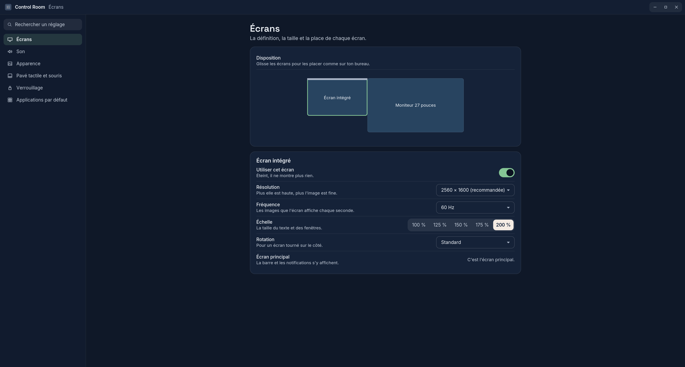 |
| Narrow, dark | 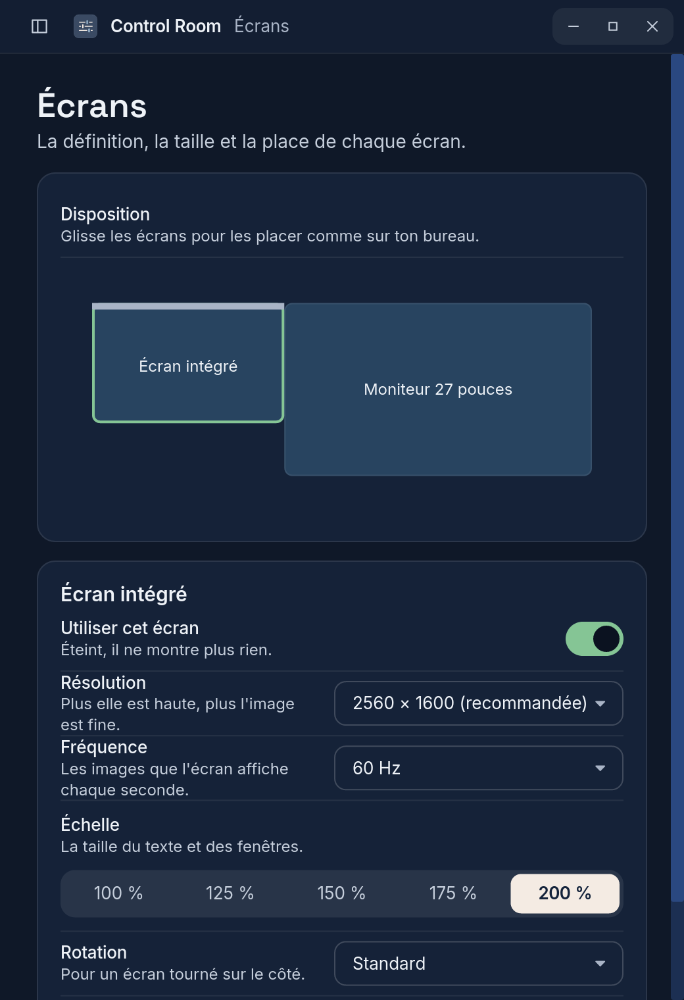 |
| Waiting for « Garder », light | 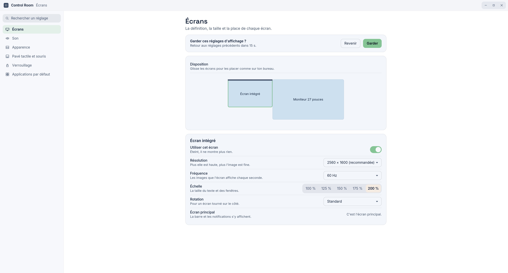 |
| In the nested compositor, two screens of its window | 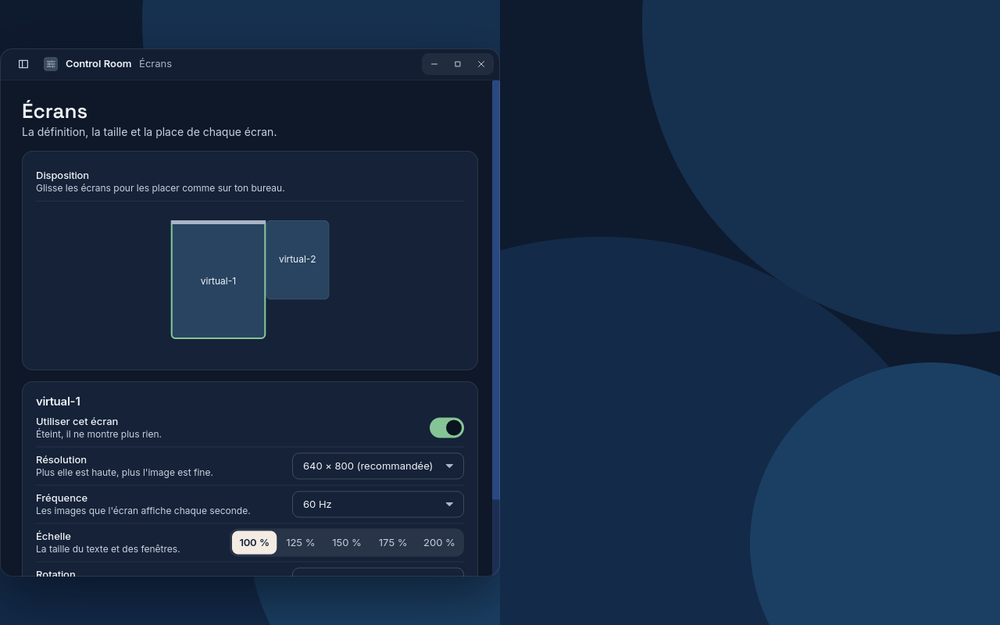 |

**Sound.** The page reads the outputs and the microphones with `pactl list sinks` and
`list sources` (the monitors of the outputs left out), their defaults and volumes, off the
interface thread (`system_services::audio`). Choosing a device runs `set-default-sink` or
`set-default-source`; PipeWire moves the sound to it. A volume is set once its slider rests.
The changes reach `pactl` one at a time, in the order they were made, through a queue that
keeps only the last volume of each device, as the media keys do.
Without `pactl`, the page says that the sound does not answer. `wpctl` alone is not enough to list
the devices: the media keys still fall back on it, this page does not.

**Clipboard.** `clipboard.conf` is read by the compositor within a second of a change (see
"Clipboard history" in `docs/compositor.md`). « Historique du presse-papiers » off forgets
everything at once; « Garder après la déconnexion » is disabled while the history is off.

**Lock.** `lock.conf` is the file of D-25a, read by the compositor live; Control Room writes it
with `desktop_config::lock`.

**Default applications.** Each kind covers several types: the browser `x-scheme-handler/https`,
`http` and `text/html`; images PNG, JPEG, GIF and WebP; and so on (`apps::Kind::types`). The
menu offers the applications that declare the first type, and writes every type with
`mime_apps::set_default`, as Evidence's « Toujours ouvrir avec » does. Two choices made in a row
are written one after the other, each from the file as it is then. The terminal has no MIME
type: the page offers the entries of category `TerminalEmulator` and writes
`xdg-terminals.list`, the file of the proposed freedesktop specification that
`xdg-terminal-exec` reads (`mime_apps::terminals`). The desktop's own programs still pick their
terminal from `$TERMINAL` (`mime_apps::pick_terminal`).

The wallpaper picker shows the wallpapers of the collection (`sherlock_ui::wallpapers`) found in
the wallpaper folders (`desktop_config::wallpaper::dirs`), from the smallest variant of each,
reduced off the interface thread. An image of the user's (`path`) is named above the picker;
choosing a wallpaper replaces it.

## Search

The field on top of the sidebar finds a setting by its name, its page or the words people use
for it (`texts::*_WORDS`), without case nor accents. Every word typed must be found. Names that
start with the query come first. The part of the name that matched is drawn in green. Enter or a
click opens the page of the setting, and the setting is lit with the selection's blue, which
fades out over `SPOTLIGHT`. Escape empties the field. Ctrl+F puts the keyboard in it.

## Motion and sizes

- A new page comes up from 12 px below while it fades in, on the spring of an opening; the page
  left fades out under it over the same fade, rising a little, and takes no click.
- The results of the search come in one after the other, 30 ms apart, each fading in and coming
  up 6 px. A name too long for the sidebar is cut with « … » (its highlight is then left out).
- A setting opened from the search is scrolled to on the spring of an opening, a section's gap
  below the top of the page, unless it shows already (`scroll::find`: an operation finds the
  row by its id and the page's scrollable in the window laid out). Then it is lit.
- A choice of a list of radio buttons (a long sound output) is cut with « … ».
- A default application that could not be written says « Ce fichier de réglages ne peut pas
  être modifié. » under its menu, until it is written.
- The dropdown menus are iced's `pick_list`: they open and close without motion (not done).
- Switches, segmented controls, sliders and menus are those of sherlock-ui, with their own
  motion. The window's entrance and exit are the compositor's.
- Below 720 px of width, the sidebar folds away. The button on the left of the title bar slides
  it back over the page, which darkens. Choosing a page, a click on the page or Escape fold it.
- Below 560 px of page, a wide control (segmented control, slider, radio buttons) goes under its
  label, full width. The page is never wider than 760 px. The wallpapers fill each line of
  their card, from 128 to 176 px wide.

## Code

| Module | Role | iced |
| --- | --- | --- |
| `settings` | Where the files are, reading them all, writing one | no |
| `search` | The pages, the settings of each, the search | no |
| `thumbnails` | The installed wallpapers and their thumbnails | no |
| `sound` | Outputs, microphones and volumes through `pactl` | no |
| `apps` | The kinds of default applications, their choices, writing them | no |
| `displays` | The compositor's screens through `wlr-output-management`, in a thread | no |
| `arrangement` | The screens drawn to scale, where a dropped screen lands | no |
| `app` | State, messages, saving, animations | yes |
| `view` | Window, title bar, sidebar, page and its transition, cards and rows | yes |
| `pages` | One module per page | yes |
| `scenarios` | Tests: files, search, navigation, captures | tests |

Added to sherlock-ui: the `control_room` module, a dropdown menu (`component::dropdown`, on
iced's `pick_list`, with its styles in `theme` and in the contrast test), a picture to choose
(`component::picture_choice`, `theme::picture_ring`), and the icons `Bluetooth`, `Touchpad`,
`Grid` and `Sidebar`. `appearance-config` gains `to_text` and `TimeOfDay::minutes`,
`desktop-config` a writer for `pointer.conf`.

## Tests

`cargo test -p control-room` runs everything in temporary folders, never in the user's
configuration:

- every setting changed, written, then read back by the libraries of the programs, and found in
  the words each program reads;
- an unknown key, a wrong line and the comments stay; a file that cannot be read, or is not
  text, is never written and its settings are disabled; a 0600 file stays 0600 and a dangling
  link stays a link; an application pinned in the dock while Control Room is open stays pinned;
- the dock file keeps what Control Room does not show; a slider writes only once it rests; the
  two hours of the automatic theme never meet;
- the search, without case nor accents, its order and its marks; a setting opened from the
  search opens its page and lights it;
- a click in the sidebar opens a page; in a narrow window the sidebar is folded, its button
  unfolds it, choosing a page folds it;
- sound through a fake `pactl` that logs what it is asked: devices read without the monitors,
  default and volume set, one change at a time and in order; without `pactl`, the page says so;
- default applications written to a temporary `mimeapps.list` and `xdg-terminals.list`, then
  read back by `mime-apps`;
- the lock delay written and read back;
- captures of every page, dark and light, at 1920 by 1032 (a window maximized on a 1080p
  screen, under the bar) and 520 by 760, in `target/tmp/control-room-*.png`.

## Captures

The appearance page, dark and light, in a wide window:


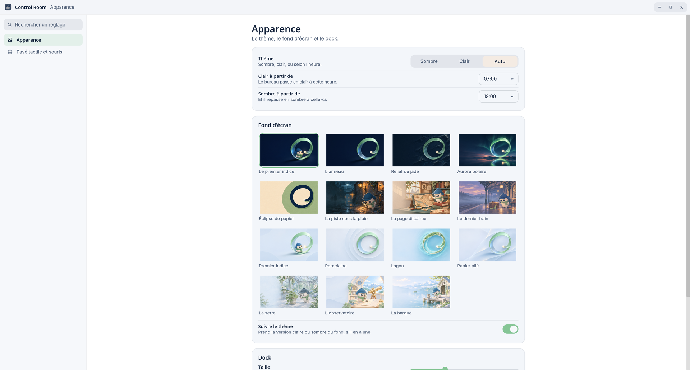

The touchpad page, dark and light:


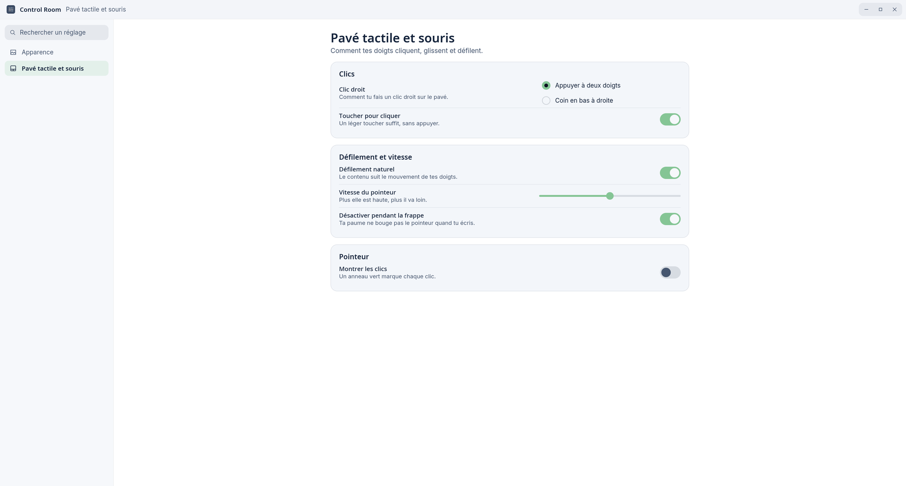

Narrow window: one column, the sidebar folded, then unfolded over the page during a search:


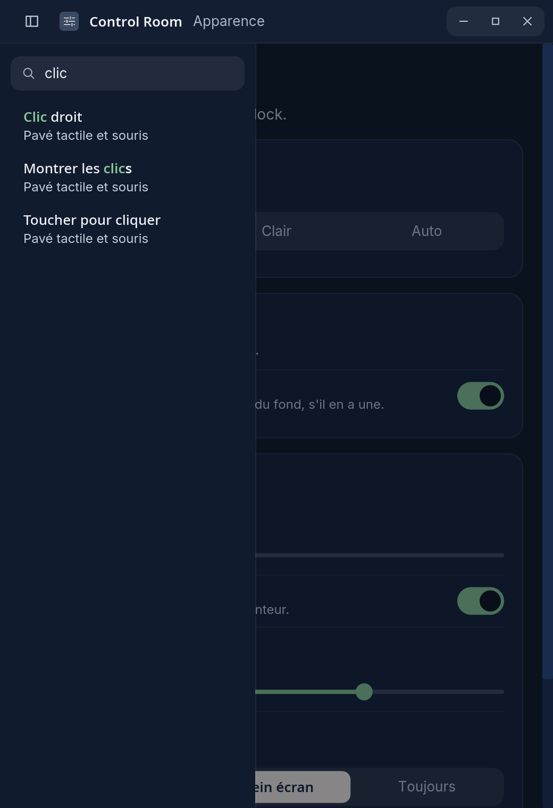

Sound, lock and default applications:

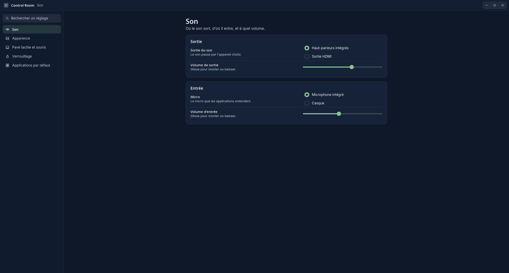
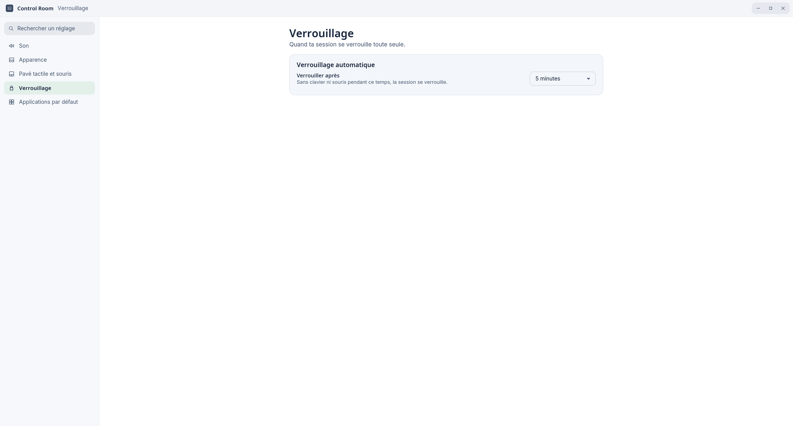
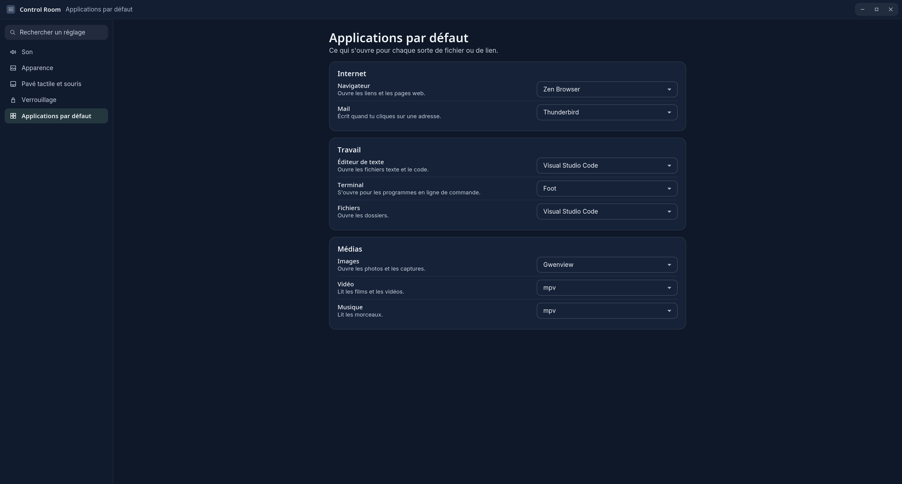
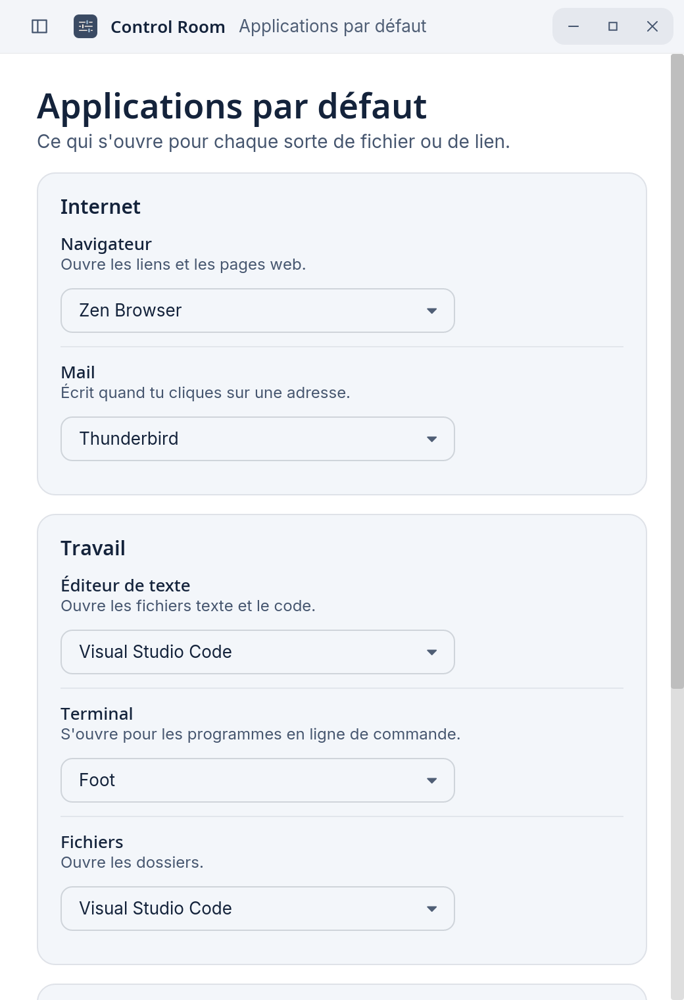

Search: the part of each name that matched, in green:

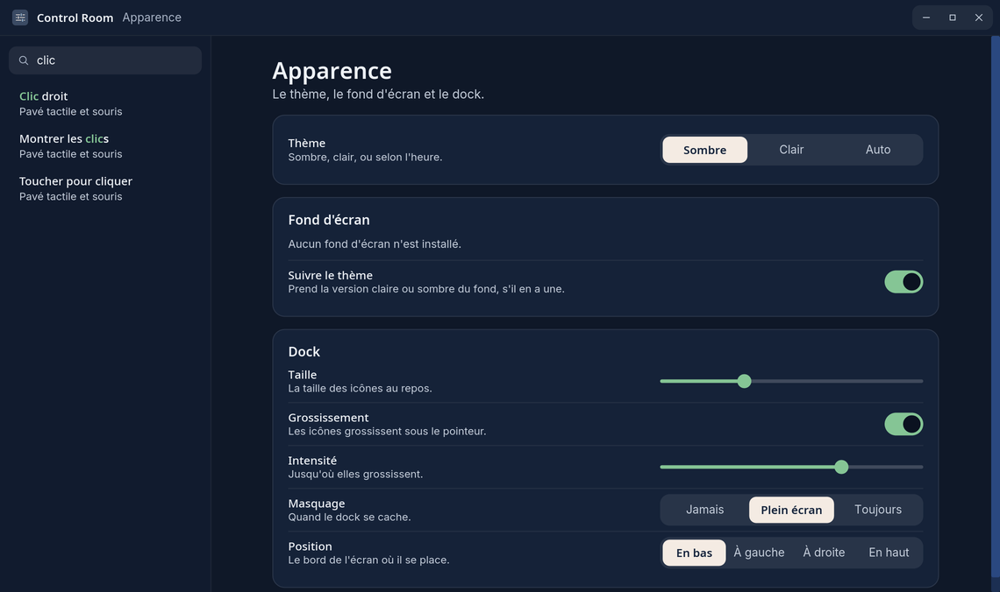

## Gaps with the board

- The board's navigation entries are 34 high; `nav_item` keeps the 32 of Evidence.
- iced 0.14 has no elastic scrolling: a page stops dead at its ends.
- The dropdown menu is iced's `pick_list`: its list opens inside the window, not as a popup
  that can leave it (E-02).
- The board has no page of these settings: their layout follows its rules.
