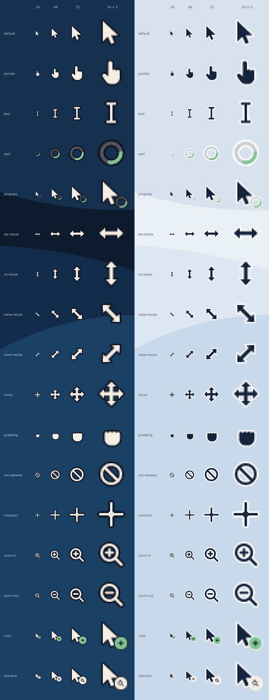

# Cursors

The cursor theme of the desktop (lot D-07): its drawings, the generator that turns them into
Xcursor themes, and the way the compositor shows them in the real session.

The drawings follow the author's cursor boards, `docs/design/cursors-dark.html` and
`docs/design/cursors-light.html` (renderings: `cursors-dark.png`, `cursors-light.png`). The
boards make the reference: base size 24 px, sharp up to 3×, an outline that detaches the
cursor from any background, short animations with a bounce.



`docs/cursor/board.png` is generated: `just cursor-board`. Each row is a shape, at 24, 48 and
72 px, then its 24 px image enlarged five times.

## The shapes

Seventeen drawings, in `assets/cursors/`. The CSS names that `wp_cursor_shape_v1` gives (versions
1 and 2) and the legacy X11 names are aliases: links to the file of the drawing.

| Drawing | Name on the board | Hotspot | Also answers to |
| --- | --- | --- | --- |
| `default` | « Pointeur » | tip (5, 2.5) | `context-menu`, `help`, `alias`, `dnd-ask`, `left_ptr`, `arrow`… |
| `pointer` | « Lien » | finger tip (11.2, 2.6) | `hand2`, `hand1`, `hand`, `pointing_hand` |
| `text` | « Texte » | middle | `vertical-text`, `xterm`, `ibeam` |
| `wait` | « Attente » | center | `watch` |
| `progress` | « En arrière-plan » | tip | `left_ptr_watch`, `half-busy` |
| `ew-resize` | « Largeur » | middle | `e-resize`, `w-resize`, `col-resize`, `h_double_arrow`… |
| `ns-resize` | « Hauteur » | middle | `n-resize`, `s-resize`, `row-resize`, `v_double_arrow`… |
| `nwse-resize` | « Diagonale » | middle | `nw-resize`, `se-resize`, `bd_double_arrow`… |
| `nesw-resize` | « Diagonale », mirrored | middle | `ne-resize`, `sw-resize`, `fd_double_arrow`… |
| `move` | « Déplacer » | middle | `all-resize`, `all-scroll`, `fleur`, `size_all` |
| `grabbing` | « Saisi » | palm (12.8, 14) | `grab`, `openhand`, `closedhand` |
| `not-allowed` | « Interdit » | middle | `no-drop`, `forbidden`, `crossed_circle` |
| `crosshair` | « Précision » | middle | `cell`, `cross`, `tcross`, `plus` |
| `zoom-in` | « Zoom » | lens (10.5, 10.5) | |
| `zoom-out` | « Zoom », with a minus | lens | |
| `copy` | « Copier » | tip | `dnd-copy` |
| `sherlock` | « Sherlock » | tip | |

The boards draw fifteen of them. `nesw-resize` is the diagonal of the board turned the other
way, `zoom-out` is its magnifier with a minus. The CSS names without a drawing take the closest
one: a column edge moves as a window edge, a cell is aimed at as a point, `grab` shows the
closed hand. The full list is `SHAPES` in `desktop/cursor-theme/src/lib.rs`, and a test checks
that every CSS name has a shape.

`sherlock` is the arrow with a magnifier badge, for Super + click: Sherlock explains what is
under the pointer. The compositor shows it while the gesture key and the left button are held
on a window that has not moved yet (lot C-01): released there, it is a Super + click; dragged
past 4 pixels, it is the move of the window, with the four arrows of « Déplacer ». The action
itself is reserved: the compositor logs it, Sherlock is not plugged in yet.

The boards draw no open hand: `grab` shows the closed hand, like `grabbing`. The fifteen
drawings of the boards are all in the theme (lot C-01 checked them against both boards).

## The drawings

One SVG per drawing, `assets/cursors/<name>.svg`, copied from the boards: on a grid of 24 units
(one unit is one pixel at 24 px), the paths of the boards unchanged. Each file says what the
generator needs:

- `data-hotspot="x y"` on the root: the point of the cursor, in grid units.
- A `<style id="theme">` block, with the colors of the dark theme. The parts that change with
  the theme carry its classes: `body` (inside), `edge` (outline), `ink` (lines of the line
  drawings), `track` (ring under the green arc). The green of the arc and the badges keep
  their own colors, as in both boards.
- For the waiting cursors, a group `id="spin"` with `data-center="x y"`: the part that turns.

Replacing a drawing is copying its SVG over the old one, then `just cursors`. A test checks
that every file has these marks and that its style block is the dark theme as the generator
writes it.

The colors come from `sherlock_ui::cursor`: cream with the darkest blue outline on the dark
desktop, night blue with a white outline on the light one. The timings of the motion live there
too.

## The generator

`desktop/cursor-theme` is a library (shapes, names, the Xcursor writer) and, with its `render`
feature, the `cursor-theme` program, which renders the SVGs with resvg (the version iced
already pulls).

| Command | What it does |
| --- | --- |
| `just cursors` | Writes `target/cursors/sherlockos/` (dark desktop) and `target/cursors/sherlockos-light/` |
| `just cursor-board` | Draws `docs/cursor/board.png` |
| `just install-session` | Also runs `just cursors`, then prints the commands that copy both themes into `/usr/local/share/icons` |

Each theme has an `index.theme` (inheriting `default`), with the name a cursor setting shows:
« SherlockOS » and « SherlockOS clair » (`sherlock_ui::cursor`). In `cursors/`, it has one
Xcursor file per drawing and a link per alias. A file holds one image per nominal size: 24, 32, 48, 64 and 96
(scales 1 to 4). An image is a quarter larger than its size (30 px at 24): room for the outline
that passes the grid and for the badges that pass it at the bottom right, as in the boards. The
grid starts two units in, rounded up to a whole pixel, so the drawing stays on its pixels; the
generator refuses a drawing that touches the edge of its image. The hotspot is the pixel under
the point. The waiting cursors hold, per size, a turn of 30 images of 33 ms: a turn per second.

To try the themes without installing them: `XCURSOR_PATH=$PWD/target/cursors`.

## In the compositor

`desktop/compositor/src/cursor.rs`, real session only: in nested mode the host window keeps
its own cursor.

- **Theme.** The compositor shows `sherlockos` while the desktop is dark and `sherlockos-light` while
  it is light, and follows a change of the appearance file (`docs/appearance.md`) live,
  automatic mode included (lot D-05c): at the next frame, `Cursors::follow` reads the other
  house theme, and the shape shown fades in as after any change of shape. The session
  (`sherlockos-session`) exports `XCURSOR_THEME`: `sherlockos`, or `sherlockos-light` when the
  appearance file gives the light theme at startup. It exports `XCURSOR_SIZE` (24 unless already set) and
  `XCURSOR_PATH`, with `cursors` beside the programs' folder first (`target/cursors` when the
  session runs from the repository with `SHERLOCKOS_BIN=target/release`), then the usual folders
  (`~/.local/share/icons`, `~/.icons`, `/usr/local/share/icons`, `/usr/share/icons`). The
  compositor takes the house theme that `XCURSOR_THEME` names, so XWayland and Qt, when they
  draw their cursor themselves, draw the same one at startup. GTK under Wayland reads
  `cursor-theme` and `cursor-size` in dconf instead, which `toolkit-theme` sets in the
  session's database and changes with the theme (`docs/third-party-theming.md`): GTK follows
  live too. Without the house theme installed, `XCURSOR_THEME`, else the system's `default`. A
  shape missing from the theme shows the arrow.
- **Limit: XWayland and Qt.** An environment variable cannot change in a running process:
  XWayland and the X11 applications, and Qt applications under Wayland when they draw their
  cursor themselves, keep the `XCURSOR_THEME` of the session's start until they restart. After
  a change of theme, an X11 window may show the cursor of the other theme over its own
  surface, while the compositor shows the new one everywhere else. Most Wayland clients name
  their cursor (`wp_cursor_shape_v1`) and get the compositor's.
- **Size.** `XCURSOR_SIZE` (24 by default) times the screen's scale. The image of the nearest
  size above is shown pixel for pixel: at 1.25, 30 px are asked for and the image of 32 is
  shown, never a stretched 24.
- **Waiting.** `wait` and `progress` turn, one image per 33 ms. A timer wakes the screen when
  the next image is due: nothing is drawn between two images.
- **Change of shape.** A new shape fades in from 30 % and 80 % of its size to full, in 120 ms,
  on the boards' curve (`cubic-bezier(0.2, 0.9, 0.3, 1.35)`, a light bounce past the end).
- **Shake to find.** Four changes of direction within 700 ms, each move longer than 6 logical
  pixels, make the cursor 2.6 times larger in 240 ms. It stays so until a second after the last
  shake, then comes back in 240 ms, with a bounce. While it is larger, the image of the largest
  size is drawn scaled down, sharp at its peak.

While a transition runs, the screen draws at each vertical blank; once it is over, nothing is
drawn until something changes (see "Frames of the real session" in `docs/compositor.md`). A
still cursor goes on the screen's cursor plane when it fits; a scaled or fading one is
composited.

- **Gestures (lot C-01).** A window held by its title bar, or moved at its client's request,
  shows the closed hand (`grabbing`); moved with the gesture key, the four arrows (`move`), as
  the board says; resized, the arrow of the pulled edge or corner. The shapes the shell's
  components name (`pointer`, `grab`, `grabbing`, `text`, `not-allowed`) reach the hand that
  points, the closed hand, the I-beam and the forbidden sign (`cursor.rs`, tested).
- **Against the boards (lot C-01).** Waiting: a turn per second, as the board's arc. Change of
  shape: from 0.8 and 30 %, 120 ms, on the boards' bouncing curve, as their `apparait`. Shake:
  the board grows to 2.6 in 8 % of its 3.6 s loop (288 ms), holds, then comes back past 1
  (0.92) to 1; the compositor takes 240 ms each way with the same bounce, 2.6 times, held a
  second after the last shake: the same motion, a little brisker.

## Show the clicks

The accessibility option of the boards (lot C-01): at each press of a button, a green ring
leaves the pressed point and the pointer sinks. Off by default; on with
`$XDG_CONFIG_HOME/sherlockos/pointer.conf` (`desktop_config::pointer`), read again within
2 seconds when it changes:

```text
# true: a green ring leaves each click, and the pointer sinks (false by default).
show-clicks = true
```

- **The ring** (`compositor/src/clicks.rs`): a circle of 40 with a stroke of 2 in the accent
  green, from 0.2 to 1.7 of its size while its opacity goes from 0.9 to 0, over 460 ms eased
  out: the board's `onde`. Drawn in front of everything, a frame at each blank while it runs,
  nothing after. In nested mode too.
- **The pointer** sinks to 0.86 around its tip in 54 ms, then comes back in 126 ms: the
  board's `appui`. Real session only: in nested mode, the host draws the pointer.
- The tokens are in `sherlock_ui::cursor` (`CLICK_*`). `State::set_show_clicks` changes the
  option while the session runs, for Control Room.

## Tests

| Test | What it checks |
| --- | --- |
| `cursor-theme`, unit | Every name given once; every CSS name of the protocol has a shape; every drawing has its marks and its hotspot inside its image; the dark style block of the files; the light theme changes only the style block; the spinning group turns around its center; the Xcursor writer, read back by the parser the compositor uses |
| `cursor-theme`, `tests/theme.rs` | Runs the generator: in both themes, every shape at every size, its hotspot, something drawn under it, 30 images for the waiting cursors, every alias a link to its drawing |
| `compositor`, `cursor.rs` | The house theme follows the desktop's theme, read again on a change; every shape a client names finds the file of its drawing; the shapes of the shell and the Sherlock cursor find theirs; the nearest size above; fallback on the user's theme and on the arrow; the turn of the waiting cursor and the time of its next image; the fade of a new shape; shake to find, held then back to rest; nothing asked at rest |
| `sherlock-ui`, `cursor.rs` | The bounce curve; the contrast of body and outline |
| `compositor`, `clicks.rs` | The ring grows and fades out in 460 ms; the pointer sinks then comes back |
| `desktop-config`, `pointer.rs` | The clicks are not shown by default; the option is read, mistakes are refused with their line |
| `compositor`, `tests/headless.rs` | The cursor follows the gesture (closed hand, Sherlock, four arrows); a click shown leaves a ring, then nothing is drawn |

On the machine, in the real session, after `just install-session` and the printed commands:

1. Move over the desktop: the cream arrow (night blue on the light theme), sharp. At scale 1.25,
   sharp too.
2. Over a link in a browser, the hand; over text, the I-beam; at a window edge, the double arrow.
   Each change fades in, with a light bounce.
3. Launch a program that takes time to start: the arrow with the turning ring, smooth, a turn per
   second. `--measure` shows about 30 frames per second meanwhile, none once it stops.
4. Shake the mouse left and right: the cursor grows, stays a second, then comes back with a
   bounce. At rest, no frame is drawn.
