# Dock

`desktop/dock` is the desktop's dock: a separate program, anchored at the bottom of the screen
with layer-shell (ADR 0005), written with iced 0.14, tiny-skia software rendering (ADR 0014)
and `iced_exwlshell` 0.21.4, like the bar (`docs/bar.md`). Batch D-21 builds it from the
`Dock.dc.html` design board and, for the menu of an icon, `Menus.dc.html`. The crate, the binary
and the layer-shell namespace are all `dock`. Its texts stay in French, from `sherlock-ui`.


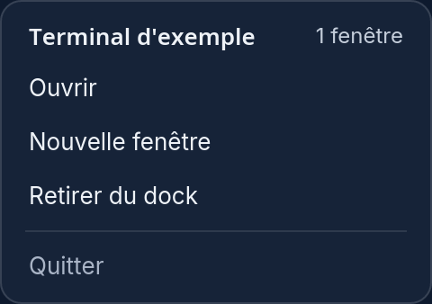

These three come from the headless rendering test (`tests/render.rs`), at scale 2, on the
desktop background, from the neutral fixtures: an application without icon (its initial on a
tile), a theme SVG, PNG icons from `hicolor` and `pixmaps`. In a nested KWin:


Under our compositor, nested in Xephyr (the black band is the opaque room above the bar, see
Surface):

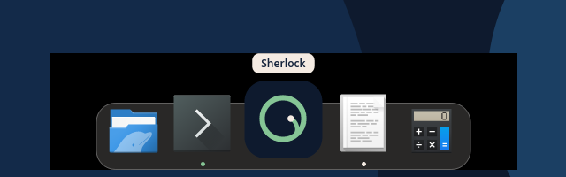

## What it shows

| Element | Board | Dock |
| --- | --- | --- |
| Bar | 76 high, radius 22, glass `rgba(244,235,227,0.17)`, border `rgba(255,255,255,0.26)`, padding 12 on the sides and below | Same, 8 above the screen edge (Main board) |
| Icons | 52, radius 27 %, 8 apart, bottoms on the padding | Same; an application icon is drawn as its theme gives it |
| Magnification | Bell of reach 1.2 icon, factor 1.7, `cubic-bezier(0.2, 0.9, 0.3, 1.25)` over 150 ms | Same formula, a spring with the same peak (see Magnification) |
| Neighbours | Pushed by the flex layout | The bar widens on both sides, the gap of 8 stays |
| Label | Cream pill 108 above the bar, the icon closest to the pointer, `opacity 120ms` | Same, centered on the icon, faded in 120 ms |
| Dot | 5, cream, 9 below the icon | Same; green for the active application (see Differences) |
| Sherlock | In the middle | In the middle at first, the author's Sherlock tile (D-03); moved or taken out like a pinned application since D-21h |

## Architecture

| Module | Role |
| --- | --- |
| `lib.rs` | Layer-shell surface for each edge, iced settings, startup (`Sources::load`, `run`) |
| `app.rs` | State (`Dock`), messages, update, reconfiguration |
| `view.rs` | The dock view and the menu view |
| `items.rs` | The icons: pinned applications, Sherlock, open applications after the separator |
| `layout.rs` | Pure geometry: the board's curve, icon places for each edge, hit testing, surface size |
| `watch.rs` | Reloading the configuration when its file changes (inotify) |
| `menu.rs` | Entries of an icon's menu (its windows, its actions), size of its surface, keyboard keys, its unfolding (D-21c) |
| `entry.rs` | Key files and desktop entries: name, icon, `Exec`, actions and the « new window » one, window class |
| `icons.rs` | Icon lookup through `icon-theme`: the themes, `hicolor`, then `pixmaps` |
| `config.rs` | Default pinned applications |
| `launch.rs` | Starting an application without a shell |
| `windows.rs` | Open windows behind the `Source` trait, acting on them behind `Control`: placeholder, `zwlr_foreign_toplevel_manager_v1`, and the choice between the sources |
| `shell.rs` | The windows of our compositor through `sherlock_shell_v1`: read, acted on, icon rectangles, covered screens (D-18c2) |
| `hide.rs` | When the dock hides (`AutoHide`) and the spring that slides it (D-18c2) |
| `anim.rs` | The animations of each icon, kept by identity: size, arrival and departure, offset, bounce (D-21b) |
| `drag.rs` | A press on an icon: click, or drag to reorder or unpin (D-21b) |

Every color, size and text comes from `sherlock-ui`: `metrics::DOCK_*` (already there since
D-01), the palette (`dock_glass`, `dock_border`, `dock_separator`, `logo_dot`, `cream`), and the
module `sherlock_ui::dock`: padding, edge margin, dot, label, separator, menu width and gap, the
bounds of the settings, the magnification spring `dock::SPRING`, the label fade, the tile
colors, the styles `bar`, `tile`, `label`, `dot`, `separator` and `ring`, and the texts
`dock::text`. The animations of D-21b take their springs and fade from `sherlock_ui::motion`,
named for the dock in `sherlock_ui::dock` (see Animations), and so does the hiding of D-18c2:
`dock::HIDE_STRIP`, `HIDE_DELAY`, `HIDE_SPRING` (see Hiding).

**Theme.** The dock reads the theme of the appearance file before its first frame, then follows
the file live and fades from one theme to the other
(D-05b, see "Following the theme" in `docs/sherlock-ui.md`): its styles read the palette of the
iced theme. The tiles keep their colors in both themes. Unlike the DockClair board, the dot
under an open application is night blue in the light theme: cream would read at 1.1 to 1 on
the light glass.


The configuration file is read and written by its own crate, `desktop/dock-config`, standard
library and sherlock-ui tokens only, so that the settings application (Control Room, D-26)
writes the same file the same way. It also holds the key file reader that the dock uses for
desktop entries and icon themes. The menu reuses `menu`,
`menu_item`, `menu_separator` and `open` of `sherlock_ui::component`.

### Surface

The layer-shell surface is anchored to the bottom only, so the compositor centers it, on the
`Top` layer. Since D-18c2 the surface reaches the screen edge (margin 0) and the gap of 8 below
the bar is inside it (`Geometry::gap`): a dock brought back over a maximized window keeps the
pointer up to the edge (see Hiding). In the `never` mode it declares an exclusive zone of 84,
the gap and the bar's height, the 76 of the bar and the margin of 8 it reserved before:
maximized windows stop just above the bar. In the other modes, none (lot D-21g). The keyboard comes on demand (`OnDemand`), on a click
into the dock, for its keyboard navigation.

The surface is taller and wider than the bar: the magnified icons grow above the bar (88 at
most, 101 above the bottom), the label sits 108 above it, an icon bounces above its place
(see Animations), and the widest magnified bar needs room on the sides.
`layout::surface_size` computes it from the number of icons: the widest bar over every pointer
position, plus `dock::SURFACE_SLACK` (52) on each side for the label; in height, the farther of
the label's top (132) and the top of the highest bounce (`Geometry::bounce_reach`), plus the
gap of 8. The highest bounce is that of the icon under the pointer, magnified, past the 7.8 %
overshoot of its spring, lifted by half its side: 13 + 52 × 1.7 × 1.078 × 1.5 = 156. With five
icons: 529 by 164. Before lot D-18d the surface stopped at the label (140 deep), and an icon
clicked under the pointer bounced out of its top: its upper part was cut. Only the surface
grows for the bounce: the exclusive zone stays 84, and the input region never reaches past the
label (the 24 pixels above it let clicks through).

**Input region.** The surface only takes the pointer where the dock is
(`Geometry::input_region`, sent with `wl_surface.set_input_region`, rounded out to whole
pixels). At rest, the bar alone: a click in the 56 px above a bottom dock, or at the ends of the
surface, goes to the window below. While the pointer is over the dock, the region grows to the
longest magnified bar, up to the top of the label, so that a magnified icon past the bar stays
reachable and the dock sees the pointer leave; the room kept at both ends for the label of an
edge icon never takes the pointer. Checked in the nested KWin with a maximized KWrite: a click
in the black band above the dock puts KWrite's cursor on the line under it, and the dock gets
no pointer event.

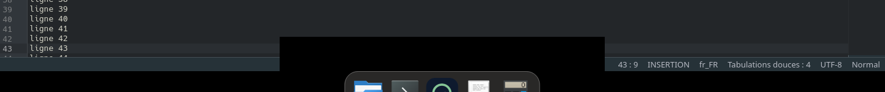

**Opaque surface.** tiny-skia draws through softbuffer, whose Wayland buffers are `XRGB8888`:
the transparent pixels of the surface come out black (see `docs/compositor.md`). The dock's
glass shows on black, and so does the room above the bar, a band 56 high over the bottom of
maximized windows. This goes with the GPU batch (D-02); the dock does not work around it.

Protocol log in the nested KWin (`WAYLAND_DEBUG=client`), five icons, before D-18c2 (the
surface has been 8 deeper since, with a margin of 0, a zone of 84 and the regions 8 higher):

```text
zwlr_layer_surface_v1#29.set_anchor(2)
zwlr_layer_surface_v1#29.set_keyboard_interactivity(2)
zwlr_layer_surface_v1#29.set_size(529, 132)
zwlr_layer_surface_v1#29.set_exclusive_zone(76)
zwlr_layer_surface_v1#29.set_margin(0, 0, 8, 0)
zwlr_layer_surface_v1#29.configure(94, 529, 132)
wl_region#39.add(105, 56, 319, 76)                 # at rest: the bar only
wl_surface#28.set_input_region(wl_region#39)
wl_region#40.add(52, 0, 425, 132)                  # the pointer comes over the dock
wl_surface#28.set_input_region(wl_region#40)
wl_region#41.add(105, 56, 319, 76)                 # it leaves: the bar again
wl_surface#28.set_input_region(wl_region#41)
```

### Hiding

`AutoHide` (`hide.rs`) decides when the dock leaves the screen:

| Mode | The dock |
| --- | --- |
| `smart` (default) | Shown, except while a maximized, fullscreen or snapped window is on its screen; never an exclusive zone |
| `always` | Hidden, without exclusive zone |
| `never` | Always shown, with its exclusive zone |

**A dock that hides never reserves room** (lot D-21g). As on macOS, the work area depends on
the mode alone: only `never` keeps its exclusive zone. In `smart` and `always` the zone stays -1
in every state (shown, covered, sliding, brought back by the pointer, hidden again), and the
dock goes over the windows. Before, `smart` took its zone back whenever no window covered it.
The author saw a maximized Konsole shrink when the dock appeared and grow back when it hid: the
work area followed the dock's state. A maximized window was also resized twice on the way in:
first above the dock, then over its room once the dock gave it up.

Whether a maximized, fullscreen or snapped (half or quarter, lot D-18d) window is on the dock's
screen comes from the `output` event of `sherlock_shell_v1`, bound at version 2 for `snapped`
(only the windows of the active workspace count), matched by name with the screen
iced_exwlshell reports for the dock's surface. A window on another screen changes
nothing; a screen not known yet counts as uncovered.

- **A window is maximized or snapped.** The dock has no exclusive zone to give up: -1, so
  that the compositor places it against the screen edge itself, never against what another surface
  reserves (a dock at the top would otherwise hide under the top bar's zone, its band below
  the bar). The compositor gives the maximized window the whole screen below the bar, the
  dock's room included (recomputing that geometry is batch D-18c1), and a snapped one the
  whole height below the bar, 8 from the edges (lot D-18d). Then the dock slides off
  the screen with the spring of the top bar (`dock::HIDE_SPRING`): only its margin moves, from
  0 to `HIDE_STRIP − depth`, one commit per whole pixel. Hidden, `HIDE_STRIP` (2) pixels of the
  surface stay on the screen, its side away from the edge; its input region shrinks to that
  band, over the whole length of the surface. A dock under the pointer when the window is
  maximized stays until the pointer leaves it.
- **The pointer rests against the edge.** The band takes the pointer; once the pointer has
  stayed on it `dock::REVEAL_DELAY` (150 ms, lot D-21d), the dock slides back over the window, on
  the `Top` layer, still without exclusive zone. As on macOS, a pointer that only passes by the
  edge, or aims at the bottom of a fullscreen video, does not bring it out. The compositor
  puts the anchored surfaces of the top layer before every window, fullscreen ones included,
  for drawing and for the pointer: the band takes the pointer over a fullscreen window
  (`tests/shell.rs` of the compositor). A button held in that window keeps the pointer there,
  as any drag does; the compositor offers no pointer lock nor confinement
  (`zwp_pointer_constraints_v1`) yet, so no client can keep the pointer from the edge. Its input region reaches the screen
  edge, the gap of 8 included: the pointer that brought it back, resting against the edge,
  keeps it.
- **The pointer leaves it.** It hides again `dock::HIDE_DELAY` (300 ms) later, unless the
  pointer came back, a menu is open or an icon is held. While a menu is open or an icon held,
  nothing counts and no frame is asked for; the delay starts when the menu closes or the icon
  is let go.
- **No maximized nor snapped window any more.** The dock slides back, still without an
  exclusive zone (lot D-21g).

Frames are asked for while the dock slides and while it waits to hide. On the left and right
edges the same happens sideways. A new mode in the configuration file applies at once.

### Magnification

The board's script, transcribed in `layout::scale`: with `n` icons and the pointer at `p` along
the bar (0 at its left edge, 1 at its right edge, measured on the bar as drawn at that moment),
icon `i` heads for `round(52 × k)` with

```text
d = p × n − (i + 0.5)
k = 1 + (1.7 − 1) × exp(−d² / (2 × 1.2²))
```

The label goes to the closest icon, `floor(p × n)`. The pointer comes over the dock over
the bar or over an icon grown past it. Once over it, it stays over it in the whole hover band:
along the bar as drawn, from the screen edge to the top of the tallest icon
(`Layout::hover_band`). So the magnification holds when the pointer runs along the top of the
grown icons and crosses the gap between two of them; a click in that gap picks no icon. Out of
the band, every icon heads back to 52.

Each icon side is a `motion::Animation` led by `dock::SPRING` (stiffness 1740, damping 52.6,
damping ratio 0.63). The board's `cubic-bezier(0.2, 0.9, 0.3, 1.25)` over 150 ms peaks about
7.8 % past its target near 97 ms; the spring peaks at 97 ms, 7.8 % past, and is within 2 % of
its target at 150 ms, 1 % from 200 ms on (test in `sherlock-ui`). A new pointer position
retargets the springs from their current value and speed: nothing jumps.

**CPU at rest.** The subscription to frames (`window::frames`) only exists while a spring or
the label fade moves. At rest, the dock subscribes to its window source, the keyboard and the
closing of its menu, all of which wait for events.

Measures, release build, on the reference laptop, the pointer gliding back and forth along the
dock for 4.5 s (XTest, one motion every 8 ms), five icons:

| Host | Frames per second while magnifying | Dock CPU while magnifying | Dock CPU at rest (10 s) |
| --- | --- | --- | --- |
| Our compositor, nested in Xephyr (`--measure`: 220 to 230 frames per second of its own) | 44 to 47 | 0.40 s over 4.5 s (9 %) | 0 |
| KWin, nested in Xephyr | 22 to 26 | 0.23 s over 3.3 s (7 %) | 0 |

The dock spends about 2 ms per frame (layout, tiny-skia, icons rasterized at their new size):
it is not what limits the rate. The limit is the frame loop through the nested hosts:
`window::frames` brings each frame back as a message after the draw, and under
`iced_exwlshell` the next draw waits for the next frame callback of the compositor. Through
Xephyr, a software X server, those callbacks are slow and irregular. The D-00 measures, with
the same frame subscription in a KWin nested on the real X server, gave 63 frames per second.
**The 60 frames per second of the plan remain to be checked in a real session**: accepted as
is for D-21, to be measured again in the real session of batch D-14; a
widget publishing the frame from inside the draw was tried to shorten the loop, but its
messages wait for the next event under `iced_exwlshell` and the animation stalled.

`RUST_LOG=dock=debug` logs `animation frames=… ms=… fps=…` every second while something moves,
and once when it settles.

### Icons

The dock reads the desktop entries of `$XDG_DATA_HOME/applications` and of each
`$XDG_DATA_DIRS/applications` (the first file of an id wins). `entry.rs` reads only what the
dock needs: `Name` (French first), `Icon`, `Exec`, `TryExec`, `Path`, `Categories`,
`StartupWMClass`, `NoDisplay`, `Hidden`, and the « new window » action (`Actions`, an id
written `new-window`, `NewWindow` or `new-empty-window`). An entry with `Hidden=true` is
deleted, as the specification says: it is not there at all, and it masks the same id in the
folders that come after (that is how a user removes a system application). So is an entry
whose `TryExec` program is missing. `NoDisplay=true` keeps the application, but the defaults
never pick it.

The `mime-apps` crate (D-27) was merged while this batch was under way. Its `DesktopEntry` has
neither `Categories`, `StartupWMClass`, `Path` nor the actions, which the dock needs for its
default roles, its open windows and « Nouvelle fenêtre », and this batch may not change it. The
dock keeps its own reader for now; moving it onto `mime-apps` once that crate reads these keys
(and its `mimeapps.list` handling, which knows the desktop-specific files) is a small follow-up.

Icons are looked up by the shared `icon-theme` crate (`docs/icon-theme.md`, since D-03), as
the Icon Theme specification says, without the cache file: in the theme of `IconTheme` in the
configuration, else the user's (`gtk-icon-theme-name` in `$XDG_CONFIG_HOME/gtk-3.0/settings.ini`,
which Plasma writes too, else Plasma's `kdeglobals`), with the themes it inherits, then
`hicolor`, then `pixmaps`. Only the `Applications` directories count; the one that fits a
magnified icon (88 by default) on a scale 2 screen (`dock::ICON_SCALE`) wins, else the closest.
A scalable icon is then drawn at the size and scale of the screen. An absolute `Icon` is taken
as it is. Without an icon, the initial of the name on a blue tile. Our applications' icons are
in the hicolor theme of sherlock-ui (`docs/sherlock-ui.md`, Application icons).

SVG and PNG both go through tiny-skia's SVG renderer: a PNG is drawn through a small SVG that
embeds it by path. iced's `image` feature would add the `image` crate and its decoders; resvg
already reads PNG. The handles are built once at startup; the renderer keeps the parsed trees
and rasterizes each icon at its current size.

### Configuration

`$XDG_CONFIG_HOME/dock/dock.conf` (`~/.config/dock/dock.conf`), a key file like the desktop
entries, rather than TOML: no parser to add, and the dock already reads this format. Every key
is optional:

```ini
[Dock]
Pinned=evidence;org.kde.konsole;sherlock;org.kde.kate;app.zen_browser.zen;
IconTheme=breeze
IconSize=52
Magnification=true
MagnificationFactor=1.7
AutoHide=smart
Position=bottom
```

| Key | Values | Default |
| --- | --- | --- |
| `Pinned` | Desktop file ids, left to right (or top to bottom), `;` after each | Chosen among the installed applications (below) |
| `IconTheme` | An icon theme name | The GTK one, then `hicolor` |
| `IconSize` | Side of an icon at rest, from 32 to 96 (`dock::ICON_SIZE_MIN`, `MAX`) | 52 (`metrics::DOCK_ICON`) |
| `Magnification` | `true`, `false` | `true` |
| `MagnificationFactor` | From 1.0 to 2.0 (`dock::MAGNIFICATION_MIN`, `MAX`) | 1.7 (`metrics::DOCK_MAGNIFICATION`) |
| `AutoHide` | `never`, `always`, `smart` (see Hiding) | `smart` |
| `Position` | `bottom`, `top`, `left`, `right` | `bottom` |
| `ShowSherlock` | `true`, `false`: Sherlock in the dock | `true` |

Words are read without regard to case. A value that cannot be read or is out of its bounds is
ignored with a warning in the log (`IconSize=9999 ignored, expected a number from 32 to 96`)
and the default is used: a bad file never stops the dock. Unknown keys, comments and blank lines are
kept when the dock writes the file, and values are escaped (`\n`, `\\`, a leading space as
`\s`): a value can never add a line of its own.

**Live reload.** The dock watches the file's folder with inotify (one blocking thread, no
polling). It reads the whole inotify buffer at each wake: a folder deleted with its file sends
both events at once. While the folder is missing, the dock watches its closest existing
ancestor, as many levels up as needed, for the next missing folder, and reads the defaults
meanwhile (an absent file is the default configuration). A file written in place, replaced by
a rename (as editors and `DockConfig::save` do), deleted, or deleted with its folder then
made again, is read again 50 ms after the last event: icon size, magnification, edge and
pinned list apply at once, the surface takes its new size, anchor, margin and exclusive zone.
The watcher sends its first reading to the dock too, so that a change between the dock's own
reading at startup and the watcher's start is not missed.

**Writing the pinned list.** The dock never writes the configuration it holds in memory:
`DockConfig::update` reads the file again, changes the list alone and writes it (Q-40). It does
so on a thread of its own (`save::Saver`, Q-42): reading, writing and flushing take what the disk
wants, the dock keeps drawing meanwhile, and of several changes waiting only the last is written.
The icons of a new icon theme are looked up on a thread too, the old ones shown meanwhile. A file
that cannot be read (not UTF-8, no permission), at startup or now, is never written over: the
change is logged and the file keeps its other keys and its comments, and a change Control Room
made since stays.

**Writing.** `DockConfig::save` goes through `mime_apps::write_atomically`, the one safe
writer of the desktop's settings files: a temporary file of its own in the same folder (process
id and a counter: the dock and Control Room may write at the same time), created with the
permissions of the file it replaces, flushed to the disk, renamed over the old file, then the
folder flushed: a reader sees the old or the new file, never half of one, and two writers never
mix. When `dock.conf` is a symbolic link (a dotfiles folder), its target is written and the link
kept, even when the target does not exist yet. `to_text` starts from the text read and sets only
the keys whose value changed since (D-26a): comments, unknown keys and a value the file got
wrong stay as they were.

`Pinned` lists desktop file ids (`.desktop` accepted), and Sherlock's place as the token
`sherlock` (`dock_config::SHERLOCK`, lot D-21h). Without the token, a file written before
Sherlock could move, Sherlock is in the middle (as many applications on its left as on its
right, one more on the left for an odd count), and the file is not written for it: the token is
written, where Sherlock is shown, the first time the pinned list changes (a drag, « Garder dans
le Dock », « Retirer du Dock »), so that Sherlock stays where it was rather than going back to
the middle. `ShowSherlock=false` takes it out of the dock, token or not. An id that is not
installed is skipped and logged. An empty `Pinned=` is a choice: Sherlock alone.

Before writing its pinned list, the dock reads the file again (`pins::write`): a change another
program made since the dock last read it, a setting of Control Room or a comment, is kept. The
dock's list wins over a list changed meanwhile: it is the order on screen.

Without `Pinned`, the dock fills five roles with what is installed and shown in menus: files,
terminal, editor, browser, games. For each, our own application (Evidence, desktop file id
`evidence`, for files), else the default application of its type in
`$XDG_CONFIG_HOME/mimeapps.list` (`inode/directory`, `text/plain`, `x-scheme-handler/https`),
else a preferred one (Konsole or GNOME's terminals, Steam), else the first one of its category
(`FileManager`, `TerminalEmulator`, `TextEditor`, `WebBrowser`). Evidence comes before
`mimeapps`, which often gives folders to the file manager of another desktop: for the files
role, the `inode/directory` choice of `mimeapps.list` is ignored as long as Evidence is
installed, even when the user made it on purpose. This only concerns the default pins: a
`Pinned` list already written is kept as it is.

Evidence is pinned only when its desktop entry is installed in a data directory
(`$XDG_DATA_HOME/applications`, then those of `$XDG_DATA_DIRS`); otherwise the files role falls
back to another file manager, Nautilus on the author's laptop. `just install-evidence` builds it
and installs it for the user, without root: the binary in `~/.local/bin`, and
`desktop/evidence/evidence.desktop` in `~/.local/share/applications` with that absolute path in
`Exec`. A dock that already wrote its `Pinned` list keeps it: « Garder dans le dock » on an open
Evidence window adds it there. The OS packages will install both in `/usr`. Nothing is
written until the list changes. « Retirer du dock », « Garder dans le dock », a drag and drop
and an icon dragged out of the dock write the file.

### Edges

`Position` puts the dock against one edge, centered along it, 8 away from it, with an
exclusive zone of the bar's thickness (`IconSize` + 24). `layout.rs` computes everything along
the dock and away from its edge, then places it for the edge: on the left and right the dock is
vertical, the icons run top to bottom, the magnification follows the pointer's height, icons
grow away from the edge, the dot sits between the icon and the edge, and the label shows beside
the icon (the surface keeps `dock::LABEL_SIDE_ROOM`, 200, for it). The menu of an icon opens
away from the edge: above at the bottom, below at the top, to the right on the left edge, to
the left on the right edge.

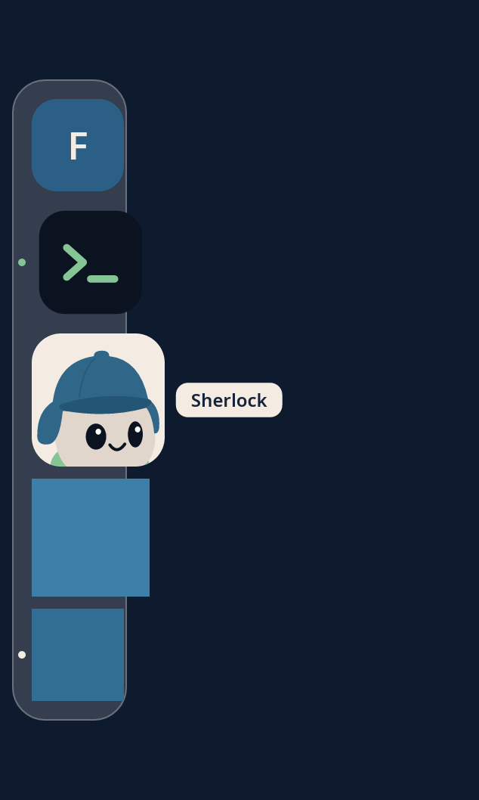

### Launching

A click on an icon depends on its windows (`windows::click`). Lot D-21c follows the macOS dock
for an application with several windows; minimizing the application in front stays the
author's choice, as on Windows and Plasma:

| The application | A click |
| --- | --- |
| Has no window, or its windows cannot be acted on (unknown, placeholder) | Starts it |
| Is open, but not in front | Brings its windows that are not minimized forward, the least recent first: the most recent ends on top with the keyboard. When they are all minimized, only the most recent one comes back |
| Is in front (one of its windows is active) with other windows shown | Brings the next one forward: the least recent, so that clicks go round them all (lot D-21d) |
| Is in front with a single window shown | Minimizes it |
| Middle button, or Ctrl+click | Starts it again for a new window (see below), whatever its windows |

**Several windows.** As on macOS, an application has one icon however many windows it has, and
whatever their kind: a Wayland window carries an `app_id`, an X11 one a class, and both go to
the icon whose desktop entry owns them (see Open windows). The most recent window is the one
that got the keyboard last: each source stamps a window when it becomes active
(`windows::Stamps`); a window not seen active since the dock started counts as older, and among
those the one that came last is the most recent.

Lot D-21c had set aside going from one window to the next on a click, which the macOS dock
does not do; the author found the dock « did not handle several windows » without it, and lot
D-21d adds it: a click on the application in front goes to its next window. The menu lists the
windows too (see Menu of an icon).

**A new window.** The middle button, a Ctrl+click and « Nouvelle fenêtre » start the
application again: its « new window » action when the desktop entry declares one, otherwise its
`Exec` without argument. The icon bounces until a window comes, as for a launch. The
application decides what a second start does: most open a new window (Konsole, Kate, Firefox,
Zen), a few with a single instance only bring their window forward. The dock does not force
anything; it stops the bounce when one of the application's windows gets the keyboard after the
start, so that such an application does not bounce for 10 s. Ctrl is read from the modifiers
the keyboard sends the dock (the compositor gives it the keyboard on a click, before the button
comes up).

Acting on windows goes through the `windows::Control` trait: `WlrControl` sends `activate`
(with the seat), `set_minimized` or `close` through `zwlr_foreign_toplevel_manager_v1` on a
connection of its own, on a thread; `Recorder` is the fake one for tests. Our compositor will
give this through a protocol of its own (batch D-18): another implementation of the same
traits. Enter on the ringed icon does the same as a click.

To check with D-18: with real windows, the keyboard the dock takes on a click (`OnDemand`) might
take the active state from the application in front, and a second click would then bring it
forward instead of minimizing it. If so, the dock will keep the last active application,
ignoring its own surface.

Starting the application: its `Exec` split as the Desktop Entry specification says
(quotes, escapes, field codes dropped, `%c`, `%i` and `%k`, the entry's own file, replaced), without a shell, in its `Path`
if it has one. Unlike the bar's monitoring commands, an application must outlive the dock: it
gets its own process group (a Ctrl+C on the dock's group spares it), no death signal, and a
thread reaps it. A test checks that `;` in a command is not run by a shell. `gtk-launch` was not
used: our OS will not ship GTK for it.

Sherlock has no window to open yet (A-19): a click on it opens the launcher, as Super + Space
does, where the question is asked to Sherlock (lot D-21m). The dock starts `launcher` beside the
session's programs (`SHERLOCKOS_BIN`) or in the `PATH`, as the compositor does; started again
while open, the launcher closes.

**The « Applications » button** (D-41) comes first, on the left as on macOS: nine squares on a
slate tile, drawn by `sherlock_ui::dock::applications_icon` in the style of the application
icons. A click starts the applications view (`docs/apps.md`), `$SHERLOCKOS_BIN/sherlockos-apps`
or `sherlockos-apps` in the `PATH`; started again while open, the view closes, so the button
toggles it. It is not in `Pinned`, cannot be dragged, and the dragged applications never take
its place (`drag::orders` keeps it first). Its menu has every entry disabled.

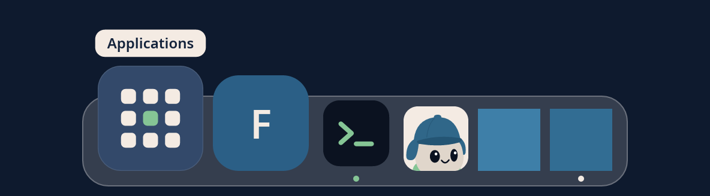

The tests of the other icons build the dock without it (`Sources::applications`), so that
their places stay those of the design board; `the_applications_button_comes_first` checks it.

**Pinned from elsewhere.** `dock::pins` gives the other programs of the shell the list as the
dock shows it, the defaults included when the file has none, and pins or unpins an application
there: « Garder dans le Dock » of the applications view and of the launcher. The dock reads its
file again at once. « Garder dans le Dock » and « Retirer du Dock » now take a capital D, as on
macOS, in the dock's own menu too.

## Animations

Batch D-21b, after macOS. The board shows none of them. Each icon keeps its animations by
identity (desktop file id, or `app_id`) when the icons are built again (`anim::Track`): its
size under the pointer, its room in the bar, its scale and opacity, and its offset from its
place. Everything is computed from the time, like the magnification: no state that advances
frame by frame.

| Token (`sherlock_ui::dock`) | Value | Use |
| --- | --- | --- |
| `ARRIVAL_SPRING` | `motion::OPEN_SPRING` (ratio 0.80, overshoot of 2 %) | Room and scale of an icon arriving or leaving |
| `ICON_FADE` | `motion::FADE`, 150 ms | Opacity of an icon arriving or leaving |
| `SHIFT_SPRING` | `motion::SNAP_SPRING` (ratio 0.75, overshoot of 3 %) | Icons moving aside, a dropped icon flying to its place |
| `BOUNCE_HEIGHT`, `BOUNCE_PERIOD` | Half the icon, 600 ms | A hop of the bounce |
| `BOUNCE_TIMEOUT` | 10 s | Longest bounce without a window |
| `DRAG_THRESHOLD` | 4 px | Under it a press is a click, past it a drag |
| `DRAG_OUT_OPACITY` | 0.5 | An icon dragged out of the dock |

The bounce height, its period, the threshold and the opacity are choices of D-21b, to review
with the design.

**Arriving and leaving.** A pinned application, an application unpinned, a window of an
application not pinned that opens or the last one that closes: the icon's room in the bar opens
or closes with `ARRIVAL_SPRING`, so its neighbours move aside or close up and the bar follows;
the icon grows from its base, or shrinks to it, and fades with `ICON_FADE`. An icon that left
is still drawn, in its room, until it is gone (`Dock::leaving`); the surface keeps its size
until then, then shrinks; the input region takes the new bar at once, for a leaving icon as for
an arriving one. The separator opens and closes with the open applications after it.
At startup (the first list of windows included), and when the edge, the icon size or the
magnification changes, everything is in place at once.

**Moving.** When the order changes (a drag, the settings, an application moving across the
separator), each icon starts where it was drawn and springs to its new place
(`SHIFT_SPRING`): its offset is the old place minus the new one, measured from the middle of
the dock, which stays put on the screen when the surface changes size.

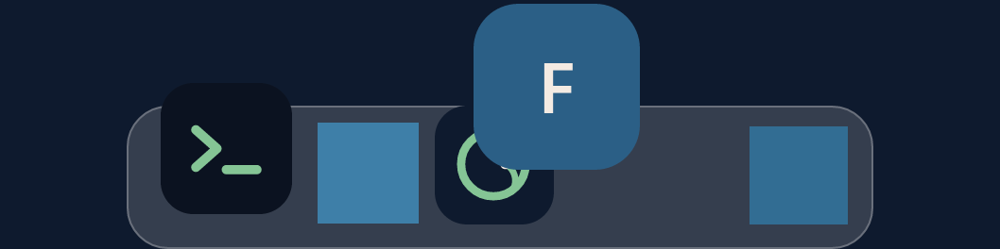

**Drag and drop.** The left button now acts when it comes up: pressed and released on the same
icon without moving 4 px, it is a click. Past 4 px, a pinned application or Sherlock follows
the pointer (the open applications that are not pinned and the « Applications » button do not
move). Along the dock it takes the place nearest the pointer among the pinned icons, Sherlock
one of them since D-21h: the dock tries each place with the current sizes and keeps the one that puts the icon closest
to the pointer; the others make room with `SHIFT_SPRING`. Let go, it flies to its place and the
new order is written to `dock.conf` by `dock-config` (`move_pinned`, then the atomic
`DockConfig::save`), only if the order shown changed: a pinned application that is not
installed, between two shown ones, never moves on its own, and a drag back to its place writes
nothing. While the button is held the dock follows the pointer
through iced's events (`drag::gesture`), past the edges of its surface as well: the surface
keeps the pointer until the button comes up.

**Across the separator** (lot D-21d). An open application after the separator can be dragged
too: once the pointer is a quarter of an icon (`dock::CROSS_MARGIN`) on the side of the pinned
ones, it is pinned, the separator moves past it, and it then takes the place nearest the
pointer like a pinned one, the others making room. Dragged back past the separator (or past the
last icon when there is none), a pinned application that is open is unpinned and goes after
it. Let go, the list is written if it changed. The file is read again just before it is
written (`DockConfig::load`, then only `Pinned` set), as Control Room does: what another
program wrote since the dock read it stays.

**Dragged out.** When the pointer is more than half the icon past the bar, away from the edge,
the icon is out: its room closes, it is drawn at half opacity. Back over the dock, its room
opens again. Let go out of the dock, a pinned application is unpinned and the file written; it
shrinks and fades where it was let go, in a puff of smoke as on macOS (lot D-21d: five puffs
that drift out, grow and fade over `dock::POOF_DURATION`, 400 ms, in the secondary text color).
Sherlock does the same, and `ShowSherlock=false` is written. A pinned application that is open
moves after the separator instead, as with « Retirer du dock », out of the same smoke. An open
application that is not pinned comes back where it was. The icon is drawn inside the dock surface:
higher than it, it stays at its top edge (a drag icon of its own, `wl_data_device`, is not
offered by `iced_exwlshell`).

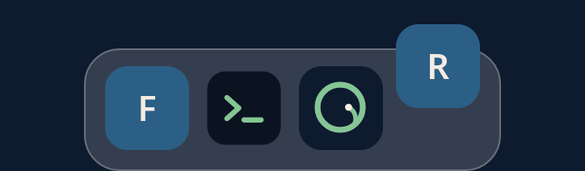

**Bounce.** An application started from the dock (a click, Enter, « Ouvrir », « Nouvelle
fenêtre », the middle button, Ctrl+click, an action of its menu) bounces: hops of 600 ms, each a parabola half the icon high, as on macOS. It is not
started again while it bounces. It stops at the end of the hop in progress, so that it lands,
when one of these says its first window came:

1. our compositor, through `sherlock_shell_v1` on its shell socket (`shell.rs`,
   `shell_protocol::socket_from_env`, ADR 0021): a window that the application owns (same
   rule as the dots) more than when it started, or one of its windows that got the keyboard
   since (an application with a single instance). The source publishes the windows at each
   `done` only: a window closing and another opening in one batch never reads as one less;
2. the dock's window source (`zwlr_foreign_toplevel_manager_v1` on wlroots compositors),
   with the same rule;
3. otherwise, `BOUNCE_TIMEOUT`, 10 s after the start.

`xdg-activation` was considered between 2 and 3: it cannot tell the dock anything. A launcher
asks for a token and gives it to the application, which uses it to take the focus; the
protocol has no event for the launcher when the token is used, so the dock would never learn
that the window came. Our compositor's shell protocol says it directly.

Since D-18c2, the shell source is the dock's window source (see Open windows): the bounce
ends with the first window it lists.

**No frame at rest.** Frames are asked for while a size, a room, a scale, an opacity or an
offset moves, while an icon is leaving and while an icon bounces. A bounce that landed and an
icon that is gone are dropped at the next frame, and the frames stop.

## Open windows

The dot under an open application, the active one in green, the open applications that are not
pinned, the window count in the menu and « Quitter » need the list of windows.

The open applications that no pinned icon owns come after a separator (the board's separator,
1 by 40, `rgba(255,255,255,0.28)`), in the order their windows came: with their desktop entry
when one owns the window, otherwise as their `app_id` on a tile. Their menu offers « Garder
dans le dock », which adds them at the end of the pinned list; a pinned application that is
still open moves after the separator when it is removed.


 A source implements `windows::Source`, like the bar's
sources (`read`, then `wait` for a change), and `windows::watch` turns it into a stream on its
own thread, connection included:

| Source | When | Closes windows |
| --- | --- | --- |
| `Placeholder` | `DOCK_OPEN` is set: comma separated `app_id`s, `DOCK_ACTIVE` the active one | No: a click starts the application, « Quitter » stays disabled |
| `shell::Shell` | Our compositor: its shell socket offers `sherlock_shell_v1` (ADR 0021) | Yes: `activate`, `minimize`, `close`, `set_rectangle`, through `shell::ShellControl` |
| `Wlr` | The compositor offers `zwlr_foreign_toplevel_manager_v1` (wlroots compositors) | Yes: `activate`, `set_minimized`, `close`, through `WlrControl` |
| None | None of them | Windows unknown: no dot, « Quitter » disabled |

They are tried in this order. `windows::Auto`, the control of the running dock, acts through
the shell protocol while its source runs, through the wlroots one otherwise.

A window belongs to a pinned application when its `app_id` (or X11 class) is the desktop file
id or its `StartupWMClass`, ignoring case; or, when one is a reverse-DNS name and the other is
not, the last part of it: `konsole` belongs to `org.kde.konsole.desktop`, and since lot D-21d
`org.kde.konsole` belongs to `konsole.desktop` as well.

**On our compositor** (D-18c2). The dock opens one connection to the shell socket, on the
thread of its source, and sends its requests on that same connection from the interface thread
(`shell::ShellControl`): nothing waits for the compositor. The state is read at each `done` of
the manager only, so a window closing and another opening in one batch never reads as one less.

- **Dots**: one under each application with a window, however many it has, green for the
  application whose window has the `activated` state. A dot per window (up to 3) was set
  aside: recent macOS shows one, the count is in the menu, and three dots would crowd the 9
  pixels under the icon. The dot fades in with the first window and out with the last
  (`dock::DOT_FADE`, the 150 ms of an icon arriving), green until it is gone. The compositor keeps that state while an anchored surface (the
  dock itself, after a click) has the keyboard: the active application stays active, and the
  click below is reliable.
- **Click** on an open application not in front: `activate` on each of its windows shown, the
  most recent last (see Launching). On the one in front: `minimize` on each. Without a window:
  started. A window of the menu: `activate` on it alone. Each window is named by the `id` the
  protocol gives it; the source also reads its `title` and its `minimized` state.
- **« Quitter »**: `close` on each window of the application, which may ask first.
- **`set_rectangle`**: for each window, the rectangle of its application's icon at rest, shown,
  on the dock's screen (`layout::on_screen`: the surface centered along its edge, 8 from it, as
  the compositor places it), for the minimize animation (D-19). Sent again only when an icon
  moves (icons added or removed, another size or edge, another screen), never while the icons
  magnify or the dock slides; a window that comes gets it at its first `done`; a window whose
  icon left gets a size of 0, which removes it. Before a click minimizes an application (lot D-21d), the
  icons are sent as they are drawn, the one under the pointer magnified, so that the genie
  lands on the icon as seen; they are sent at rest again when the pointer leaves the dock. A
  magnification that changes during the 300 ms of the minimize is not sent again. On the left and right edges the compositor
  centers the dock in the area the bar leaves, a few pixels off this rectangle.

The list is restricted to the shell (ADR 0021): only the shell socket offers it. KWin offers no
window list to an ordinary client (it keeps `org_kde_plasma_window_management` for Plasma):
under KWin the dock has no dot. `tests/windows.rs` runs the `Wlr` source against a fake
compositor written with `wayland-server`: two windows, one active, then the clicks of the dock
on them (the one behind brought forward, the active one minimized), then « Quitter », which the
compositor receives and the watching connection sees go.

Still missing: **game mode**, a way for the dock to know it, so that it hides (see below).

## Menu of an icon

A right click opens the menu of the icon under the pointer, as an `xdg_popup` attached to the
dock surface, centered on the icon and 12 away from the bar, or from the icon when it grew past the bar
(Menus board: 240 wide). The gap is
not part of the popup surface: it would be drawn black over the magnified icons. The compositor
closes it on a click elsewhere. The menu remembers its application by identity (desktop file
id, or `app_id`), not by the place of its icon: when windows open or close, or the
configuration changes, while it is open, its entries still act on the same application, and do
nothing if it left the dock.

Since lot D-21c the entries follow the dock menu of macOS:

| Entry | Enabled when |
| --- | --- |
| Header: the application name, its window count when known (« 3 fenêtres ») | |
| Each window, in the order they came: its title, « … » when too long, the application's name when it has none; the active one checked. A click brings it forward alone | The source can act on its windows |
| Separator, then « Nouvelle fenêtre », or « Ouvrir » when the application has no window | The application has an `Exec` |
| The other actions of its desktop entry (`Actions=`, their French `Name`), « Nouvel onglet », « Nouvelle fenêtre de navigation privée »… | The application has an `Exec` |
| Separator, then « Garder dans le Dock » for an open application that is not pinned, otherwise « Retirer du Dock » | Pinned, Sherlock included |
| Separator, then « Quitter » | The windows are known, the source can close them, and the application has one |

A disabled entry stays visible and does nothing: nothing is pretended. For Sherlock, every entry
but « Retirer du Dock » is disabled.

**The dock's own menu** (D-21h). A right click on the bar outside the icons, on the separator
or between two icons, opens the dock's menu, as the Dock options of macOS, from the pointer:
header « Dock », and « Afficher Sherlock dans le Dock », checked while Sherlock is there. It
takes Sherlock out, or puts it back in the middle of the pinned applications, its place
written. Sherlock is in neither the applications view nor the launcher (only « Demander à
Sherlock », a search result), and neither can drag an icon to the dock yet: this menu is the way
back.

| Dark | Light |
| --- | --- |
| 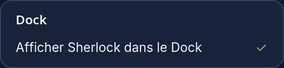 | 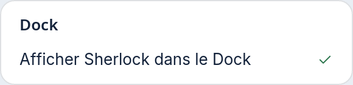 |

`the_docks_own_menu_renders_and_toggles_sherlock` (`tests/render.rs`) renders it in both themes
(`dock-own-menu-{dark,light}`), 290 wide (`dock::OWN_MENU_WIDTH`) so that its entry is not cut. « Quitter » asks each window to close (`close`, the toolkit's own close): an
application with unsaved work asks first, as on macOS. The compositor offers no confirmation of
its own, and the dock adds none.

**Unfolding.** The menu unfolds from its icon: it fades in and grows from `dock::MENU_SCALE`
(0.96) around its side facing the dock, with the spring and the fade of the bar's panels
(`dock::MENU_SPRING`, `dock::MENU_FADE`). Closed from the dock (an entry, Escape), it folds back
the same way, takes no other entry meanwhile, and its popup goes once it has faded out. Closed
by the compositor (a click elsewhere), it goes at once: its surface is already gone.

| Theme | 1920 × 1080 | 1366 × 768 |
| --- | --- | --- |
| Dark | 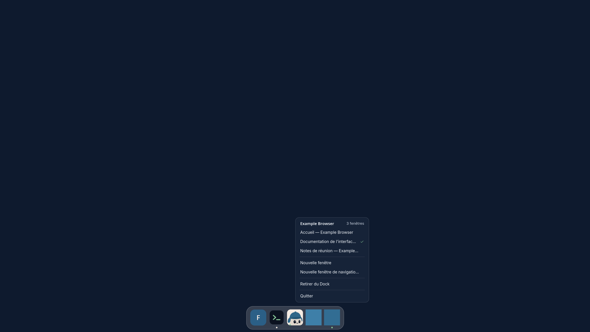 | 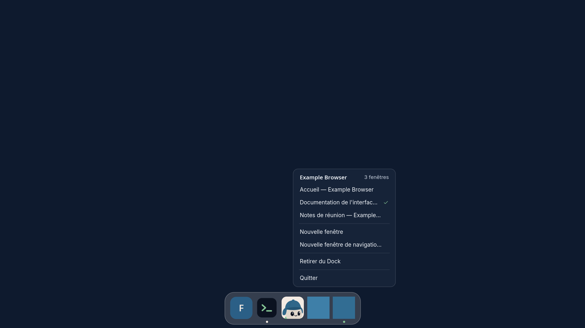 |
| Light | 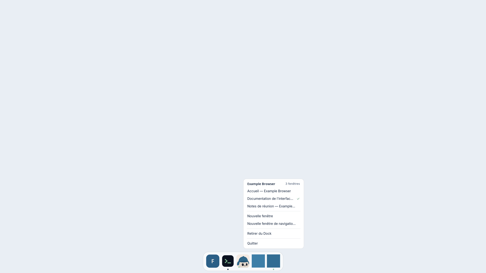 |  |

`tests/several.rs` composes these from the dock and its menu, at the bottom of a screen of
1920 × 1080 and of 1366 × 768, in both themes (`dock-windows-{dark,light}-{1920,1366}`): the
browser of the fixtures with two Wayland windows and an X11 one, the second in front.

Keyboard:

| Where | Key | Effect |
| --- | --- | --- |
| Dock | Tab, Shift+Tab, then arrows | Moves the light blue ring between the icons, wrapping around |
| Dock | Enter, Space | Starts the ringed application |
| Dock | Menu key, Shift+F10 | Opens the menu of the ringed icon |
| Dock | Escape | Removes the ring |
| Menu | Down, Up, Tab, Shift+Tab | Next or previous enabled entry, wrapping around |
| Menu | Home, End | First, last enabled entry |
| Menu | Enter, Space | Activates the highlighted entry |
| Menu | Escape | Closes the menu |

The dock keeps its focus and its menu cursor in its own state, like the bar (see `docs/bar.md`).
Hovering an enabled entry highlights it too.

## Running and checking by hand

In a nested KWin inside a Xephyr display started for the test, never in the author's session
(`:0`). The dock starts applications: give them the nested display and no session D-Bus, or
they would open in the author's session.

```sh
cargo build --release -p dock
Xephyr :21 -screen 1440x900 -br -nolisten tcp &
DISPLAY=:21 kwin_wayland --x11-display :21 --width 1440 --height 900 \
  --no-lockscreen --no-global-shortcuts --socket wayland-dock &
mkdir -p /tmp/dock-test/dock
printf '[Dock]\nPinned=org.kde.dolphin;org.kde.konsole;org.kde.kwrite;\nIconTheme=breeze\n' \
  > /tmp/dock-test/dock/dock.conf
DISPLAY=:21 WAYLAND_DISPLAY=wayland-dock QT_QPA_PLATFORM=wayland \
  DBUS_SESSION_BUS_ADDRESS=unix:path=/nonexistent XDG_CONFIG_HOME=/tmp/dock-test \
  DOCK_OPEN=org.kde.konsole DOCK_ACTIVE=org.kde.konsole RUST_LOG=dock=debug \
  target/release/dock
```

`XDG_CONFIG_HOME` keeps « Retirer du dock » away from the real configuration. Without
`--no-lockscreen`, the nested KWin locks itself after a while. Pointer and keys for a test
(XTest) go to `:21` only, after checking the display name.

1. **Anchoring**: the dock floats 8 above the bottom edge, centered, Sherlock in the middle.
2. **Exclusive zone** (`AutoHide=never`): click KWrite in the dock. Its window opens maximized
   and stops just above the bar (y = 816 on 900), without covering it.
   Then click in the black band just above the dock (outside the bar): the click reaches the
   window (the text cursor moves there), not the dock.
3. **Magnification**: move the pointer slowly along the dock. The icon under the pointer grows
   to 88, its neighbours less, the others are pushed outwards; the label follows the closest
   icon. Leave the dock: everything comes back to 52 with a slight overshoot, the label fades.
4. **Frame rate**: with `RUST_LOG=dock=debug`, the log shows `fps` while moving, and nothing
   once settled. `top -p $(pidof dock)` stays at 0 % at rest.
5. **Launching**: a click on an application starts it (`started app=… pid=…` in the log).
6. **Dots**: with `DOCK_OPEN=org.kde.konsole` and `DOCK_ACTIVE=org.kde.konsole`, Konsole has a
   green dot; another `app_id` in `DOCK_OPEN` gets a cream one.
7. **Menu**: right click Konsole. Its window (« Konsole », checked, disabled: the placeholder
   cannot act on windows), « Nouvelle fenêtre », its other actions, « Retirer du Dock »,
   « Quitter » (disabled too). On Dolphin, not open: « Ouvrir » first. Down, Up, Enter, Escape. On
   Sherlock, every entry is disabled.
8. **Unpin**: « Retirer du dock » on Dolphin: the icon goes, Sherlock stays in the middle, and
   `/tmp/dock-test/dock/dock.conf` loses it.
9. **Keyboard**: click the dock, Tab rings the first icon, arrows move the ring, Enter starts
   it, Shift+F10 opens its menu.
10. **Open applications**: with `DOCK_OPEN=org.kde.konsole,org.kde.kate` and Kate not pinned,
    Kate shows after a separator with its dot; its menu offers « Garder dans le dock », which
    moves it before the separator and adds it to `dock.conf`.
11. **Settings, live**: while the dock runs, write `Position=left` in
    `/tmp/dock-test/dock/dock.conf`: the dock moves to the left edge at once, vertical, the
    label beside the icons. Then `Position=right`, `Position=top`, `IconSize=40`,
    `MagnificationFactor=2`, `Magnification=false`. `IconSize=9999` or `Position=middle` log a
    warning and keep the default.

With our compositor, in a second Xephyr, the dock is the command it starts (the compositor
gives it its sockets; `--measure` logs its own frame rate):

```sh
cargo build --release -p compositor -p dock
Xephyr :22 -screen 1440x900 -br -nolisten tcp &
DISPLAY=:22 XDG_CONFIG_HOME=/tmp/dock-test DBUS_SESSION_BUS_ADDRESS=unix:path=/nonexistent \
  DOCK_OPEN=org.kde.konsole DOCK_ACTIVE=org.kde.konsole RUST_LOG=dock=debug \
  target/release/compositor --nested --measure target/release/dock
```

Steps 1, 3, 4, 5, 6 and the menu by pointer were checked this way. The keys did not reach the
dock under our compositor in Xephyr (no window manager there to give the compositor's window the
X focus): the keyboard steps were checked in the nested KWin.

`cargo test -p dock --test render` writes `target/tmp/dock-rest-tiny-skia.png`,
`dock-hover-tiny-skia.png` and `dock-menu-tiny-skia.png`, to compare with the boards.

## Tests

`just verify` runs everything, without a screen:

- **Curve** (`layout.rs`): the target size of each of the board's nine icons, at ten pointer
  positions, equals the board's script transcribed as it is; values at the key points (88 under
  the pointer, 78, 61, 54, 52); the label goes to the closest icon.
- **Settings** (`dock-config`): every key read, defaults without a file, invalid values give
  the default and a problem each, bounds accepted, unknown keys kept on writing, atomic save;
  live reload of a file saved in place or replaced by a rename (`watch.rs`), inotify event
  parsing.
- **Edges**: the same places along the dock and distances from the edge on all four edges, the
  bar against its edge; on the left, the pointer's height decides the magnification, icons grow
  away from the edge, the label beside, the dot against the edge; icon size and factor change
  the curve; without magnification nothing grows.
- **Open applications**: after the separator, with their entry or their `app_id`, glyphs looked
  up once; « Garder dans le dock » and « Retirer du dock » move an open application across the
  separator; a new configuration moves and resizes the dock.
- **Hover band**: a point above the bar in the gap between two grown icons keeps the hover and
  picks no icon; crossing it keeps the magnification, leaving the band lets it go.
- **Menu identity**: the pinned order changes while a menu is open; « Retirer du dock »
  removes the application of the menu, not the one now at its place.
- **Sherlock** (`tests/sherlock.rs`, D-21h): dragged to the left end, the others moving aside,
  its place written; an old file without the token keeps it in the middle and is not written by
  a click, a drag back, a menu or a new reading; taken out from its menu and by a drag out of
  the dock, put back from the dock's menu; a file changed by another program between the dock's
  reading and its writing keeps that change.
- **Writing the file**: comments kept, a value with a line break escaped, unique temporary
  files with saves from four threads at once, a symbolic link kept and its target written.
- **Watching**: the file saved, replaced by a rename, deleted, then its folder deleted and made
  again, two missing folder levels at the start.
- **Desktop entries**: `%k`, `Hidden` (deleted, and masking the same id further down),
  missing `TryExec`.
- **Default pins**: the real `desktop/evidence/evidence.desktop`, installed beside the fixtures,
  is found by its id `evidence` and pinned first, before the file manager `mimeapps` names.
- **Theme**: the dock fades to the light palette over the frames; captures at rest, hovered and
  of an icon's menu in the light theme (`dock-*-light-tiny-skia.png`).
- **Input region**: the bar alone at rest (the room above and at the ends lets clicks through),
  the longest magnified bar up to the label while hovered, on the bottom and right edges;
  rounding to whole pixels never shrinks it.
- **Pushed neighbours**: a grown icon widens the bar by its growth on both sides, the middle
  icon keeps its center, the gap stays 8, the outer icons move out, bottoms stay aligned; hit
  testing above the bar and in the gaps; the surface holds the widest dock and the label.
- **Spring** (`sherlock-ui`): peak time and height of the board's transition, within 2 % at
  150 ms.
- **Desktop entries and configuration**: the fixtures in `fixtures/` (neutral names, no data of
  the machine): localized name, actions, window class, hidden entries and links, `Exec`
  splitting, escapes, the configuration read and written back, the default roles with and
  without `mimeapps.list`, icon lookup in a theme, `hicolor` and `pixmaps`, GTK theme.
- **Launching**: no shell between the dock and the application; a missing program is an error.
- **Click**: an open application behind is brought forward, the one in front minimized, one
  without window started, and nothing is asked of windows a source cannot act on
  (`windows.rs`, `tests/render.rs` with the `Recorder`).
- **Several windows** (`tests/several.rs`, lot D-21c): Wayland and X11 windows of one
  application make one icon, pinned or after the separator; a click with none, one and several
  windows (the most recent last, a minimized one left down); the middle button and Ctrl+click
  start the application again, through its « new window » action or its `Exec`, and bounce
  until a window comes or one of its windows gets the keyboard; the menu lists the windows
  (titles, the active one checked, an untitled one named after the application), then the
  actions; a window of the menu comes forward alone, « Quitter » closes them all; the menu
  unfolds and folds back; the dot fades in with the first window and out with the last; the
  captures above.
- **Menu**: entries by ability, keyboard walk over enabled entries only, surface size.
- **Windows** (`tests/windows.rs`): the `Wlr` source against a fake compositor; a compositor
  without the protocol is reported.
- **Animations** (`anim.rs`, `tests/animations.rs`): an arriving icon opens its room, overshoots
  a little and settles; a leaving one closes it and is gone, never below 0; a moved icon starts
  where it was and springs to its place; the bounce hops, lands at the end of its hop, gives up
  at its timeout; a launch ends with one more window. In the dock: a pinned application
  arrives and its neighbours move aside without a jump, one unpinned leaves and the surface
  shrinks once it is gone, a drag reorders and writes the file once let go (comment kept, no
  temporary file left), a small move is still a click, a drag out unpins and the icon
  vanishes, Sherlock and the open applications that are not pinned do not move, an open pinned
  application dragged out moves after the separator, the bounce stops when the window comes
  (fake source) or at its timeout, and no frame is asked for once everything is still.
  Captures of a bounce and of a drag (`dock-bounce-tiny-skia.png`, `dock-drag-tiny-skia.png`).
- **Shell windows** (`tests/shell.rs`): the `sherlock_shell_v1` source against a fake
  compositor: windows already open, one that comes, one that closes, a window closed in a batch
  that is not over yet published only at `done`, a covered screen and back, the requests
  (minimize, close, activate) on the right windows, a rectangle sent once while it stays, given
  to a window that comes, moved, then removed; and a compositor without the protocol.
- **Hiding** (`hide.rs`, `tests/hide.rs`): on the four edges, nothing reserved in `smart`, a
  maximized window makes the dock slide until only the band of 2 is on the screen, the input
  region is that band on the side away from the edge, and the window restored brings it back,
  still reserving nothing; a window on another screen changes nothing; in `smart` and `always`
  the zone stays -1 at every frame of covering, hiding, revealing, hiding again and uncovering
  (`a_dock_that_hides_never_reserves_room`, lot D-21g), 84 in `never`. Without a screen
  (`tests/headless.rs` of the compositor), a maximized window gets no new configure while a dock
  without zone is revealed and hidden again; the edge
  brings the dock back over the window without zone, it hides again after the delay and not
  before, a menu holds it; `always` hidden from the start, `never` never; the icon rectangles
  on the screen, Sherlock owning no window, unchanged while the pointer magnifies or the dock
  hides, sent again when an icon comes.
- **Bounce room** (`layout.rs`, lot D-18d): on the four edges, with icons of 52 magnified 1.7
  times, of 96 magnified 2 times and of 32 without magnification, the icon under the pointer,
  its spring at its peak, at the top of its bounce, fits whole in the surface; the input
  region does not grow for it; 164 deep at the bottom by default.
- **Snapped windows** (`tests/shell.rs`): a screen with the `snapped` state counts as covered,
  like a maximized one.
- **Pinned order** (`dock-config`): `move_pinned` before another id, at the end, unchanged.
- **Rendering** (`tests/render.rs`): headless screenshots at rest, magnified with the label, on
  the left edge, with an open application after the separator, and of the menu; the pointer tracked over the surface; a disabled entry picks nothing; unpinning
  keeps Sherlock in the middle.

## Differences from the design board

- **Glass, blur, shadow**: the glass is a translucent tint on black (opaque software surfaces,
  see Surface); blur is the compositor's job; the board's shadow (`0 18px 44px`) would overflow
  the surface: not drawn.
- **Application icons**: the board draws our applications as line glyphs on colored tiles.
  Since D-03 they are the author's icons, found in the hicolor theme of sherlock-ui; their tiles
  have a radius of 22 % where the board has 27 %. Other applications show their theme icon as
  it is, without a tile.
- **Sherlock**: the board shows the mascot on a cream tile; since D-03 the dock draws the
  author's Sherlock tile, which shows it so.


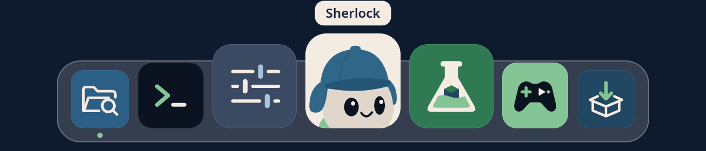
- **Active application**: the board draws only open ones. The dot of the active one takes the
  green of the active state.
- **Label position**: the board's script puts it at `(i + 0.5) / n` of the bar width, which only
  matches the icon at rest. The dock centers it on the icon as drawn.
- **Separator**: the board puts it before « Réglages », which does not exist yet; the dock puts it
  before the open applications that are not pinned.
- **Menu**: the board's dock menu belongs to « Conteneurs » (its containers, « Tout mettre en
  pause », « Garder dans le dock » checked). The dock offers « Garder dans le dock » to open
  applications that are not pinned and « Retirer du dock » to pinned ones; « Quitter » shows no
  Super+Q, which nothing binds yet.
- **Screen reader labels**: iced 0.14 exposes nothing (`docs/bar.md`).

## What this batch does not do

Batch D-21b added the bounce, smooth adding and removing of icons, reordering by drag and drop
and dragging an icon out to unpin it (see Animations). Batch D-18c2 put the dock on
`sherlock_shell_v1` and added hiding (see Hiding).

- **Hiding in game mode**: there is no game mode yet, and no way for the dock to know it (see
  what the compositor will have to provide).
- `Terminal=true` entries are started as they are, without a terminal around them; D-Bus
  activation is not used, `Exec` always is.
- Several outputs: the dock opens on the active output (`StartMode::Active`), like the bar.
- The launcher (D-22).
