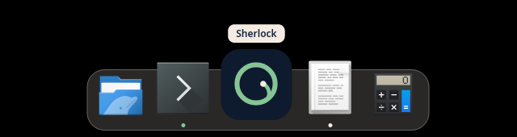

# Dock

`desktop/dock` is the desktop's dock: a separate program, anchored at the bottom of the screen
with layer-shell (ADR 0005), written with iced 0.14, tiny-skia software rendering (ADR 0014)
and `iced_exwlshell` 0.21.4, like the bar (`docs/bar.md`). Batch D-21 builds it from the
`Dock.dc.html` design board and, for the menu of an icon, `Menus.dc.html`. The crate, the binary
and the layer-shell namespace are all `dock`. Its texts stay in French, from `sherlock-ui`.


These three come from the headless rendering test (`tests/render.rs`), at scale 2, on the
desktop background, from the neutral fixtures: an application without icon (its initial on a
tile), a theme SVG, PNG icons from `hicolor` and `pixmaps`. In a nested KWin:



Under our compositor, nested in Xephyr (the black band is the opaque room above the bar, see
Surface):


## What it shows

| Element | Board | Dock |
| --- | --- | --- |
| Bar | 76 high, radius 22, glass `rgba(244,235,227,0.17)`, border `rgba(255,255,255,0.26)`, padding 12 on the sides and below | Same, 8 above the screen edge (Main board) |
| Icons | 52, radius 27 %, 8 apart, bottoms on the padding | Same; an application icon is drawn as its theme gives it |
| Magnification | Bell of reach 1.2 icon, factor 1.7, `cubic-bezier(0.2, 0.9, 0.3, 1.25)` over 150 ms | Same formula, a spring with the same peak (see Magnification) |
| Neighbours | Pushed by the flex layout | The bar widens on both sides, the gap of 8 stays |
| Label | Cream pill 108 above the bar, the icon closest to the pointer, `opacity 120ms` | Same, centered on the icon, faded in 120 ms |
| Dot | 5, cream, 9 below the icon | Same; green for the active application (see Differences) |
| Sherlock | In the middle | In the middle, the color logo on its night blue tile |

## Architecture

| Module | Role |
| --- | --- |
| `lib.rs` | Layer-shell surface, iced settings, startup (`Setup::load`, `run`) |
| `app.rs` | State (`Dock`), messages, update, the dock view and the menu view |
| `layout.rs` | Pure geometry: the board's curve, icon places, hit testing, surface size |
| `menu.rs` | Entries of an icon's menu, size of its surface, keyboard keys |
| `entry.rs` | Key files and desktop entries: name, icon, `Exec`, « new window » action, window class |
| `icons.rs` | Icon lookup in the themes, `hicolor`, then `pixmaps` |
| `config.rs` | `$XDG_CONFIG_HOME/dock/dock.conf`, default pinned applications |
| `launch.rs` | Starting an application without a shell |
| `windows.rs` | Open windows behind the `Source` trait: placeholder and `zwlr_foreign_toplevel_manager_v1` |

Every color, size and text comes from `sherlock-ui`: `metrics::DOCK_*` (already there since
D-01), `color::DOCK_GLASS` and `DOCK_BORDER`, and the new module `sherlock_ui::dock` (one new
file, a `pub mod` line in `lib.rs`): padding, bottom margin, dot, label, menu width and gap,
the magnification spring `dock::SPRING`, the label fade, the label and dot colors, the styles
`bar`, `tile`, `label`, `dot` and `ring`, and the texts `dock::text`. The menu reuses `menu`,
`menu_item`, `menu_separator` and `open` of `sherlock_ui::component`.

### Surface

The layer-shell surface is anchored to the bottom only, so the compositor centers it, on the
`Top` layer, with a bottom margin of 8. It declares an exclusive zone of 76, the bar's height:
maximized windows stop just above the bar. The keyboard comes on demand (`OnDemand`), on a click
into the dock, for its keyboard navigation.

The surface is taller and wider than the bar: the magnified icons grow above the bar (88 at
most, 101 above the bottom), the label sits 108 above it, and the widest magnified bar needs
room on the sides. `layout::surface_size` computes it from the number of icons: the widest bar
over every pointer position, plus `dock::SURFACE_SLACK` (52) on each side for the label, by
the label's top in height (132). With five icons: 529 by 132.

**Input region.** At rest, only the bar takes the pointer: clicks above it and on its sides go
to the windows below. While the pointer is over the dock, the whole surface takes it, so that a
magnified icon above the bar can be reached and the dock knows when the pointer leaves.

**Opaque surface.** tiny-skia draws through softbuffer, whose Wayland buffers are `XRGB8888`:
the transparent pixels of the surface come out black (see `docs/compositeur.md`). The dock's
glass shows on black, and so does the room above the bar, a band 56 high over the bottom of
maximized windows. This goes with the GPU batch (D-02); the dock does not work around it.

Protocol log in the nested KWin (`WAYLAND_DEBUG=client`), five icons:

```text
zwlr_layer_surface_v1#29.set_anchor(2)
zwlr_layer_surface_v1#29.set_keyboard_interactivity(2)
zwlr_layer_surface_v1#29.set_size(529, 132)
zwlr_layer_surface_v1#29.set_exclusive_zone(76)
zwlr_layer_surface_v1#29.set_margin(0, 0, 8, 0)
zwlr_layer_surface_v1#29.configure(94, 529, 132)
wl_region#39.add(105, 56, 318, 76)                 # at rest: the bar only
wl_surface#28.set_input_region(wl_region#39)
wl_region#41.add(0, 0, 529, 132)                   # the pointer comes over the dock
wl_surface#28.set_input_region(wl_region#41)
```

### Magnification

The board's script, transcribed in `layout::scale`: with `n` icons and the pointer at `p` along
the bar (0 at its left edge, 1 at its right edge, measured on the bar as drawn at that moment),
icon `i` heads for `round(52 × k)` with

```text
d = p × n − (i + 0.5)
k = 1 + (1.7 − 1) × exp(−d² / (2 × 1.2²))
```

The label goes to the closest icon, `floor(p × n)`. The pointer is over the dock when it is over
the bar or over an icon grown past it; elsewhere every icon heads back to 52.

Each icon side is a `motion::Animation` led by `dock::SPRING` (stiffness 1740, damping 52.6,
damping ratio 0.63). The board's `cubic-bezier(0.2, 0.9, 0.3, 1.25)` over 150 ms peaks about
7.8 % past its target near 97 ms; the spring peaks at 97 ms, 7.8 % past, and is within 2 % of
its target at 150 ms, 1 % from 200 ms on (test in `sherlock-ui`). A new pointer position
retargets the springs from their current value and speed: nothing jumps.

**CPU at rest.** The subscription to frames (`window::frames`) only exists while a spring or
the label fade moves. At rest, the dock subscribes to its window source, the keyboard and the
closing of its menu, all of which wait for events.

Measures, release build, on the reference laptop, the pointer gliding back and forth along the
dock for 4.5 s (XTest, one motion every 8 ms), five icons:

| Host | Frames per second while magnifying | Dock CPU while magnifying | Dock CPU at rest (10 s) |
| --- | --- | --- | --- |
| Our compositor, nested in Xephyr (`--mesurer`: 220 to 230 frames per second of its own) | 44 to 47 | 0.40 s over 4.5 s (9 %) | 0 |
| KWin, nested in Xephyr | 22 to 26 | 0.23 s over 3.3 s (7 %) | 0 |

The dock spends about 2 ms per frame (layout, tiny-skia, icons rasterized at their new size):
it is not what limits the rate. The limit is the frame loop through the nested hosts:
`window::frames` brings each frame back as a message after the draw, and under
`iced_exwlshell` the next draw waits for the next frame callback of the compositor. Through
Xephyr, a software X server, those callbacks are slow and irregular. The D-00 measures, with
the same frame subscription in a KWin nested on the real X server, gave 63 frames per second.
**The 60 frames per second of the plan remain to be checked in a real session** (D-14); a
widget publishing the frame from inside the draw was tried to shorten the loop, but its
messages wait for the next event under `iced_exwlshell` and the animation stalled.

`RUST_LOG=dock=debug` logs `animation frames=… ms=… fps=…` every second while something moves,
and once when it settles.

### Icons

The dock reads the desktop entries of `$XDG_DATA_HOME/applications` and of each
`$XDG_DATA_DIRS/applications` (the first file of an id wins). The `mime-apps` crate is not
merged: `entry.rs` reads only what the dock needs: `Name` (French first), `Icon`, `Exec`,
`Path`, `Categories`, `StartupWMClass`, `NoDisplay`, `Hidden`, and the « new window » action
(`Actions`, an id written `new-window`, `NewWindow` or `new-empty-window`).

Icons are looked up as the Icon Theme specification says, without the cache file: in the theme
of `IconTheme` in the configuration, else the GTK one (`gtk-icon-theme-name` in
`$XDG_CONFIG_HOME/gtk-3.0/settings.ini`, which Plasma writes too), with the themes it inherits,
then `hicolor`, then `pixmaps`. In each theme, the `Applications` directory closest to 88 (a
magnified icon) wins. An absolute `Icon` is taken as it is. Without an icon, the initial of the
name on a blue tile.

SVG and PNG both go through tiny-skia's SVG renderer: a PNG is drawn through a small SVG that
embeds it by path. iced's `image` feature would add the `image` crate and its decoders; resvg
already reads PNG. The handles are built once at startup; the renderer keeps the parsed trees
and rasterizes each icon at its current size.

### Configuration

`$XDG_CONFIG_HOME/dock/dock.conf`, a key file:

```ini
[Dock]
Pinned=evidence;org.kde.konsole;org.kde.kate;app.zen_browser.zen;
IconTheme=breeze
```

`Pinned` lists desktop file ids, left to right (`.desktop` accepted). Sherlock is not in it: it
is always in the middle (as many applications on its left as on its right, one more on the left
for an odd count). An id that is not installed is skipped and logged. An empty `Pinned=` is a
choice: Sherlock alone.

Without `Pinned`, the dock fills five roles with what is installed and shown in menus: files,
terminal, editor, browser, games. For each, the default application of its type in
`$XDG_CONFIG_HOME/mimeapps.list` (`inode/directory`, `text/plain`, `x-scheme-handler/https`),
else a preferred one (`evidence` for files, Konsole or GNOME's terminals, Steam), else the first
one of its category (`FileManager`, `TerminalEmulator`, `TextEditor`, `WebBrowser`). Nothing is
written until the list changes. « Retirer du dock » writes the file, keeping the keys the dock
does not know.

### Launching

A click starts the application: its `Exec` split as the Desktop Entry specification says
(quotes, escapes, field codes dropped, `%c` and `%i` replaced), without a shell, in its `Path`
if it has one. Unlike the bar's monitoring commands, an application must outlive the dock: it
gets its own process group (a Ctrl+C on the dock's group spares it), no death signal, and a
thread reaps it. A test checks that `;` in a command is not run by a shell. `gtk-launch` was not
used: our OS will not ship GTK for it.

Sherlock has no window to open yet: a click on it is logged, like the entries of the bar's
Sherlock menu.

## Open windows

The dot under an open application, the active one in green, the window count in the menu and
« Quitter » need the list of windows. A source implements `windows::Source`, like the bar's
sources (`read`, then `wait` for a change), and `windows::watch` turns it into a stream on its
own thread, connection included:

| Source | When | Closes windows |
| --- | --- | --- |
| `Placeholder` | `DOCK_OPEN` is set: comma separated `app_id`s, `DOCK_ACTIVE` the active one | No: « Quitter » stays disabled |
| `Wlr` | The compositor offers `zwlr_foreign_toplevel_manager_v1` (wlroots compositors) | Yes, `close` on each window, on a connection of its own |
| None | Neither | Windows unknown: no dot, « Quitter » disabled |

A window belongs to a pinned application when its `app_id` (or X11 class) is the desktop file
id, its last part (`konsole` for `org.kde.konsole`), or its `StartupWMClass`, ignoring case.

Neither our compositor nor KWin offers a window list to an ordinary client (KWin keeps
`org_kde_plasma_window_management` for Plasma). `tests/windows.rs` runs the `Wlr` source
against a fake compositor written with `wayland-server`: two windows, one active, then
« Quitter » on one of them, which the compositor receives and the watching connection sees go.

**What our compositor will have to provide**, to replace the placeholder:

1. **The windows**: `zwlr_foreign_toplevel_manager_v1` (version 3), the protocol the dock
   already speaks: for each window its `app_id` (the X11 class for XWayland windows), its
   states (`activated` for the active one, and `fullscreen`), `done` after each change,
   `closed` when it goes; and the `close` request for « Quitter ». `activate` would let a click
   on an open application bring it forward. `ext-foreign-toplevel-list-v1` alone is not
   enough: it carries neither the active state nor `close`.
2. **Restricted to the shell**: like layer-shell (see the security notes of
   `docs/compositeur.md`), the global must not be open to every client, Flatpak ones
   included: it lists and closes every window.
3. **Game mode**: a way for the dock to know it, so that it hides (see below).

## Menu of an icon

A right click opens the menu of the icon under the pointer, as an `xdg_popup` attached to the
dock surface, centered above the icon and 12 above the bar (Menus board: 240 wide). The gap is
not part of the popup surface: it would be drawn black over the magnified icons. The compositor
closes it on a click elsewhere.

| Entry | Enabled when |
| --- | --- |
| Header: the application name, its window count when known (« 1 fenêtre ») | |
| Ouvrir | The application has an `Exec` |
| Nouvelle fenêtre | Only there when the desktop entry declares the action |
| Retirer du dock | Always, except for Sherlock |
| Quitter | The windows are known, the source can close them, and the application has one |

A disabled entry stays visible and does nothing: nothing is pretended. For Sherlock, every entry
is disabled.

Keyboard:

| Where | Key | Effect |
| --- | --- | --- |
| Dock | Tab, Shift+Tab, then arrows | Moves the light blue ring between the icons, wrapping around |
| Dock | Enter, Space | Starts the ringed application |
| Dock | Menu key, Shift+F10 | Opens the menu of the ringed icon |
| Dock | Escape | Removes the ring |
| Menu | Down, Up, Tab, Shift+Tab | Next or previous enabled entry, wrapping around |
| Menu | Home, End | First, last enabled entry |
| Menu | Enter, Space | Activates the highlighted entry |
| Menu | Escape | Closes the menu |

The dock keeps its focus and its menu cursor in its own state, like the bar (see `docs/bar.md`).
Hovering an enabled entry highlights it too.

## Running and checking by hand

In a nested KWin inside a Xephyr display started for the test, never in the author's session
(`:0`). The dock starts applications: give them the nested display and no session D-Bus, or
they would open in the author's session.

```sh
cargo build --release -p dock
Xephyr :21 -screen 1440x900 -br -nolisten tcp &
DISPLAY=:21 kwin_wayland --x11-display :21 --width 1440 --height 900 \
  --no-lockscreen --no-global-shortcuts --socket wayland-dock &
mkdir -p /tmp/dock-test/dock
printf '[Dock]\nPinned=org.kde.dolphin;org.kde.konsole;org.kde.kwrite;\nIconTheme=breeze\n' \
  > /tmp/dock-test/dock/dock.conf
DISPLAY=:21 WAYLAND_DISPLAY=wayland-dock QT_QPA_PLATFORM=wayland \
  DBUS_SESSION_BUS_ADDRESS=unix:path=/nonexistent XDG_CONFIG_HOME=/tmp/dock-test \
  DOCK_OPEN=org.kde.konsole DOCK_ACTIVE=org.kde.konsole RUST_LOG=dock=debug \
  target/release/dock
```

`XDG_CONFIG_HOME` keeps « Retirer du dock » away from the real configuration. Without
`--no-lockscreen`, the nested KWin locks itself after a while. Pointer and keys for a test
(XTest) go to `:21` only, after checking the display name.

1. **Anchoring**: the dock floats 8 above the bottom edge, centered, Sherlock in the middle.
2. **Exclusive zone**: click KWrite in the dock. Its window opens maximized and stops just above
   the bar (y = 816 on 900), without covering it.
3. **Magnification**: move the pointer slowly along the dock. The icon under the pointer grows
   to 88, its neighbours less, the others are pushed outwards; the label follows the closest
   icon. Leave the dock: everything comes back to 52 with a slight overshoot, the label fades.
4. **Frame rate**: with `RUST_LOG=dock=debug`, the log shows `fps` while moving, and nothing
   once settled. `top -p $(pidof dock)` stays at 0 % at rest.
5. **Launching**: a click on an application starts it (`started app=… pid=…` in the log).
6. **Dots**: with `DOCK_OPEN=org.kde.konsole` and `DOCK_ACTIVE=org.kde.konsole`, Konsole has a
   green dot; another `app_id` in `DOCK_OPEN` gets a cream one.
7. **Menu**: right click Konsole. « Ouvrir », « Nouvelle fenêtre », « Retirer du dock »,
   « Quitter » (disabled, the placeholder cannot close windows). Down, Up, Enter, Escape. On
   Sherlock, every entry is disabled.
8. **Unpin**: « Retirer du dock » on Dolphin: the icon goes, Sherlock stays in the middle, and
   `/tmp/dock-test/dock/dock.conf` loses it.
9. **Keyboard**: click the dock, Tab rings the first icon, arrows move the ring, Enter starts
   it, Shift+F10 opens its menu.

With our compositor, in a second Xephyr, the dock is the command it starts (the compositor
gives it its sockets; `--mesurer` logs its own frame rate):

```sh
cargo build --release -p compositeur -p dock
Xephyr :22 -screen 1440x900 -br -nolisten tcp &
DISPLAY=:22 XDG_CONFIG_HOME=/tmp/dock-test DBUS_SESSION_BUS_ADDRESS=unix:path=/nonexistent \
  DOCK_OPEN=org.kde.konsole DOCK_ACTIVE=org.kde.konsole RUST_LOG=dock=debug \
  target/release/compositeur --imbrique --mesurer target/release/dock
```

Steps 1, 3, 4, 5, 6 and the menu by pointer were checked this way. The keys did not reach the
dock under our compositor in Xephyr (no window manager there to give the compositor's window the
X focus): the keyboard steps were checked in the nested KWin.

`cargo test -p dock --test render` writes `target/tmp/dock-rest-tiny-skia.png`,
`dock-hover-tiny-skia.png` and `dock-menu-tiny-skia.png`, to compare with the boards.

## Tests

`just verifier` runs everything, without a screen:

- **Curve** (`layout.rs`): the target size of each of the board's nine icons, at ten pointer
  positions, equals the board's script transcribed as it is; values at the key points (88 under
  the pointer, 78, 61, 54, 52); the label goes to the closest icon.
- **Pushed neighbours**: a grown icon widens the bar by its growth on both sides, the middle
  icon keeps its center, the gap stays 8, the outer icons move out, bottoms stay aligned; hit
  testing above the bar and in the gaps; the surface holds the widest dock and the label.
- **Spring** (`sherlock-ui`): peak time and height of the board's transition, within 2 % at
  150 ms.
- **Desktop entries and configuration**: the fixtures in `fixtures/` (neutral names, no data of
  the machine): localized name, actions, window class, hidden entries and links, `Exec`
  splitting, escapes, the configuration read and written back, the default roles with and
  without `mimeapps.list`, icon lookup in a theme, `hicolor` and `pixmaps`, GTK theme.
- **Launching**: no shell between the dock and the application; a missing program is an error.
- **Menu**: entries by ability, keyboard walk over enabled entries only, surface size.
- **Windows** (`tests/windows.rs`): the `Wlr` source against a fake compositor; a compositor
  without the protocol is reported.
- **Rendering** (`tests/render.rs`): headless screenshots at rest, magnified with the label, and
  of the menu; the pointer tracked over the surface; a disabled entry picks nothing; unpinning
  keeps Sherlock in the middle.

## Differences from the design board

- **Glass, blur, shadow**: the glass is a translucent tint on black (opaque software surfaces,
  see Surface); blur is the compositor's job; the board's shadow (`0 18px 44px`) would overflow
  the surface: not drawn.
- **Application icons**: the board draws our applications as line glyphs on colored tiles; they
  do not exist yet. Installed applications show their theme icon as it is, without a tile.
- **Sherlock**: the board shows the mascot on a cream tile. Until Sherlock has its icon, the
  dock shows the color logo of `sherlock-ui` on its night blue tile at the dock radius (27 %),
  since the cream dot of the logo would vanish on cream.
- **Active application**: the board draws only open ones. The dot of the active one takes the
  green of the active state.
- **Label position**: the board's script puts it at `(i + 0.5) / n` of the bar width, which only
  matches the icon at rest. The dock centers it on the icon as drawn.
- **Separator and Réglages**: the board ends with a separator and Réglages. Our settings
  application does not exist yet: no separator.
- **Menu**: the board's dock menu belongs to « Conteneurs » (its containers, « Tout mettre en
  pause », « Garder dans le dock »). The dock offers the entries the brief lists; « Quitter »
  shows no Super+Q, which nothing binds yet.
- **Screen reader labels**: iced 0.14 exposes nothing (`docs/bar.md`).

## What this batch does not do

- **Hiding in game mode**: there is no game mode yet, and no way for the dock to know it (see
  what the compositor will have to provide).
- Applications that are open but not pinned do not show in the dock.
- Reordering by dragging, pinning from the dock.
- `Terminal=true` entries are started as they are, without a terminal around them; D-Bus
  activation is not used, `Exec` always is.
- Several outputs: the dock opens on the active output (`StartMode::Active`), like the bar.
- The launcher (D-22).
