# Evidence

Evidence is the file manager of the desktop (lot D-27). It browses folders, copies, moves,
renames, sends to the trash and restores, previews files, shows the git state of each file,
and lists disks, USB keys and cards. The design board `docs/design/planches/Fichiers.dc.html` is the
reference for its look. Its interface texts are French and live in `sherlock_ui::texts::evidence`.

```sh
cargo run --release -p evidence            # opens the home folder
cargo run --release -p evidence -- ~/Projets   # opens a folder
```

Use `--release`: in a debug build, iced and tiny-skia are not optimised and the software
renderer is several times slower (see Performance). Evidence logs the renderer it chose at start
(ADR 0018); `ICED_BACKEND=tiny-skia` forces software rendering.

## Runtime (ADR 0029, lot E-02a)

On Wayland (`WAYLAND_DISPLAY` set), Evidence runs on `iced_exwlshell`, like the shell programs.
Its window is an `xdg_toplevel` made with `NewBaseWindow` (app id `evidence`, client-side
decorations, title « Evidence »), and its daemon starts in `StartMode::Background`, without any
layer surface. This is what lets its menus be real `xdg_popup`s.

The right-click menu and its submenu are popups of their own (lot E-02b), so they leave the
window, as on macOS. The menu's popup is larger than the menu by the room of its shadow, its input
region the menu only. Its anchor rectangle is chosen so that the menu's corner lands on the
clicked point both ways: below right, or above left when the compositor flips it at the
screen's edge (`flip_x`, `flip_y`, `slide_x`, `slide_y`). The submenu is a child popup anchored
beside its entry, which the compositor flips to the left the same way. The popups grab the
pointer and the keyboard: the arrows, Enter and Escape drive the menu as before, and a click
outside closes it (`popup_done`). The menu unfolds and folds back inside its popup, which goes
once it has faded out. Under winit, both are still drawn inside the window. The completion list,
the drop-down lists and the tooltips follow in E-02c. Under X11, it keeps iced's own runtime on winit. The title
bar's buttons work on both: moving, maximizing and minimizing become `xdg_toplevel` requests, and
closing the window, from its button or from the compositor, ends the program.

Before choosing, Evidence reads the compositor's globals: `iced_exwlshell` needs `xdg_wm_base` 2
at least, and an older compositor (WSLg's Weston offers version 1) gets the winit runtime
instead, rather than a crash at start.

In SherlockOS's compositor (nested, software rendering): 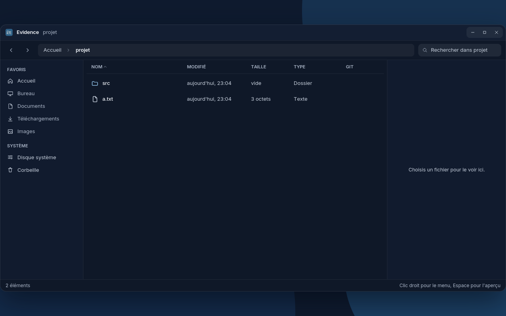

Differences with winit, found while moving (the ADR's spike): `iced_exwlshell` 0.21.4 sets no
smallest size on the window (`xdg_toplevel.set_min_size`), so `MIN_WINDOW` holds only under
X11, and it has no resize from the edges of a client-side decorated window
(`xdg_toplevel.resize`); winit had none either for a window without decorations.

## Architecture

| Module | Role | iced |
| --- | --- | --- |
| `listing` | Reads a folder, kind of each entry (folder, file, link, special), labels of each row (date, size, kind), sort by column | no |
| `ops` | Copy, move, rename, duplicate, new folder, on raw (`OsStr`) names. Never overwrites, even in a race; typed errors with French messages | no |
| `trash` | freedesktop Trash 1.0 in `$XDG_DATA_HOME/Trash`: put, list, restore, remove | no |
| `git` | Runs `git status --porcelain=v2` with a locked-down configuration and reads it | no |
| `preview` | First lines of a text file with light highlighting, decoded image, or information | no |
| `devices` | Reads UDisks2 objects, chooses and names volumes, `DeviceSource` trait | no |
| `udisks` | The real `DeviceSource`: UDisks2 on the system bus through zbus, and its watcher | no |
| `icons` | Application icons (hicolor, pixmaps, absolute paths), decoded off the interface thread | no |
| `places` | Favourites from `user-dirs.dirs` | no |
| `clock` | Local time (`localtime_r`, `mktime`) | no |
| `probe` | `--measure`: smoothness measurement | no |
| `selection` | Selected items, cursor and anchor; clicks with Ctrl and Shift, ranges, the lasso and its scrolling at the edges | no |
| `app` | State, messages, keyboard, commands, animations | yes |
| `view` | The window, after the design board | yes |
| `scenarios` | End-to-end tests driven by the keyboard, headless capture | tests |

Installed applications, file types and default applications come from the workspace crate
`mime-apps` (`docs/mime-apps.md`), which Control Room will reuse.

No file system access runs in `update` or `view`. Reading a folder (with one `stat` per
entry and the item count of each subfolder), checking which favourites exist, the git
state, the preview (text read and image decoding), the trash listing, copies, moves,
renames, new folders, restoring, emptying the trash, launching programs, reading the
applications and their icons, writing `mimeapps.list` and every device action are tasks on
iced's thread pool. A folder read carries a generation number, so a slow read overtaken by a
newer navigation is dropped. `view` only reads what those tasks cached.

The list is virtualised: only the visible rows and four more above and below are in the
widget tree, between two spacers. Row labels are computed once when the folder is read, icons
are built once (`sherlock_ui::component::icon` caches the SVG handles).

## Safety

- **Special files.** A named pipe, a socket or a device is listed as « Fichier spécial » and
  never opened: the preview opens regular files only, checks the type again on the open
  descriptor, opens with `O_NONBLOCK`, and gives up after 2 s on its own thread. A copy
  recreates named pipes (`mkfifo`) without reading them, and leaves sockets and devices aside
  with a message.
- **git.** Listing a folder must not run code, even from a repository found on a USB key or
  in an archive. Evidence runs git with `GIT_CONFIG_NOSYSTEM=1`, `GIT_CONFIG_GLOBAL=/dev/null`,
  none of the caller's `GIT_*` variables, `--no-optional-locks`, and forced settings that win
  over the repository's `.git/config` and the files it includes: `core.fsmonitor=false`,
  `core.untrackedCache=false`, `core.hooksPath=/dev/null`, no pager, no ask-pass, no external
  diff. It first reads (without running anything) the filter drivers the repository declares,
  then empties each one (`filter.<name>.clean=`, `.smudge=`, `.process=`, `.required=false`),
  which git treats as no filter. Submodules, each with its own configuration, are not entered
  (`--ignore-submodules=all`). A test builds a trapped repository (fsmonitor, clean and process
  filters, an included file) and checks that no command ran while the state is still read.
  Asking the user to trust each repository was the alternative; it adds a question for every
  project folder, for no more safety once the configuration is locked down.
- **No overwrite, even in a race.** Copies create files with `create_new`; renames and moves
  use `renameat2(RENAME_NOREPLACE)` (a plain check then rename on filesystems without it).
- **Failures clean up.** A copy, or a move between disks, that fails removes what it created
  at the destination; the source is untouched. Modification times are kept from one disk to
  another.
- **The path field.** Completion and the check of a typed path run on a thread of their own,
  never on the interface thread nor on iced's pool: a folder that hangs (a network share
  gone) holds that thread only, and no more than four such threads run. A completion reads at
  most 20 000 entries within 500 ms, offers 200 folders at most, and leaves out names that are
  not UTF-8 or hold a control character. A stale read, overtaken by a newer one, is dropped.
  A typed path longer than 4096 bytes, or with a control character, is refused.
- **Images.** The preview reads an image's size from its header before decoding it: beyond
  32 million pixels or 16 384 on a side, only its information shows (a 420 KB PNG can hold
  12000 × 12000 pixels, 430 MB decoded). The decoder may hold 192 MB at most. A decode that is
  no longer the last one asked for, or that ran out of time, stops at its next read, so that
  images run through with the arrows never pile up. Application icons: 1 MB per file, 1024
  pixels on a side.
- **Disguised files.** The preview reads the first bytes of the selected file. A program (ELF,
  Windows, `#!`) named like a document, or an image, PDF or ZIP named as another of these
  kinds, gets a warning in salmon above the preview: « Attention : malgré son nom en .pdf, ce
  fichier est un programme. »
- **No program through xdg-open.** A file opened without an application chosen for its type
  goes to `xdg-open`, which on some desktops runs launchers. An executable file, a `.desktop`
  launcher, or a file that starts like a binary or a script, is never handed to it: Evidence
  says it does not run programs. A file that cannot be read in time counts as one.
- **Copies drop setuid and setgid**, as `cp` without `-p` does; the sticky bit of a folder
  stays.
- **Small files stay small.** Trash records and `user-dirs.dirs` are read up to 64 KB, a named
  pipe in their place is never waited on.
- **Renames refuse control characters** (a line feed, an escape, a tab), as they refuse « / ».
- **Names shown safely.** In the listing, the preview and the breadcrumb, a control character
  of a name shows as its picture (␊ for a line feed, ␛ for an escape) and a direction mark
  (U+202E and its kin, which can make a name read « exe.txt » for an `.exe`) as �.
- **Names are bytes.** Copy, move and conflict names keep the exact bytes of a name that is not
  UTF-8; only the display is lossy.

## What it does

- Sidebar: Favourites (home, Desktop, Documents, Downloads, Projets when `~/Projets` exists,
  Pictures, from xdg-user-dirs), Devices, System (system disk, trash). The favourite that
  contains the current folder is active; Home only for the home folder itself.
- Toolbar: back, forward, path bar, git branch, search in the current folder, and at its right
  end the button of the preview (lot E-08). The button, Ctrl+Alt+P (the Finder's Alt+Cmd+P)
  or « Aperçu » in the bar's menu hide the preview and show it again: it slides out to the right
  edge and back in 220 ms, the button lit while it shows. The choice is remembered in
  `$XDG_CONFIG_HOME/evidence/settings` (`preview=on` or `off`), written whole to a temporary
  file then renamed, off the interface thread, and read before the first frame.
- Path bar (lot E-04, after Finder and Nautilus): a breadcrumb as wide as the toolbar allows;
  each segment opens its folder. A name wider than `CRUMB_MAX_WIDTH` keeps its start and its end
  around « … » (`sherlock_ui::ellipsis::fit_middle`); when the segments do not fit the bar,
  those after the first fold behind « … » until the rest fits, so the bar follows the window's
  width; « … » opens the deepest folded folder. Back and forward: the buttons, Alt+← and Alt+→,
  the side buttons of the mouse; parent folder: Alt+↑ or Backspace.

  Ctrl+L, a click on the empty part of the bar, or typing « / » or « ~ » in the listing turn
  it into a text field, the current folder selected (empty in the trash); Maj+Ctrl+G
  (« Aller » menu, « Aller au dossier… ») opens the same field in a sheet under the toolbar, as
  on macOS. In the field:
  - the subfolders that complete the name being typed show in a list under it (hidden ones
    once a dot is typed or when the listing shows them; case ignored); Tab completes to the
    picked one, the only one, or as far as they all agree; the arrows pick; a click opens;
  - `~` is the home folder, a relative path starts from the current folder, `.` and `..` fold,
    a pasted `file://` link is decoded and the blanks around a paste are dropped;
  - Enter opens a folder; a file opens in its default application and is selected in its
    folder;
  - a path that leads nowhere, or where Evidence may not go, shakes the field (450 ms, three
    swings that die out) and says why in the status bar; the field stays open;
  - Escape, a click in the listing, or a navigation give the breadcrumb back.

  The breadcrumb and the field cross-fade (160 ms each way); the list fades and slides in and
  out; the sheet comes down and fades, over a dimmed window.

  | 1920 × 1080 | Smallest window |
  | --- | --- |
  | 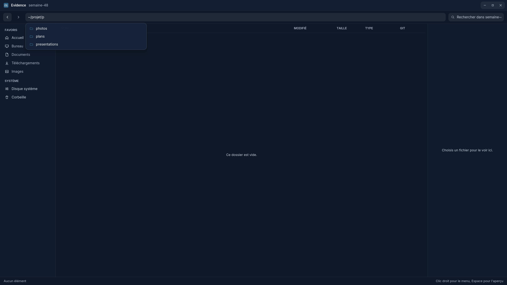 | 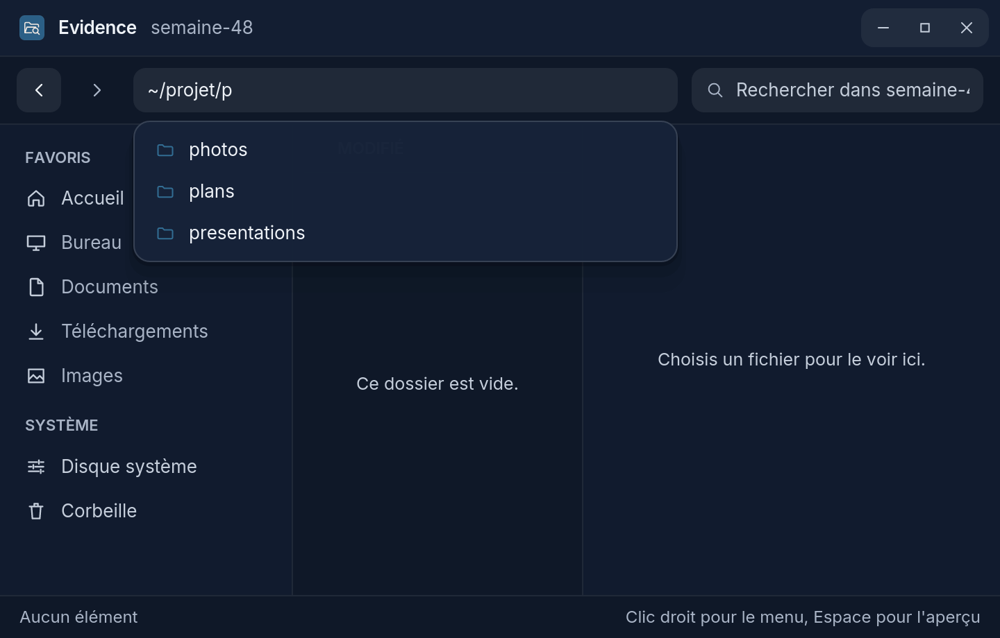 |
  | 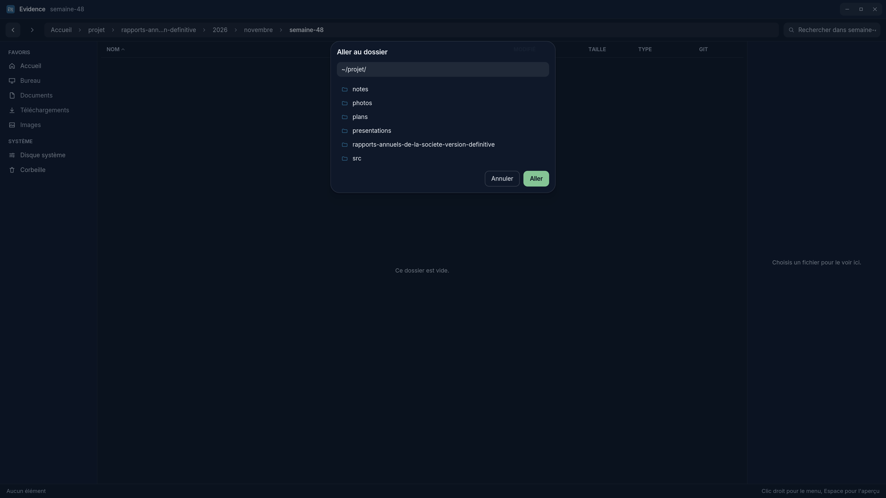 | 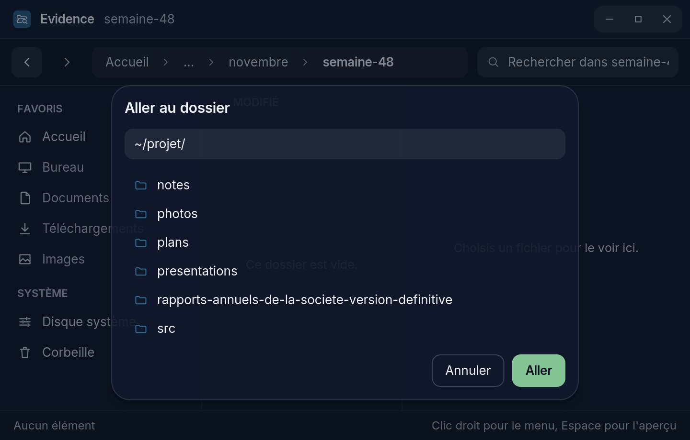 |

  | 1920 × 1080 | Smallest window | In a WSLg window |
  | --- | --- | --- |
  | 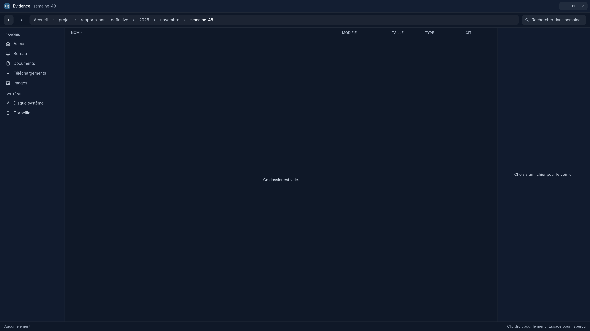 | 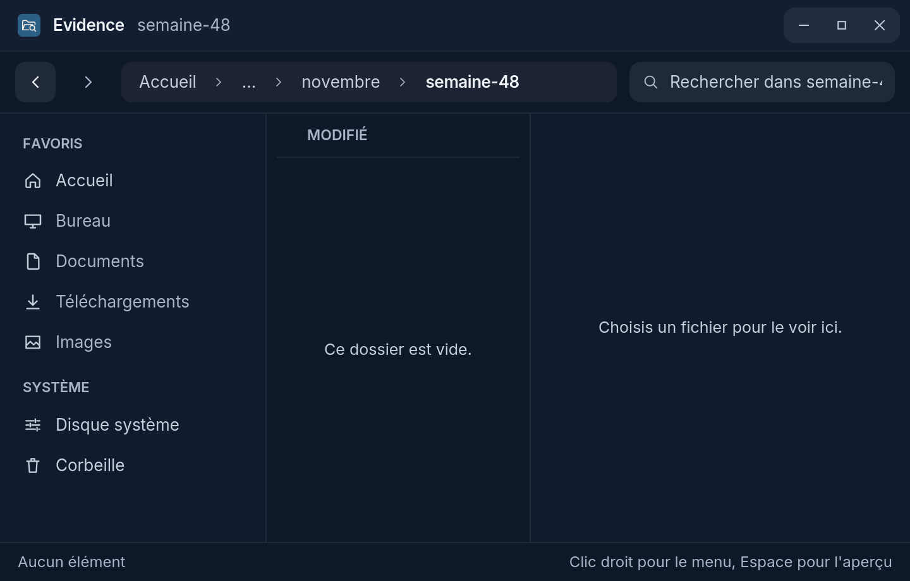 | 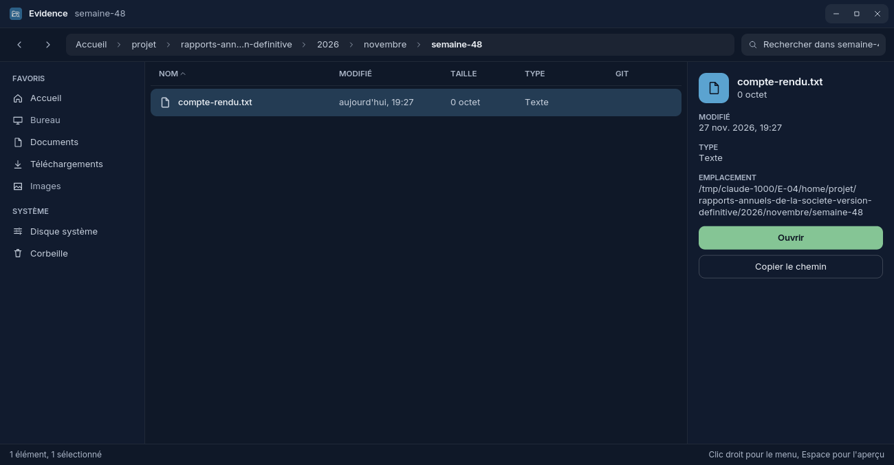 |
- The window follows its width (lot E-05, after the Finder and Nautilus). The name of a file
  always keeps `NAME_MIN_WIDTH` (220): when the room runs short, the Git column folds first,
  then Type, the preview, Size, Modified, and last the sidebar (`layout::Panes`). The preview
  folds at half a 1080p screen; Space brings it back at that width, and the columns fold
  instead. Names, the origin of a trash item and the preview's title end with « … » where the
  shaped text stops fitting (`sherlock_ui::ellipsis`), not after an estimated count of
  characters.

  | 720 × 460 | 944 × 1048 (half of 1080p) | 1366 × 768 | 1920 × 1080 |
  | --- | --- | --- | --- |
  | 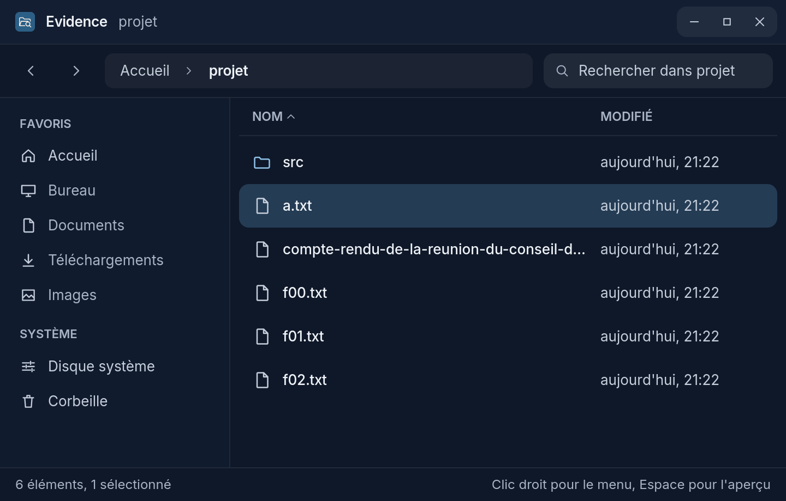 | 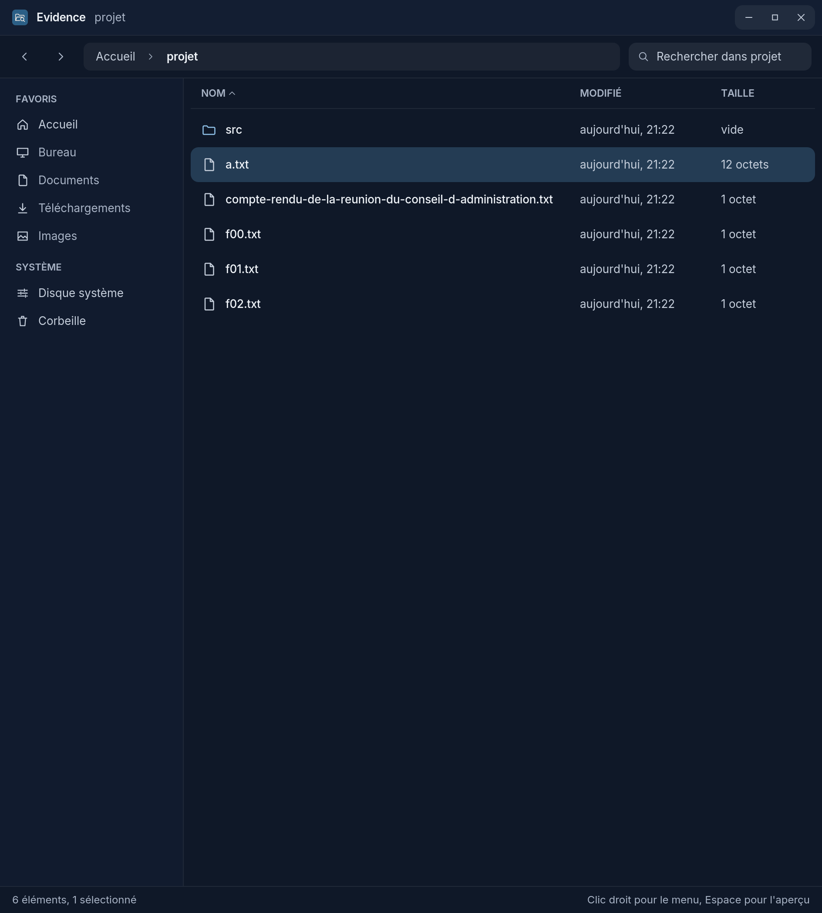 | 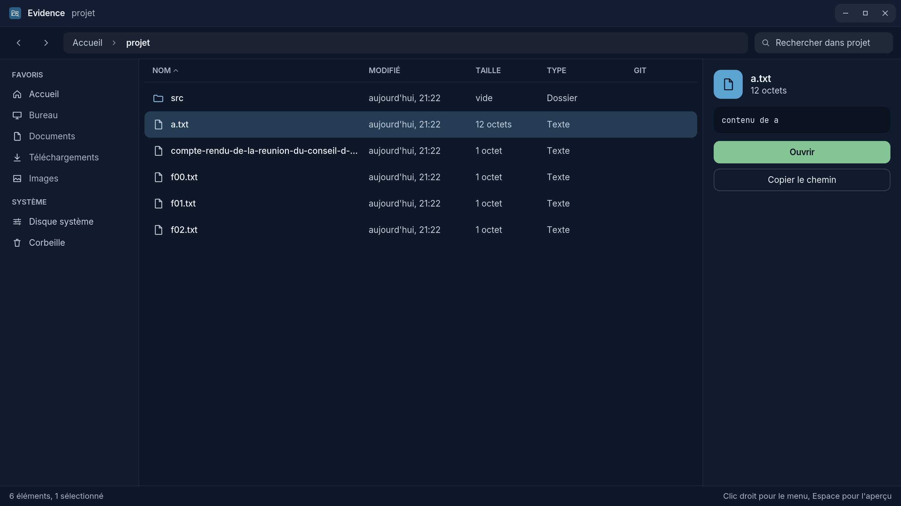 | 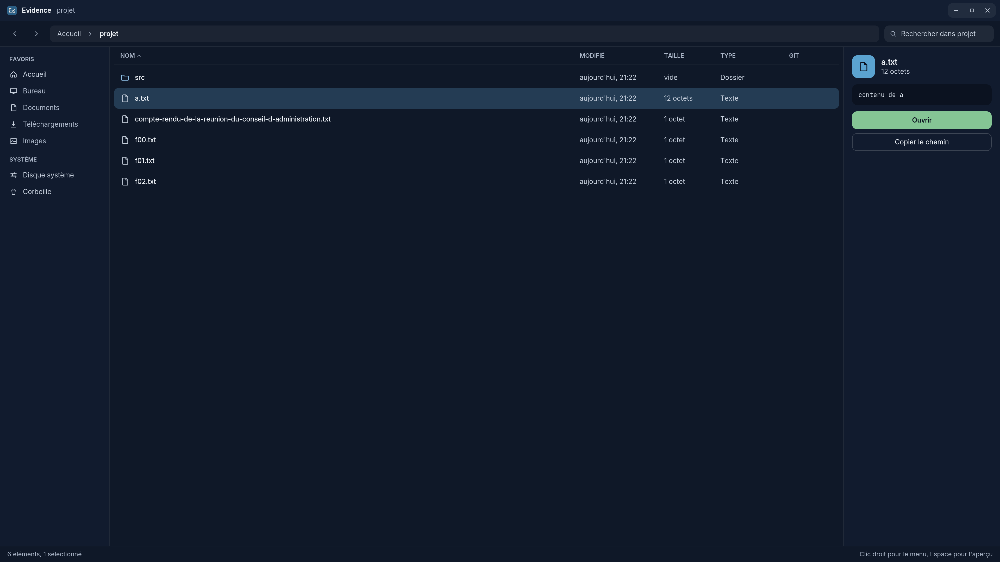 |
- List: name with an icon per kind, modified date, size (item count for folders), kind, git
  state (modified, new, ignored). Click a column header to sort, again to reverse. Folders
  stay first. Hidden files with Ctrl+H. A double click opens an item, selected or not: the
  application recognises it (`sherlock_ui::click`, within `decorations::DOUBLE_CLICK`, 400 ms,
  and 6 px), not the row widget, whose state iced drops when the first click reshapes the view
  (the selection highlight wraps the rows in a stack). Lot Q-13.
- Title bar: the icon of Evidence (`sherlock_ui::app_icon`, D-03) at 18 px, where the design
  board has its badge (it was a plain tile until Q-13): `docs/evidence/header-dark.png` and
  `header-light.png`.
- Preview: header with tile, size and git state; first lines of a text file in JetBrains Mono
  with keywords and comments coloured (Dockerfile, Rust, TOML, shell, Python); PNG and JPEG
  images; date, kind and place for the rest. Buttons: Open, Copy path (Restore in the trash).
- Context menu as on the design board. « Ouvrir avec » lists the installed applications that open the
  file's type (from their `.desktop` files, with their icon, the default first and checked),
  then « Terminal, dans ce dossier », « Autre application… » (a chooser of every application, with
  a search), and the switch "Toujours ouvrir ce type ainsi". With the switch on, the chosen
  application becomes the default in `~/.config/mimeapps.list` (and in `kde-mimeapps.list`
  when that file already names a default for the type); opening a file then uses the default
  application of its type (xdg-open when there is none). The switch applies to one choice
  only: it goes back off after that choice, and when the menu or the chooser closes, so an
  "open once with" never changes the defaults shared with the desktop. `Terminal=true`
  applications open in the terminal (see `docs/mime-apps.md`). In the trash: restore, empty.
  On a device: open or mount, unmount, eject.
  The chooser keeps its rows whole (lot E-01, the author found it « toute écrasée dans
  certains cas »): every row is one line of `MENU_ITEM_HEIGHT`, a long name ends with « … »
  (`sherlock_ui::ellipsis`), an application without an icon gets an empty square of the icon's
  size so that names line up, icons of any size are drawn at 16 px; the list scrolls, as high
  as the design (300) or as the window allows, never less than four rows. « Ouvrir avec »
  lists no more applications than the window's height holds. The window cannot be made
  smaller than 720 × 460 (`sherlock_ui::evidence::MIN_WINDOW`), where the menu and the
  chooser fit.

  | 30 applications | Long names, light | Smallest window | « Ouvrir avec » in a corner |
  | --- | --- | --- | --- |
  | 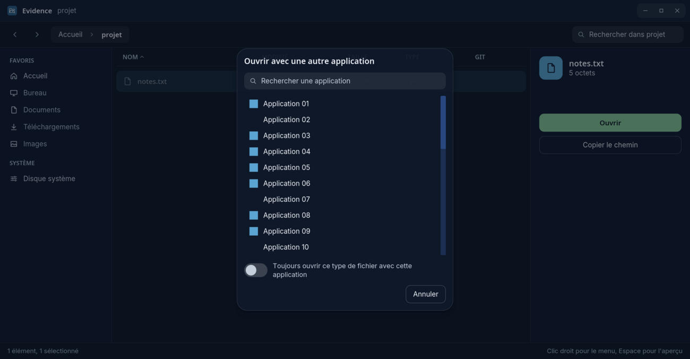 | 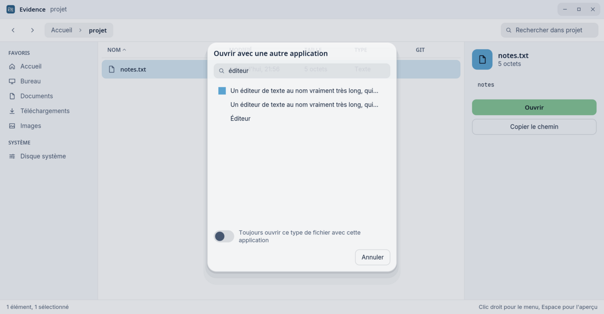 | 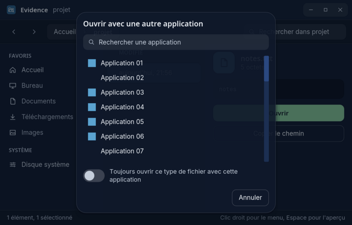 | 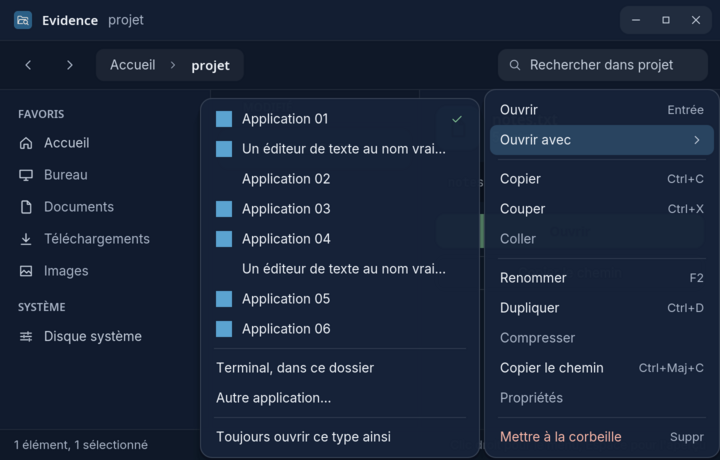 |
- The menu, as in Finder and Dolphin (lot E-01). On an item or a selection: « Ouvrir »,
  « Ouvrir avec » (for several files of one type, the application gets them all), « Copier »,
  « Couper », « Coller », « Renommer », « Dupliquer », « Compresser », « Copier le chemin »,
  « Propriétés », « Mettre à la corbeille ». On the background: « Nouveau dossier », « Coller »,
  « Fichiers cachés » (checked when shown), « Trier par » (name, modified, size, kind, git; the
  checked one again reverses the order, like a column header), « Vue » (« Liste » checked).
  « Coller » is greyed while nothing is copied. **Greyed because Evidence cannot do it yet**:
  « Compresser », « Propriétés », and the « Grille » and « Colonnes » views.
  The keyboard passes over greyed entries. A submenu opens on the left when the window has no
  room on the right, and moves up to stay inside; the menu stays inside the window. A right
  click while the menu is open opens it again on the row or background under the pointer
  (it used to close only).

  | Dark | Light |
  | --- | --- |
  | 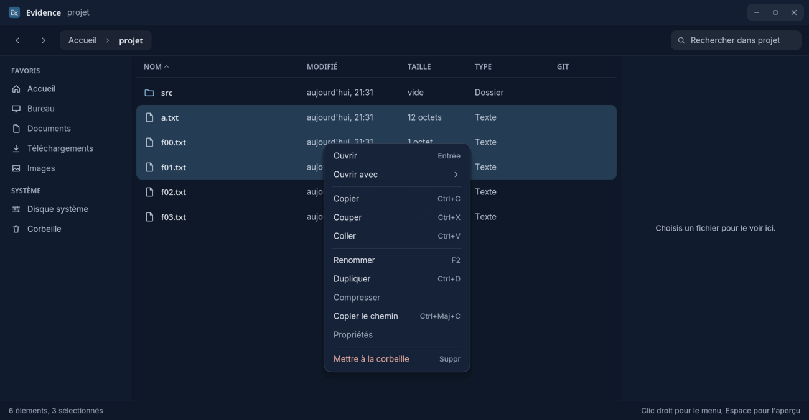 | 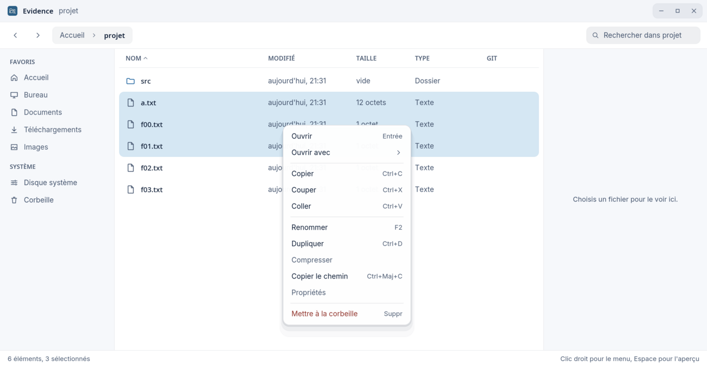 |
  | 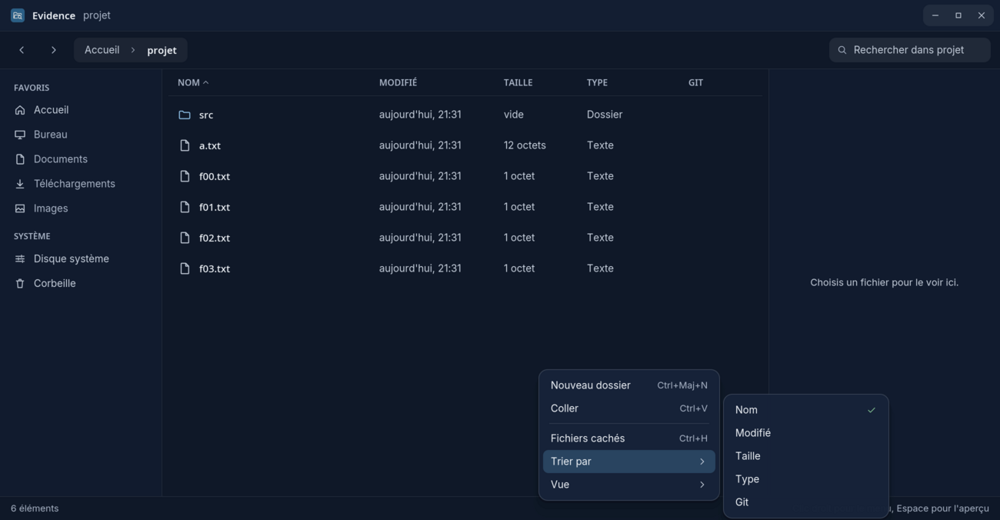 | 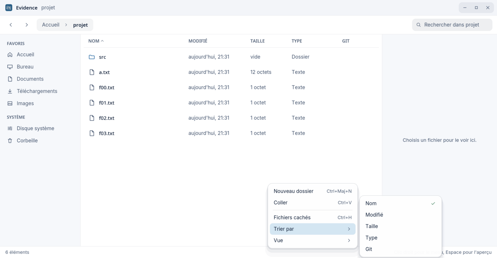 |

  Halfway through unfolding, software renderer: 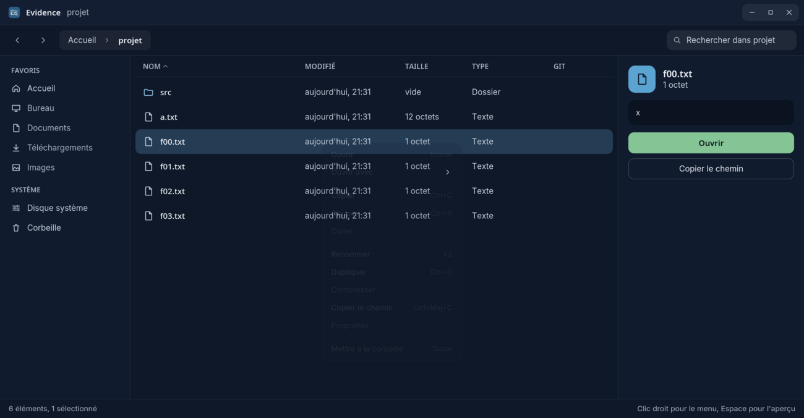
- Copies and moves (lot E-11, `transfer_job`): a paste first looks, off the interface
  thread, for the names already taken where it goes. If any, a dialog asks once for all of them:
  « Remplacer » (the item there goes to the trash, never deleted for good), « Garder les deux »
  (« nom (copie) »), « Ignorer », or « Annuler ». While it runs, the status bar shows its share
  done and an « Arrêter » button: the size is counted first (200 000 entries at most), the
  files are copied by chunks of 1 MB that count and check for a stop, and a copy stopped or
  failed leaves nothing half-written behind.
- Network (lot E-07): a « Réseau » section of the sidebar lists the file servers of the local
  network, found without any tool installed (`network`): a multicast DNS question for
  `_smb._tcp.local` (Samba, macOS and NAS boxes, announced by Avahi or mDNSResponder) and a
  WS-Discovery probe (Windows computers, Samba with wsdd). Each listening lasts 2.5 s, on a
  thread of its own, again every 2 minutes; at most 256 answers of 9000 bytes are read and 64
  servers kept; a compression loop or a cut packet names nothing; names are shown safely. A
  click mounts the server as a guest through gvfs (`gio mount --anonymous smb://host/`, `smb`),
  without root, off the interface thread with a 30 s limit, then opens the folder gvfs shows it
  in (`gio info`, « local path »); an eject button beside it unmounts it. Without gvfs, the
  status bar says so. Servers that want a name and a password say so for now: the sheet that
  asks for them, and the Secret Service keyring, come in E-07b.
- Trash: deleting moves to the freedesktop trash (shared with Plasma, GNOME, `gio trash`).
  The trash view lists the original name, the deletion date read from the record, and the
  origin. Emptying asks first and deletes only what was listed when the question was asked.
  Long names are cut in the record's name, never refused; no empty record is left behind.
- Operations: copy, cut, paste, duplicate, rename in place, new folder (named right away).
  Pasting a copy over a taken name makes "name (copie).ext"; a move or rename onto a taken
  name is refused with a message. Copying a folder into itself is refused.
- Devices: internal data partitions (mounted or not, even when UDisks marks them
  `HintSystem`), USB keys, external disks, memory cards, optical discs, from UDisks2. Name:
  volume label, else UDisks' name hint, else model and size, else "Volume de 32 Go". Icon by
  kind. Free space when mounted. A click mounts (through `Filesystem.Mount`, so polkit asks
  when needed) then opens. Unmount and eject in the menu, eject button beside removable media.
  A medium plugged in or pulled out shows up or goes away at once (UDisks2 signals watched on a
  thread). Hidden: what UDisks marks `HintIgnore`; anything mounted at `/`, `/boot`, `/efi`,
  `/usr`, `/var` or `/home`; unmounted EFI, extended boot, BIOS boot, Microsoft reserved,
  Windows recovery and swap partitions (by partition type) and blocks without a mountable
  filesystem; blocks without a drive (loop devices, zram). LUKS volumes show locked. Eject is
  refused when no drive can be found for the volume.

## Drag and drop and the clipboard of files (lot E-03)

winit, under iced, neither starts a drag nor receives a drop on Wayland, and iced's clipboard
only knows text. Evidence speaks `wl_data_device` itself (`src/dnd.rs`), on the window's own
Wayland connection (`Backend::from_foreign_display`, from the window's raw handles), with an
event queue of its own in a thread: its own `wl_seat`, `wl_pointer` (the serial of the press
that starts a drag), `wl_keyboard` (the serial of the key that copies) and data device. The
interface sends it commands and gets events back (`app/drag.rs`). Under X11 (the author's Plasma
session), none of this starts: Evidence keeps its own clipboard.

- **Dragging out.** A press on the name of a selected row, moved by more than
  `drag::THRESHOLD` (6 px), becomes a drag of the whole selection (a plain press on a multiple
  selection keeps it until the release, as in the Finder). It offers
  `x-special/gnome-copied-files`, `text/uri-list` and the paths as text, to copy or move. The
  picture under the pointer (`src/drag_image.rs`) stacks the cards of the first three files,
  fanned and turned, the front one showing its icon or the thumbnail of a photo (PNG or JPEG of
  24 MB at most), with the count in a pill past one file; drawn at scale 2 by resvg, in the drag
  thread. The compositor draws it under the pointer and, if the drop is refused or cancelled
  (Escape), glides it back (lot D-29c): Evidence keeps the picture `drag::RETURN` for that.
  Discord and the other X11 applications receive it through the compositor's XDND bridge.
- **Dropping in.** Files dragged over the window light up the folder row under the pointer, or
  the whole listing for the folder shown (`drag::target`). A drop moves the files there, or
  copies them with Ctrl held (`Prefer`), off the interface thread (`ops::move_into`,
  `ops::copy_into`). A folder that keeps the pointer `drag::SPRING_DELAY` (0.8 s) blinks twice,
  then opens, as the Finder's spring-loaded folders. Refused: the trash, a folder dragged onto
  itself, files dropped back where they are.
- **The clipboard.** Ctrl + C and Ctrl + X also put the files on the session's clipboard
  (`copy` or `cut` in `x-special/gnome-copied-files`, `text/uri-list`, the paths as text).
  Ctrl + V reads the session's clipboard first: files copied in Dolphin, Nautilus or another
  Evidence are pasted, and cut ones moved. With no files there, Evidence's own clipboard.
- **Security.** What comes from another application is read off the interface thread, 4 MiB
  and 10,000 files at most, each piece awaited 5 s at most; only local `file://` addresses are
  kept, absolute and without `..` (`src/transfer.rs`).

## Keyboard

Everything works from the keyboard. Arrow keys and shortcuts act on the list unless a text
field has the focus.

| Keys | Action |
| --- | --- |
| Up, Down, Home, End | Move the selection |
| Shift+Up, Shift+Down, Shift+Home, Shift+End | Extend the selection from its anchor, or shrink it back |
| Enter | Open (folder: enter it; file: `xdg-open`) |
| Backspace, Alt+Up | Parent folder, with the folder you came from selected |
| Alt+Left, Alt+Right | Back, forward |
| Ctrl+C, Ctrl+X, Ctrl+V | Copy, cut, paste |
| Ctrl+D | Duplicate |
| Ctrl+Shift+C | Copy the path |
| F2 | Rename (Enter confirms; Escape leaves the field, a second Escape cancels) |
| Ctrl+Shift+N | New folder |
| Delete | Move to the trash |
| Ctrl+H | Show or hide hidden files |
| Ctrl+A | Select all |
| Ctrl+F | Search |
| F5, Ctrl+R | Reload |
| Space | Show or hide the preview |
| Menu key, Shift+F10 | Context menu; arrows, Right for the submenu, Enter, Escape |
| Tab, Shift+Tab | Move the focus through buttons and fields |
| Escape | Clear the search and the selection |

## Menus in the bar (lot D-36c)

Under SherlockOS, Evidence's menus go to the bar, after its name, like those of Qt
applications (`docs/bar.md`, "Global menu"). `menubar.rs` exports them with
`com.canonical.dbusmenu` on the session bus, at `/MenuBar`, then calls `RegisterWindow` of
`com.canonical.AppMenu.Registrar` when the session has one; the compositor gives the menu to
Evidence's window by its process. Without a registrar they are only exported, and Evidence
keeps its shortcuts and its right-click menu either way.

| Menu | Entries |
| --- | --- |
| « Fichier » | « Nouveau dossier », « Ouvrir », « Terminal, dans ce dossier », « Renommer », « Dupliquer », « Copier le chemin », « Mettre à la corbeille », « Restaurer », « Vider la corbeille » |
| « Édition » | « Couper », « Copier », « Coller », « Tout sélectionner » |
| « Présentation » | « Fichiers cachés » and « Aperçu » (check marks), « Actualiser » |
| « Aller » | « Précédent », « Suivant », « Dossier parent », the favourites of the sidebar, « Corbeille » |
| « Fenêtre » | « Réduire », « Agrandir », « Fermer la fenêtre » |

Each entry runs what its shortcut or the right-click menu runs, and shows that shortcut.
Entries are enabled as the right-click menu's are: « Copier » needs a selection, « Coller » and
« Nouveau dossier » a folder rather than the trash, « Restaurer » and « Vider la corbeille »
the trash, « Précédent » and « Suivant » a history. When one of these changes, the bar is told
(`LayoutUpdated`) and reads them again; the ids of the entries never change. A click in the bar
comes back as an `Event` « clicked », which only runs an entry that is enabled.

## Selection

As in Finder and Dolphin (lot E-01). The logic is in `selection`, without iced.

| Mouse | Action |
| --- | --- |
| Click | Selects the item alone; it becomes the anchor |
| Ctrl+click | Adds or removes the item; it becomes the anchor |
| Shift+click | Selects the range from the anchor to the item, alone. Another Shift+click starts again from the same anchor |
| Ctrl+Shift+click | Adds that range to the selection |
| Drag on the background, or on a row beside its name | Lasso: selects the rows the rectangle crosses. With Ctrl or Shift held, adds them to the selection |
| Double click | Opens the item (unchanged, `sherlock_ui::click`) |

The lasso starts once the pointer is 4 px away from the press, so a click that slips stays a
click. It can start on a row past its name, as in Dolphin's details view: a long folder has no
background left. Held in the row-high band along the top or bottom edge of the listing (or past
it), it scrolls the listing, faster the deeper the pointer, up to 1,000 px per second whatever
the frame rate, and goes on selecting. The left button going up anywhere ends it (a subscription
to the window's events, since the pointer may be outside the listing by then).

The pointer is read by the view (a `mouse_area` around the window, `on_move`), not from a
subscription: a subscription's message arrives after the messages of the widgets for the same
batch of events, so a press right after a move used the previous position. The right-click
menu opened where the pointer had been before.

With several items selected, the preview shows nothing, Delete moves them all to the trash,
Ctrl+C, Ctrl+X and Ctrl+D act on them all, and F2 renames the item under the cursor alone.

**Drawing.** Selected items that follow each other form one block, rounded only at the top of the
first and the bottom of the last, without a seam between rows: the selection is drawn as one
rounded rectangle per run, in a layer under the rows, not as a rounded background per row. An
item selected alone keeps its gliding highlight. Only the rows built (visible, plus four) are
drawn; a run cut there has its end among the rows built out of sight. Evidence has no grid or
column view yet: when they come, the grid should merge the selected items of a row the same
way.

| Dark | Light |
| --- | --- |
| 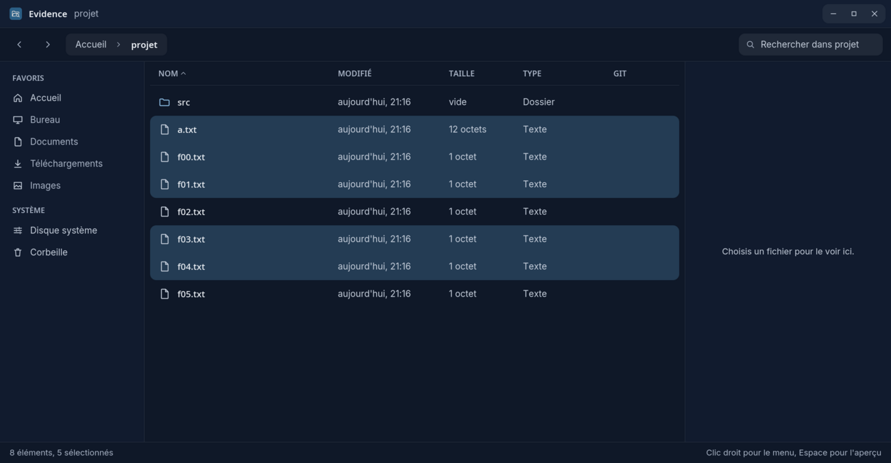 | 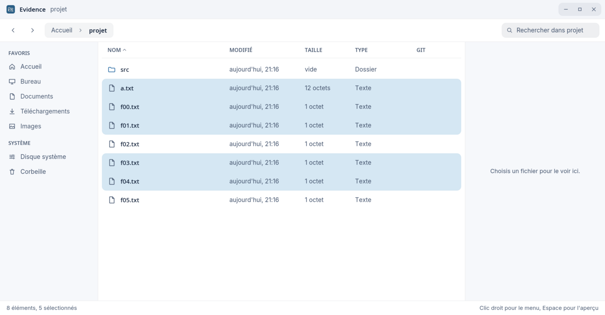 |

## Animations

Built on `sherlock_ui::motion`. The application subscribes to window frames only while one of
its animations runs (or during `--measure`), never at rest.

| What | How |
| --- | --- |
| Hover of rows, menu entries, sidebar entries, icon and secondary buttons | 150 ms fade of the hover veil (`sherlock_ui::animated::Hoverable`, which requests its own frames) |
| Selection | The highlight of an item selected alone glides from row to row on `PREVIEW_SPRING`; several items are drawn at once |
| Opening a folder | The rows rise 8 px and fade in over 150 ms |
| Context menu | Unfolds from its corner and folds back when it closes (lot E-01): scale from `panels::OPEN_SCALE` to 1 on `panels::OPEN_SPRING`, and a 150 ms fade, like the bar's panels. Its last entries are drawn while it folds back, without answering |
| Preview | Fades in over 150 ms when its content arrives |

iced 0.14 has no group opacity. A fade is a veil of the background colour laid over the
content and fading out. The context menu cannot use that trick (it floats over the list):
since lot E-01 it fades with `sherlock_ui::animated::Reveal` and `color::with_opacity`, which
the bar's panels use.

It used to open from its corner on a spring (`Scaled`, a transformation). Review 3 showed it
broken in a real window: a black rounded block with a greenish halo hid every entry but the
first, and cut the submenu. The cause is iced 0.14's software renderer: a quad's blurred
shadow is drawn as a separate image, computed in screen pixels and painted without the
current transformation and without the clip mask of the area being redrawn. Under the scale
transformation, the menu's shadow (`0 22px 54px`) came out as a large opaque block drawn over
the menu. Checked in an isolated Xephyr: with the scale removed and the blurred shadow kept,
the menu draws correctly. Two changes, for safety beyond this case:

- the menu has no scale animation any more (and `Scaled` is gone from sherlock-ui); lot E-01
  brings one back through `Reveal`, now that no menu shadow is an iced shadow in software: a
  capture halfway through unfolding, in the software renderer, checks that it has no black
  block (`menu_captures`);
- menus and floating panels no longer use iced shadows at all: `sherlock_ui::surface::Shadowed`
  draws a crisp, light shadow as a few plain offset rounded rectangles (ordinary quads,
  clipped and transformed like everything else), close to the design board's.
  Since D-02 this crisp shadow is only the software one: on the GPU, `Shadowed` draws the
  design board's blurred shadow (ADR 0018).

Nothing blinks.

## Start

Lot E-01, after Evidence took more than 10 s to show its window in the author's session.

- **Nothing on D-Bus before the window.** UDisks2 used to be reached while the application
  was built, before its window: a system bus slow to answer held the window back. `UDisks`
  now opens its connection on first use, off the interface thread, and every call runs on a
  thread of its own and gives up after `sherlock_ui::evidence::BUS_READ_TIMEOUT` (5 s, as the
  bar) for a read, `BUS_ACTION_TIMEOUT` (120 s, polkit may ask for a password) for a mount,
  unmount or eject. A bus that never answers leaves the devices out; the window and the folder
  come at once. The watcher thread waits for the bus as long as it takes, holding nothing
  else. Evidence reaches no other bus (the session bus is not used).
- **Each step logs when it ends**, with `RUST_LOG=evidence=info`: `renderer chosen`,
  `theme read`, `configuration read`, `application built`, `first view`, `window opened`,
  `folder listed`, `applications read`, `devices read`, counted from the start of the
  process (`startup`). In a hidden window on the reference laptop, debug build: first view at
  202 ms, window at 396 ms, folder and applications at 500 ms.
- Test: a bus socket that takes connections and never says a word; the application and its
  first view are ready in less than 500 ms, the devices are left out after the delay
  (`a_silent_bus_never_delays_the_first_view`).

The start in the author's session also had Mesa's shader cache threads (`disk`) running: if
the log shows the time going between `first view` and `window opened`, the renderer (wgpu
on the AMD chip) is the next suspect, not D-Bus.

## Performance

`evidence --measure <folder> [--maximized]` opens the folder, scrolls the list continuously
for 3 s, then moves the selection one row every 9 frames for 3 s, and logs each phase
(`RUST_LOG=evidence=info`). Frames are counted from iced's frame events: an interval longer
than 16.7 ms is a frame that misses 60 per second. Reference laptop, Plasma X11, 144 Hz
screen, release build, a folder of 5,000 files.

| Step | Open | Scroll | Selection animation |
| --- | --- | --- | --- |
| Before (first version) | 258 ms | 6.3 fps, p95 170 ms | 24 fps, p95 47 ms |
| Background reading, virtual list, cached labels | 46 ms | 12 fps, p95 96 ms | 108 fps, p95 49 ms |
| No clipped container per row | 49 ms | 12 fps | 110 fps |
| Window body drawn as the renderer's clear colour | 49 ms | 95 fps, p95 11 ms | 267 fps, p95 10 ms |
| Evidence, 1300 × 676 | 61 ms | 101 fps, p95 10.5 ms, 5 late frames | 285 fps, p95 9.9 ms, none late |
| Evidence, maximised (1920 × 1080 screen) | 49 ms | 50 fps, p95 21.8 ms, 148 late of 152 | 159 fps, p95 23 ms, 32 late |

What the profile showed (stack samples with gdb during the scroll): almost all the time is in
tiny-skia. iced's software renderer redraws, for every damaged rectangle of a frame and every
layer, every quad of that layer, through a clip mask as large as the window. A quad as large
as the window (the window body) was therefore filled again many times per frame; it is now
the clear colour of the renderer (`sherlock_ui::theme::window_theme`). Each clipped
container or extra stack layer also costs a full-window mask: rows do not clip (long names
are cut with "…" from an estimate of the width), and the code block does not clip (lines are
cut to the panel width).

Limit of the engine: in a maximised window, scrolling stays around 50 frames per second
(about 20 ms per frame), below the 60 required, with the software renderer imposed by
ADR 0014. The remaining cost is tiny-skia's: the sidebar and preview backgrounds and the title
bar are still quads, redrawn for every damaged rectangle. This lot does not change the engine.
The question of a GPU renderer (wgpu on the AMD chip) is for the author, as a revision of
ADR 0014: ADR 0018 (lot D-02) renders Evidence with wgpu on the AMD chip, and keeps tiny-skia
when there is none. Its measurements are in the ADR.

`cargo test --release -p evidence frame_cost -- --ignored` writes the headless cost of a frame
(view, layout, render) to `target/tmp/frame_cost.txt`.

## Comparing with the design board

1. Render the design board once, from a copy of `docs/design/planches/Fichiers.dc.html` saved as
   `board.html`: replace `/_blob/5a8a…` with `docs/design/images/sherlock-tete.png`, drop the
   `support.js` line, then
   `chromium --headless --disable-gpu --hide-scrollbars --window-size=1440,900 --screenshot=board.png board.html`.
   Crop the window: `(70, 64)` to `(1370, 740)`, 1300 × 676.
2. `cargo test -p evidence window_renders_headless` (see `scenarios.rs`) writes
   `target/tmp/evidence-tiny-skia.png`, at scale 2: the same folder as the design board (a git repo
   with a modified `src`, a new `Dockerfile`, an ignored `target`), Dockerfile selected, menu
   and submenu open where the design board has them. Scale it down to 1300 × 676.
3. Put the two side by side. The pair of this lot is in `docs/evidence/`.

The context menu was also checked in a real window, in an isolated Xephyr (`Xephyr :7 -screen
1300x676`), Evidence started with `DISPLAY=:7`, temporary `HOME`/XDG directories and neutral
fake applications, the pointer driven by XTest on `:7` only: `docs/evidence/menu-xephyr.png`
(menu open), `open-with-xephyr.png` (submenu open) and `open-with-xephyr-2s.png` (the same
two seconds later, pointer still).

On the author's laptop: `cargo run --release -p evidence -- <a git project>`, then compare
with the design board at 1440 × 900 (the window is 1300 × 676, as on the design board).

On the GPU (ADR 0018), the same capture rendered by wgpu on the AMD chip
(`ICED_TEST_BACKEND=wgpu` with the variables of ADR 0018): the menu and its submenu are drawn
whole, over the design board's blurred shadow.

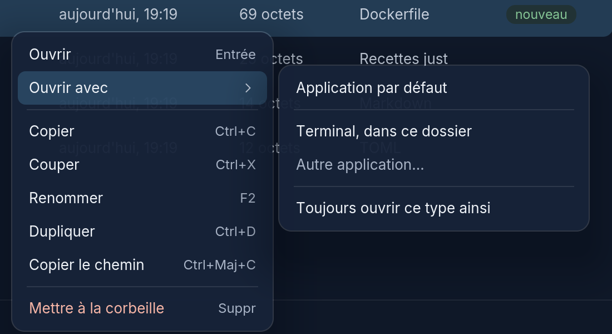

## Gaps with the design board

- No grid or column views: list only.
- No drag and drop of files, inside Evidence or to other applications. No renaming of several
  items at once.
- No "Ask Sherlock" button, Sherlock bubble, "Build the image" or "Run in a sandbox"
  buttons, no Dev section (Docker volumes, sandboxes): out of this lot's scope.
- « Ouvrir avec » is wider than the design board's submenu (280 instead of 216): application names
  and the "always" switch. The design board's « Éditeur » entry is the list of installed
  applications; its « Bac à sable » entry is out of scope.
- The open submenu entry uses the selection token at 0.26 (the design board has 0.30; see
  `docs/sherlock-ui.md`).
- A selected row's git badge sits on the darkest background: the design board's veil would fall
  under 4.5:1 contrast on the selection.
- The search field has no clear button. Column header letter spacing is not supported by iced.
- The sort arrow next to the sorted column is an addition, and so are Copier and Couper in
  the context menu.
- The design board has no Devices section: its entries use the sidebar's style, with an eject
  button in the style of sherlock-ui's icon buttons.
- No board draws the menu on the background with « Trier par » and « Vue », nor greyed
  entries: they take the style of the other entries and of a disabled control.

## Limits

- No folder watching: the list reloads after each operation, with F5 or Ctrl+R.
- The clipboard is internal: copy and cut between Evidence and another application are not
  shared (the path is copied to the system clipboard with Ctrl+Shift+C).
- Copy progress is a message in the status bar, without a percentage; a copy cannot be
  cancelled.
- The trash handles the home trash only: a file on another disk is refused with a message.
  `directorysizes` is not maintained yet (the specification makes it optional).
- Encrypted volumes show locked; unlocking them is not done yet.
- File types come from names (`globs2`); content sniffing (`magic`) is not done.
- Application icons are looked up in hicolor and pixmaps only, not in the current icon theme.
  Applications with `Terminal=true` are started directly, not in a terminal.
- Long names are cut from an estimated character width, not measured text.
- Accessibility: iced 0.14 exposes nothing to screen readers (ADR 0014).
- Left for later, from the second review: `type_of` (a walk over the `globs2` patterns, about
  0.3 ms in a debug build) still runs in `update` when the « Ouvrir avec » submenu opens; moving a
  folder across disks drops the sockets and devices it contains (with the "left aside"
  message); a dark trace of the menu shadow was seen under the menu in Xephyr.

## Tests

`just verify` runs them without a screen, on temporary folders. The trash, the XDG
directories and `mimeapps.list` used by the tests are in the temporary folder, never the
user's; no test calls the real UDisks.

- `ops`: copy (with links), named pipes recreated and never read, names that are not UTF-8,
  modification times kept, a failed copy that leaves nothing, no-replace rename, duplicate and
  name conflicts, folder into itself, move and refused move, rename and invalid names, new
  folder.
- `trash`: put and restore (folder recreated), two items with the same name, refused restore,
  emptying only the listed items, long names, orphan items, the deletion date from the record,
  path encoding.
- `git`: porcelain v2 parsing (renames, spaces, root prefix, whole ignored folder), a real
  repository, and a trapped repository that must run nothing.
- `listing`, `preview` (named pipe never opened, image decoded, broken image), `places`,
  `clock`, `icons`, `devices` (filtering, internal data partitions, naming, kinds, free space
  and errors from UDisks2 objects recorded with `busctl --json`, made anonymous, plus a USB key,
  an SD card and a LUKS disk in the same format).
- `scenarios`: keyboard navigation, copy/cut/paste and conflicts, rename and new folder, trash
  with restore and confirmed emptying, context menu from the keyboard, devices through a fake
  source, « Ouvrir avec » with fake applications and a default written to a temporary
  `mimeapps.list`, a headless capture of the window, double clicks on a selected or
  unselected item, slow clicks and clicks on two items, and captures of the title bar in
  `target/tmp/evidence-header-dark.png` and `-light.png` with the icon in its badge.
- The menu (lot E-01): its entries on an item, on several items and on the background, Coller
  greyed then not, the keyboard passing over greyed entries, « Trier par » and « Vue », a right
  click with the menu open, unfolding and folding back, the submenu on the left near the right
  edge, and captures in `target/tmp/evidence-menu-selection-dark-tiny-skia.png`, `-light-`,
  `evidence-menu-background-dark-` and `-light-` (« Trier par » open), and
  `evidence-menu-opening-` (halfway through unfolding).
- `selection` and its scenarios (lot E-01): clicks with Ctrl, Shift and both, ranges from the
  anchor, Shift and the arrows, select all, the lasso (threshold, rows crossed, Ctrl, the
  scroll at the edges, release, a press beside or on a name), Delete and F2 on several items,
  and captures of two selected runs in `target/tmp/evidence-selection-dark-tiny-skia.png` and
  `-light-` with pixels checked: no seam inside a run, rounded corners at its ends only.
- `sherlock_ui::animated`: the hover fade, and a reused row that starts from rest;
  `sherlock_ui::component`: no hover on a disabled control.
- `mime-apps`: see `docs/mime-apps.md`.

- **Menus in the bar** (`tests/menubar.rs`, `menubar.rs`): on a private bus with a fake
  registrar, the menus registered at `/MenuBar`, read as the bar reads them (the five menus,
  the favourites under « Aller »), « Nouveau dossier » clicked coming back as its command, a
  disabled « Copier » doing nothing until a selection enables it, which sends `LayoutUpdated`;
  without a registrar, the menus are only exported. The entries follow the state, and a layout
  carries labels, check marks and shortcuts.

## Theme

Evidence reads the theme of the appearance file before its first frame, then follows it live
and fades from one theme to the other (D-05b, see
"Following the theme" in `docs/sherlock-ui.md`): its iced theme is `window_theme()`, read again
at every redraw, and its view reads `color::palette()`. The capture test also writes
`target/tmp/evidence-light-tiny-skia.png`, to compare with the light Files board,
`docs/design/planches-clair/FichiersClair.dc.html`.

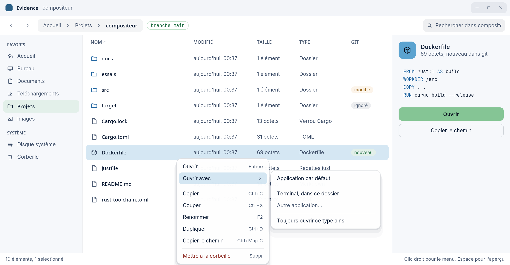

## Installing

`just install-evidence` builds Evidence in release and installs it for the user, without root:
`~/.local/bin/evidence`, and `desktop/evidence/evidence.desktop` in
`~/.local/share/applications` (or `$XDG_DATA_HOME/applications`) with that absolute path in
`Exec`, quoted as the desktop entry specification asks (a home folder with a space works), so
that it starts even when `~/.local/bin` is not in the `PATH` of the session. It takes the build
from `$CARGO_TARGET_DIR` when that variable is set. The dock
then pins it in place of the file manager of another desktop (`docs/dock.md`), and the launcher
lists it. The packages of the OS will install both in `/usr`.

## Manual procedure

On the author's laptop, Plasma X11:

1. `cargo run --release -p evidence -- <a git project>`. Check the list, the git badges, the
   branch, the preview of a text file and of an image.
2. Hover rows and buttons (150 ms fade), move with the arrows (the highlight glides), open a
   folder (rows rise and fade in), right-click (the menu scales in), hover « Ouvrir avec ».
3. In a scratch folder: copy, cut, paste, Ctrl+D, F2, Ctrl+Shift+N, Delete, then the trash:
   restore, then empty (the question appears; Escape cancels).
4. Right-click a text file, hover « Ouvrir avec »: the editors installed on the laptop are
   listed with their icon. Turn on "Toujours ouvrir ce type ainsi", pick one: it opens, and
   `~/.config/mimeapps.list` gains it under `[Default Applications]` (back the file up first;
   the other lines stay as they were). Enter on another file of the same type opens it with
   that application. « Autre application… » lists every application, with a search.
5. Plug in a USB key: it appears under Appareils. Click it: Plasma's polkit agent may ask for
   the password, then the key opens. Right-click: « Démonter », « Éjecter ». Click the eject button:
   the key disappears from the list and the status bar says it can be removed. With a file of
   the key open in another program, « Démonter » shows the "busy" message.
6. `RUST_LOG=evidence=info cargo run --release -p evidence -- --measure <folder of 5,000
   files> --maximized` and read the three `measure:` lines.
