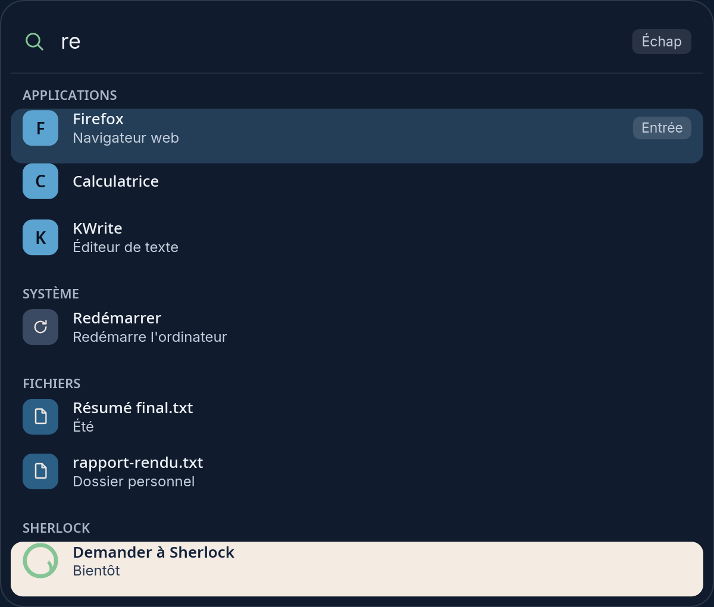

# Launcher

`desktop/launcher` is the desktop's application launcher: a search field that finds the
installed applications and starts them from the keyboard. It is a separate program started on
demand, shown above everything with layer-shell (ADR 0005), written with iced 0.14 and
`iced_exwlshell` 0.21.4 like the bar (`docs/bar.md`) and the dock (`docs/dock.md`). Batch
D-22a builds its core from the launcher of `Panneaux.dc.html`; D-22b adds the application
icons, the calculator, the system commands, the files and « Demander à Sherlock ». The crate,
the binary and the layer-shell namespace are all `launcher`. Its texts stay in French, from
`sherlock-ui`.





These come from the headless rendering tests (`tests/launcher.rs`, `tests/sources.rs`), at
scale 2, from the fixtures in `desktop/launcher/fixtures` and a fake personal folder. The
first three show the applications alone, as in D-22a.

## What it shows

| Element | Board | Launcher |
| --- | --- | --- |
| Panel | 600 wide, 150 below the screen top, padding 8, radius 20, glass `rgba(16,26,44,0.88)`, border `rgba(255,255,255,0.12)`, shadow `0 32px 80px` | Same, centered across the screen; blur and shadow are the compositor's job, as for the dock |
| Search row | 52 high, green magnifier of 20, query at 18, « Échap » key cap, line `rgba(255,255,255,0.08)` under it | Same; the board's hidden label « Rechercher ou lancer » is the placeholder |
| Section label | « Applications », « Réglages », « Fichiers », « Sherlock », 11 px semibold capitals, tertiary text, padding 10 10 4 | Same, with « Calculatrice » and « Système » (see Sections); letter spacing is a known gap of iced 0.14 (`docs/sherlock-ui.md`) |
| Result | 46 high, radius 10, tile of 30 at radius 8, name in medium weight, a 12 px line under it | Same; the line of an application is its `GenericName`; the selected row takes the selection blue and the « Entrée » key cap |
| Application icon | A line icon on a blue tile (« Conteneurs ») | The application's own icon, 30 px, from its icon theme (`icon-theme`); its initial on the blue tile when it has none |
| Other tiles | Settings: a cream glyph on `#3A4A63`; files: a cream document on `#2B5F86` | System commands on the settings tile, files and folders on the files tile, the calculator on the application tile; glyphs of 16 on the grid of `sherlock_ui::icon` |
| « Demander à Sherlock » | Cream row, Sherlock, title semibold `#14233B`, line `#2B3A54` « Tab pour lui passer la recherche » | Same, with the logo; « Bientôt » for now (see Sherlock); a blue ring of 2 when selected, which the board does not show |
| Nothing found | Not on the board | « Aucun résultat » in secondary text, one row high; it only shows without the Sherlock source, which always answers |

The light theme takes the light board's values: white glass at 0.88, night blue veils at the
same opacity. The launcher reads the theme of the appearance file once at start
(`appearance-config`, ADR 0019): it lives a few seconds and does not follow changes.

## Architecture

| Module | Role |
| --- | --- |
| `main.rs` | Renderer choice, logs, single instance, then `run` |
| `lib.rs` | Layer-shell surface, iced settings, theme, locales, sources, startup |
| `app.rs` | State (`Launcher`), messages, keys, update, view |
| `source.rs` | The `Source` trait, `Query`, `Hit`, `Tile`, `Action`, `Command`, `Power`, sections |
| `apps.rs` | The installed applications and their icons, a `Source` |
| `calc.rs` | The calculator: tokens, parser, writing a result, a `Source` |
| `system.rs` | The session commands, the `Session` trait and `Systemd`, a `Source` |
| `files.rs` | The walk of the personal folder in the background, a `Source` |
| `ask.rs` | « Demander à Sherlock », a `Source` |
| `search.rs` | Folding (case, accents), scoring a term, `Haystack` |
| `launch.rs` | Starting a program without a shell |
| `instance.rs` | The lock file that keeps one launcher at a time |

Every color, size and text comes from `sherlock_ui::launcher` (one new file and a `pub mod`
line): the geometry, `panel_height`, the launcher's own colors for each theme (`Colors::DARK`,
`Colors::LIGHT`), the styles `panel`, `divider`, `key`, `tile`, `row`, `query`, and the texts.
The rest comes from the palette of the active theme (`color::palette()`).

### Data: `mime-apps`, not the dock's reader

Both read desktop entries. `mime-apps` (D-27) is the one meant to be shared, the dock plans to
move onto it (`docs/dock.md`), and it already did more of what the launcher needs: folders
under `applications/` (`kde/org.kde.konsole.desktop`), localized names for the locales of
`LC_ALL`, `LC_MESSAGES` or `LANG`, `Hidden` entries masking the same id further down, `TryExec`,
and `Terminal=true` entries run in a terminal (left out when there is none). It lacked
`GenericName`, `Keywords` and `Path`: this batch adds them to its `DesktopEntry` (localized like
the name), and nothing else changes there. The launcher leaves out `NoDisplay` entries.

### Surface

Anchored to the top only, so the compositor centers it, with a top margin of 150 and an
exclusive zone of -1: the panel sits at the board's place whatever the bar reserves. Layer
`Overlay`, above the bar, the dock and the windows. The keyboard is `Exclusive`: the launcher
gets every key as soon as it maps, and the search field takes the focus at once. The surface is
exactly the panel: 600 wide, as high as `launcher::panel_height(sections, rows)`, and it is
resized (`LayoutChange`) when the number of results changes.

### Search

Every key typed in the field searches again: the first one already filters. An empty query (or
spaces only) shows no result, no section at all. A query is folded (lower case, accents removed: « É » is « e », « œ » is « oe ») and
split into terms; every term must be found. Each term is scored where it fits best:

| Where | Score |
| --- | --- |
| The whole name | 1000 |
| Start of the name | 900 |
| Start of a word of the name | 800 |
| Inside the name | 600 |
| The letters in order in the name (fuzzy) | 400, less 10 per letter skipped, 100 at least, plus 50 when the first starts a word |
| `GenericName` | The same, 100 less, only from the start of a word (800 and up) |
| `Keywords` | The same, 200 less, only from the start of a word |

Scattered letters only count in the name: in the longer generic names and keywords they matched
almost anything. A result's score is the sum over the terms. The order is stable and total:
score, then folded name, then desktop id. The files' order never matters (tested by reading
them backwards). Searching 500 applications takes well under 50 ms (tested, in a debug build).

## Sections

The sources answer in this order, each under its title (`launcher::arrange`):

| Section | Source | When |
| --- | --- | --- |
| « Calculatrice » | `calc.rs` | The query is an expression with at least one operation |
| « Applications » | `apps.rs` | As above |
| « Système » | `system.rs` | A term starts a word of the command's name or of its words |
| « Fichiers » | `files.rs` | Every term is inside the file's name |
| « Sherlock » | `ask.rs` | Always, last, when the query is not empty |

The board orders « Applications », « Réglages », « Fichiers », « Sherlock ». It has neither the
calculator nor the system commands: the calculator comes first, its single result being the
most precise answer to a query that is a calculation (and an expression rarely matches
anything else); the system commands take the place of the board's « Réglages », which have no
source yet. A section gives 5 results at most (`launcher::SECTION_RESULTS`), and the panel 9 in
all (`launcher::MAX_RESULTS`), which keeps it clear of the dock on the 900 high reference
screen with five sections (tested). Sherlock's row is reserved: the sources before it never
take it (`Source::reserved`).

### Calculator

`+ - * / ^ %`, parentheses, `×` and `÷`, decimals with a comma or a point (`1,5` and `1.5`).
Usual priorities, `^` to the right and above a unary minus (`-2^2` is -4). `%` is a modulo
between two operands (`7 % 3`) and a percent after one (`200 * 15%` is 30). A lone number is
no calculation; a division or modulo by zero, an invalid expression or a result out of range
give no result at all. Results have 12 significant digits, no trailing zeros, and an exponent
beyond 10¹⁵ or below 10⁻⁶; the separator is a comma, or a point when the query used one. The
parser is written by hand (recursive descent, 200 characters and 32 levels at most): no
dependency for so small a grammar.

Enter copies the result as shown:

- **With `wl-copy`** (`wl-clipboard`, looked up in `PATH` at start): run without a shell as
  `wl-copy -- <result>`, then the launcher closes. `wl-copy` stays in the background and keeps
  offering the text, so it can be pasted after the launcher is gone.
- **Without it**, iced's clipboard. On Wayland a selection lives as long as the program that
  offers it: the launcher stays open, the row says « Copié », until Escape. A clipboard manager
  (Klipper) takes the text over meanwhile.

### System commands

« Verrouiller », « Se déconnecter », « Redémarrer » and « Éteindre », found by the start of a
word of their name or of a few words (`eteindre`, `shutdown`, `reboot`, `deconnexion`…; never
by scattered letters). The launcher hands them to a `Session` (`system.rs`), never to the
program starter. `Systemd`, the real one, runs without a shell:

| Command | Program |
| --- | --- |
| « Verrouiller » | `loginctl lock-session <id>` |
| « Se déconnecter » | `loginctl terminate-session <id>` |
| « Redémarrer » | `systemctl reboot` |
| « Éteindre » | `systemctl poweroff` |

`<id>` is `$XDG_SESSION_ID`, or an empty argument, which `loginctl` reads as the caller's
session. Locking only asks logind to lock: the session needs a locker that listens (the lock
screen is a later batch). « Redémarrer » and « Éteindre » ask for confirmation: the first Enter
(or click) turns their line into « Appuie encore sur Entrée pour confirmer »; the second runs
the command. Moving the selection or typing cancels it. Without a session given (tests, or
`Launcher::new` alone), `NoSession` refuses every command and the launcher stays open.

### Files

The personal folder (`$HOME`) is walked once, on a thread of its own, as the launcher opens:
breadth first, 4 levels and 20 000 entries at most (the shallow ones first), leaving out hidden
entries (`.git`, `.cache`…) and the folders `node_modules`, `target`, `__pycache__`, `venv` and
`site-packages`; a symbolic link is listed, never followed. The MIME catalog of `mime-apps` is
read on the same thread. When the walk is done, the query is searched again
(`Message::Refresh`), so typing never waits for it. A file counts when every term is inside its
name (accents and case ignored, no scattered letters); the best score first, then the
shallowest. Its line is its folder under the personal one, « Projets, compositeur, src », or
« Dossier personnel ». Enter opens it with the default application of its type
(`Catalog::default_for`), a folder with the folder application; a type nobody opens is shown,
disabled. A real index (watching changes, more folders) is a later batch.

### Sherlock

« Demander à Sherlock » is always the last row when the query is not empty. sherlockd has no
interface for the shell yet, nor an option that takes a request: it knows `--demo`,
`--claude-code <request>` (a demonstration), `--proxy` and `--test-server`. The row is
therefore shown disabled, its line « Bientôt », and Enter does nothing. `ask::ASK_OPTION` names
the option once it exists (`--ask`): the row then runs `<terminal> -e sherlockd --ask
"<query>"`, the query in a single argument, without a shell (tested with the option set).

What the interface should provide, for the launcher and the rest of the shell:

- a way to hand over a request as typed, from another program of the session, without a shell
  and without a terminal: a socket of the user session (D-Bus or a Unix socket under
  `$XDG_RUNTIME_DIR`) with a call like `Ask(text) -> conversation id`;
- that Sherlock's own panel opens on that conversation, so the launcher can close at once;
- an error the launcher can show when sherlockd is not running;
- the board's « Tab pour lui passer la recherche »: Tab would hand over the query instead of
  Enter, once the call exists.

### Keyboard

| Key | Action |
| --- | --- |
| Letters | Typed in the field, results filtered |
| Down, Up | Next, previous result; they stop at both ends; they cancel a confirmation |
| Enter | Runs the selected result (starts, opens, copies, runs the session command), then the launcher closes; « Redémarrer » and « Éteindre » want a second Enter |
| Escape | Closes the launcher |

The first result is selected after every key. The keys are read with `event::listen_with`,
whatever the field did with them: iced's text field takes Escape for itself. A click on a result
starts it too.

« ki » then Enter starts Kitty: three keys after opening. The test types the two letters into
the field through the headless simulator, then sends Enter. Another test checks that every
application of the fixtures is the first result for two letters of its name.

### Starting a program

As in the dock: the `Exec` line is split and expanded by `mime-apps` (no files given, so file
field codes disappear), run without a shell, with the environment the launcher started with
minus its renderer choice (`sherlock_ui::gpu::for_child`, ADR 0018), in its own process group,
with no standard streams, in the entry's `Path` when it has one. `Terminal=true` entries run
in the terminal `mime-apps` picks (`$TERMINAL`, then the usual ones). The launcher closes
right after, and ignores any further Enter or click meanwhile, so a repeated key starts nothing
twice. If the start fails, it stays open and logs the error; a `Path` that is not a folder is
logged as such, apart from a missing program.

### One launcher at a time

The launcher is started on demand: by a keyboard shortcut of the compositor later, by hand for
now. Started again while open, it closes the open one: pressing the shortcut twice toggles it.

- The first launcher opens `$XDG_RUNTIME_DIR/launcher.lock` (without following a symbolic
  link), takes an exclusive `flock` on it without waiting, and writes its process id in it. It
  keeps the file open while it runs, and empties it when it closes normally (Escape, a start).
- A second one cannot take the lock. It reads the process id and checks that it is a launcher
  before sending anything: it pins the process with `pidfd_open`, compares its program
  (`/proc/<id>/exe`) with its own (`/proc/self/exe`), and only then sends `SIGTERM` through the
  pidfd (`pidfd_send_signal`). It then stops without showing anything.
- Why the check: a launcher closed by `SIGTERM` leaves its id in the file, and a second launcher
  may read the file before a new first one rewrote it. That id may belong to another process by
  now: it is never signalled. Should the id be reused between the check and the signal, the
  pidfd still names the dead process and nothing is sent. Only an id above 1 and other than its
  own is considered.
- A launcher whose program file was replaced since it started (a new build) reads as another
  program: the second start then does nothing and the open launcher stays until Escape.
- The kernel drops the lock when its holder ends, crash included: a stale file never blocks
  the next start. The file is opened close-on-exec, so started programs never inherit the lock.
- Without `XDG_RUNTIME_DIR` (or with a relative one, which the XDG specification ignores), or
  when the file cannot be opened, the launcher runs without the lock and logs a warning.

## Running it

```sh
cargo run -p launcher                 # in a Wayland session with layer-shell
RUST_LOG=launcher=debug cargo run -p launcher
```

## Limits

- The icons are looked up for 30 px at scale 2 (sharp on the author's screen); an XPM icon is
  not drawn, the initial shows instead.
- The files come from a bounded walk, not an index: past 4 levels or 20 000 entries, a file is
  not found.
- « Demander à Sherlock » is disabled until sherlockd takes requests from the shell.
- Without `wl-copy`, a copied result lives while the launcher is open, unless a clipboard
  manager takes it.
- The settings of the board's « Réglages » section have no source yet (Control Room).
- `OnlyShowIn` and `NotShowIn` are not checked (a limit of `mime-apps`).
- A click outside the panel does nothing: the surface is only the panel, and with the keyboard
  `Exclusive` the launcher keeps it until Escape or a start. To revisit with the compositor's
  shortcut.
- The `Comment` key is not read: the line under a name is its `GenericName`.
- Folding knows the composed accented letters only: a name written with combining accents
  (`e` then U+0301) is not folded. Desktop entries and typed text hardly use them.
- No real session was run for this batch: the author's machine rules forbade opening a window.
  The checks of the next section are still to do.

## Checks in a session

1. `cargo run -p launcher`: the panel appears 150 below the top, centered, above everything,
   and typing goes into the field without a click.
2. Type « ki », Enter: Kitty starts, the launcher closes.
3. Start it twice: the second start closes the first.
4. Escape closes it. `kill -9` it, start it again: it opens (the lock was released).

## Tests

`cargo test -p launcher`, on the fixtures only:

- applications: `NoDisplay`, `Hidden` and missing `TryExec` left out, `Terminal=true` only with
  a terminal, localized names, a subfolder;
- search: folding, the order of the tiers, the name before the generic name and the keywords,
  every term required, a stable order whatever the file order, the first key filtering, 500
  applications under 50 ms;
- keyboard: « ki » typed into the field then Enter starts Kitty and closes the launcher; every
  fixture reachable with two letters; arrows stop at the ends; a new query selects the first
  result; Escape closes; a click starts its result in its `Path`;
- start: no shell (a `;` in an argument stays in the file name), the working directory, a
  missing program and a missing working directory told apart, a second Enter or click after a
  start starting nothing;
- layout: the panel height for each state, the texts drawn, the surface's place, and three
  screenshots in `target/tmp`;
- sources (`tests/sources.rs`): the order of the sections (applications, system, files,
  Sherlock last; the calculator first), an empty query showing nothing, 5 results a section and
  9 in all with Sherlock's row kept, a disabled Sherlock doing nothing; « Éteindre » and
  « Redémarrer » waiting for a second Enter, an arrow cancelling it, « Verrouiller » and « Se
  déconnecter » at once, all through a fake session, the program starter never called; the
  `loginctl` and `systemctl` commands built and never run, a launcher without a session
  refusing them; the copy through `wl-copy -- <result>` (recorded) or iced's clipboard; files
  with accents, hidden and heavy folders, level 5 and links left out, the open command of a
  file and of a folder, a type nobody opens disabled; the walk stopped at 20 000 and run in the
  background; an application's icon from a fake `hicolor`; three more screenshots;
- calculator (`calc.rs`): priorities, `^` to the right, unary minus, modulo and percent, comma
  and point, division by zero, invalid expressions, a lone number, deep nesting, the writing of
  results;
- « Demander à Sherlock » (`ask.rs`): disabled without the option, the query in one argument
  with it.
- single instance: the lock taken, our own id never signalled, a stand-in launcher (a copy of
  the test program) closed by `SIGTERM`, the file emptied by a normal close and the lock free
  again, a live `sleep` and a dead id never signalled, a linked lock file refused, odd file
  contents signalling nobody.

`cargo test -p sherlock-ui launcher`: contrast of the texts on the panel, on the selected row
and on Sherlock's row in both themes, of the glyphs on their tiles, the glyphs inside the grid,
and the panel height with five sections.

## Open questions

- **Icons.** `desktop/icon-theme` (D-22b, `docs/icon-theme.md`) is the shared lookup; the dock
  and Evidence should move onto it in a batch of their own (they were being changed by another
  batch meanwhile).
- **Locales.** `launcher::locales` repeats the function Evidence keeps private; it could move to
  `mime-apps` with that same batch.
