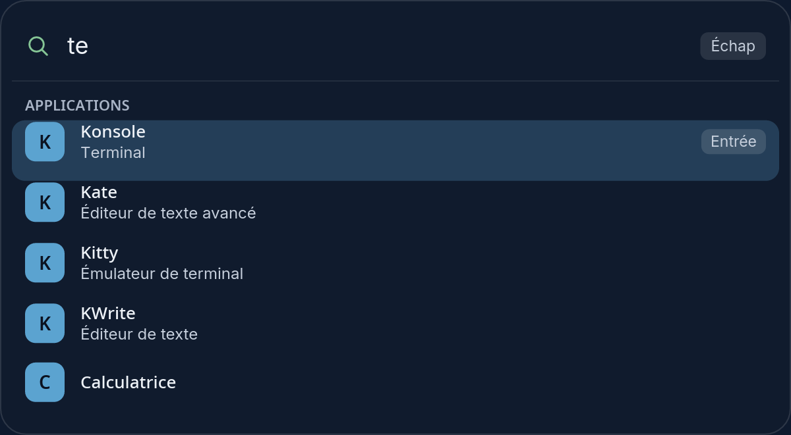
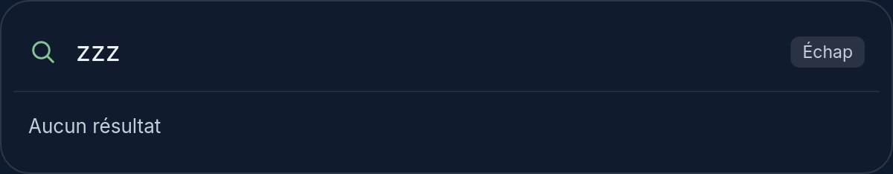
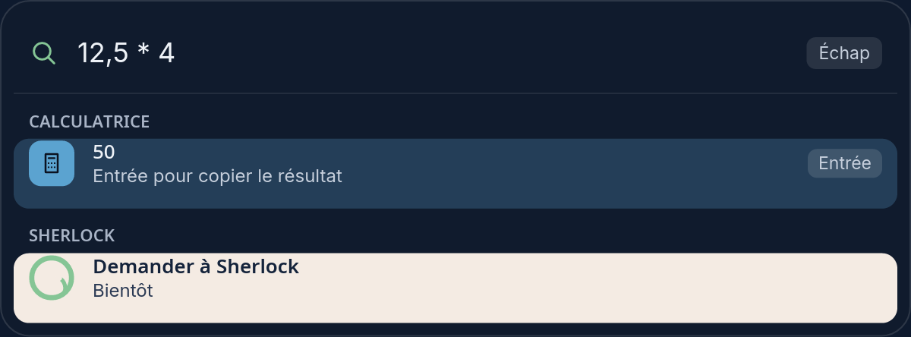
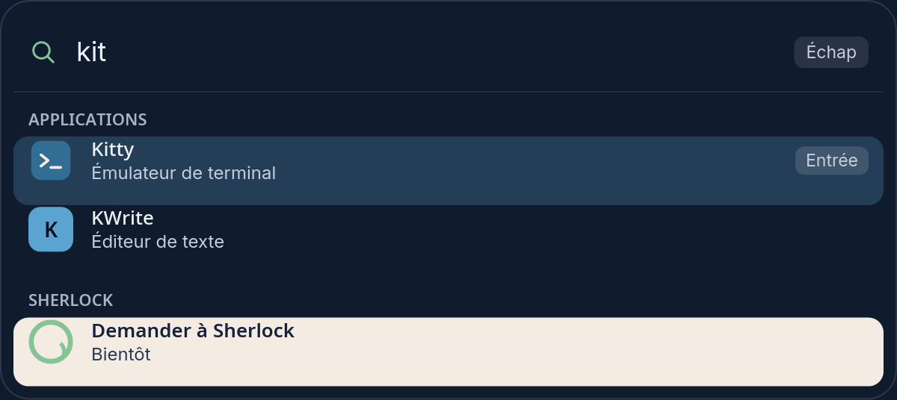
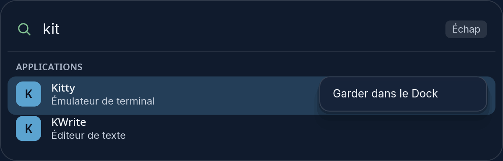

# Launcher

`desktop/launcher` is the desktop's application launcher: a search field that finds the
installed applications and starts them from the keyboard. It is a separate program, resident:
started with the session and kept in memory, its surface shown and hidden at once (lot P-02, see
Resident service), above everything with layer-shell (ADR 0005), written with iced 0.14 and
`iced_exwlshell` 0.21.4 like the bar (`docs/bar.md`) and the dock (`docs/dock.md`). Batch
D-22a builds its core from the launcher of `Panneaux.dc.html`; D-22b adds the application
icons, the calculator, the system commands, the files and « Demander à Sherlock ». The crate,
the binary and the layer-shell namespace are all `launcher`. Its texts stay in French, from
`sherlock-ui`.











These come from the headless rendering tests (`tests/launcher.rs`, `tests/sources.rs`), at
scale 2, from the fixtures in `desktop/launcher/fixtures` and a fake personal folder. The
first three show the applications alone, as in D-22a.

## What it shows

| Element | Board | Launcher |
| --- | --- | --- |
| Panel | 600 wide, 150 below the screen top, padding 8, radius 20, glass `rgba(16,26,44,0.88)`, border `rgba(255,255,255,0.12)`, shadow `0 32px 80px` | Same, centered across the screen; blur and shadow are the compositor's job, as for the dock |
| Search row | 52 high, green magnifier of 20, query at 18, « Échap » key cap, line `rgba(255,255,255,0.08)` under it | Same; the board's hidden label « Rechercher ou lancer » is the placeholder |
| Section label | « Applications », « Réglages », « Fichiers », « Sherlock », 11 px semibold capitals, tertiary text, padding 10 10 4 | Same, with « Calculatrice » and « Système » (see Sections); letter spacing is a known gap of iced 0.14 (`docs/sherlock-ui.md`) |
| Result | 46 high, radius 10, tile of 30 at radius 8, name in medium weight, a 12 px line under it | Same; the line of an application is its `GenericName`; the selected row takes the selection blue and the « Entrée » key cap |
| Application icon | A line icon on a blue tile (« Conteneurs ») | The application's own icon, 30 px, from its icon theme (`icon-theme`); its initial on the blue tile when it has none |
| Other tiles | Settings: a cream glyph on `#3A4A63`; files: a cream document on `#2B5F86` | System commands on the settings tile, files and folders on the files tile, the calculator on the application tile; glyphs of 16 on the grid of `sherlock_ui::icon` |
| « Demander à Sherlock » | Cream row, Sherlock, title semibold `#14233B`, line `#2B3A54` « Tab pour lui passer la recherche » | Same, with the logo; « Bientôt » for now (see Sherlock); a blue ring of 2 when selected, which the board does not show |
| Nothing found | Not on the board | « Aucun résultat » in secondary text, one row high; it only shows without the Sherlock source, which always answers |

The light theme takes the light board's values: white glass at 0.88, night blue veils at the
same opacity. The launcher reads the theme of the appearance file (`appearance-config`, ADR
0019) before its first frame, then follows it: a resident launcher lives as long as the session.

## Architecture

| Module | Role |
| --- | --- |
| `main.rs` | The press handed to the service, renderer choice, logs, single instance, then `run` |
| `lib.rs` | Layer-shell surface, iced settings, theme, locales, sources, startup |
| `app.rs` | State (`Launcher`), messages, keys, update, view |
| `source.rs` | The `Source` trait, `Query`, `Hit`, `Tile`, `Action`, `Command`, `Power`, sections |
| `apps.rs` | The installed applications and their icons, a `Source` |
| `calc.rs` | The calculator: tokens, parser, writing a result, a `Source` |
| `system.rs` | The session commands, the `Session` trait and `Systemd`, a `Source` |
| `files.rs` | The walk of the personal folder in the background, a `Source` |
| `ask.rs` | « Demander à Sherlock », a `Source` |
| `search.rs` | Folding (case, accents), scoring a term, `Haystack` |
| `launch.rs` | Starting a program without a shell |
| `instance.rs` | The lock file that keeps one launcher at a time, without the service |
| `service.rs` | The resident service: its socket, its lock, the requests (lot P-02) |
| `startup.rs` | The timing of the start, of each opening and of the animations, in the log |

Every color, size and text comes from `sherlock_ui::launcher` (one new file and a `pub mod`
line): the geometry, `panel_height`, the launcher's own colors for each theme (`Colors::DARK`,
`Colors::LIGHT`), the styles `panel`, `divider`, `key`, `tile`, `row`, `query`, and the texts.
The rest comes from the palette of the active theme (`color::palette()`).

### Data: `mime-apps`, not the dock's reader

Both read desktop entries. `mime-apps` (D-27) is the one meant to be shared, the dock plans to
move onto it (`docs/dock.md`), and it already did more of what the launcher needs: folders
under `applications/` (`kde/org.kde.konsole.desktop`), localized names for the locales of
`LC_ALL`, `LC_MESSAGES` or `LANG`, `Hidden` entries masking the same id further down, `TryExec`,
and `Terminal=true` entries run in a terminal (left out when there is none). It lacked
`GenericName`, `Keywords` and `Path`: this batch adds them to its `DesktopEntry` (localized like
the name), and nothing else changes there. The launcher leaves out `NoDisplay` entries.

### Surface

**Resident, on the GPU** (lot P-02): the surface covers the screen, anchored to its four edges,
transparent, layer `Overlay`, exclusive zone -1, the keyboard `Exclusive`. The panel sits at the
same place as below, centred, 150 below the top. A click anywhere beside the panel, on the
desktop, a window, the bar or the dock, closes the launcher with its closing animation, and goes
no further: the surface takes it, as Spotlight does. Its input region is the whole screen; the
panel's own room (its padding, its labels) is not « beside ». A surface drawn in software has no
alpha (ADR 0018): there the launcher keeps the surface below, the panel alone, and a click
beside it does nothing. Which one a service uses is known before the first opening, from the
surface that readies the renderer (see Resident service).

**Otherwise**: anchored to the top only, so the compositor centers it, with a top margin of 150 and an
exclusive zone of -1: the panel sits at the board's place whatever the bar reserves. Layer
`Overlay`, above the bar, the dock and the windows. The keyboard is `Exclusive`: the launcher
gets every key as soon as it maps, and the search field takes the focus at once. The surface is
exactly the panel: 600 wide, as high as `launcher::panel_height(sections, rows)`, and it is
resized (`LayoutChange`) when the number of results changes.

### Search

Every key typed in the field searches again: the first one already filters. An empty query (or
spaces only) shows no result, no section at all. A query is folded (lower case, accents removed: « É » is « e », « œ » is « oe ») and
split into terms; every term must be found. Each term is scored where it fits best:

| Where | Score |
| --- | --- |
| The whole name | 1000 |
| Start of the name | 900 |
| Start of a word of the name | 800 |
| Inside the name | 600 |
| The letters in order in the name (fuzzy) | 400, less 10 per letter skipped, 100 at least, plus 50 when the first starts a word |
| `GenericName` | The same, 100 less, only from the start of a word (800 and up) |
| `Keywords` | The same, 200 less, only from the start of a word |

Scattered letters only count in the name: in the longer generic names and keywords they matched
almost anything. A result's score is the sum over the terms. The order is stable and total:
score, then folded name, then desktop id. The files' order never matters (tested by reading
them backwards). Searching 500 applications takes well under 50 ms (tested in a debug build, best of 5 runs).

## Sections

The sources answer in this order, each under its title (`launcher::arrange`):

| Section | Source | When |
| --- | --- | --- |
| « Calculatrice » | `calc.rs` | The query is an expression with at least one operation |
| « Applications » | `apps.rs` | As above |
| « Système » | `system.rs` | The query starts the command's name, or is one of its keywords in full |
| « Fichiers » | `files.rs` | Every term is inside the file's name |
| « Système » | `system.rs` | The same section, here when the commands are found by a keyword only |
| « Sherlock » | `ask.rs` | Always, last, when the query is not empty |

The board orders « Applications », « Réglages », « Fichiers », « Sherlock ». It has neither the
calculator nor the system commands: the calculator comes first, its single result being the
most precise answer to a query that is a calculation (and an expression rarely matches
anything else); the system commands take the place of the board's « Réglages », which have no
source yet. A command found only by a keyword (`logout`) is a weaker guess than a file whose
name holds the query: its section then comes after the files. A section gives 5 results at most (`launcher::SECTION_RESULTS`), and the panel 9 in
all (`launcher::MAX_RESULTS`), which keeps it clear of the dock on the 900 high reference
screen with five sections (tested). Sherlock's row is reserved: the sources before it never
take it (`Source::reserved`).

### Calculator

`+ - * / ^ %`, parentheses, `×` and `÷`, decimals with a comma or a point (`1,5` and `1.5`).
Usual priorities, `^` to the right and above a unary minus (`-2^2` is -4). `%` is a modulo
between two operands (`7 % 3`) and a percent after one (`200 * 15%` is 30). A lone number is
no calculation; a division or modulo by zero, an invalid expression or a result out of range
give no result at all. Results have 12 significant digits, no trailing zeros, and an exponent
beyond 10¹⁵ or below 10⁻⁶; the separator is a comma, or a point when the query used one. The
parser is written by hand (recursive descent, 200 characters and 32 levels at most): no
dependency for so small a grammar.

Enter copies the result as shown:

- **With `wl-copy`** (`wl-clipboard`, looked up in `PATH` at start): run without a shell as
  `wl-copy -- <result>`, then the launcher closes. `wl-copy` stays in the background and keeps
  offering the text, so it can be pasted after the launcher is gone.
- **Without it**, iced's clipboard. On Wayland a selection lives as long as the program that
  offers it: the launcher stays open, the row says « Copié », until Escape. A clipboard manager
  (Klipper) takes the text over meanwhile.

### System commands

« Verrouiller », « Se déconnecter », « Redémarrer » and « Éteindre ». A command is offered
only when the query (folded, its words joined by one space) starts its name as shown (« se d »,
« étein », « Redém ») or is one of its keywords in full (`deconnexion`, `logout`, `quitter`,
`reboot`, `shutdown`…). A query that only looks like one, « logo », « déco » or « quit », offers
nothing: these commands must never sit first on an ordinary search. The launcher hands them to a `Session` (`system.rs`), never to the
program starter. `Systemd`, the real one, runs without a shell:

| Command | Program |
| --- | --- |
| « Verrouiller » | `loginctl lock-session <id>` |
| « Se déconnecter » | `loginctl terminate-session <id>` |
| « Redémarrer » | `systemctl reboot` |
| « Éteindre » | `systemctl poweroff` |

`<id>` is `$XDG_SESSION_ID`, or an empty argument, which `loginctl` reads as the caller's
session. `Systemd` reads the exit code for 300 ms (`REFUSAL_WAIT`, Q-43): a refusal of logind
or polkit is a `LaunchError::Refused` with its reason (the bar shows « Refusé »; the launcher
stays open and logs it); a command still running then is reaped by a thread. Locking only asks logind to lock: the session needs a locker that listens (the lock
screen is a later batch). Everything but locking loses unsaved work, so « Se déconnecter »,
« Redémarrer » and « Éteindre » ask for confirmation: the first Enter (or click) turns their
line into « Appuie encore sur Entrée pour confirmer »; a second one runs the command, if it is
a new press at least 400 ms later (`launcher::CONFIRM_DELAY`). A held Enter repeats nothing
(the compositor repeats keys after 200 ms: a repeated Enter is ignored altogether), and a
double click or a key bounce only arms the command. Moving the selection, typing, or the end of
the files' walk cancels it. Without a session given (tests, or
`Launcher::new` alone), `NoSession` refuses every command and the launcher stays open.

### Files

The personal folder (`$HOME`) is walked once, on a thread of its own, as the launcher opens:
breadth first, 4 levels and 20 000 entries at most (the shallow ones first), leaving out hidden
entries (`.git`, `.cache`…) and the folders `node_modules`, `target`, `__pycache__`, `venv` and
`site-packages`; a symbolic link is listed, never followed, and so is a folder on another
device (`st_dev` differs from the personal folder's: a USB disk, a network share that may
hang). A folder is read no further than the room left under the 20 000 entries. The MIME catalog of `mime-apps` is
read on the same thread. When the walk is done, the query is searched again
(`Message::Refresh`), so typing never waits for it. A file counts when every term is inside its
name (accents and case ignored, no scattered letters); the best score first, then the
shallowest. Its line is its folder under the personal one, « Projets, compositeur, src », or
« Dossier personnel ». Enter opens it with the default application of its type
(`Catalog::default_for`), a folder with the folder application; a type nobody opens is shown,
disabled. A real index (watching changes, more folders) is a later batch.

### Sherlock

« Demander à Sherlock » is always the last row when the query is not empty. sherlockd has no
interface for the shell yet, nor an option that takes a request: it knows `--demo`,
`--claude-code` (a demonstration, its request on standard input), `--proxy` and
`--test-server`. The row is therefore shown disabled, its line « Bientôt », and Enter does
nothing. `ask::ASK_OPTION` names the option once it exists (`--ask`): the row then runs
`<terminal> -e sherlockd --ask <file>`, without a shell (tested with the option set). The query
is never in the arguments, which every local account reads (`ps`, `/proc/*/cmdline`, S-11): it
is written when the row is chosen into a new file of `$XDG_RUNTIME_DIR/sherlockd-requests/`,
0600 from its creation in 0700 folders, which sherlockd reads then removes.

What the interface should provide, for the launcher and the rest of the shell:

- a way to hand over a request as typed, from another program of the session, without a shell
  and without a terminal: a socket of the user session (D-Bus or a Unix socket under
  `$XDG_RUNTIME_DIR`) with a call like `Ask(text) -> conversation id`;
- that Sherlock's own panel opens on that conversation, so the launcher can close at once;
- an error the launcher can show when sherlockd is not running;
- the board's « Tab pour lui passer la recherche »: Tab would hand over the query instead of
  Enter, once the call exists.

### Keyboard

| Key | Action |
| --- | --- |
| Letters | Typed in the field, results filtered |
| Down, Up | Next, previous result; they stop at both ends; they cancel a confirmation |
| Enter | Runs the selected result (starts, opens, copies, runs the session command), then the launcher closes; « Redémarrer » and « Éteindre » want a second Enter |
| Escape | Closes the launcher |

Every opening fades the panel in from a scale of 0.96, around the middle of its top edge
(`launcher::OPEN_SCALE`, `OPEN_SPRING`), and every closing, whatever its cause (Escape, a start,
a click beside, the shortcut again, the applications view opening), fades it out the same way
before the surface goes. Frames are asked for only while it moves.

The first result is selected after every key. The keys are read with `event::listen_with`,
whatever the field did with them: iced's text field takes Escape for itself. A click on a result
starts it too.

« ki » then Enter starts Kitty: three keys after opening. The test types the two letters into
the field through the headless simulator, then sends Enter. Another test checks that every
application of the fixtures is the first result for two letters of its name.

### Keeping an application in the dock

A right click on an application opens its menu inside its row, on the right, so that it never
leaves the panel: « Garder dans le Dock », or « Retirer du Dock » when it is pinned (D-41).
Pinning goes through `dock::pins`, as in the applications view (`docs/apps.md`). Any other key
or click closes the menu; Escape closes it alone.



### Starting a program

As in the dock: the `Exec` line is split and expanded by `mime-apps` (no files given, so file
field codes disappear), run without a shell, with the environment the launcher started with
minus its renderer choice (`sherlock_ui::gpu::for_child`, ADR 0018), in its own process group,
with no standard streams, in the entry's `Path` when it has one. `Terminal=true` entries run
in the terminal `mime-apps` picks (`$TERMINAL`, then the usual ones). The launcher closes
right after, and ignores any further Enter or click meanwhile, so a repeated key starts nothing
twice. If the start fails, it stays open and logs the error; a `Path` that is not a folder is
logged as such, apart from a missing program.

### Resident service

Starting a program on each press cost about 200 ms before the panel showed, most of it in the
renderer (Vulkan, wgpu, its pipelines) and the fonts (see Performance). So the session starts
`launcher --resident` with the bar and the dock, and starts it again if it stops, as it does for
them (`sherlockos-session`). The service:

- takes `$XDG_RUNTIME_DIR/launcher.service.lock` (one service at a time, dropped by the kernel
  with its holder) and listens on `$XDG_RUNTIME_DIR/launcher.sock`, replacing a socket left by
  a service that died; the runtime folder is the user's alone (0700);
- opens no panel, but draws once a surface of one pixel, on the background layer, without input
  nor keyboard, then removes it: the renderer, its pipelines, the fonts and the SVG renderer are
  ready before the first press, and the service knows whether the GPU draws;
- shows the panel on `toggle` when it is hidden, and hides it otherwise (`hide` only hides); the
  process, the renderer and the fonts stay;
- creates its surface at the first opening; once the panel faded out, parks it rather than
  removing it: one transparent pixel in a corner, on the background layer, without the keyboard,
  its text field let go (its caret would blink, and draw the surface again). Its renderer keeps
  what it drew: glyphs, shaped texts, layout. Shown again, the surface is anchored back to the
  four edges, on the `Overlay` layer, with the keyboard: its first frame comes about 10 ms after
  the press, where a new surface took 75 ms. In software the panel's own surface is removed, as
  before, since a parked pixel would show black;
- opens with an empty search, the first result selected, no menu, no confirmation armed, as a
  new launcher would; it reads the applications again and walks the files again at each opening,
  on a thread of the pool (the first opening uses those read at start);
- asks the applications view's service to hide as it opens (`hide`), and the view does the same:
  two overlays never fight for the keyboard.

The compositor's shortcut, **Super + Space** (Alt + Space in nested mode, where the host keeps
Super), still starts `launcher`. Right after choosing its renderer (ADR 0018: a few files of
`/sys`, under a millisecond) and before anything that costs, that program connects to the socket, sends `toggle`, waits for `ok` (1 s at most) and stops. Without a service
listening, it runs on its own, as below.

iced_exwlshell 0.21 reports no keyboard focus to the program: the launcher cannot see it leave.
With its surface over the screen and the keyboard `Exclusive`, only the compositor can take it
away: the lock screen (which hides everything anyway), or the applications view, which hides the
launcher as it opens.

### One launcher at a time, without the service

Without a service (another compositor, a session started by hand), the launcher is started on
demand. Started again while open, it closes the open one: pressing the shortcut twice toggles it. The compositor starts
`$SHERLOCKOS_BIN/launcher` when that file exists, `launcher` in the session's `PATH` otherwise,
with its Wayland socket and X11 display (`compositor/src/launcher.rs`, lot C-01). The shortcut
does not open Mission Control: the gesture key is no longer alone when it is released.

- The first launcher opens `$XDG_RUNTIME_DIR/launcher.lock` (without following a symbolic
  link), takes an exclusive `flock` on it without waiting, and writes its process id in it. It
  keeps the file open while it runs, and empties it when it closes normally (Escape, a start).
- A second one cannot take the lock. It reads the process id and checks that it is a launcher
  before sending anything: it pins the process with `pidfd_open`, compares its program
  (`/proc/<id>/exe`) with its own (`/proc/self/exe`), and only then sends `SIGTERM` through the
  pidfd (`pidfd_send_signal`). It then stops without showing anything.
- Why the check: a launcher closed by `SIGTERM` leaves its id in the file, and a second launcher
  may read the file before a new first one rewrote it. That id may belong to another process by
  now: it is never signalled. Should the id be reused between the check and the signal, the
  pidfd still names the dead process and nothing is sent. Only an id above 1 and other than its
  own is considered.
- A launcher whose program file was replaced since it started (a new build) reads as another
  program: the second start then does nothing and the open launcher stays until Escape.
- The kernel drops the lock when its holder ends, crash included: a stale file never blocks
  the next start. The file is opened close-on-exec, so started programs never inherit the lock.
- Without `XDG_RUNTIME_DIR` (or with a relative one, which the XDG specification ignores), or
  when the file cannot be opened, the launcher runs without the lock and logs a warning.

## Performance

Lot P-02, after the author found the launcher slow to appear. Measured on the reference laptop
(Ryzen 7, AMD Renoir chip, Vulkan through RADV), release builds, in a headless KWin 6.3
(`kwin_wayland --virtual`, 1920 × 1080) inside `bwrap` with a `/dev/dri` holding only the AMD
render node, a D-Bus of its own and a temporary home: nothing reached the author's screen, and no
NVIDIA device existed in the sandbox. The applications are the author's (203 desktop entries,
the `kora` icon theme). A frame is shown when the program commits a buffer to its surface, read
from `WAYLAND_DEBUG` (whose printing slows the program a little); other builds ran on the machine
meanwhile.

| From the press to the first frame | Before: a new program | After: the resident service |
| --- | --- | --- |
| First press | 274 ms | 83 ms (the surface created) |
| Next presses | 205 to 218 ms, median 208 ms (5 runs) | 8.7 to 19 ms, median 10.2 ms (7 runs, the surface parked) |

The first frame is drawn transparent, at the start of the opening: the panel shows from the next
one, 17 ms later.

Where the 208 ms went, from the program's own log (`startup.rs`) and the `startup` example of
sherlock-ui (`cargo run --release -p sherlock-ui --example startup`):

| Step | Time |
| --- | --- |
| Start of the process to the renderer choice | 0.3 ms |
| Desktop entries read (`mime-apps`) | 20 to 22 ms |
| Vulkan instance | 14 to 18 ms |
| Adapter | 4 to 5 ms |
| Device | 14 to 15 ms (172 ms the first time after the machine started) |
| iced's pipelines (shaders) | 28 to 29 ms |
| System fonts, read by iced's text (2,694 faces here), then again by its SVG renderer | 64 ms, twice |
| The process started to its first view (Wayland, all of the GPU steps) | 134 ms |
| First view to first frame (fonts, layout, drawing) | 73 ms |

The GPU steps and the fonts come from the `startup` example, without a window, 3 runs; the
others from the launcher's own log, 5 runs.

The service pays all of it once, at the start of the session: its surface of one pixel is drawn
280 ms after the process starts (6.4 s once, on a machine busy with other builds: the start does
not block the session). An opening then only brings its surface back and draws it.

| Animation, frames | Median interval | 95th percentile | Longest |
| --- | --- | --- | --- |
| Opening (18 to 23 frames, 8 runs) | 16.5 to 16.8 ms | 17.3 to 17.8 ms | 23.4 ms |
| Closing (22 to 23 frames, 8 runs) | 16.5 to 16.9 ms | 17.2 to 17.6 ms | 17.9 ms |

At rest, hidden: no frame and no CPU time in 5 s. Shown and still, the text field's caret
blinks: iced draws the surface again twice a second for it. Memory of the service, hidden:
87 MiB resident, 64 MiB proportional (shared libraries counted in part); a launcher started on
demand took 74 to 80 MiB while it was open, and nothing once closed.

The same figures come into the session's log: `start` lines (each step, `took_ms`, `at_ms`) and,
after each opening or closing, a `frames` line (frame count, median, 95th percentile, longest).

## Running it

```sh
cargo run -p launcher                 # in a Wayland session with layer-shell
cargo run -p launcher -- --resident   # the service, hidden; `launcher` then shows or hides it
RUST_LOG=launcher=debug cargo run -p launcher
```

## Limits

- The icons are looked up for 30 px at scale 2 (sharp on the author's screen); an XPM icon is
  not drawn, the initial shows instead.
- The files come from a bounded walk, not an index: past 4 levels or 20 000 entries, a file is
  not found.
- « Demander à Sherlock » is disabled until sherlockd takes requests from the shell.
- Without `wl-copy`, a copied result lives while the launcher is open, unless a clipboard
  manager takes it; since the launcher keeps the keyboard, it cannot be pasted elsewhere
  meanwhile. `wl-clipboard` is not yet a package of the image (`distro/`): to add with the
  system track.
- The settings of the board's « Réglages » section have no source yet (Control Room).
- `OnlyShowIn` and `NotShowIn` are not checked (a limit of `mime-apps`).
- In software (no GPU, or a compositor without `linux-dmabuf`), or without the service, the
  surface is only the panel: a click outside it does nothing, and the launcher keeps the
  keyboard until Escape or a start.
- The loss of the keyboard focus is not seen (iced_exwlshell does not report it); see Resident
  service.
- The `Comment` key is not read: the line under a name is its `GenericName`.
- Folding knows the composed accented letters only: a name written with combining accents
  (`e` then U+0301) is not folded. Desktop entries and typed text hardly use them.
- No real session was run for this batch: the author's machine rules forbade opening a window.
  The checks of the next section are still to do.

## Checks in a session

1. `cargo run -p launcher`: the panel appears 150 below the top, centered, above everything,
   and typing goes into the field without a click.
2. Type « ki », Enter: Kitty starts, the launcher closes.
3. Start it twice: the second start closes the first.
4. Escape closes it. `kill -9` it, start it again: it opens (the lock was released).

## Tests

`cargo test -p launcher`, on the fixtures only:

- applications: `NoDisplay`, `Hidden` and missing `TryExec` left out, `Terminal=true` only with
  a terminal, localized names, a subfolder;
- search: folding, the order of the tiers, the name before the generic name and the keywords,
  every term required, a stable order whatever the file order, the first key filtering, 500
  applications under 50 ms;
- keyboard: « ki » typed into the field then Enter starts Kitty and closes the launcher; every
  fixture reachable with two letters; arrows stop at the ends; a new query selects the first
  result; Escape closes; a click starts its result in its `Path`;
- start: no shell (a `;` in an argument stays in the file name), the working directory, a
  missing program and a missing working directory told apart, a second Enter or click after a
  start starting nothing;
- layout: the panel height for each state, the texts drawn, the surface's place, and three
  screenshots in `target/tmp`;
- sources (`tests/sources.rs`): the order of the sections (applications, system, files,
  Sherlock last; the calculator first), an empty query showing nothing, 5 results a section and
  9 in all with Sherlock's row kept, a disabled Sherlock doing nothing; « Se déconnecter »,
  « Éteindre » and « Redémarrer » waiting for a second Enter at least 400 ms later, an arrow
  cancelling it, « Verrouiller » at once, a held Enter (`repeat`) and a double click never
  confirming, all through a fake session, the program starter never called; « logo », « déco »,
  « quit » offering no command, a command found by its name before the files and by a keyword
  after them; the
  `loginctl` and `systemctl` commands built and never run, a launcher without a session
  refusing them; the copy through `wl-copy -- <result>` (recorded) or iced's clipboard; files
  with accents, hidden and heavy folders, level 5 and links left out, the open command of a
  file and of a folder, a type nobody opens disabled; the walk stopped at 20 000, never
  entering another device, and run in the background; an application's icon from a fake `hicolor`, Evidence's from the hicolor theme of sherlock-ui (D-03); three more screenshots;
- calculator (`calc.rs`): priorities, `^` to the right, unary minus, modulo and percent, comma
  and point, division by zero, invalid expressions, a lone number, deep nesting, the writing of
  results;
- « Demander à Sherlock » (`ask.rs`): disabled without the option, the query in one argument
  with it.
- single instance: the lock taken, our own id never signalled, a stand-in launcher (a copy of
  the test program) closed by `SIGTERM`, the file emptied by a normal close and the lock free
  again, a live `sleep` and a dead id never signalled, a linked lock file refused, odd file
  contents signalling nobody.

- resident service (`tests/service.rs`, `service.rs`): a toggle shows then hides the panel and
  each opening starts with an empty search; Escape and a start hide it without ending the
  program; a click beside the panel closes it and a click on it does not, on three screens; the
  program started by the shortcut hands its press to the service and ends; an opening, from the
  press sent to the panel laid out, under 100 ms (best of 5, in a debug build); the session
  starts the service again when it stops (the real `sherlockos-session`, with fake programs);
  requests acknowledged, a second service refused, a stale socket replaced, an unknown line
  refused.

`cargo test -p sherlock-ui launcher`: contrast of the texts on the panel, on the selected row
and on Sherlock's row in both themes, of the glyphs on their tiles, the glyphs inside the grid,
and the panel height with five sections.

## Open questions

- **Icons.** `desktop/icon-theme` (D-22b, `docs/icon-theme.md`) is the shared lookup; the dock
  and Evidence should move onto it in a batch of their own (they were being changed by another
  batch meanwhile).
- **Locales.** `launcher::locales` repeats the function Evidence keeps private; it could move to
  `mime-apps` with that same batch.
