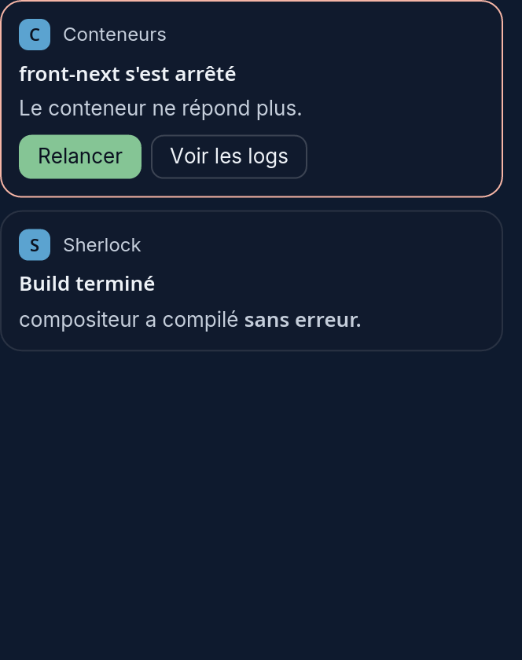

# Notifications

`desktop/notifications` is the notification daemon of the desktop: the
`org.freedesktop.Notifications` server on the session bus (Desktop Notifications Specification
1.2), and its bubbles, shown top right below the bar with layer-shell (ADR 0005), written with
iced 0.14 and `iced_exwlshell` 0.21.4 like the bar and the dock (`docs/bar.md`). Batch D-23
builds it. The crate, the binary and the layer-shell namespace are all `notifications`. Its
texts stay in French, from `sherlock-ui` (`sherlock_ui::notifications`).



From the headless rendering test (`tests/render.rs`), at scale 2, on the desktop background: a
critical notification with two actions over a normal one whose body has a bold span.

The notification centre of the panels is not in this batch: the daemon keeps the history it
will show (see History).

## Architecture

| Module | Role |
| --- | --- |
| `lib.rs` | The surface (`surface`), iced settings, startup (`run`) |
| `server.rs` | The D-Bus interface, taking the name (`start`) |
| `core.rs` | The state, without D-Bus nor screen: open notifications, which show, timers, Do not disturb, history |
| `model.rs` | A notification read from the arguments of `Notify`: urgency, timeout, icon, actions |
| `markup.rs` | The body markup, reduced to bold and italic |
| `layout.rs` | Pure geometry of the stack: places, surface height, input region |
| `app.rs` | The bubbles: iced state, update, view, animations |

`core::Core` is what the future centre and Control Room will talk to: `history()`,
`clear_history()`, `open(id)`, `shown()`, `click(id)`, `invoke(id, key)`, `hold(id, held)`.
The bubbles receive its `Event`s (`Show`, `Close`) and report the clicks back; a test receives
the same events from a channel.

The Do not disturb setting has its own crate, `desktop/notifications-config`, standard library
and `dock-config`'s key file reader only, so that the quick settings panel and Control Room read
and write the same file without pulling iced or zbus.

## The server

| Method or signal | Behavior |
| --- | --- |
| `Notify` | Returns the id. `replaces_id` that this daemon gave (even closed since) keeps its id and updates the bubble in place, timer restarted; any other value gets a new id |
| `CloseNotification` | Closes it and sends `NotificationClosed` with reason 3. An unknown or closed id is not an error |
| `GetCapabilities` | `actions`, `body`, `body-markup`, `icon-static` |
| `GetServerInformation` | `notifications`, `NOM_OS` (the OS has no name yet), the crate version, `1.2` |
| `NotificationClosed` | Reason 1 when it expires, 2 when the user closes it (click, action), 3 on `CloseNotification` |
| `ActionInvoked` | A button, or `default` for a click on the bubble |

**Timeout.** The application's (`expire_timeout` > 0, in ms); 0 means never; -1 takes
`notifications::DEFAULT_TIMEOUT` of sherlock-ui (6 s, a choice of this batch). A critical
notification (`urgency` 2) never expires, whatever the application asks. The timer runs in the
core, on a thread of its own that sleeps until the next deadline (no polling); a bubble only
starts its timer once it shows, and the pointer over it holds the time it has left.

**Urgency.** Low and normal look the same; critical takes a salmon border and shows even in Do
not disturb.

**Actions.** Pairs of key and label. `default` is no button: a click on the bubble invokes it.
The others are buttons, the first one primary (green), as in the board. After an action the
notification closes (reason 2), unless it has the `resident` hint. A click on a bubble without a
default action closes it.

**Icons.** In the order of the specification: `image-data` (also `image_data`, `icon_data`),
then `image-path` (also `image_path`), then `app_icon`.

| Given as | Shown |
| --- | --- |
| Raw pixels `(iiibiiay)` | Yes: 8 bits per sample, RGB or RGBA, 1024 per side at most (more is refused) |
| An absolute path or a `file://` URI | Yes: SVG as it is, PNG and other pictures through resvg, as the dock does. A URI with `%` escapes is not decoded |
| An icon name of the theme (`firefox`) | Not yet: the initial of the application on a blue tile. The lookup will come from the shared icon theme crate of batch D-22b |

The picture shows in the 20 px tile of the header, as on the board.

**Markup.** `<b>` and `<i>` become bold (weight 600) and italic spans, nested as written. Every
other tag is dropped and its text kept (`<a href>`, `<u>`, ``, `<script>`); `<br>` breaks
the line; the five XML entities and numeric ones are decoded into text. What comes out is a list
of styled spans, never markup: nothing a client sends is interpreted as HTML. A `<` not followed
by a letter or `/` is text (« a < b »). The body is cut at 300 characters
(`notifications::MAX_BODY_CHARS`). sherlock-ui embeds no italic face of Inter: italic spans are
asked for, and come out upright until one is added (see Differences).

**One daemon at a time.** The name is requested with `DO_NOT_QUEUE` and without
`REPLACE_EXISTING`. If another daemon owns it (Plasma, mako, dunst), `notifications` logs
`another notification daemon owns the name on the session bus: stopping` and exits with status
0, before any surface: a supervisor that restarts it on failure does not loop. Nothing is taken
from the other daemon.

## Bubbles

The board draws no bubble: a bubble is one card of the notification centre of the Panels board,
standing alone on the panel glass (`rgba(16,26,44,0.82)`, border `rgba(255,255,255,0.10)`),
with the card radius 14 and padding 12, 320 wide like the centre. Header: the 20 px tile and the
application name in 12 px secondary text; the title in weight 600; the body in secondary text;
the action buttons 28 high with radius 8, 6 apart. Every value comes from
`sherlock_ui::notifications`, and the colors from the palette of the active theme: the daemon
follows the appearance file live, like the gallery.

**Placement.** One layer-shell surface, on the `Top` layer, anchored top and right, exclusive
zone 0: the compositor places it below the area the bar reserves (its margin of 10 and height of
36), plus a margin of 8. The first bubble starts at y = 54, where the board puts the centre,
12 from the right edge (the bar's side margin). The surface reaches the screen edge so that a
bubble slides out there. It takes no keyboard, and its input region is the bubbles alone: clicks
between or beside them reach the window below. It exists only while a bubble shows.
Its height is the stack's, plus 16 below (`notifications::STACK_SLACK`) so that a spring
passing its target never squeezes the last bubble, and plus 480 (`MEASURE_ROOM`) while a new
bubble is being laid out out of sight: in a surface of the stack's height, it would be measured
squeezed. It shrinks back once everything settled.

**Stack.** The newest on top, 8 apart (the board's gap), four at most
(`notifications::MAX_VISIBLE`); the others wait, in the order they came, and show as room
frees up. Their timer starts when they show.

**Animations.** A bubble is laid out out of sight, measured (`sensor`), then slides in from the
right edge; it slides out the same way, and the bubbles below close up. Both follow
`notifications::SPRING`, the `motion::OPEN_SPRING` of an opening window (stiffness 450, damping
34, 2 % overshoot, settled in under 300 ms). Frames are asked for only while something moves.

**Pointer.** A click closes the bubble or runs its default action; a button runs its action. The
pointer over a bubble holds its timer, which goes on with the time it had left once it leaves.

## Do not disturb

`$XDG_CONFIG_HOME/notifications/notifications.conf`, a key file like the dock's:

```ini
[Notifications]
DoNotDisturb=true
```

While it is `true`, only critical notifications show; the others are kept, expire out of
sight, and go to the history like every notification. A value that cannot be read gives `false`
and a warning in the log. The daemon reads the file again whenever its modification time, size
or inode changed, when a notification comes in: there is no watch, since the value is only used
then. Bubbles already on screen when it is switched on stay until they close.
`NotificationsConfig::save` writes the file atomically and keeps its other lines, for the quick
settings panel and Control Room.

## History

The 100 newest notifications (`notifications::HISTORY`), in memory, newest first, whatever
became of them: shown, hidden by Do not disturb, expired, closed. A replacement takes the place
of the old entry. `Core::history()` and `Core::clear_history()` are the API for the centre. The
history is lost when the daemon stops.

## Running and checking by hand

**Never on the author's session bus**: Plasma owns the name there, and the daemon would only
stop (that is its behavior); taking the name from Plasma would break its notifications. Every
check runs on a private bus and a nested compositor:

```sh
cargo build -p notifications
mkdir -p /tmp/notif-test
dbus-daemon --session --nofork --print-address --address=unix:dir=/tmp/notif-test > /tmp/notif-test/address &
export DBUS_SESSION_BUS_ADDRESS=$(head -1 /tmp/notif-test/address)
Xephyr :23 -screen 1440x900 -br -nolisten tcp &
DISPLAY=:23 kwin_wayland --x11-display :23 --width 1440 --height 900 \
  --no-lockscreen --no-global-shortcuts --socket wayland-notif &
WAYLAND_DISPLAY=wayland-notif XDG_CONFIG_HOME=/tmp/notif-test RUST_LOG=notifications=debug \
  target/debug/notifications &
notify-send -a Sherlock "Build terminé" "compositeur a compilé <b>sans erreur</b>."
notify-send -u critical -A restart=Relancer -A logs="Voir les logs" "front-next s'est arrêté" "Le conteneur ne répond plus."
```

1. The bubble slides in at the top right, below the bar, and leaves after 6 s.
2. The pointer over it holds it; it leaves 6 s after the pointer left (minus the time it had
   already shown).
3. The critical one has a salmon border, stays, and its buttons print the action key in
   `notify-send`'s output.
4. `printf '[Notifications]\nDoNotDisturb=true\n' > /tmp/notif-test/notifications/notifications.conf`:
   the next normal notification does not show, a critical one does.
5. A second `target/debug/notifications` on the same bus stops with the message above.

Checked during this batch without a screen: a private bus, a headless KWin
(`kwin_wayland --virtual`, 1440 × 900) and `gdbus` for the notifications. Protocol log
(`WAYLAND_DEBUG=client`), a normal notification of 1.5 s then a critical one with an action,
then `CloseNotification` on the critical one:

```text
zwlr_layer_shell_v1#19.get_layer_surface(new id zwlr_layer_surface_v1#25, wl_surface#24, nil, 2, "notifications")
zwlr_layer_surface_v1#25.set_anchor(9)                 # top and right
zwlr_layer_surface_v1#25.set_exclusive_zone(0)
zwlr_layer_surface_v1#25.set_margin(8, 0, 0, 0)
zwlr_layer_surface_v1#25.set_size(332, 480)            # room to lay out the first bubble
wl_region#68.add(0, 0, 320, 90)                        # the first bubble, 90 high
zwlr_layer_surface_v1#25.set_size(332, 570)            # the second one is being laid out
wl_region#55.add(0, 0, 320, 126)                       # the critical one on top
wl_region#55.add(0, 133, 320, 91)                      # the first one pushed down
zwlr_layer_surface_v1#25.set_size(332, 142)            # the first one expired
zwlr_layer_surface_v1#25.destroy()                     # the last one closed
```

A second daemon on the same bus logged its message and exited with status 0.

In the real session (batch D-14), Plasma is not running: the session starts `notifications`
with the bar and the dock.

## Tests

`just verify` runs everything, without a screen and without the user's bus:

- **D-Bus** (`tests/dbus.rs`): each test starts its own `dbus-daemon` with a configuration of
  its own (a socket in a temporary folder, no service activation). `Notify` and its events,
  `CloseNotification` and its signal, the capabilities and the server information; replacement
  by `replaces_id`, an unknown id not taken over; expiry (reason 1), the default timeout,
  critical never expiring; actions (`ActionInvoked` then reason 2), the default action on a
  click, a click without one, `resident`; Do not disturb (only critical shows, all in the
  history, switched off at once); the name already taken.
- **Core**: four bubbles at most, the next one shows when one closes; the pointer holds the
  timer and gives back the time left; the history keeps 100, a replacement takes its entry.
- **Model**: timeouts, urgency, actions in pairs, icons from pixels, path and name.
- **Markup**: bold and italic nested, injected HTML neutralized (script, event attributes,
  links, pictures, escaped tags that stay text), entities, stray characters, cut bodies.
- **Layout**: the stack and its gap, the surface height, the input region through the gaps; the
  surface below the bar against the right edge, the first bubble at y = 54 on the reference
  screen (`lib.rs`).
- **Settings** (`notifications-config`): reading, defaults, a bad value, saving with the other
  lines kept, the follower seeing a write, a rename and a deletion.
- **Contrast** (`sherlock-ui`): titles, bodies and button labels on the bubble glass over each
  desktop disc, in both themes.

`dbus-daemon` is needed by the D-Bus tests: on Debian and Ubuntu, package `dbus-daemon`.

## Differences from the design board

- **Bubbles**: no board draws them (see Bubbles). The time of the board's cards is not shown on
  a bubble, which is always new; the history keeps the time each notification came.
- **Blur and shadow**: the glass is a translucent tint; blur is the compositor's job; the panel
  shadow would need room around the surface, so bubbles have none.
- **Application icons**: the board draws a tile per source (« Sherlock », « Conteneurs »,
  « Mises à jour »). Theme icon names are not looked up yet (see Icons).
- **Italic**: no italic face is embedded; italic spans show upright.
- **Screen reader labels**: iced 0.14 exposes nothing (`docs/bar.md`).

## What this batch does not do

- The notification centre and its grouping by application, « Tout effacer »: the panels batch,
  on top of `Core::history()`.
- Theme icon names: after the shared icon lookup of D-22b.
- Muting in game mode: there is no game mode yet; it will set Do not disturb, or a state of its
  own in the same file.
- Sound, `ActivationToken` (specification 1.2, optional), `x-` and `category` hints: read and
  ignored.
- Several outputs: the surface opens on the active output.
