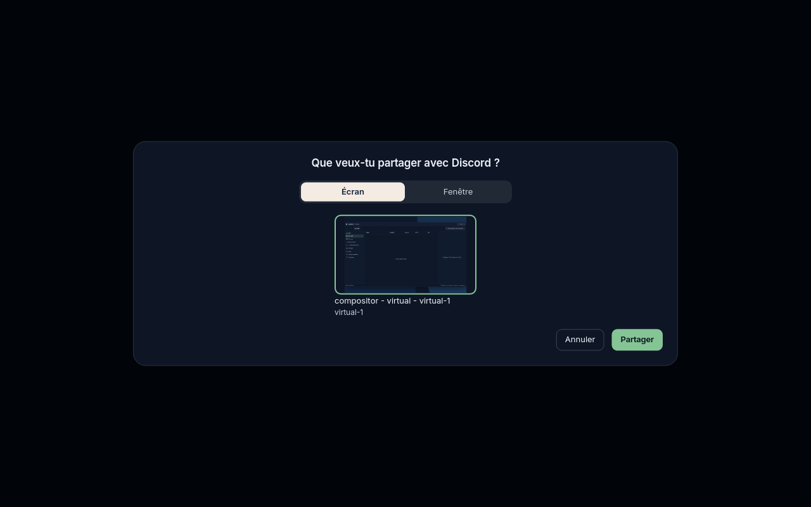
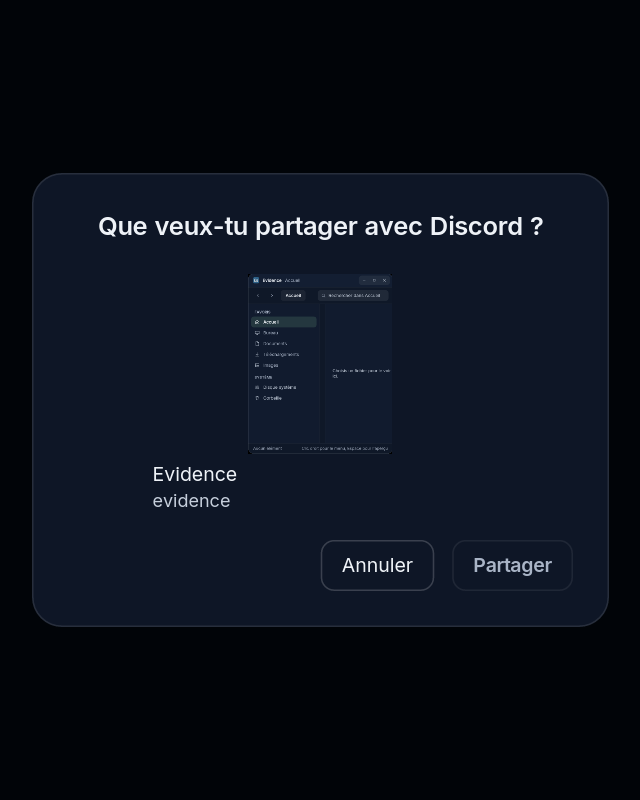

# Portal backend: screen sharing (lot D-28d)

Discord (Vesktop), Chrome (Meet), Firefox and Teams share a screen or a window through
`xdg-desktop-portal`. In the SherlockOS session its `ScreenCast` portal goes to our own backend,
`sherlock-portal` (crate `desktop/portal`, ADR 0028): it asks the user what to share in our
picker, captures it from the compositor and pushes the frames into PipeWire, whose node the
frontend hands to the application.

```
application ──D-Bus──▶ xdg-desktop-portal ──D-Bus──▶ sherlock-portal ──spawns──▶ sherlock-portal --pick
     ▲                                                   │  ▲                      (the picker)
     └──────────── PipeWire node ◀── frames ─────────────┘  └── shell socket: ext-image-copy-capture
```

## Pieces

| File | What it does |
| --- | --- |
| `screencast.rs` | `org.freedesktop.impl.portal.ScreenCast` version 5 and its sessions (`org.freedesktop.impl.portal.Session`); `org.sherlockos.ScreenShare1` for the bar |
| `picker.rs` | The request written to the picker and its answer, bounded and checked |
| `chooser.rs` | The picker's window (`sherlock-portal --pick`) |
| `capture.rs` | The capture client on the compositor's shell socket: screens, windows, frames |
| `pipewire.rs` | A PipeWire video source, `libpipewire-0.3.so.0` loaded at run time |
| `pod.rs` | The SPA pods of the format and of the buffers, written by hand |
| `session/` | `sherlockos.portal` and the D-Bus service file |

## The calls

- **`CreateSession`** puts a `Session` object at the path the frontend gives; `Close` on it,
  or the application leaving (the frontend closes the session then), stops its shares.
- **`SelectSources`** keeps what the application asks for: screens (`MONITOR`) and windows
  (`WINDOW`) only, there is no virtual screen; one source or several (`multiple`); the cursor
  hidden or drawn into the frames (`cursor_mode`: `HIDDEN` or `EMBEDDED`; `METADATA` is not
  offered and counts as drawn). `persist_mode` and `restore_data` are not kept: the picker asks
  each time.
- **`Start`** lists the screens and the windows from the compositor, starts the picker and
  waits for the user, off the bus's thread. Cancelled: answer 1. Chosen: one PipeWire stream per
  source, each answered with its node, `source_type` and `size`.

## Capture and PipeWire

- **Access.** The compositor offers the capture protocols to the program `sherlock-portal` alone
  (ADR 0028, `docs/compositor.md`, "Screen capture"); the picker is the same program.
- **Frames.** Each share has a thread and a connection of its own: a capture session on its
  source (`paint_cursors` if the cursor is wanted), a `xrgb8888` buffer in a memfd, then one
  frame after another, each copied into a PipeWire buffer. The compositor gives a frame when the
  source shows a new picture, at most once per vertical blank: a still screen sends nothing. The
  thread waits 100 ms at most at a time, so a stop is seen at once. A source that changes size
  gives new constraints: a new buffer, and the format is offered again to PipeWire. A source
  gone (`stopped`), or PipeWire that stops reading, ends the share; within a second the session
  ends (`reap`), the frontend tells the application, and the bar's indicator goes.
- **PipeWire.** A `Video/Source` node that drives its graph (`PW_STREAM_FLAG_DRIVER`), in its own
  thread loop. It offers raw video in `BGRx` (blue first, as `xrgb8888`), at the source's size,
  a variable rate up to 60 frames per second; the buffers are 2 to 8 in shared memory that
  PipeWire allocates and maps (`MemFd` or `MemPtr`). A frame is dropped when the application
  holds every buffer. The library is loaded with `dlopen` (ADR 0028, amended): nothing to build
  against, no headers, no `bindgen`; without PipeWire, `Start` fails and nothing else does.
- **Bounds.** Sizes beyond 16384 pixels a side are refused; the picker's answer is read up to
  4 KiB and must name sources offered; the request's fields are cut at 512 characters, without
  tabs nor line ends.

## The picker

`sherlock-portal --pick` reads the request on its standard input and writes the numbers of the
sources chosen on its standard output, nothing to cancel. Its window covers the screen as a
layer-shell overlay with the keyboard: a veil, and in the middle a glass panel.

- The title says who asks: « Que veux-tu partager avec Discord ? » (the last part of the
  `app_id`; « cette application » without one, as for an X11 application).
- « Écran » and « Fenêtre », a segmented control when both may be shared (Tab goes from one to
  the other); the screens first.
- A grid of tiles, each with its thumbnail (taken at start, side by side, 1.5 s at most; a tile
  whose picture came late shows without it), the screen's description or the window's title
  ending with « … » when long, and the screen's name or the window's application below. The
  chosen tile has the ring of the chosen wallpaper in Control Room; hover and press veil it.
  The grid takes as many columns as fit (`sherlock_ui::screen_share::columns`) and scrolls past
  86 % of the screen's height.
- « Annuler » and « Partager », disabled until something is chosen. A single screen is chosen
  already. Enter shares, Escape or a click beside the panel cancels, the arrows move the choice.
- It grows from 0.92 and fades in on the panels' spring, and shrinks and fades out the same way
  before it answers.

Seen in the nested compositor (software rendering, so the glass is opaque), Discord asking:
screens and windows on a screen of 1280 × 800, then windows only on a screen of 640 × 800 at
scale 1.5, with Evidence's window as thumbnail.





## The bar's indicator

While an application shares, the bar shows « ● Arrêter le partage » before the status pill; one
click stops every share. The portal announces the applications sharing on the session bus
(`org.sherlockos.ScreenShare1` at `/org/sherlockos/ScreenShare`, signal `Changed(as)`, method
`StopAll`, method `Sharing`); the bar listens to that signal and to the portal leaving the
bus, and calls `StopAll` without starting the portal. It grows in and fades in, and out.

## Installation

`just install-session` builds `sherlock-portal` and prints where its files go:

- the program in `/usr/local/libexec/sherlockos/`;
- `sherlockos.portal` in `/usr/share/xdg-desktop-portal/portals/`, where `xdg-desktop-portal`
  reads its backends;
- the D-Bus service file in `/usr/local/share/dbus-1/services/`, so the bus starts it;
- `sherlockos-portals.conf` gives it `org.freedesktop.impl.portal.ScreenCast`, in the SherlockOS
  session only (`XDG_CURRENT_DESKTOP=SherlockOS`).

PipeWire must run (`pipewire`, `wireplumber`, Debian's default). The session already sets
`XDG_SESSION_TYPE=wayland` and passes `WAYLAND_DISPLAY` to the bus's services.

### What each application needs

- **Firefox** (Wayland): nothing.
- **Chrome and Chromium** (Wayland, or X11 with `XDG_SESSION_TYPE=wayland`): nothing since
  Chrome 110, where `WebRTCPipeWireCapturer` is on by default.
- **Discord, Vesktop and other Electron applications**: under XWayland, Chromium also takes the
  portal when `XDG_SESSION_TYPE=wayland`, which the session sets. If an older Electron shows its
  own list of X11 windows instead, start it with
  `--enable-features=WebRTCPipeWireCapturer`, or on Wayland with `--ozone-platform-hint=auto`
  (Vesktop: its setting « Native Wayland »). Push to talk under XWayland is another lot (J-16).

## Tests

- `pod.rs`: the format laid out word by word as SPA writes it; the buffers padded to 8 bytes.
- `picker.rs`: a request reads back without tabs nor line ends; the answer chooses among what
  is offered, one unless several are allowed.
- `screencast.rs`: the options keep what can be shared; a stream says its kind and size.
- `chooser.rs`: screens first and windows after Tab; one choice or several, the arrows; sharing
  needs a choice; labels; thumbnails shrunk into RGBA.
- Not tested in CI: PipeWire itself (no daemon there) and the bus with `xdg-desktop-portal`;
  see the pull requests for the trial on the machine.
