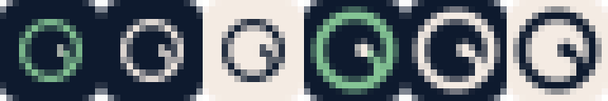

# sherlock-ui

`desktop/sherlock-ui` est la bibliothèque visuelle du desktop : le seul endroit où s'écrivent les
couleurs, les tailles, les polices et les textes d'interface. Le lot D-01 la remplit à partir de
la section Identité visuelle de `docs/contexte.md` et des planches, qui font foi pour
l'apparence. Le toolkit est iced 0.14 en rendu logiciel (ADR 0014).

## Deux étages

| Étage | Modules | Dépend de |
| --- | --- | --- |
| Jetons | `color`, `metrics`, `motion`, `typography`, `icon`, `logo`, `window` | Rien |
| iced | `theme`, `component`, `focus` | iced 0.14, derrière la fonction `iced` |

La galerie n'est pas dans la bibliothèque : elle vit dans `examples/galerie/` et ses tests
l'incluent. Les programmes du shell ne compilent ni elle ni ses textes d'exemple.

La fonction `iced` est active par défaut, parce que tous les programmes du shell la veulent. Le
compositeur, qui ne lit que des jetons, la coupe avec `default-features = false` et ne compile
pas iced. iced est compilé avec le seul moteur tiny-skia : sans la fonction `wgpu`, aucune
variable d'environnement ne peut choisir le GPU ni réveiller la carte NVIDIA.

## Jetons

Tous les jetons sont nommés par leur rôle, en anglais comme le reste du code.

- **`color`** : fonds (`DESKTOP`, `DESKTOP_DISCS`, `SYSTEM_SCREEN`, `DEEPEST`, `WINDOW`,
  `TITLE_BAR`, `SIDEBAR`, `CARD`, `TERMINAL_BLOCK`), verres (`GLASS`, `MENU_GLASS`,
  `DOCK_GLASS`), traits et voiles (`BORDER`, `MENU_BORDER`, `CARD_BORDER`, `DOCK_BORDER`,
  `SECONDARY_BORDER`, `DIVIDER`, `FIELD`, `HOVER`, `PRESSED`, `DISABLED`, `TOGGLE_OFF`,
  `SHADOW`, `MENU_SHADOW`), textes (`TEXT_PRIMARY`, `TEXT_SECONDARY`, `TEXT_TERTIARY`,
  `TEXT_LINE_NUMBER`, `TEXT_ON_ACCENT`, `TEXT_ON_CREAM`), accents (`ACCENT` et ses nuances de
  survol et d'appui, les quatre bleus, `CREAM`, `AMBER`, `SALMON`), états (`SELECTED_ROW`,
  `ACTIVE_ENTRY`, `FOCUS_RING`). `Color` sait se poser sur un fond (`over`, mélange sRGB comme le
  navigateur et tiny-skia) et calculer un contraste WCAG (`contrast`).
- **`metrics`** : barre du haut, fenêtre, panneau, menu, bouton, interrupteur, champ, carte,
  anneau de focus, icônes, dock, espacements par rôle (`GAP_TIGHT`, `GAP_ICON`, `GAP_INLINE`,
  `GAP_SECTION`, `GAP_ROW`, `PAGE_PADDING`) et durées. Les gammes du design (bouton de 28 à 36,
  rayon de 8 à 10, trait d'icône de 1,6 à 1,7…) sont vérifiées à la compilation.
- **`typography`** : familles, tailles, graisses, et les trois fichiers de police à charger.
- **`window`** : bande de saisie et calage des fenêtres, posés par D-17 pour le compositeur.
- **`metrics::DESKTOP_DISC_GEOMETRY`** : place et diamètre des trois disques du fond sur l'écran
  de référence (planche Main), ajoutés par D-11.

## Mouvement

Le module `motion`, ajouté par D-11, porte la physique des animations : du calcul pur, sans
iced, que le compositeur utilise déjà et que le shell reprendra. Le temps est une `Duration`
comptée depuis une origine choisie par l'appelant : une animation se calcule à n'importe quel
instant, sans état qui avance image par image.

| Type | Rôle |
| --- | --- |
| `Spring` | Ressort amorti de masse 1 : raideur (`stiffness`) et amortissement (`damping`). `damping_ratio` donne le taux d'amortissement. `solve(écart, vitesse, t)` rend l'écart et la vitesse au bout de `t` secondes, par la solution exacte (sous-critique, critique ou sur-critique) |
| `Animation` | Une valeur menée par un `Spring` de `from` vers `to`. `value(now)`, `target()`, `is_done(now, précision)`. `retarget(now, to)` change de cible en gardant valeur et vitesse : rien ne saute |
| `Fade` | Fondu sur une durée fixe, départ vif et arrivée douce (cubique). `value(now)`, `is_done(now)`. `retarget(now, to, durée)` repart de la valeur courante, pour la part du trajet qui reste |

| Jeton | Valeur | Usage |
| --- | --- | --- |
| `SNAP_SPRING` | raideur 500, amortissement 33,5 (taux 0,75, dépassement de 3 %) | Calage, agrandissement, retour d'une fenêtre |
| `OPEN_SPRING` | raideur 450, amortissement 34 (taux 0,80, dépassement de 2 %) | Échelle d'une fenêtre à l'ouverture |
| `PREVIEW_SPRING` | raideur 700, amortissement 42 (taux 0,79) | Aperçu du calage |
| `OPEN_SCALE` | 0,92 | Échelle d'une fenêtre au début de son ouverture, et de l'aperçu qui apparaît |
| `FADE` | 150 ms, le haut de `metrics::HOVER_MS` | Fondu d'ouverture, d'apparition et d'effacement |
| `FRAME_RATE` | 60 | Cadence à tenir, animations comprises (`contexte.md`) |
| `GEOMETRY_PRECISION` | 0,5 px | Écart sous lequel une géométrie animée est posée |
| `SCALE_PRECISION` | 0,001 | Écart sous lequel une échelle animée est posée |

`contexte.md` ne donne que « ressorts » et « léger dépassement » : les raideurs et les
amortissements sont des choix de D-11, à revoir avec le design. Les tests de `motion` les
tiennent : dépassement entre 0,5 et 4 %, 90 % du trajet en moins de 150 ms, posé à 1 % près en
moins de 300 ms, fondu dans la gamme d'un survol. Leur usage dans le compositeur est décrit dans
`docs/compositeur.md`, section Animations.

## Polices

Inter (version variable), Space Grotesk (version variable) et JetBrains Mono Regular sont
embarquées dans `desktop/sherlock-ui/polices/`, chacune avec sa licence OFL 1.1. Elles viennent
des dépôts de leurs auteurs : Inter 4.1 (`rsms/inter`), Space Grotesk (`google/fonts`, fichier
`SpaceGrotesk[wght].ttf`), JetBrains Mono 2.304. Les versions variables évitent un fichier par
graisse ; cosmic-text, le moteur de texte d'iced, applique l'axe `wght` demandé. Le nom interne
d'Inter variable est « Inter Variable » : c'est celui de `typography::UI_FAMILY`. Un programme
les charge au démarrage : `typography::FONTS` passé à `application(..).font(..)`.

## Thème et composants

`theme::theme()` construit le thème iced sur les jetons. Chaque composant a sa fonction de
style par état dans `theme`, et son constructeur dans `component` :

| Composant | Constructeur | Planche |
| --- | --- | --- |
| Bouton principal, secondaire | `primary_button`, `secondary_button` | Réglages, Panneaux |
| Bouton d'icône seule | `icon_button(icône, libellé, message)` | Barre de titre de Réglages |
| Interrupteur 44 par 26 | `toggle(valeur, message)` | Réglages |
| Champ de texte | `text_field` | Recherche de Réglages |
| Entrée de menu, raccourci, sous-menu, coche | `menu_item(libellé, Trailing, message)`, `open` | Menus |
| Menu, séparateur | `menu`, `menu_separator` | Menus |
| Ligne de réglage, trait entre deux lignes | `setting_row(libellé, aide, contrôle)`, `divider` | Réglages |
| Étiquette de section | `section_label` | Panneaux, Main |
| Carte, panneau de verre | `card`, `glass_panel` | Réglages, Panneaux |
| Textes | `body`, `description`, `title`, `icon` | Toutes |

Un composant sans message est désactivé. Les composants cliquables rendent un `Control`, qui
devient un `Element` et accepte `status(..)` et `focus_ring()` pour imposer un état (galerie).

### Clavier

iced 0.14 ne sait focaliser que ses champs de texte. `focus::Focusable` enveloppe les autres
composants : il se déclare aux opérations de focus d'iced, déclenche l'action à Entrée ou
Espace, et dessine un anneau bleu clair de 2 px à 2 px du bord. Une touche gardée enfoncée
n'active qu'une fois. Un composant qui devient désactivé perd le focus. Un clic efface
l'anneau, comme `:focus-visible` dans un navigateur. Le programme fait circuler le focus :

```rust
fn subscription(&self) -> Subscription<Message> {
    keyboard::listen().filter_map(focus::tab).map(Message::Focus)
}
// dans update : Message::Focus(direction) => return focus::advance(direction),
```

### Icônes

Une icône est un tracé SVG sur la grille de 24 (`icon::Icon::path`). Le cadre commun (trait de
1,7, bouts et angles arrondis) vient des jetons ; `component::icon` la dessine à la taille et à
la couleur voulues. Pour en ajouter une : une variante de `Icon`, son tracé, une place dans
`Icon::ALL`. Le test vérifie que chaque tracé reste dans la grille. Une icône seule cliquable
passe par `icon_button`, dont le libellé est obligatoire.

### Ajouter un composant

1. Les valeurs manquantes vont d'abord en jetons, dans `color` ou `metrics`, nommées par rôle.
2. Sa fonction de style par état va dans `theme`, sans couleur ni taille littérale.
3. Son constructeur va dans `component`. S'il est cliquable, il rend un `Control` pour avoir le
   focus clavier et l'anneau.
4. Chaque texte qu'il pose sur un fond entre dans le test de contraste de `theme`.
5. Il prend une ligne dans le tableau des états de la galerie (`examples/galerie/vue.rs`).

## Logo

Le logo n'a ni texte ni nom. Il est redessiné à la main sur une grille de 512, d'après la
planche générée par IA que l'auteur a fournie, sans tracé automatique :

| Forme | Valeur |
| --- | --- |
| Carré de fond | 512, rayon 96 |
| Anneau | Centre (256, 256), rayon 140, épaisseur 36 |
| Queue | Arc de rayon 80 et d'épaisseur 28, bouts ronds, de (340, 368) sur l'anneau jusqu'au point |
| Point | Centre (308, 256), rayon 22 |
| Version sans carré | Même dessin, cadré sur `96 96 320 320` |

Les fichiers sont dans `desktop/sherlock-ui/logo/` : `logo.svg` (anneau vert, point crème, carré
bleu nuit), `logo-creme.svg` (crème sur bleu nuit), `logo-nuit.svg` (bleu nuit sur crème),
chacun aussi en `-sans-fond` et, avec carré, en version optique `-32` et `-16`, et leurs PNG en
16, 32, 64, 256 et 512 dans `logo/png/`. Le bleu
nuit est `DESKTOP`, le vert `ACCENT`, le crème `CREAM` ; un test le vérifie. Les SVG et les PNG
s'écrivent avec `python3 exporter.py` depuis ce dossier (librsvg, déjà sur le poste).

Écarts voulus avec la planche : la queue de la planche s'effile jusqu'à une pointe ; ici elle
garde une épaisseur constante, plus lisible petit. Le point a la même place dans les trois
versions.

### Versions optiques pour 32 et 16 px

Dessiné tel quel à 16 px, l'anneau de la version avec carré ne fait qu'un pixel et la queue
devient une tache. Le logo avec carré a donc deux versions optiques, écrites par le même
`exporter.py` (`logo-32.svg`, `logo-16.svg` et leurs équivalents crème et nuit) : même
construction, symbole agrandi dans le carré, anneau épaissi, queue plus courte et plus épaisse.

| Forme | 32 px (1 px = 16 unités) | 16 px (1 px = 32 unités) |
| --- | --- | --- |
| Anneau | Rayon 175, épaisseur 50 (3 px) | Rayon 180, épaisseur 56 (1,75 px) |
| Queue | De (361, 396), arc de rayon 100, épaisseur 36 | De (364, 400), arc de rayon 110, épaisseur 40 |
| Point | Centre (300, 248), rayon 36 | Centre (300, 252), rayon 38 |
| Marge entre l'anneau et le bord du carré | 31 unités, 2 px | 20 unités, 0,6 px |

Le départ de la queue reste sur l'anneau, à 53° sous l'horizontale (triangle 3-4-5) ; un test
le vérifie dans chaque version. Les PNG de 16 et 32 px avec carré sont tirés des versions
optiques. Dans le code, `logo::Logo::square(taille)` choisit la bonne version. La version sans
carré remplit déjà son cadre et se lit à 16 px : elle n'a pas de version optique.

Planche de lisibilité à 16 px, agrandie huit fois sans lissage : les trois versions dessinées
telles quelles, puis les trois versions optiques.



La planche source n'est pas dans le dépôt : elle est générée par IA, irrégulière, pèse 760 Kio
et n'a plus d'usage une fois le symbole redessiné. Ses mesures sont dans le tableau ci-dessus.

## Galerie

```sh
cargo run -p sherlock-ui --example galerie
```

Elle montre chaque composant dans ses cinq états (normal, survol, appui, focus, désactivé), sur
le fond du bureau puis sur un panneau de verre : boutons, icône seule, interrupteur allumé et
éteint, entrée de menu dans son menu, champ vide et rempli. Suivent le menu Fenêtre de la
planche Menus et son sous-menu, deux cartes de la planche Réglages, des boutons vivants, et le
logo dans ses trois versions, avec carré puis sans, à 96, 64, 32 et 16 px (versions optiques à
32 et 16). Tab et Maj+Tab déplacent le focus, Entrée ou Espace active.

Les seules tailles écrites dans la galerie sont celles de sa propre mise en page, regroupées
dans le module `layout` de `examples/galerie/vue.rs` : largeur des cases du tableau, colonne des
noms, écart entre colonnes, tailles d'affichage du logo. Ce ne sont pas des valeurs du design.

Procédure de comparaison aux planches, sur le poste de l'auteur (Plasma X11) :

1. Lancer la galerie. La fenêtre fait 1440 par 900, comme les planches.
2. Ouvrir `docs/design/planches/Menus.dc.html` dans un éditeur : le menu « Menu Fenêtre » se lit
   dans les styles en ligne. Dans la galerie, cliquer « Déplacer vers le bureau ». Comparer :
   menu de 256 de large, marge 6, entrées de 30 et rayon 7, raccourcis en `#A9B4C6` à 12 px,
   séparateurs, sous-menu de 190 aligné sur son entrée et posé à 4 du menu (`SUBMENU_GAP`),
   coche verte sur « 1 · Code ».
3. Ouvrir `Reglages.dc.html` de même. Comparer les cartes (`#152238`, rayon 14, marges 16 et 18),
   les lignes de réglage (libellé 13 px graisse 500, aide 12 px en `#C5CEDB`, 48 de haut, trait
   `rgba(255,255,255,0.07)` entre deux lignes), les interrupteurs (44 par 26, vert, rond sombre
   de 20), le bouton secondaire de 34 de haut, et le champ de recherche
   (`rgba(255,255,255,0.07)`, rayon 9).
4. Une mesure au pixel se fait sur la capture du test (ci-dessous), à l'échelle 2.

## Tests

`just verifier` lance tout, sans écran :

- **Contraste** (`theme`) : chaque texte de chaque composant, dans chacun de ses états, posé sur
  chaque fond où il peut paraître (bureau et ses trois disques, verre et menu posés sur chacun,
  fenêtre, barre de titre, panneau latéral, carte, écran système, zone de code, bloc du
  terminal), doit atteindre 4,5 pour 1. Le calcul lit les styles réels, pose les fonds
  translucides et compare. Les entrées de menu sont vérifiées dans les menus. S'y ajoutent les
  textes du code (numéros de ligne, mots-clés bleus, vert, ambre, saumon) sur les fonds de code
  et la fenêtre, les textes sur une ligne sélectionnée (`SELECTED_ROW`) dans une fenêtre, un
  panneau latéral et une carte, et sur l'entrée active d'une navigation (`ACTIVE_ENTRY`) sur le
  panneau latéral. Tous passent sans changer de jeton.
- **Cohérence des jetons** : gammes du design vérifiées à la compilation, nuances du vert, logo
  limité aux couleurs du thème, icônes dans leur grille.
- **Galerie** (`tests/galerie.rs`) : capture du rendu de la galerie, sous-menu ouvert, dans
  `target/tmp/galerie-tiny-skia.png`, sur 2 400 de haut pour tout contenir ; un clic déclenche
  son action ; Tab parcourt les composants en sautant les désactivés, Entrée ou Espace les
  active, une touche gardée enfoncée n'active qu'une fois, un composant désactivé perd le
  focus.

La capture n'est pas comparée à une image de référence : elle s'écrit à chaque test pour être
regardée. Une comparaison au pixel près ferait échouer la CI au moindre changement de rendu.

## Écarts connus avec les planches

- **Flou** : le verre n'est qu'une teinte translucide. Le flou est le travail du compositeur.
- **Interlettrage** : iced 0.14 n'en a pas. Les étiquettes de section sont en majuscules sans
  les 0,06 em de la planche.
- **Sélection de menu** : la planche Menus pose l'entrée ouverte à 0,30 d'opacité,
  `contexte.md` dit 0,26. À 0,30, un raccourci en gris tertiaire sur cette ligne tombe à 4,46, contre
  4,81 à 0,26 : le jeton garde 0,26. Un test le montre.
- **Champ de texte** : l'indication est en gris secondaire, pas tertiaire : le tertiaire tombe à
  4,25 sur le champ posé sur le disque le plus clair. La planche ne montre pas l'icône de
  recherche dans le champ : iced 0.14 n'accepte qu'une icône de police dans `text_input`.
- **États absents des planches** : survol, appui, focus et désactivé ne sont dessinés nulle part.
  Choix faits : survol du vert éclairci de 18 %, appui assombri de 14 % ; voile blanc de 7 et
  12 % sur les éléments sans fond ; anneau de focus bleu clair `#8FC1E8` ; désactivé sans fond,
  texte tertiaire, bordure `DIVIDER`. L'interrupteur éteint n'a pas de planche : piste blanche à
  18 %, rond gris clair.
- **Bordure du bouton secondaire** : 0,20 dans la planche Réglages, 0,18 dans `contexte.md` et
  dans les planches Panneaux et Fichiers. Le jeton garde 0,18 : c'est la valeur du texte de
  référence et de la majorité des planches.
- **Trait des icônes de menu** : la planche Menus dessine le chevron à 2 et la coche à 2,4. Le
  jeton garde 1,7 pour toutes les icônes : `contexte.md` fixe une seule gamme, de 1,6 à 1,7, et
  un trait commun garde les icônes homogènes. À 14 px, la différence tient en un tiers de pixel.
- **Animations** : iced change d'état d'un coup. Les ressorts et le fondu existent dans
  `motion` (D-11), mais les composants iced ne s'en servent pas encore : les survols de 110 à
  150 ms ne sont pas faits.
- **Accessibilité** : iced 0.14 n'expose rien aux lecteurs d'écran. Le libellé d'une icône seule
  est obligatoire dans l'API et s'affiche en bulle au survol, en attendant AccessKit (ADR 0014).
- **Rendu du texte** : cosmic-text lisse en niveaux de gris, sans lissage sous-pixel ; la graisse
  600 sort un peu plus épaisse que dans un navigateur (annexe de l'ADR 0014).

## Additions of D-27 (Evidence)

Written in English, like all code and technical documentation from now on.

- **Tokens.** `metrics`: application window (`REFERENCE_WINDOW`, title bar paddings, app badge,
  window controls), toolbar, breadcrumb, branch chip, search field, status bar, sidebar and
  navigation entries, preview panel, code block, lists (`LIST_*`, column widths, overscan,
  slide), badges, dialog, context menu and submenu widths (236 and 216, planche Fichiers).
  `color`: `TEXT_CODE`, `INSET`, `CONTROLS`, `SCRIM`, `AMBER_SOFT`, `ACCENT_SOFT`,
  `NEUTRAL_SOFT`, `ACCENT_BORDER`. `typography`: `CODE_SMALL_SIZE`, `COLUMN_HEADER_SIZE`,
  `BADGE_SIZE`, `UI_CHAR_WIDTH` (to cut names without shaping them).
- **Icons.** Back, sort arrows, minimise, maximise, home, desktop, document, download, folder,
  image, trash, cube (from the planche); system disk (planche); internal disk, USB key, external
  disk, card, optical disc, eject, lock (drawn for Evidence on the same grid and stroke).
  `component::icon` now builds each SVG handle once.
- **Texts.** New module `texts`: French interface texts and their formatting (`short_date`,
  `full_date`, `size`, `items`), and `texts::evidence` for the file manager.
- **Components.** `danger` (salmon menu entry), `danger_button`, `primary_block` and
  `secondary_block` (full width, centred label), `toolbar_button`, `search_field` (magnifier
  inside), `nav_item` and `nav_section`, `badge` (with `theme::Tone`), `chip`,
  `window_controls`, `crumb`, `column_header`, `code_block` with `CodeRole` colouring.
  `theme::window_theme()` gives an application window whose body is the renderer's clear colour.
- **Animations.** `animated::Hoverable` fades a hover veil in and out over `motion::FADE` and
  requests its own frames while it runs. Every control without a resting background (menu
  entries, icon, secondary, window and navigation buttons) now uses it: its hover is animated.
  (`animated::Scaled`, which drew menus opening at a scale, was removed: see below.)
- **Shadows.** Menus and floating panels carry no iced shadow: iced 0.14's software renderer
  paints a blurred quad shadow as a separate image, outside the redrawn area's clip and
  without the current transformation, which broke the context menu of Evidence.
  `surface::Shadowed` draws a crisp shadow instead, from `metrics::MENU_SHADOW_LAYERS` and
  `PANEL_SHADOW_LAYERS` (steps of offset, spread and opacity of `color::SHADOW_BASE`).
  `component::menu` uses it, and `component::floating_panel` gives a glass panel of a given
  width with it (dialogs). A test checks that no surface style has an iced shadow.
- **Tests.** The contrast test covers the new components, badges on a selected row, the code
  text, the destructive button (its pressed state keeps the hover veil: the lighter veil would
  drop the salmon to 4.39:1 on the lightest desktop disc). The gallery shows the destructive
  button, the toolbar button, the destructive menu entry and the navigation entries, and its
  capture is now 2,400 pixels high.

## Ce que le lot ne fait pas

- Les composants animés : les ressorts et le fondu sont dans `motion` depuis D-11, à brancher
  sur les survols et les transitions des composants.
- layer-shell : c'est le lot D-20. `iced_exwlshell` 0.21 n'a pas été essayé.
- Le menu qui s'ouvre en `xdg_popup` : la galerie pose le sous-menu à côté du menu, comme la
  planche. Le placement réel est celui de la barre (D-20).
